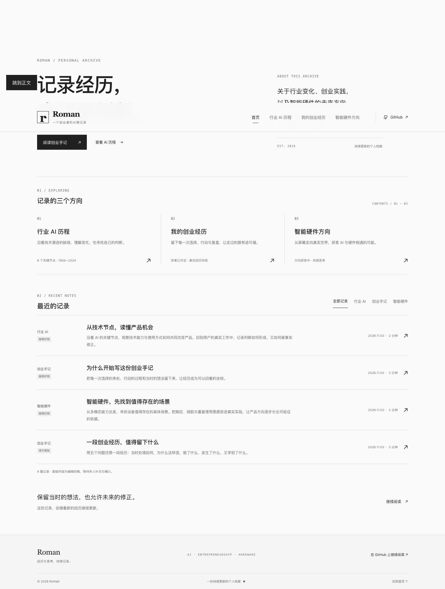
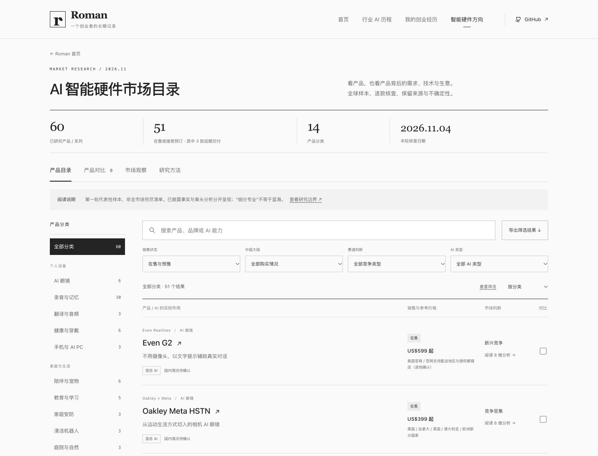

<div align="center">

# ROMAN

**经历与思考，持续记录。**

一份持续更新的个人档案，记录行业 AI 的演进、创业过程中的选择与思考，以及智能硬件方向的探索。

[浏览完整网站](https://romanagent.github.io/Roman/) · [GitHub 仓库](https://github.com/RomanAgent/Roman)

</div>

[](https://romanagent.github.io/Roman/)

---

## 记录的三个方向

| 栏目 | 记录什么 | 首版内容 |
| --- | --- | --- |
| **01 · 行业 AI 历程** | 技术演进、关键节点与值得继续追问的问题 | 有一手资料来源的历史时间线，以及行业观察编辑初稿 |
| **02 · 我的创业经历** | 每段经历的背景、选择、行动、结果与复盘 | 序章编辑初稿、经历填写模板，等待真实材料逐篇补充 |
| **03 · 智能硬件方向** | 面向具体使用场景的想法、问题与后续验证 | 全球市场目录：60款 / 系列、14类、逐款八维分析与产品对比 |

## 01 · 行业 AI 历程

从早期的人工智能研究设想到深度学习、Transformer 与多模态模型，沿着关键技术节点理解行业变化。时间线中的历史事实附有原始论文或机构资料，编辑观察与事实分开呈现。

- [查看完整行业时间线与来源](docs/ai-history.md)
- [阅读行业观察初稿](content/ai-notes.md)

| 年份 | 关键节点 |
| --- | --- |
| 1956 | 达特茅斯夏季研究项目：人工智能成为共同研究议题 |
| 2012 | AlexNet：深度网络与 GPU 训练展示图像分类的新路径 |
| 2016 | AlphaGo：以 4∶1 战胜李世石，复杂决策能力走入公众视野 |
| 2017 | Transformer：注意力机制带来新的语言模型架构 |
| 2020 | GPT-3：大规模语言模型展示少样本学习能力 |
| 2022 | ChatGPT：自然语言对话成为大众体验生成式 AI 的入口 |
| 2023 | Llama 2：开放权重，在许可条件下支持研究与商业使用 |
| 2024 | GPT-4o：文本、视觉与音频的统一模型探索自然交互 |

各节点的一手资料与编辑观察见[完整时间线](docs/ai-history.md)。

时间线是经过选择的历史节点，不是完整行业史，也不代表最新市场全貌。后续可继续增加节点、修订观点并保留出处。

## 02 · 我的创业经历

这里会逐篇收录真实经历，把一次选择放回当时的背景中：为什么开始，采取了什么行动，发生了什么，以及后来如何理解它。

首版包含两篇用于确认展示方式的内容：

- **《为什么开始写这份创业手记》**：第一人称编辑初稿，等待本人确认与改写。
- **《一段创业经历，值得留下什么》**：填写模板，提供背景、选择、行动、结果、复盘五个记录角度。

尚未填入真实个人经历。首版文章中的日期是内容整理日期，不是创业事件发生日期。

[阅读全文](docs/journal.md) · [开始提交一段经历](content/journey-template.md)

## 03 · AI 智能硬件市场目录

[打开市场目录](https://romanagent.github.io/Roman/#hardware) · [GitHub 分类阅读版](docs/hardware-market.md) · [市场横向观察](docs/hardware-market-insights.md) · [研究方法](docs/hardware-methodology.md)

[](https://romanagent.github.io/Roman/#hardware)

首轮核查 **60 款 / 系列、14 个分类**，核查日期 **2026-11-04**。其中 48 款有官方在售依据、3 款接受预订或延期订单、8 款待复核、1 款停售观察。默认网页只显示在售与预售 / 延期订单；地区库存、型号与交付条件保留在详情中。

覆盖 AI 眼镜、录音与记忆、翻译音频、健康穿戴、手机与 AI PC、陪伴宠物、教育学习、家庭安防、清洁机器人、庭院自然、厨房烹饪、影像创作、具身机器人、开发与制造。

- 每款包含需求、用户画像、竞争、供应链、技术、审美、风险、市场空间八项案头分析。
- 支持产品 / 品牌 / AI能力搜索，销售状态、国内购买情况、竞争类型和AI类型筛选。
- 最多三款产品横向对比；可导出当前筛选结果的完整研究 JSON。
- 每款有来源、核查日期、服务依赖与功能分层图。概念图不是实物拆机；Reachy Mini 另附官方装配示意。
- 内容可直接在 GitHub 阅读，无需打开网站。

**边界：这是首轮代表性案头研究，不是全球全部 SKU 的穷尽清单。** 未开展用户访谈、销量审计或实物测试；“细分专业”不等于蓝海。厂商声明、资料事实与分析推断分开标注，不虚构未披露供应商、BOM 成本或成功概率。

Idea 投稿与在线 AI 分析按当前要求暂缓。

## 本地预览

这是一个无第三方运行依赖的静态 HTML / CSS / JavaScript 项目。进入项目目录后运行：

```sh
python3 -m http.server 4173
```

然后打开 [本地预览](http://localhost:4173)。请通过 HTTP 服务访问，确保浏览器能读取内容文件。

## 内容维护

**JSON 是正文内容的唯一来源**，网站直接读取它们。便于在 GitHub 阅读的 Markdown 由脚本生成；请不要直接编辑生成文件，以免下次导出时被覆盖。

| 文件 | 用途 |
| --- | --- |
| [`content/ai-history.json`](content/ai-history.json) | AI 历史节点、编辑观察与来源；生成 [`docs/ai-history.md`](docs/ai-history.md) |
| [`content/ai-articles.json`](content/ai-articles.json) | 行业与智能硬件观察文章；生成 [`content/ai-notes.md`](content/ai-notes.md) |
| [`content/journal.json`](content/journal.json) | 创业手记文章及展示状态；生成 [`docs/journal.md`](docs/journal.md) |
| [`content/journey-template.md`](content/journey-template.md) | 逐篇提交真实经历的模板 |
| [`content/hardware/metadata.json`](content/hardware/metadata.json) | 硬件分类、研究边界与覆盖缺口 |
| [`content/hardware/`](content/hardware/) 中的 `research-*.json` | 逐产品原始研究记录；合并生成 `catalog.json` 与 `docs/hardware/` |
| [`docs/hardware-market-insights.md`](docs/hardware-market-insights.md) | 本轮跨产品观察与后续真实调研计划；同步进入网页 |

修改 JSON 后，在项目目录执行以下命令，同步更新 GitHub 阅读版；此步骤使用 Node.js，无需安装任何依赖：

```sh
node scripts/export-content.mjs
```

硬件目录的研究记录或市场观察更新后运行：

```sh
npm run catalog
npm run check
```

将修改后的 JSON 和生成的 Markdown 一起提交。网页读取 JSON，GitHub 直接展示 Markdown，两种阅读方式保持相同的正文与资料来源。

提交新经历时，可以直接提供原始叙述。整理后核对事实、语气与公开范围，再发布到网站。历史事实保留出处；个人观点保留语境；未确认内容保持草稿标识。

网页由 GitHub Pages 展示，README 可直接在 GitHub 仓库中阅读。
