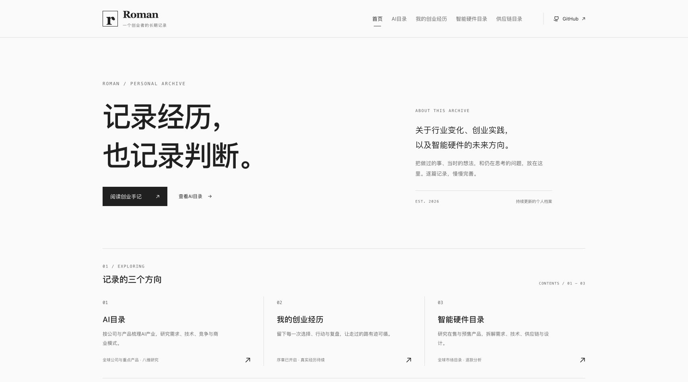
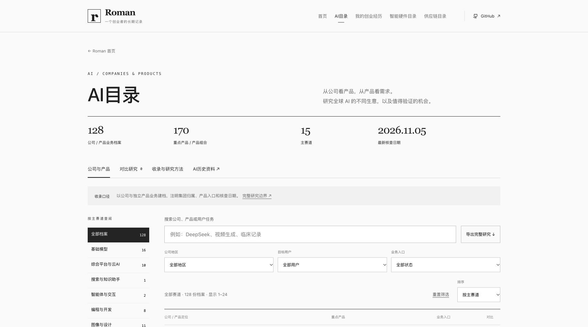
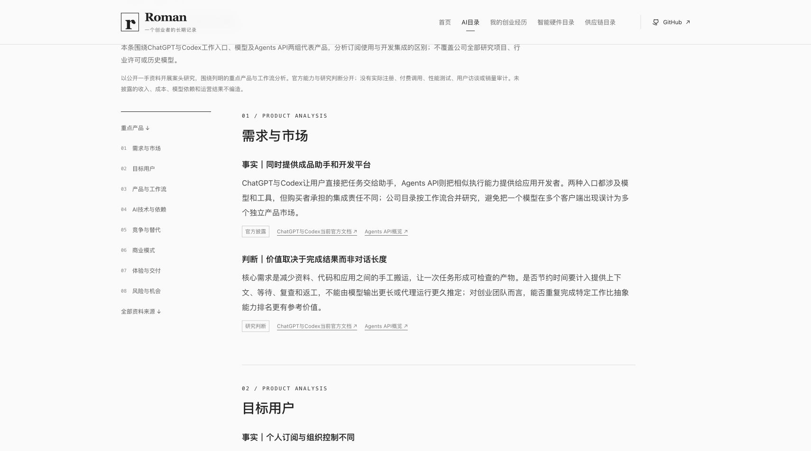
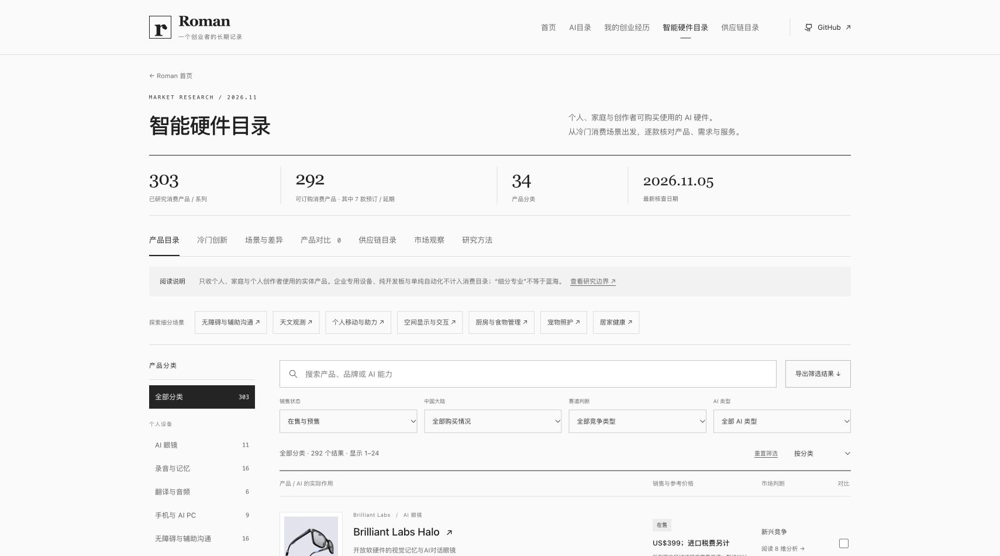
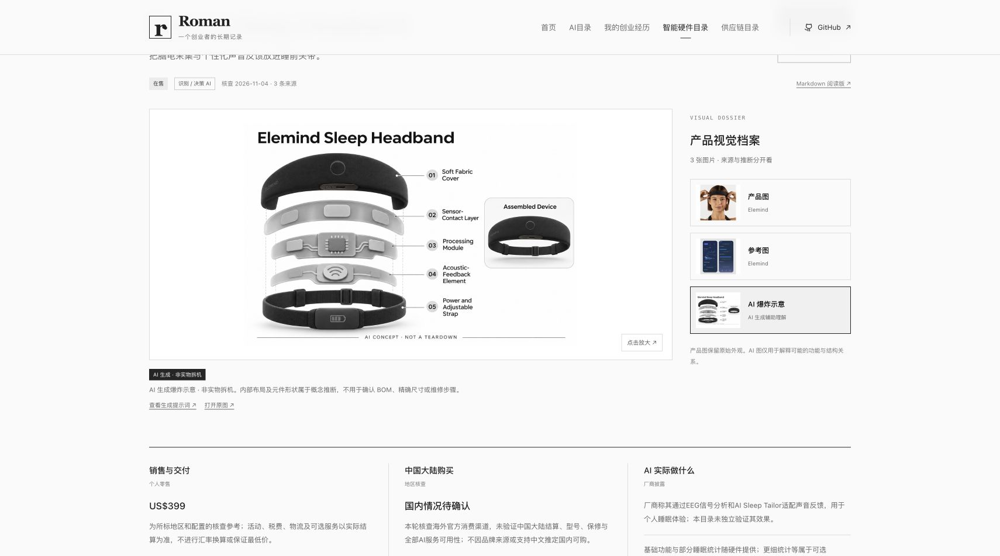
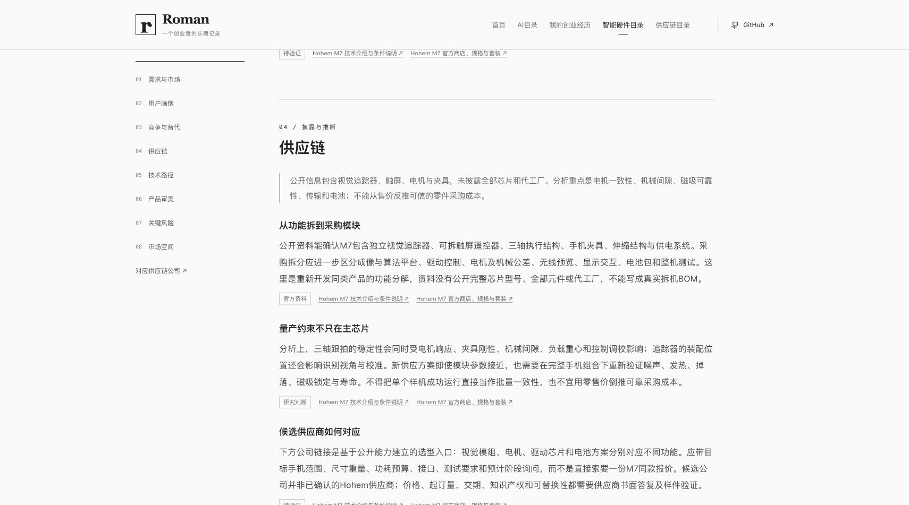
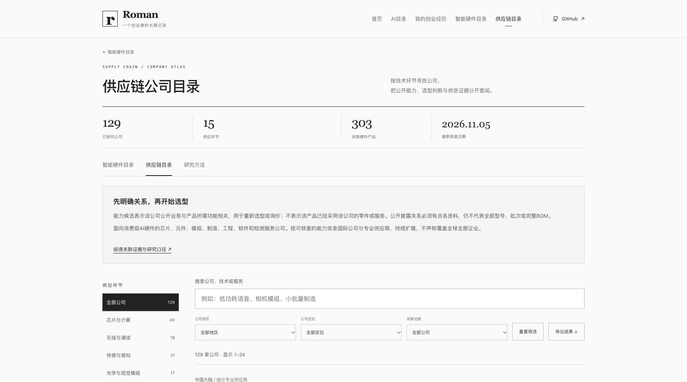

<div align="center">

# ROMAN

**经历与思考，持续记录。**

一份持续更新的个人档案，研究AI公司与产品、记录创业过程中的选择与思考，并整理智能硬件及其供应链。

[浏览完整网站](https://romanagent.github.io/Roman/) · [GitHub 仓库](https://github.com/RomanAgent/Roman)

</div>

[](https://romanagent.github.io/Roman/)

---

## 记录的三个方向

| 栏目 | 记录什么 | 首版内容 |
| --- | --- | --- |
| **01 · AI目录** | 全球公司与重点产品、技术与商业模式 | 分类检索、重点产品概览、八维详析与资料来源 |
| **02 · 我的创业经历** | 每段经历的背景、选择、行动、结果与复盘 | 序章编辑初稿、经历填写模板，等待真实材料逐篇补充 |
| **03 · 智能硬件目录** | 面向具体使用场景的想法、问题与后续验证 | 全球C端市场目录：292款可订购产品、34类、完整八维详析与供应链关联 |

## 01 · AI目录

[打开AI目录](https://romanagent.github.io/Roman/#ai) · [GitHub分类阅读版](docs/ai-directory.md)

<!-- AI-DIRECTORY-SUMMARY:START -->

当前收录 **128 份公司 / 产品业务档案、170 个重点产品 / 产品组合、15 个主赛道**，最新核查 **2026-11-05**。每份档案列出重点产品、使用与收费形式，并提供八维详细分析和一手来源。公开产品、商务接洽、研发观察与业务调整分别标明；条目数量不代表全球全部AI公司或独立集团数量。

<!-- AI-DIRECTORY-SUMMARY:END -->

支持公司、产品和用户任务检索，按主赛道、公司地区、用户类型及业务入口筛选；可比较最多三份产品研究，导出完整分析。公司与集团归属、产品开放阶段和研究边界分别说明，不把模型版本和产品套餐计作新公司。

每份档案包含需求与市场、目标用户、产品与工作流、AI技术与依赖、竞争与替代、商业模式、体验与交付、风险与机会八项详细分析。

[](https://romanagent.github.io/Roman/#ai)

[](https://romanagent.github.io/Roman/#ai/company/openai)

原有技术时间线保留为[AI历史资料归档](https://romanagent.github.io/Roman/#ai/history)，也可在[GitHub阅读历史资料](docs/ai-history.md)。

## 02 · 我的创业经历

这里会逐篇收录真实经历，把一次选择放回当时的背景中：为什么开始，采取了什么行动，发生了什么，以及后来如何理解它。

首版包含两篇用于确认展示方式的内容：

- **《为什么开始写这份创业手记》**：第一人称编辑初稿，等待本人确认与改写。
- **《一段创业经历，值得留下什么》**：填写模板，提供背景、选择、行动、结果、复盘五个记录角度。

尚未填入真实个人经历。首版文章中的日期是内容整理日期，不是创业事件发生日期。

[阅读全文](docs/journal.md) · [开始提交一段经历](content/journey-template.md)

## 03 · 智能硬件目录

[打开市场目录](https://romanagent.github.io/Roman/#hardware) · [GitHub 分类阅读版](docs/hardware-market.md) · [市场横向观察](docs/hardware-market-insights.md) · [研究方法](docs/hardware-methodology.md) · [916张图像与生成记录](docs/hardware-media-index.md)

[](https://romanagent.github.io/Roman/#hardware)

本轮收录 **303 款消费产品 / 系列、34 个产品分类**，最新核查日期 **2026-11-05**，每款保留自己的核查快照。其中 **292 款可订购：285 款在售（含明确标注的硬件租赁）、7 款正式预售 / 延期交付**；另有 2 款付费预约、7 款待复核、1 款停售观察、1 款资格申请 / 资助发放，不计入可订购数量。付费排队的定金不等于整机售价，也不等于正式产品订单。

覆盖个人、家庭与个人创作者可购买的AI硬件，扩展了无障碍辅助、助听、睡眠、运动训练、宠物照护、观鸟、家庭能源、音乐乐器与实体对弈等细分场景。156款标为“细分专业”，这是定性判断，不代表蓝海。4款原有开发或科研设备移入[专业档案](docs/hardware-professional-archive.md)，不计入消费目录。

- 每款包含需求、用户画像、竞争、供应链、技术、审美、风险、市场空间八项详析；每项至少三个实质分项，标明资料、判断与待验证。
- 支持产品 / 品牌 / AI能力搜索，销售状态、国内购买情况、竞争类型和AI类型筛选；每页24款，可切换结果页和直接进入细分场景。
- [按独立场景看差异](https://romanagent.github.io/Roman/#hardware/scenes)：163个核心需求组，相似型号作为同组实现比较，不冒充新的品类。
- 最多三款产品横向对比；可导出当前筛选结果的完整研究 JSON。
- 每款均有真实产品图、参考图及单独生成的 AI 爆炸示意；来源和图像类型明确标注，支持切换、放大和打开原图。
- AI 爆炸示意由内置 ImageGen 生成，内部未知部分为概念推断，不是实际拆机或精确 BOM；生成提示词与引用图片一并保存。
- 内容可直接在 GitHub 阅读，无需打开网站。

[](https://romanagent.github.io/Roman/#hardware/product/elemind-sleep-headband)

[](https://romanagent.github.io/Roman/#hardware/product/hohem-isteady-m7/dimension-supplyChain)

**边界：这是消费市场案头研究，不是全球全部 SKU 的穷尽清单。** 未开展用户访谈、销量审计或实物测试；“细分专业”不等于蓝海。厂商声明、资料事实与分析推断分开标注，不虚构未披露供应商、BOM 成本或成功概率。

Idea 投稿与在线 AI 分析按当前要求暂缓。

## 供应链公司目录

[](https://romanagent.github.io/Roman/#supply-chain)

[打开供应链目录](https://romanagent.github.io/Roman/#supply-chain) · [GitHub 分类阅读版](docs/supply-chain.md) · [证据与研究口径](docs/supply-chain-methodology.md)

已完成 **129 家公司**的八项研究，覆盖芯片、传感、光学、声学、显示、电源、运动、结构、电子装联、整机制造、工程、软件与检测等环节。包含跨地区公司与细分专业供应商，规模分组不使用猜测的员工或营收数字。

产品页与公司页通过 **669 条关联**双向跳转，其中 **7 条为公开点名关系**；其余为能力候选，用于新方案选型，不代表原产品已采用。支持按环节、地区、定位和关系证据筛选、搜索、分页及导出。

每家公司分析定位、能力、适用场景、合作导入、质量交付、商业成本、风险替代和询价验证。未公开MOQ、报价、工厂与BOM保持边界，不由客户标志推断逐型号采购。

## 创新产品的扩展与去重

[打开冷门创新专题](https://romanagent.github.io/Roman/#hardware/innovations)。专题保留各产品的独立任务、不同实现和交付条件，可继续筛选、对比与导出；不作为创新排名。

[](https://romanagent.github.io/Roman/#hardware/innovations)

继续向千级产品规模研究，优先独特任务、明显差异与可核验消费渠道。已建立[1,382条CES官方奖项发现线索](content/discovery/ces-award-leads.json)，**线索不是已核验产品，不计入可订购数量**。研究过程与排除口径见[发现记录](docs/hardware-discovery-log.md)。

[逐项筛选案例与资料来源](docs/hardware-screening.md)保留暂缓原因及复核后收录的变化，便于下一轮研究接续。


## 本地预览

这是一个无第三方运行依赖的静态 HTML / CSS / JavaScript 项目。进入项目目录后运行：

```sh
python3 -m http.server 4173
```

然后打开 [本地预览](http://localhost:4173)。请通过 HTTP 服务访问，确保浏览器能读取内容文件。

## 内容维护

正文按下表注明的源文件维护。AI公司、硬件与供应链的列表摘要、独立详情JSON及GitHub阅读版由脚本生成；请不要直接编辑生成文件，以免下次构建时被覆盖。网页列表按需载入，导出仍包含完整研究。

| 文件 | 用途 |
| --- | --- |
| [`content/ai-directory/`](content/ai-directory/) | AI公司与重点产品源数据；构建独立详情、轻量索引及GitHub阅读版 |
| [`content/ai-history.json`](content/ai-history.json) | AI 历史节点、编辑观察与来源；生成 [`docs/ai-history.md`](docs/ai-history.md) |
| [`content/ai-articles.json`](content/ai-articles.json) | 行业与智能硬件观察文章；生成 [`content/ai-notes.md`](content/ai-notes.md) |
| [`content/journal.json`](content/journal.json) | 创业手记文章及展示状态；生成 [`docs/journal.md`](docs/journal.md) |
| [`content/journey-template.md`](content/journey-template.md) | 逐篇提交真实经历的模板 |
| [`content/supply-chain/`](content/supply-chain/) | 公司原始资料、角色定义与生成公司目录 |
| [`content/hardware/deep/`](content/hardware/deep/) | 产品八维详细分析、独立需求分组与公司关联 |
| [`content/hardware/metadata.json`](content/hardware/metadata.json) | 硬件分类、研究边界与覆盖缺口 |
| [`content/hardware/`](content/hardware/) 中的 `research-*.json` | 逐产品原始研究记录；合并生成 `catalog.json` 与 `docs/hardware/` |
| `content/hardware/media-*.json`、`generated-*.json` | 原始图片与AI图的来源、核查记录和生成溯源 |
| [`assets/hardware/`](assets/hardware/) | 每个产品自己的原始图、参考图和AI爆炸图 |
| [`content/hardware/prompts/`](content/hardware/prompts/) | 每款实际使用的 ImageGen 提示词 |
| [`docs/hardware-market-insights.md`](docs/hardware-market-insights.md) | 本轮跨产品观察与后续真实调研计划；同步进入网页 |

修改 JSON 后，在项目目录执行以下命令，同步更新 GitHub 阅读版；此步骤使用 Node.js，无需安装任何依赖：

```sh
node scripts/export-content.mjs
```

AI公司目录更新后运行：

```sh
npm run ai:catalog
npm run ai:check
```

硬件目录的研究记录或市场观察更新后运行：

```sh
npm run catalog
npm run check
npm run media:check
npm run target:check
npm run supply:check
```

将修改后的 JSON 和生成的 Markdown 一起提交。网页读取 JSON，GitHub 直接展示 Markdown，两种阅读方式保持相同的正文与资料来源。

提交新经历时，可以直接提供原始叙述。整理后核对事实、语气与公开范围，再发布到网站。历史事实保留出处；个人观点保留语境；未确认内容保持草稿标识。

网页由 GitHub Pages 展示，README 可直接在 GitHub 仓库中阅读。
