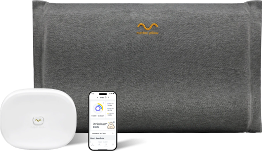
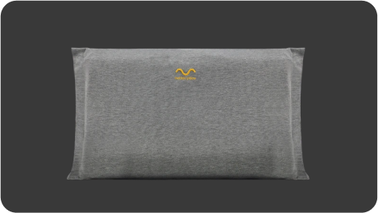
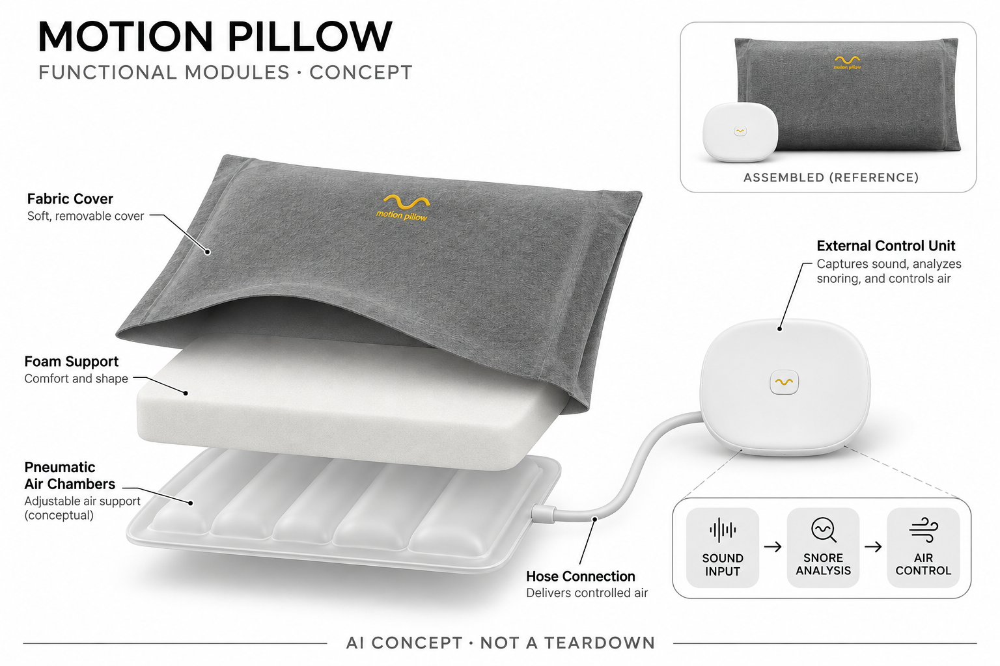

# 10minds Motion Pillow

**10minds** · 睡眠与放松 · 核查 2026-11-04

识别鼾声后用气囊调整枕头支撑

消费渠道：个人零售。

## 产品图片与结构参考

### 产品图

官方Motion Pillow枕体与外置控制单元 · 来源：[10minds · 官方图片](<https://motionpillow.com/en/home.do>) · [原始图片](<https://motionpillow.com/images/ces/system/system_set.jpg>)

### 参考图

官方枕体外形参考 · 来源：[10minds · 官方图片](<https://motionpillow.com/en/home.do>) · [原始图片](<https://motionpillow.com/images/ces/features/key_img_02.png>)

### AI 生成爆炸示意

**AI 生成 · 非实物拆机。** 内部为概念推断，不能作为元件布局、BOM 或维修依据。[生成提示词](../../content/hardware/prompts/10minds-motion-pillow.txt)

> 依据已核验官方外形与公开功能生成；未知内部仅为概念功能块，不代表原机电路板、芯片或实际布局。

> 原图按官方文件保存，未改色或语义编辑；图片中的营销文字不视为本研究独立验证。

> 分析为基于公开资料的案头研究与 AI 辅助判断，未经用户访谈、销量审计或实物拆机。需求、画像、竞争冷门度、审美及商业机会均为研究假设，不是投资结论。

## 销售与购买

- 状态：在售。英文官方商店列US$489与BUY NOW、Add to Cart；技术页链接购买，本条不混入CES AI Mopill或戒指概念配置。

- 地区：美国

- 价格：US$489。英文官方现售页价格；枕套或其他组合不另计型号。

- 中国大陆：英文店购物指南明确仅配送美国；未确认中国大陆官方零售及保修。本条不按网页横幅的泛化全球促销文案推断。

- [官方产品 / 商店](<https://en.10minds.com/Product/Detail/view/pid/1>)

## AI 的实际作用

外置Motion System利用深度学习区分用户鼾声，结合头部位置驱动枕内气囊缓慢充放气；不是只有定时充气或睡眠音频播放。

服务与联网依赖：外置控制单元和枕内气囊共同工作；应用提供记录和设置，具体端云及更新边界未完全披露，不将鼾声判断视为诊断。

## 是否冷门

细分专业（研究判断）：鼾声识别到气囊姿态辅助是较窄消费场景，价值受舒适与适用条件限制，不能用健康焦虑推定普遍需求。

## 需求与市场

需求假设：对鼾声和同住者睡眠干扰有困扰的家庭，可能希望在不佩戴设备的情况下得到姿态辅助。应记录舒适、觉醒与误触发，不能把声音降低或厂商个案自动解释为治疗睡眠疾病或改善全部睡眠质量。

### 产品任务与边界 · 研究判断

需求假设：对鼾声和同住者睡眠干扰有困扰的家庭，可能希望在不佩戴设备的情况下得到姿态辅助。应记录舒适、觉醒与误触发，不能把声音降低或厂商个案自动解释为治疗睡眠疾病或改善全部睡眠质量。

依据：[Motion Pillow英文官方商店](<https://en.10minds.com/Product/Detail/view/pid/1>) · [Motion Pillow官方AI与气囊技术](<https://motionpillow.com/en/home.do>)

### 需求判断 · 研究判断

声音识别到枕头动作形成不同于只记录睡眠的反馈，但用户是否接受夜间支撑变化比检测到多少次鼾声更重要。设备不能代替医学判断，需求研究应同时考虑使用者和同住者的舒适，不能只从一方希望安静推断有效或适合。

依据：[Motion Pillow英文官方商店](<https://en.10minds.com/Product/Detail/view/pid/1>) · [Motion Pillow官方AI与气囊技术](<https://motionpillow.com/en/home.do>)

### 需求验证 · 待验证

可在合适使用条件下记录觉醒、误触发、枕高接受和次日感受，再比较普通支撑枕与仅观察方案。研究应区分声音变化和临床结果，不能以厂商改善比例、单夜记录或用户故事推断治疗睡眠呼吸暂停。

依据：[Motion Pillow英文官方商店](<https://en.10minds.com/Product/Detail/view/pid/1>) · [Motion Pillow官方AI与气囊技术](<https://motionpillow.com/en/home.do>)

## 用户画像

画像推断：愿意尝试枕体变化、可接受外置气路与控制盒的成人家庭更匹配。枕高、睡姿和同床声音各不相同，实际使用者与购买者需求需要分开，不能因同住者希望安静就假定本人愿意长期使用。

### 适用行为与条件 · 研究判断

画像推断：愿意尝试枕体变化、可接受外置气路与控制盒的成人家庭更匹配。枕高、睡姿和同床声音各不相同，实际使用者与购买者需求需要分开，不能因同住者希望安静就假定本人愿意长期使用。

依据：[Motion Pillow英文官方商店](<https://en.10minds.com/Product/Detail/view/pid/1>) · [Motion Pillow官方AI与气囊技术](<https://motionpillow.com/en/home.do>)

### 人群取舍 · 研究判断

枕体高度、习惯睡姿、同床者声音与气泵接受度都影响适配，购买者有时并非实际睡在枕头上的人。画像应围绕个人选择和维护条件，而不是把所有打鼾者都归为同一用户，更不能用家庭抱怨替代本人意愿。

依据：[Motion Pillow英文官方商店](<https://en.10minds.com/Product/Detail/view/pid/1>) · [Motion Pillow官方AI与气囊技术](<https://motionpillow.com/en/home.do>)

### 画像验证 · 待验证

画像验证应让实际使用者评估枕体与控制盒摆放，记录是否愿意继续以及何时关闭动作。分别访谈同住者与本人，不迫使试用，也不把设备被留下或价格较高当作长期舒适、依从或健康收益已经成立的证据。

依据：[Motion Pillow英文官方商店](<https://en.10minds.com/Product/Detail/view/pid/1>) · [Motion Pillow官方AI与气囊技术](<https://motionpillow.com/en/home.do>)

## 竞争与替代

竞争判断：与普通支撑枕、睡姿辅助和其他鼾声观察方案竞争，区别是学习声音后驱动气囊。AI Mopill和戒指联动不能移植为现售版能力；需要比较真实舒适与误动作，而非仅以获奖和技术名称判断价值。

### 比较对象与差异 · 研究判断

竞争判断：与普通支撑枕、睡姿辅助和其他鼾声观察方案竞争，区别是学习声音后驱动气囊。AI Mopill和戒指联动不能移植为现售版能力；需要比较真实舒适与误动作，而非仅以获奖和技术名称判断价值。

依据：[Motion Pillow英文官方商店](<https://en.10minds.com/Product/Detail/view/pid/1>) · [Motion Pillow官方AI与气囊技术](<https://motionpillow.com/en/home.do>)

### 竞争判断 · 研究判断

相较普通可调枕，Motion Pillow 的差异是学习声音后驱动气囊，而不是单纯增加枕高。CES展示的戒指、更多气囊或其他设备不能混入现售配置，比较应固定型号，把外置单元与枕体作为完整系统而非只看枕头照片。

依据：[Motion Pillow英文官方商店](<https://en.10minds.com/Product/Detail/view/pid/1>) · [Motion Pillow官方AI与气囊技术](<https://motionpillow.com/en/home.do>)

### 竞争验证 · 待验证

可比较普通枕、声音记录与气囊反馈的舒适、误动作及维护，明确实际购买地区和配件。不能用奖项或宣称更安静代替真实体验，也不把减少声音直接等同改善呼吸相关疾病，比较目标应限定为消费级辅助体验。

依据：[Motion Pillow英文官方商店](<https://en.10minds.com/Product/Detail/view/pid/1>) · [Motion Pillow官方AI与气囊技术](<https://motionpillow.com/en/home.do>)

## 供应链

供应链分析：外置声学控制、气泵气路、阀与枕内气囊及泡棉共同形成体验，工厂和BOM未披露。噪声、气密、反复充放、枕套清洁和长期材料状态影响可靠性，不应在枕内凭空添加电路板或传感芯片。

### 功能模块拆分 · 研究判断

功能层包括外置麦克风、鼾声学习与判断、气泵和气路、头部区域与枕内气囊、泡棉枕套及应用。官方说明枕内没有电子设备，因此概念图把电子留在外部，未知气囊数量和内部管路不应伪造成实物拆解。

依据：[Motion Pillow英文官方商店](<https://en.10minds.com/Product/Detail/view/pid/1>) · [Motion Pillow官方AI与气囊技术](<https://motionpillow.com/en/home.do>)

### 制造与供应约束 · 研究判断

供应链分析：外置声学控制、气泵气路、阀与枕内气囊及泡棉共同形成体验，工厂和BOM未披露。噪声、气密、反复充放、枕套清洁和长期材料状态影响可靠性，不应在枕内凭空添加电路板或传感芯片。

依据：[Motion Pillow英文官方商店](<https://en.10minds.com/Product/Detail/view/pid/1>) · [Motion Pillow官方AI与气囊技术](<https://motionpillow.com/en/home.do>)

### 候选与证据缺口 · 研究判断

歌尔可作为外置声学输入和电子整合候选，3ERP可支持控制盒与气路连接原型。没有Motion Pillow点名合作证据，气囊寿命、枕体材料和夜间噪声需专项验证，制造能力不等于临床有效或所有用户都舒适。

依据：[Motion Pillow英文官方商店](<https://en.10minds.com/Product/Detail/view/pid/1>) · [Motion Pillow官方AI与气囊技术](<https://motionpillow.com/en/home.do>)

## 技术路径

技术判断：官网明确深度学习鼾声区分和头部下方气囊动作，仍需验证同床者、环境声与姿态变化。检测声音和缓解效果是不同证据，厂商准确率及改善比例不作为本研究已独立验证的结果。

### 已披露技术边界 · 研究判断

技术判断：官网明确深度学习鼾声区分和头部下方气囊动作，仍需验证同床者、环境声与姿态变化。检测声音和缓解效果是不同证据，厂商准确率及改善比例不作为本研究已独立验证的结果。

依据：[Motion Pillow英文官方商店](<https://en.10minds.com/Product/Detail/view/pid/1>) · [Motion Pillow官方AI与气囊技术](<https://motionpillow.com/en/home.do>)

### 系统难点判断 · 研究判断

深度学习区分鼾声与其他声音只提供触发依据，头部位置和气囊响应另有机械与感知条件。系统需要让误触发可理解、动作可关闭，不能把学习更多就更准确的宣传外推为任何同床、背景声和睡姿下都不会判断错误。

依据：[Motion Pillow英文官方商店](<https://en.10minds.com/Product/Detail/view/pid/1>) · [Motion Pillow官方AI与气囊技术](<https://motionpillow.com/en/home.do>)

### 技术验证 · 待验证

验证应在受控声音与合适使用条件下分别检查识别、动作和停止，再记录舒适与误触发，不制造身体风险。应用评分只用于理解设备记录，不能作为诊断或疗效指标，也不由一次成功动作推断长期机械可靠。

依据：[Motion Pillow英文官方商店](<https://en.10minds.com/Product/Detail/view/pid/1>) · [Motion Pillow官方AI与气囊技术](<https://motionpillow.com/en/home.do>)

## 产品审美

审美判断：织物枕体较容易融入床铺，但外置控制盒、气管和夜间声音会影响真实体验。不同枕高与睡姿的舒适需要实际试用，不能只看卧室场景照，也不因没有枕内电子元件就推断完全无风险。

### 外观与交互语言 · 研究判断

审美判断：织物枕体较容易融入床铺，但外置控制盒、气管和夜间声音会影响真实体验。不同枕高与睡姿的舒适需要实际试用，不能只看卧室场景照，也不因没有枕内电子元件就推断完全无风险。

依据：[Motion Pillow英文官方商店](<https://en.10minds.com/Product/Detail/view/pid/1>) · [Motion Pillow官方AI与气囊技术](<https://motionpillow.com/en/home.do>)

### 使用中审美判断 · 研究判断

外置盒与气管在卧室里可能比织物枕体更显眼，夜间声音和放置高度也会影响体验。设计应让清洗、拿取和状态简单，不以无枕内电子的表述掩盖完整系统仍有电源、气路和机械动作需要正确使用。

依据：[Motion Pillow英文官方商店](<https://en.10minds.com/Product/Detail/view/pid/1>) · [Motion Pillow官方AI与气囊技术](<https://motionpillow.com/en/home.do>)

### 设计验证 · 待验证

设计验证应观察铺床、气管整理、枕套更换和夜间关闭，记录是否容易误放或不清楚运行状态。比较不同枕高与实际睡姿的个人接受，不能只看整洁床铺照片或以软织物外观推断所有人适合长期使用。

依据：[Motion Pillow英文官方商店](<https://en.10minds.com/Product/Detail/view/pid/1>) · [Motion Pillow官方AI与气囊技术](<https://motionpillow.com/en/home.do>)

## 关键风险

风险判断：错误声音判断可能引发不需要的动作或漏触发，气路与电源还需维护。设备不替代临床评估，不能把姿态辅助宣传当作睡眠呼吸暂停治疗；购买地区、保修与返修条件也应明确核对。

### 主要失效与依赖 · 研究判断

风险判断：错误声音判断可能引发不需要的动作或漏触发，气路与电源还需维护。设备不替代临床评估，不能把姿态辅助宣传当作睡眠呼吸暂停治疗；购买地区、保修与返修条件也应明确核对。

依据：[Motion Pillow英文官方商店](<https://en.10minds.com/Product/Detail/view/pid/1>) · [Motion Pillow官方AI与气囊技术](<https://motionpillow.com/en/home.do>) · [Motion Pillow英文店配送指南](<https://en.10minds.com/Mobile/Help/shoppingguide>)

### 风险传播判断 · 研究判断

设备可能被误当作对打鼾原因的完整解决方案，而声音识别并不能说明具体病因。外置单元失效或气路泄漏也可能改变动作，产品需要清楚区分记录、辅助和医学评估，地区售后条件更不能被泛化全球促销文案替代。

依据：[Motion Pillow英文官方商店](<https://en.10minds.com/Product/Detail/view/pid/1>) · [Motion Pillow官方AI与气囊技术](<https://motionpillow.com/en/home.do>) · [Motion Pillow英文店配送指南](<https://en.10minds.com/Mobile/Help/shoppingguide>)

### 风险验证 · 待验证

风险验证应核对当前使用与保修条件，演练气路脱开、环境声音和电源异常后的提示及停止。任何身体相关结论应保持专业评估边界，不把算法评分或没有触发解释为健康正常，也不能推断美国店能在大陆完整服务。

依据：[Motion Pillow英文官方商店](<https://en.10minds.com/Product/Detail/view/pid/1>) · [Motion Pillow官方AI与气囊技术](<https://motionpillow.com/en/home.do>) · [Motion Pillow英文店配送指南](<https://en.10minds.com/Mobile/Help/shoppingguide>)

## 机会与验证

机会假设：先研究声音触发是否可控、枕体是否舒适以及同住者的实际负担，再考虑更多睡眠指标。若核心问题是误触发或气泵噪声，清楚状态和可靠机械可能比加入更多AI评分更有价值。

### 可能的机会入口 · 研究判断

机会假设：先研究声音触发是否可控、枕体是否舒适以及同住者的实际负担，再考虑更多睡眠指标。若核心问题是误触发或气泵噪声，清楚状态和可靠机械可能比加入更多AI评分更有价值。

依据：[Motion Pillow英文官方商店](<https://en.10minds.com/Product/Detail/view/pid/1>) · [Motion Pillow官方AI与气囊技术](<https://motionpillow.com/en/home.do>)

### 机会成立条件 · 研究判断

机会在于低干扰、可关闭且舒适的声音到姿态辅助，不必追加更多睡眠评分或医疗叙事。新项目应先证明用户接受动作与维护，再考虑更复杂传感，避免把同住者的困扰直接转化为对全套健康平台的需求。

依据：[Motion Pillow英文官方商店](<https://en.10minds.com/Product/Detail/view/pid/1>) · [Motion Pillow官方AI与气囊技术](<https://motionpillow.com/en/home.do>)

### 下一步验证 · 待验证

下一步可分别研究声音误触发、气泵噪声和枕体接受，比较仅记录与实体反馈的增量，明确不形成临床结论。用真实舒适和可持续使用决定产品，而不是由奖项、销售话术或单次静音效果预测市场价值。

依据：[Motion Pillow英文官方商店](<https://en.10minds.com/Product/Detail/view/pid/1>) · [Motion Pillow官方AI与气囊技术](<https://motionpillow.com/en/home.do>)

## 对应供应链公司

能力候选用于选型研究，不代表本产品实际采用；未公开的供货关系不作推断。

- [goertek](../supply-chain/goertek.md) — **能力候选 · 非已采用** / 外置鼾声识别单元声学整合：歌尔公开声学器件与智能硬件能力可支持外置收音和电子整合，但鼾声模型、同床噪声及气路控制需专项验证；没有Motion Pillow供货披露，不能将候选能力解释为实际制造或健康效果。

- [3erp](../supply-chain/3erp.md) — **能力候选 · 非已采用** / 外置控制盒与气路连接原型：3ERP的机械原型和模塑服务可用于控制盒、接口与维护结构比较，但气囊、泡棉接触与长期噪声需另外验证；未见Motion Pillow点名合作，候选不代表实际气路或枕内结构。

[浏览供应链目录](../supply-chain.md)

## 功能分层示意

这是功能关系，不是实物拆机、真实空间结构或已核实 BOM。

1. **声音输入**：外置单元麦克风获取声音。（官方披露）

2. **识别判断**：学习用户鼾声模式并区分其他噪声。（官方披露）

3. **头部与气路**：定位头部所在区域并通过气路驱动枕内气囊。（官方披露）

4. **枕体支撑**：记忆泡棉与气囊构成可变支撑；不画虚构枕内PCB。（官方披露）

5. **记录交互**：应用查看鼾声和气囊工作记录及设置。（官方披露）

## 来源

1. [Motion Pillow英文官方商店](<https://en.10minds.com/Product/Detail/view/pid/1>) — 实际打开，价格及购买按钮明确；不将其他CES概念配置混入。

2. [Motion Pillow官方AI与气囊技术](<https://motionpillow.com/en/home.do>) — 已打开，明确深度学习鼾声识别和外置系统驱动气囊；医疗效果营销未作独立结论。

3. [Motion Pillow英文店配送指南](<https://en.10minds.com/Mobile/Help/shoppingguide>) — 已打开，配送仅美国及保修范围明确。

[返回目录](../hardware-market.md) · [网页分析](https://romanagent.github.io/Roman/#hardware/product/10minds-motion-pillow)
