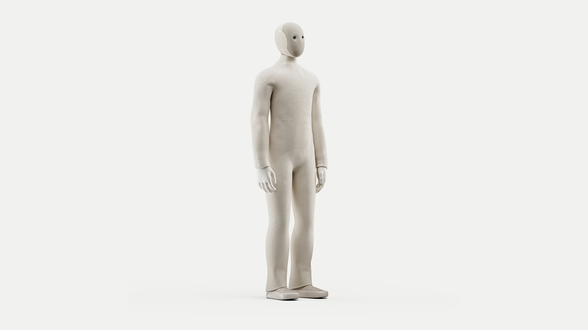
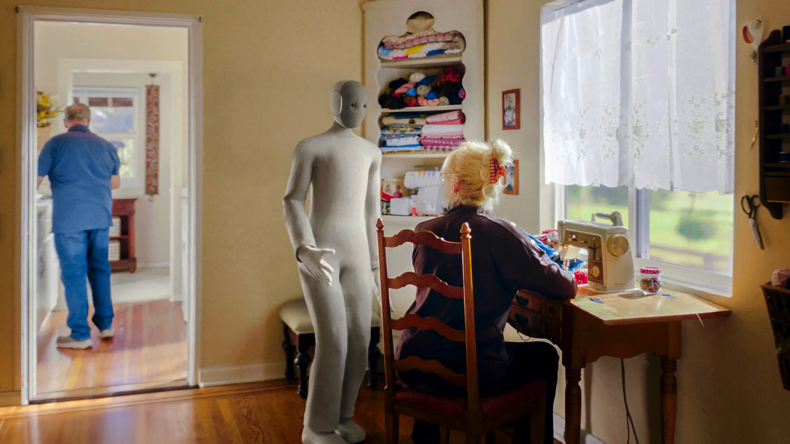
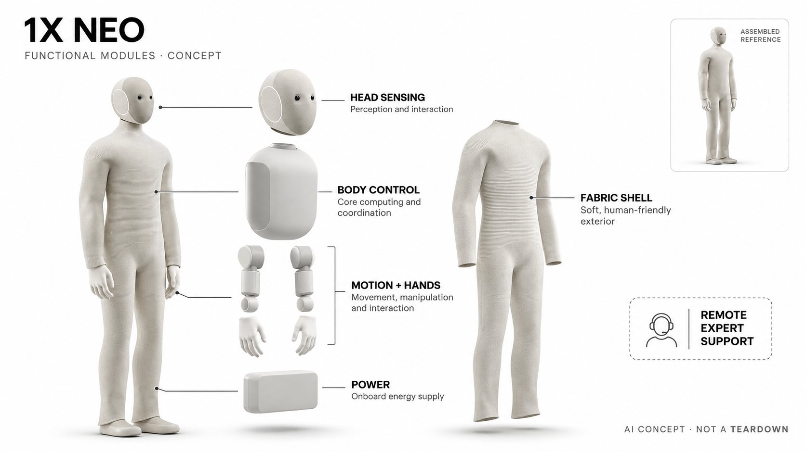

# 1X NEO Home Robot

**1X** · 消费机器人 · 核查 2026-11-04

以学习动作与远程专家协助进入家庭家务

消费渠道：付费预约 · 非正式订单。

## 产品图片与结构参考

### 产品图

官方NEO全身 · 来源：[1X · 官方图片](<https://www.1x.tech/order>) · [原始图片](<https://www.1x.tech/_next/image?url=https%3A%2F%2Fcdn.sanity.io%2Fimages%2Fqka6yvsc%2Fproduction%2F1054db069547b8a970273c62fa96fb6ae1818e8a-3665x2062.webp&w=3840&q=100>)

### 参考图

官方NEO家庭场景 · 来源：[1X · 官方图片](<https://www.1x.tech/order>) · [原始图片](<https://www.1x.tech/_next/image?url=https%3A%2F%2Fcdn.sanity.io%2Fimages%2Fqka6yvsc%2Fproduction%2F900c4cb36ceb21a1c3d70ff0f261558c4b471d00-3000x1686.webp&w=3840&q=100>)

### AI 生成爆炸示意

**AI 生成 · 非实物拆机。** 内部为概念推断，不能作为元件布局、BOM 或维修依据。[生成提示词](../../content/hardware/prompts/1x-neo-home.txt)

> 依据已核验官方外形与公开功能生成；未知内部仅为概念功能块，不代表原机电路板、芯片或实际布局。

> 实际查看并核对对应型号，官方原图未改色或语义编辑；营销文字不代表本研究独立验证。

> 分析为基于公开资料的案头研究与 AI 辅助判断，未经用户访谈、销量审计或实物拆机。需求、画像、竞争冷门度、审美及商业机会均为研究假设，不是投资结论。

## 销售与购买

- 状态：付费预约 · 非正式订单。官网有US$200可退定金与Order Now；法律页明确是未来购买/订阅邀请的排队预订，不保证交付时间，本条列付费预约·非正式订单，不计可购/预售数量。

- 地区：美国（初期）

- 价格：US$200预约金；Early Access买断标价US$20,000。另有US$499/月方案，交付与服务条件不同；定金不是整机售价，也不构成交付时间保证。

- 中国大陆：官方当前初期交付面向美国，未确认大陆购买及服务；后续其他市场计划不作为当前国内可用证据。

- [官方产品 / 商店](<https://www.1x.tech/order>)

## AI 的实际作用

Redwood通用动作模型用于学习和重复家务，语音接口用于交互；早期只承诺基础自主性，复杂任务由预约远程Expert监督协助，不把全部演示视为无人自主。

服务与联网依赖：需要家庭环境部署、应用、网络和服务支持；机器人可用任务及远程介入边界按交付方案核对，未来学习能力不是当前完成率。

## 是否冷门

新兴竞争（研究判断）：付费预订的家用通用操作机器人属于早期赛道，区别于陪伴或工业部署；能力和交付仍须保守理解。

## 需求与市场

需求假设：家庭希望把取放、整理等实物家务交给机器人，而不只是获得语音建议。应记录真正完成、人工准备与远程协助，不能用发布演示或通用模型名称推断能独立完成所有家务，更不能把预订热度当作实际留存。

### 产品任务与边界 · 研究判断

需求假设：家庭希望把取放、整理等实物家务交给机器人，而不只是获得语音建议。应记录真正完成、人工准备与远程协助，不能用发布演示或通用模型名称推断能独立完成所有家务，更不能把预订热度当作实际留存。

依据：[1X NEO官方预订与能力](<https://www.1x.tech/order>) · [1X官方预订条款](<https://www.1x.tech/legal>)

### 需求判断 · 研究判断

通用移动家务的吸引力在于减少人在房间之间搬取和整理的劳动，但这些任务包含寻找物品、判断归属与失败恢复。即使机器人能完成某个动作，仍可能需要用户先整理环境或远程人员接管，需求评估必须覆盖这些前后步骤而非只看动作片段。

依据：[1X NEO官方预订与能力](<https://www.1x.tech/order>) · [1X官方预订条款](<https://www.1x.tech/legal>)

### 需求验证 · 待验证

验证计划应先选择少数明确物品和收纳位置，记录准备、完成、人工纠错与等待的总时间，再比较简单工具或人工服务。由于当前公开购买入口属于预约，不能把未取得实机的计划写成已完成测试，更不能以预约人数替代真实家庭的使用证据。

依据：[1X NEO官方预订与能力](<https://www.1x.tech/order>) · [1X官方预订条款](<https://www.1x.tech/legal>)

## 用户画像

画像推断：美国愿意接受早期产品、提供合适空间并能管理服务与隐私的家庭更匹配。高预算不代表可以接受远程人员参与，实际家务承担者和购买者需共同评估，不能把所有需要省时的人都当作早期用户。

### 适用行为与条件 · 研究判断

画像推断：美国愿意接受早期产品、提供合适空间并能管理服务与隐私的家庭更匹配。高预算不代表可以接受远程人员参与，实际家务承担者和购买者需共同评估，不能把所有需要省时的人都当作早期用户。

依据：[1X NEO官方预订与能力](<https://www.1x.tech/order>) · [1X官方预订条款](<https://www.1x.tech/legal>)

### 人群取舍 · 研究判断

愿意接受早期硬件的家庭还需具备安排机器人活动空间、管理访问权限和处理服务中断的能力。购买者与日常家务承担者可能不是同一个人，画像应同时考虑对被拍摄和远程协助的接受度，不能只按预算或科技爱好判断匹配。

依据：[1X NEO官方预订与能力](<https://www.1x.tech/order>) · [1X官方预订条款](<https://www.1x.tech/legal>)

### 画像验证 · 待验证

画像验证可以先用任务日记与空间检查识别高频重复劳动，再向家庭成员解释自主及人工协助的区别。只有取得设备并获得明确同意后才能观察实际共处，不应把访谈中的省时愿望当成会接受摄像、机械动作和持续服务费用的结论。

依据：[1X NEO官方预订与能力](<https://www.1x.tech/order>) · [1X官方预订条款](<https://www.1x.tech/legal>)

## 竞争与替代

竞争判断：与人工家务服务、专用家电及其他家用机器人竞争，移动实体操作是区别于桌面伙伴的任务。只有一个NEO型号，不以颜色或月付买断重复计数；应比较完整任务和支持，而非以人形或算力判断优势。

### 比较对象与差异 · 研究判断

竞争判断：与人工家务服务、专用家电及其他家用机器人竞争，移动实体操作是区别于桌面伙伴的任务。只有一个NEO型号，不以颜色或月付买断重复计数；应比较完整任务和支持，而非以人形或算力判断优势。

依据：[1X NEO官方预订与能力](<https://www.1x.tech/order>) · [1X官方预订条款](<https://www.1x.tech/legal>)

### 竞争判断 · 研究判断

人形布局可能适配为人设计的家居工具，但也意味着比专用机器承担更复杂的感知和动作任务。与洗碗机、机械抓取工具或家政服务比较时，应统一任务边界及完成标准，不能因为同一种外形能演示许多动作就推导经济性普遍更优。

依据：[1X NEO官方预订与能力](<https://www.1x.tech/order>) · [1X官方预订条款](<https://www.1x.tech/legal>)

### 竞争验证 · 待验证

竞争验证应比较完成相同家庭任务的全流程成本，并分别统计机器人自主部分和远程支持贡献。对尚未普遍交付的能力只列验证计划，不能把官方未来更新路线写为现售功能，也不能把颜色、买断与月付方案当成多个独立需求条目。

依据：[1X NEO官方预订与能力](<https://www.1x.tech/order>) · [1X官方预订条款](<https://www.1x.tech/legal>)

## 供应链

供应链分析：感知、关节、手部、结构、能源和充电需要长期协同，公开参数不等于完整BOM。软性外衣、家庭碰撞、维修与远程服务都是成本，不能凭外形或官方算力列表推定具体部件来源和量产可靠性。

### 功能模块拆分 · 研究判断

功能上包括环境与人体交互感知、躯干及肢体运动、手部操作、供能充电、织物外衣和AI与远程支持服务。公开外观和参数不能说明每个关节内部结构，供应分析需保留维护、校准和家庭安全验证，不能从人形比例猜零件品牌与成本。

依据：[1X NEO官方预订与能力](<https://www.1x.tech/order>) · [1X官方预订条款](<https://www.1x.tech/legal>)

### 制造与供应约束 · 研究判断

供应链分析：感知、关节、手部、结构、能源和充电需要长期协同，公开参数不等于完整BOM。软性外衣、家庭碰撞、维修与远程服务都是成本，不能凭外形或官方算力列表推定具体部件来源和量产可靠性。

依据：[1X NEO官方预订与能力](<https://www.1x.tech/order>) · [1X官方预订条款](<https://www.1x.tech/legal>)

### 候选与证据缺口 · 研究判断

捷普可作为复杂机电产品制造导入候选，富创可支持结构件原型及可装配性评估，两者均没有本型号点名采用证据。需要另核柔性外层、运动部件与家庭场景验证能力，通用加工和电子制造经验不能证明已拥有整个人形机器人量产方案。

依据：[1X NEO官方预订与能力](<https://www.1x.tech/order>) · [1X官方预订条款](<https://www.1x.tech/legal>)

## 技术路径

技术判断：官方点名Redwood及基础自主与Expert模式，学习模型和人工介入应分别记录。不同物体、家庭布局和失败恢复会影响表现，不能把未来能力增长当作已交付，也不把语音流畅解释为动作安全可靠。

### 已披露技术边界 · 研究判断

技术判断：官方点名Redwood及基础自主与Expert模式，学习模型和人工介入应分别记录。不同物体、家庭布局和失败恢复会影响表现，不能把未来能力增长当作已交付，也不把语音流畅解释为动作安全可靠。

依据：[1X NEO官方预订与能力](<https://www.1x.tech/order>) · [1X官方预订条款](<https://www.1x.tech/legal>)

### 系统难点判断 · 研究判断

从语言指令到抓取与移动之间存在多层判断，Redwood名称本身没有告诉用户每个任务的成功边界。基础自主和Expert模式应有可见状态与明确接管权限，模型能力增长需要版本化验证，不能把语音理解或记忆直接等同稳定物理操作。

依据：[1X NEO官方预订与能力](<https://www.1x.tech/order>) · [1X官方预订条款](<https://www.1x.tech/legal>)

### 技术验证 · 待验证

技术验证应在厂商允许范围内逐步测试可重复任务，记录物品变化、遮挡、失败停止与人工接管，而非追求危险极限。每项结果保留软件版本和服务条件，在取得实机前仅能提出计划，不能以模拟图或宣传视频声称已验证家庭安全。

依据：[1X NEO官方预订与能力](<https://www.1x.tech/order>) · [1X官方预订条款](<https://www.1x.tech/legal>)

## 产品审美

审美判断：织物外衣与柔和色调试图降低家庭机器人压迫感，但体量、声音、行走和停靠更影响共处。设计需让正在自主或远程协助的状态清楚，不能用亲和外观掩盖实际机械动作与摄像采集。

### 外观与交互语言 · 研究判断

审美判断：织物外衣与柔和色调试图降低家庭机器人压迫感，但体量、声音、行走和停靠更影响共处。设计需让正在自主或远程协助的状态清楚，不能用亲和外观掩盖实际机械动作与摄像采集。

依据：[1X NEO官方预订与能力](<https://www.1x.tech/order>) · [1X官方预订条款](<https://www.1x.tech/legal>)

### 使用中审美判断 · 研究判断

浅色织物、柔和头部和收敛的视觉表情试图让大型机器人更容易融入家居。真正的共处体验还取决于转身距离、关节声音、停靠位置和状态可见性；亲和外衣不能替代对摄像和远程人员参与的清楚表达，也不应暗示生物式情感能力。

依据：[1X NEO官方预订与能力](<https://www.1x.tech/order>) · [1X官方预订条款](<https://www.1x.tech/legal>)

### 设计验证 · 待验证

设计验证应观察家人在通道、桌边和停靠区是否需要改变习惯，并检查每人能否辨认自主、暂停和远程支持状态。对儿童宠物及访客不推定默认接受，不能仅通过白底全身图评价安全距离或家居融入，也不把软质表面作为无碰撞风险证据。

依据：[1X NEO官方预订与能力](<https://www.1x.tech/order>) · [1X官方预订条款](<https://www.1x.tech/legal>)

## 关键风险

风险判断：付费预订只是未来下单机会，交付与任务能力存在不确定；远程专家涉及家庭隐私与授权。机器人不能作为儿童或宠物照护替代，AI与机械安全需实际验证，不能用家用定位或软外衣推定无风险。

### 主要失效与依赖 · 研究判断

风险判断：付费预订只是未来下单机会，交付与任务能力存在不确定；远程专家涉及家庭隐私与授权。机器人不能作为儿童或宠物照护替代，AI与机械安全需实际验证，不能用家用定位或软外衣推定无风险。

依据：[1X NEO官方预订与能力](<https://www.1x.tech/order>) · [1X官方预订条款](<https://www.1x.tech/legal>)

### 风险传播判断 · 研究判断

当前支付取得的是未来购买机会，时间、资格和后续条款可能变化，应与整机价格明确分离。进入家庭后的远程支持还涉及可见范围、录制和退出权，动作失败也可能影响物品与人；不能因定位家用就当作可替代照护或紧急响应服务。

依据：[1X NEO官方预订与能力](<https://www.1x.tech/order>) · [1X官方预订条款](<https://www.1x.tech/legal>)

### 风险验证 · 待验证

风险验证应先核对预约退款、后续合同与服务地区，再评估权限、远程接管记录和停止方式。任何机械测试均需遵循厂商安全条件，不自行制造危险接触；不能把预约页面或个别部署故事解释成已经交付所有消费者或已具备无限家务能力。

依据：[1X NEO官方预订与能力](<https://www.1x.tech/order>) · [1X官方预订条款](<https://www.1x.tech/legal>)

## 机会与验证

机会假设：先选择可衡量的少数家务，比较机器人、专用工具和人工服务的总劳动。若大部分价值依赖远程协助，应明确服务成本与边界；不应从人形机器人热度直接推导所有家庭都需要通用平台。

### 可能的机会入口 · 研究判断

机会假设：先选择可衡量的少数家务，比较机器人、专用工具和人工服务的总劳动。若大部分价值依赖远程协助，应明确服务成本与边界；不应从人形机器人热度直接推导所有家庭都需要通用平台。

依据：[1X NEO官方预订与能力](<https://www.1x.tech/order>) · [1X官方预订条款](<https://www.1x.tech/legal>)

### 机会成立条件 · 研究判断

机会在于把少数实体任务做成可解释、可接管且总劳动更少的服务，未必来自通用程度最大化。若远程人员贡献显著，商业模式应诚实包含这部分成本；创业者可先研究任务分解和失败恢复，而不急于复刻完整人形硬件外观。

依据：[1X NEO官方预订与能力](<https://www.1x.tech/order>) · [1X官方预订条款](<https://www.1x.tech/legal>)

### 下一步验证 · 待验证

下一步可以先建立家庭任务基线与试用标准，待取得设备后逐条核查自主比例、停机和实际省下的劳动。使用真实版本及权限记录决定扩展，不用整机展示、生成图或行业融资热度预测居民普遍需求，也不提前把承诺更新当成验证结果。

依据：[1X NEO官方预订与能力](<https://www.1x.tech/order>) · [1X官方预订条款](<https://www.1x.tech/legal>)

## 对应供应链公司

能力候选用于选型研究，不代表本产品实际采用；未公开的供货关系不作推断。

- [jabil](../supply-chain/jabil.md) — **能力候选 · 非已采用** / 复杂机电系统制造与测试导入：Jabil公开工程和复杂电子制造服务可匹配感知、控制及机电整合的导入评估，但家庭运动安全、手部与柔性外衣需专项验证；没有1X NEO点名采用证据，不能把候选能力解释为实际整机工厂。

- [fictiv](../supply-chain/fictiv.md) — **能力候选 · 非已采用** / 机器人结构与装配原型评估：Fictiv公开数字制造和原型服务可用于结构、外壳接口与装配迭代，但不等于拥有NEO关节、控制或安全方案；未见1X点名供货，本候选只对应原型与结构工程的潜在匹配而非现用部件。

[浏览供应链目录](../supply-chain.md)

## 功能分层示意

这是功能关系，不是实物拆机、真实空间结构或已核实 BOM。

1. **家庭感知**：公开视觉、音频与动作感知支持家庭交互。（官方披露）

2. **动作模型**：Redwood用于学习和重复任务。（官方披露）

3. **实体执行**：双足、机械臂和手执行；未知内部只作功能概念。（官方披露）

4. **专家协助**：复杂任务可预约远程监督与操作协助。（官方披露）

5. **能源服务**：充电、应用调度与持续更新。（官方披露）

## 来源

1. [1X NEO官方预订与能力](<https://www.1x.tech/order>) — 实际打开，US$200定金、买断/月付、基础自主与Expert模式明确。

2. [1X官方预订条款](<https://www.1x.tech/legal>) — 已打开，明确个人家庭用途和排队邀请性质，不承诺具体交付时间。

[返回目录](../hardware-market.md) · [网页分析](https://romanagent.github.io/Roman/#hardware/product/1x-neo-home)
