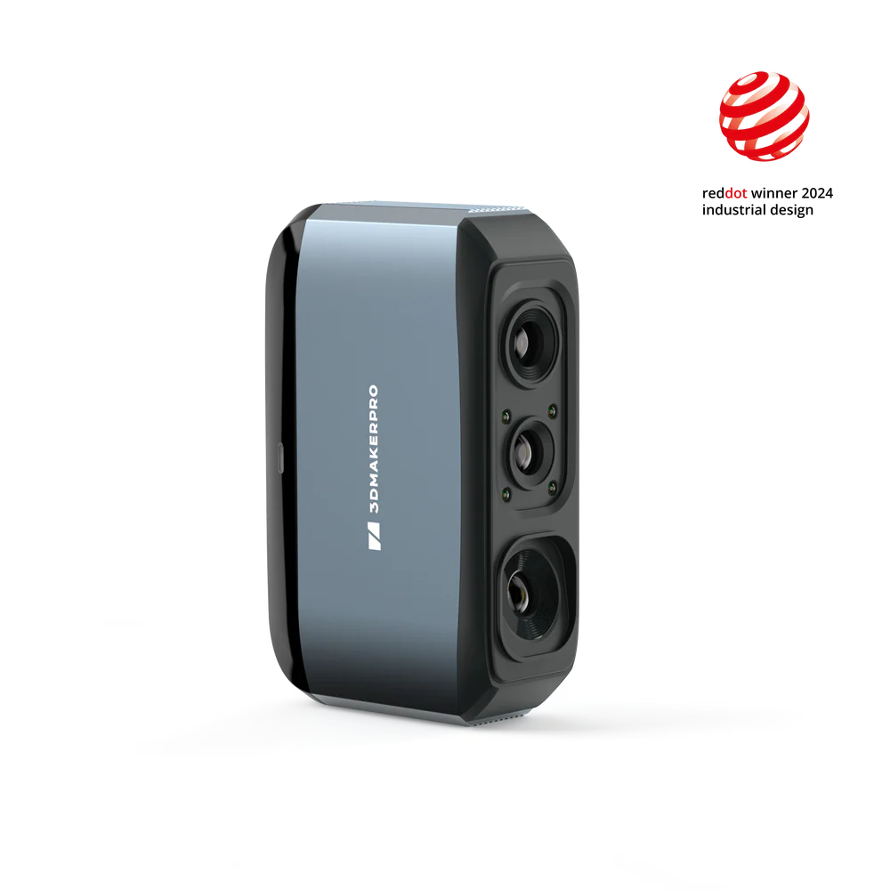
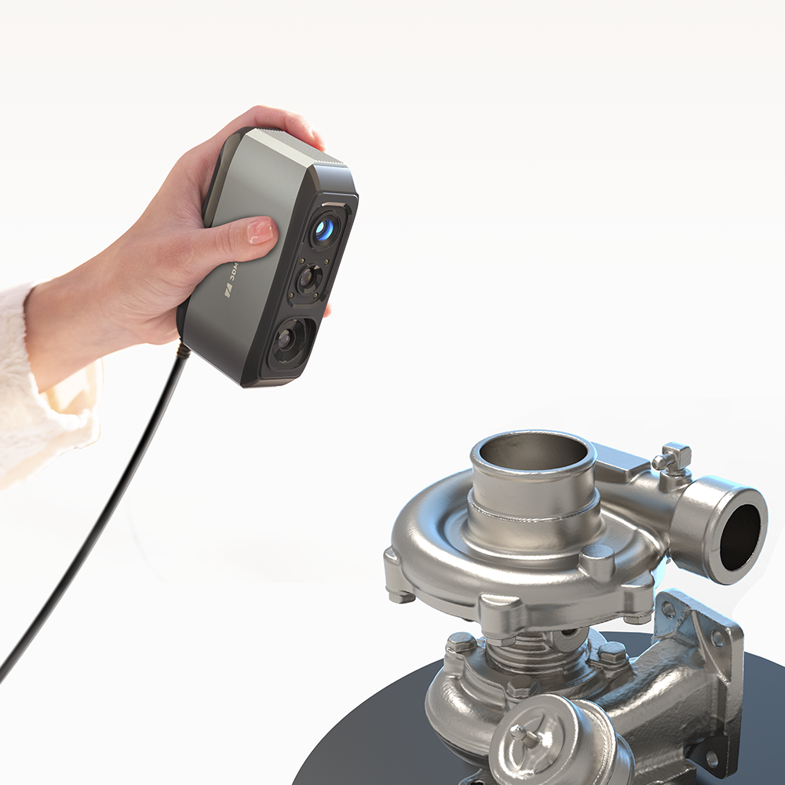
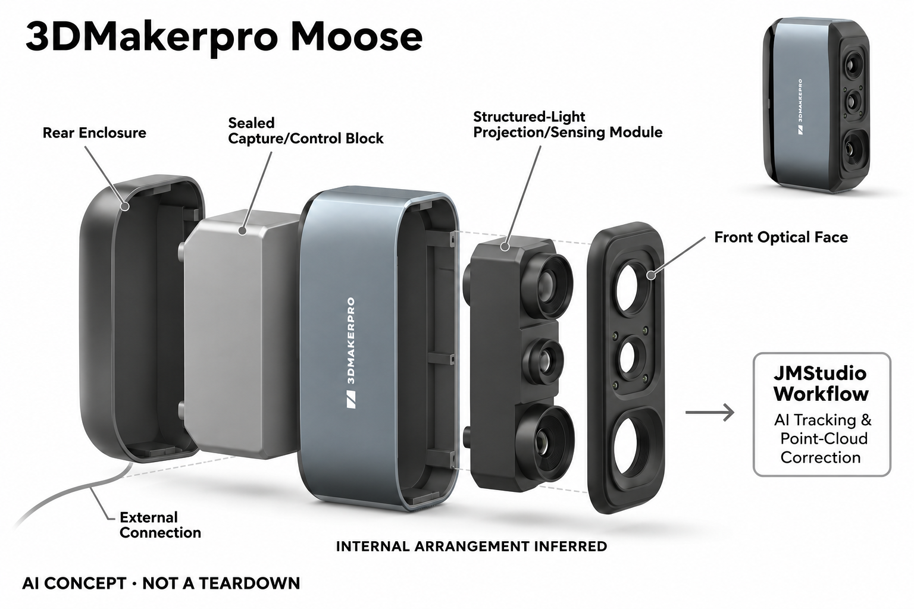

# 3DMakerpro Moose

**3DMakerpro** · 专业兴趣工具 · 核查 2026-11-04

用AI跟踪辅助中型物体三维扫描

消费渠道：个人零售。

## 产品图片与结构参考

### 产品图

3DMakerpro Moose · 官方产品图 · 来源：[3DMakerpro · 官方图片](<https://store.3dmakerpro.com/products/moose>) · [原始图片](<https://cdn.shopify.com/s/files/1/0563/9290/8869/files/Moose_627f8cd8-9952-4c17-b627-52bf65bdb019.webp?v=1775201860>)

### 参考图

3DMakerpro Moose · 官方参考图 · 来源：[3DMakerpro · 官方图片](<https://store.3dmakerpro.com/products/moose>) · [原始图片](<https://cdn.shopify.com/s/files/1/0563/9290/8869/files/1000x1000-1_-2.png?v=1775201860>)

### AI 生成爆炸示意

**AI 生成 · 非实物拆机。** 内部为概念推断，不能作为元件布局、BOM 或维修依据。[生成提示词](../../content/hardware/prompts/3dmakerpro-moose-repair.txt)

> 已目视核对外形、标签与非拆机声明；不代表内部结构经实测验证。

> 分析为基于公开资料的案头研究与 AI 辅助判断，未经用户访谈、销量审计或实物拆机。需求、画像、竞争冷门度、审美及商业机会均为研究假设，不是投资结论。

## 销售与购买

- 状态：在售。官方商品数据Standard变体available=true，商店提供购买与美国仓配送说明；通用Sold out模板不作为唯一库存判断，不把Moose Lite及附件组合重复计数。

- 地区：美国仓及官方配送市场

- 价格：官方标准组合 US$489。核查日页面快照；运费、税费、会员和配送区域按官方结算确认，不视为中国到手价。

- 中国大陆：本轮核实所列区域官方商店；未确认中国大陆官方现货、账户及完整服务，不把境外可购等同大陆可用。

- [官方产品 / 商店](<https://store.3dmakerpro.com/products/moose>)

## AI 的实际作用

AI视觉跟踪辅助表面特征定位，JMStudio进行错误点云剔除与自动对齐；把实体物体转换为可编辑三维数据，精度宣传属于厂商测试而非本轮实测。

服务与联网依赖：需要兼容电脑与JMStudio；不同表面可能需扫描喷剂或转台，软件处理、后期清理和导出是工作流的一部分，不是按一次键就必然得到可打印模型。

## 是否冷门

新兴竞争（研究判断）：面向个人建模与复制兴趣形成具体使用场景；本轮没有销量与市场份额证据。

## 需求与市场

需求假设：个人创作者希望把已有物件转成模型，用于修改、收藏展示或打印复制，减少从零建模。应把表面准备、反复扫描和网格修复时间一起计算，确认扫描确实比手工建模更合适。

### 需求假设：从已有物体开始建模而不是从零画 · 研究判断

Moose把物体表面转为三维数据，针对个人创作者需要修改、展示或复现已有形状的任务。需求应验证扫描是否比手工建模省事，不能只看得到一个点云就认为完成，也不把扫描演示漂亮等同用户反复有值得购买设备的建模任务。

依据：[Moose官方商店](<https://store.3dmakerpro.com/products/moose>) · [Moose官方AI跟踪说明](<https://store.3dmakerpro.com/pages/moose>)

### 价值判断：采集之后的修复决定真正收益 · 研究判断

表面准备、重扫、对齐和网格清理都可能占用时间，自动跟踪只减少其中一部分。研究应以最终能用于目标任务的模型评价，而不是原始数据量，不能把一次按键导出当作可直接打印，更不以厂商精度数字替代实际对象适配。

依据：[Moose官方AI跟踪说明](<https://store.3dmakerpro.com/pages/moose>)

### 验证方案：选用户真正需要的三类物件 · 待验证

让创作者用自己常处理的实物完成准备、扫描、清理和导出，再与手机摄影测量或手工建模比较。记录重扫与修复，不只选表面友好的展示物，最终检查模型是否满足用途，本轮没有实际精度或成功率测量，测试计划不冒充结果。

依据：[Moose官方商店](<https://store.3dmakerpro.com/products/moose>) · [Moose官方AI跟踪说明](<https://store.3dmakerpro.com/pages/moose>)

## 用户画像

画像推断：已有电脑、愿意学习三维文件处理并经常接触实物建模的爱好者较匹配。只想偶尔扫描一个物件的人可能更适合外包服务，不能将扫描仪可购买等同所有用户都能即刻输出可用模型。

### 画像假设：经常处理实物形状的个人创作者 · 研究判断

较匹配者已有兼容电脑，愿意学习三维文件并反复遇到实物建模任务，可能从事模型、设计或收藏展示。偶尔只扫一件物品的人可能更适合服务外包，画像应按任务频率和后处理能力划分，不把硬件可买等同所有用户都能即刻获得可用模型。

依据：[Moose官方商店](<https://store.3dmakerpro.com/products/moose>) · [Moose官方AI跟踪说明](<https://store.3dmakerpro.com/pages/moose>)

### 使用约束：对象表面与工作区共同影响准备 · 研究判断

光滑、反光或透明表面可能需要额外处理，转台、喷剂和预览电脑也会占用空间，不能只按手持机身大小评价便利。用户需要接受这些准备与清理，研究应了解物件是否允许处理及用途限制，不假定任何收藏或精细对象都能采用相同方法。

依据：[Moose官方AI跟踪说明](<https://store.3dmakerpro.com/pages/moose>)

### 访谈重点：为什么当前建模方式不够用 · 待验证

请用户展示最近一次因手工建模或手机扫描受阻的对象，说明需要的是外观展示、修改还是尺寸参考，再判断Moose的作用。不同输出目标需要不同质量，不能只问想要多高精度，也不将对三维扫描好奇当作稳定购买需求。

依据：[Moose官方商店](<https://store.3dmakerpro.com/products/moose>) · [Moose官方AI跟踪说明](<https://store.3dmakerpro.com/pages/moose>)

## 竞争与替代

竞争判断：手机摄影测量、深度扫描设备和人工建模服务都能替代部分需求，专用扫描器属于较窄创作工具。低大众热度不代表没有竞争，软件易用性和实际对象适配比最高精度更关键。

### 替代方案：摄影测量、其他扫描与建模服务 · 研究判断

Moose与手机摄影测量、深度采集设备、其他专用扫描仪和人工建模竞争，针对对象与输出任务的适配比参数排名更重要。小众工具不代表无成熟替代，也不能因使用AI跟踪就判定优于熟练用户的普通采集或手工方案。

依据：[Moose官方商店](<https://store.3dmakerpro.com/products/moose>) · [Moose官方AI跟踪说明](<https://store.3dmakerpro.com/pages/moose>)

### 差异判断：跟踪、纠错与对齐各减少不同工作 · 研究判断

AI视觉定位可能帮助连续采集，JMStudio纠错和对齐则处理数据整理，不能把三项能力合成一个必成功承诺。研究应分别观察丢失、误删与拼接问题，用户若主要耗时在网格修复，前端跟踪改善未必足以决定购买。

依据：[Moose官方AI跟踪说明](<https://store.3dmakerpro.com/pages/moose>)

### 比较方法：交付同一个可用模型 · 待验证

让不同方案为相同物件输出满足目标用途的模型，记录表面准备、采集、重扫、清理与导出时间。不要只比较原始点云是否密集，也不把软件自动生成的平滑外观当作真实形状准确，最终应检查任务所需细节是否被保留。

依据：[Moose官方商店](<https://store.3dmakerpro.com/products/moose>) · [Moose官方AI跟踪说明](<https://store.3dmakerpro.com/pages/moose>)

## 供应链

供应链推断：投光、摄像与外壳的相对位置需稳定，运输与校准影响光学一致性，数据线也承担持续连接。官方未披露完整工厂和物料表；校准维护、喷剂和电脑性能都是实际交付成本。

### 功能拆分：结构光、跟踪和电脑处理 · 研究判断

公开链路包含投光与摄像采集、AI视觉跟踪、JMStudio点云处理及模型导出，电脑是重要外部依赖。不能将全部处理画在手持本体内部，也不把相机拍照当作完整三维重建，具体光学模组、主控与工厂本轮未披露。

依据：[Moose官方AI跟踪说明](<https://store.3dmakerpro.com/pages/moose>)

### 制造判断：光学相对位置与校准需要稳定 · 研究判断

投光与摄像之间的几何关系影响采集，外壳、运输和数据线又会影响使用与维护，不能只选择高规格相机。供应评估应关注装配与标定配合，本轮没有原机公差、校准流程或维修数据，不能由产品精度宣传反推实际制造良率。

依据：[Moose官方AI跟踪说明](<https://store.3dmakerpro.com/pages/moose>)

### 候选选型：结构光与相机工程分别核对 · 研究判断

Sunny Optical公开结构光和视觉模组方向，可作为光学输入候选，Arducam可讨论相机接口与驱动工程。两者都需确认表面范围、同步和标定，标准模组不等于完整Moose扫描器，也没有点名供货证据，不能补写原机内部布局。

依据：[Moose官方AI跟踪说明](<https://store.3dmakerpro.com/pages/moose>)

## 技术路径

官方披露AI跟踪、点云纠错和自动对齐，技术判断应分别看跟踪丢失、错误清除与拼接结果。光滑、反光或透明物件需要额外处理，不能把厂商精度数字当成所有材料和扫描姿态的保证。

### 已披露能力：AI跟踪与点云整理 · 官方资料

官方说明AI视觉跟踪辅助表面特征定位，JMStudio进行错误点云剔除和自动对齐，输出再进入建模流程。应把跟踪、数据清理和几何重建分开，不能把漂亮网格当作原物每个细节已被忠实恢复，也不将厂商测量条件推广到所有材料。

依据：[Moose官方AI跟踪说明](<https://store.3dmakerpro.com/pages/moose>)

### 技术判断：少特征表面可能让定位更难 · 研究判断

如果物体表面缺少可辨信息或反射复杂，采集和对齐可能需要更多准备，自动处理也可能删除有用细节。研究应观察用户如何发现和纠正，而不是只看软件完成提示；这里是待验证条件，不声称已测得Moose在某类对象上的误差。

依据：[Moose官方AI跟踪说明](<https://store.3dmakerpro.com/pages/moose>)

### 验证方案：保留原始点云与处理步骤 · 待验证

对真实物件保存各轮采集、对齐和清理结果，检查缺失与误删如何影响最终用途，并记录何时需要人工修复。不要只留下导出的平滑模型，也不把扫描结果直接用于安全关键或精密工程判断，本轮没有独立尺寸与可靠性验证。

依据：[Moose官方商店](<https://store.3dmakerpro.com/products/moose>) · [Moose官方AI跟踪说明](<https://store.3dmakerpro.com/pages/moose>)

## 产品审美

审美判断：手持盒体与纵向光学窗口强调工具性，较紧凑外形利于围绕物体移动。握持疲劳、线缆拖拽和实时预览位置影响使用，精致渲染无法说明长时间扫描中的手部稳定性。

### 外形判断：手持窗口强调围绕物体移动 · 研究判断

Moose的盒体与光学窗口形成明确工具形态，握持与线缆会影响围绕对象采集，实际便利不能只看裸机紧凑。实时预览位置和扫描姿态也属于设计，照片无法说明长时间手部稳定与疲劳，更不能从外观精致推断校准稳定。

依据：[Moose官方商店](<https://store.3dmakerpro.com/products/moose>)

### 交互判断：跟踪状态应帮助用户调整 · 研究判断

采集过程中用户需要知道哪里已扫、哪里丢失以及下一步怎样移动，不能仅在结束后发现模型不完整。研究应观察预览和提示是否可执行，避免把自动化理解为没有反馈需求，也不将点云更多或颜色更丰富视为交互更清楚。

依据：[Moose官方AI跟踪说明](<https://store.3dmakerpro.com/pages/moose>)

### 体验验证：与电脑和实际对象一起使用 · 待验证

让用户在常用工作台完成摆放、连接、扫描、翻面与收纳，记录线缆拖拽、屏幕视线和对象固定问题。不要只在转台演示条件下测试单体手感，完整桌面流程更能说明手持设计是否真的减少建模工作的负担。

依据：[Moose官方商店](<https://store.3dmakerpro.com/products/moose>) · [Moose官方AI跟踪说明](<https://store.3dmakerpro.com/pages/moose>)

## 关键风险

风险判断：跟踪中断、表面反射和误删点云会影响模型完整性，扫描他人物件还需注意使用权限。后期修复和测量校验不能省略，不把扫描结果直接当作安全关键零件或精密工程依据。

### 输出风险：自动修复可能改变原物信息 · 研究判断

错误点剔除、对齐与平滑可能让模型看起来整洁却丢失细节，重要用途应保存原始数据并检查所需部位。扫描不自动证明形状或尺寸准确，本轮没有实机测量，也不将输出当作安全关键零件或精密工程的确定依据。

依据：[Moose官方AI跟踪说明](<https://store.3dmakerpro.com/pages/moose>)

### 拥有风险：电脑、材料准备和使用权限 · 研究判断

兼容电脑、软件更新、喷剂或转台会改变完整成本，某些对象也未必允许表面处理或复制使用。用户需要按实际任务核对条件，不能只看扫描仪标价，也不把可导出模型理解为对任何他人物件均有自由复制和发布权利。

依据：[Moose官方商店](<https://store.3dmakerpro.com/products/moose>) · [Moose官方AI跟踪说明](<https://store.3dmakerpro.com/pages/moose>)

### 验证安排：记录重扫与外包回退 · 待验证

试用应保留跟踪中断、处理不合意、对象不适合和最终改用建模服务的原因，区分采集、软件与任务要求。不要只统计成功导出，也不将所有失败归因于用户不熟练，完整后处理负担决定扫描方案是否值得长期采用。

依据：[Moose官方AI跟踪说明](<https://store.3dmakerpro.com/pages/moose>)

## 机会与验证

市场观察：选择用户真正想复制的三种物体进行完整任务测试，记录重扫次数、修复时间和成功导出。需求应由反复出现的建模任务证明，而不是以扫描演示漂亮或硬件精度排名推断市场。

### 研究方向：让实物到可用模型的流程可预测 · 研究判断

Moose可用于研究个人创作者在哪一步失去时间，机会可能在对象适配说明、采集反馈或修复，而不是更高精度宣传。应先确认哪些实物任务反复发生并难以用现有方案完成，再讨论硬件创新，不能从漂亮扫描演示推断需求。

依据：[Moose官方AI跟踪说明](<https://store.3dmakerpro.com/pages/moose>)

### 执行计划：按输出用途跟踪完整任务 · 待验证

分别观察展示、修改和打印相关任务，记录准备、重扫、人工修复及最终使用，访谈一次放弃扫描的对象。将数据采集与实际模型价值分开，不以点云数量、演示热度或一次成功样件代表留存，也不冒充已经完成用户访谈。

依据：[Moose官方商店](<https://store.3dmakerpro.com/products/moose>) · [Moose官方AI跟踪说明](<https://store.3dmakerpro.com/pages/moose>)

### 决策边界：专用扫描属于明确但有替代的场景 · 研究判断

实体三维采集与二维文档扫描不同，但仍面对手机、人工建模和服务外包，专业程度不等于市场空白。当前没有访谈、销量与供应报价，不以精度排名、AI标签或模型评分预测创业成功，价值应按重复建模任务验证。

依据：[Moose官方商店](<https://store.3dmakerpro.com/products/moose>) · [Moose官方AI跟踪说明](<https://store.3dmakerpro.com/pages/moose>)

## 对应供应链公司

能力候选用于选型研究，不代表本产品实际采用；未公开的供货关系不作推断。

- [sunny-optical](../supply-chain/sunny-optical.md) — **能力候选 · 非已采用** / 结构光采集光学与视觉组件候选：Sunny Optical公开结构光与立体视觉模组方向，可作为Moose表面采集的光学候选，但具体投光、视场、同步和几何标定须专项确认，普通机器人视觉模块不能直接替换扫描器。当前没有3DMakerpro点名采用证据，也不保证扫描精度。

- [arducam](../supply-chain/arducam.md) — **能力候选 · 非已采用** / 扫描相机接口与驱动工程候选：Arducam公开相机接口和定制驱动工程，可用于Moose采集链路的候选研究，但结构光同步、数据带宽、光学固定与JMStudio配合需要验证，不能当作完整三维算法方案。当前没有原机模组或工厂采用证据。

[浏览供应链目录](../supply-chain.md)

## 功能分层示意

这是功能关系，不是实物拆机、真实空间结构或已核实 BOM。

1. **结构光采集**：投光与摄像获取物体表面信息。（官方披露）

2. **视觉跟踪**：AI辅助定位表面特征。（官方披露）

3. **点云处理**：JMStudio纠错、对齐与优化。（官方披露）

4. **模型导出**：三维数据进入建模或打印流程。（官方披露）

## 来源

1. [Moose官方商店](<https://store.3dmakerpro.com/products/moose>) — 已实际打开官方页面；功能说明不等于独立性能测量。

2. [Moose官方AI跟踪说明](<https://store.3dmakerpro.com/pages/moose>) — 已实际打开官方页面；功能说明不等于独立性能测量。

[返回目录](../hardware-market.md) · [网页分析](https://romanagent.github.io/Roman/#hardware/product/3dmakerpro-moose)
