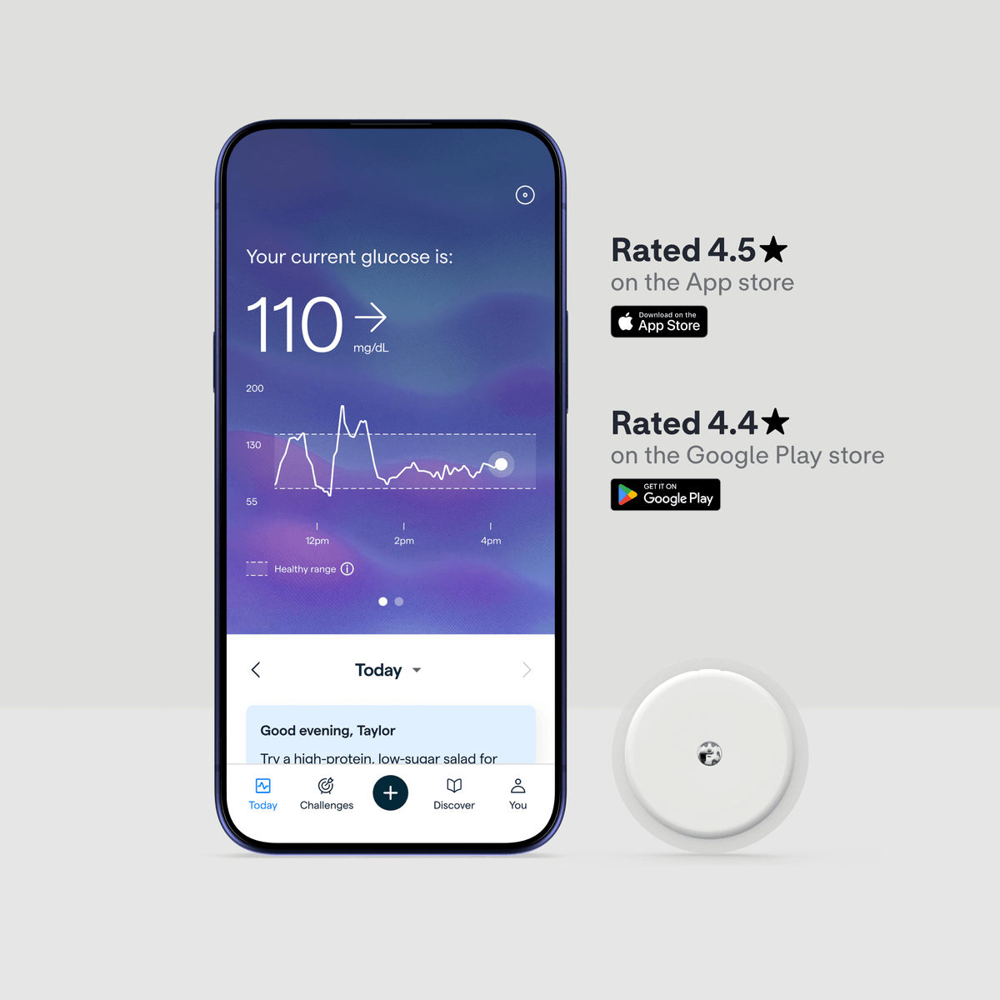
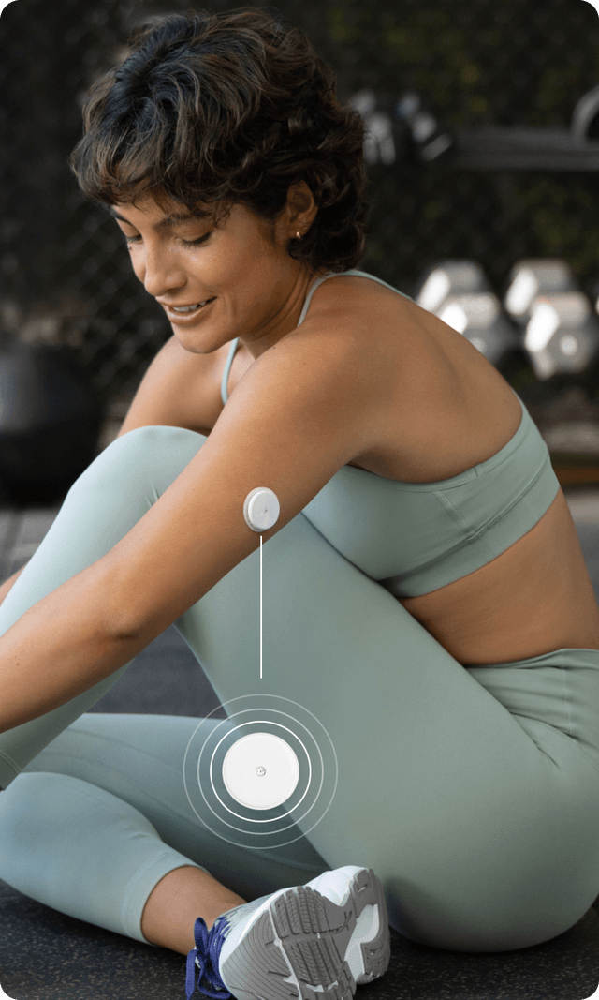
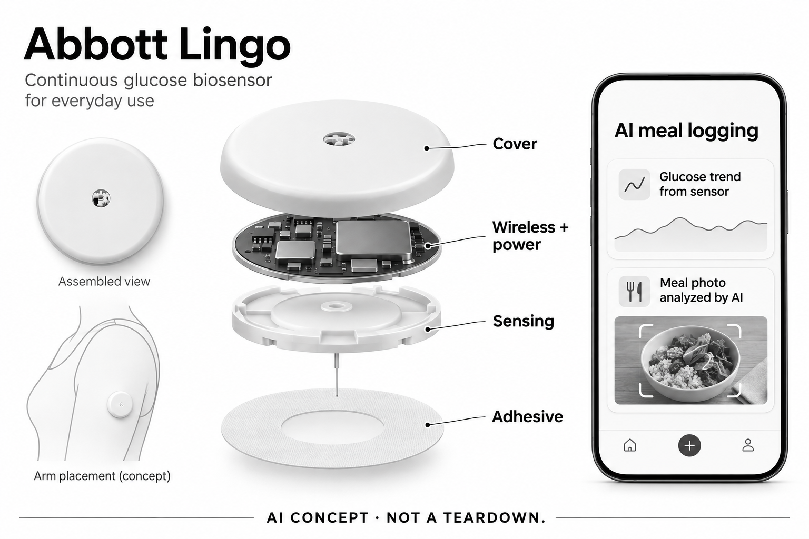

# Abbott Lingo（AI餐照记录方案）

**Abbott** · 居家健康 · 核查 2026-11-05

把连续葡萄糖趋势与用户核对后的餐食照片关联

消费渠道：个人零售。

## 产品图片与结构参考

### 产品图

Lingo官方电子传感器与App界面；评分和读数为厂家展示 · 来源：[Abbott Lingo · 官方产品图片](<https://www.hellolingo.com/products>) · [原始图片](<https://www.hellolingo.com/_next/image?url=https%3A%2F%2Fcms.services.abbott%2Fcontent%2Fdam%2Fbts%2Fbluebird%2Fdtc%2Fus%2Fpdp%2Fproduct-carousel%2Fpdp_slide_1_d.png%3FlastModifiedAt%3D2024-07-11-13-00&w=1200&q=90>)

### 参考图

Lingo官方上臂佩戴位置参考；不从人物推断健康状况 · 来源：[Abbott Lingo · 官方产品图片](<https://www.hellolingo.com/products>) · [原始图片](<https://www.hellolingo.com/_next/image?url=https%3A%2F%2Fcms.services.abbott%2Fcontent%2Fdam%2Fbts%2Fbluebird%2Fdtc%2Fus%2Fpdp%2Fnext-carousel%2Fpdp-next-3.png%3FlastModifiedAt%3D2024-07-12-16-00&w=640&q=85>)

### AI 生成爆炸示意

**AI 生成 · 非实物拆机。** 内部为概念推断，不能作为元件布局、BOM 或维修依据。[生成提示词](../../content/hardware/prompts/abbott-lingo.txt)

> 已检查外形、标签与灰阶；分离模块是概念功能架构，非真实内部布局、完整BOM或性能证明。

> 逐张实际查看确认型号与代次，保留官方源图；图片与界面中的营销内容不作为独立实测或效果保证。

> 分析为基于公开资料的案头研究与 AI 辅助判断，未经用户访谈、销量审计或实物拆机。需求、画像、竞争冷门度、审美及商业机会均为研究假设，不是投资结论。

## 销售与购买

- 状态：在售。美国官方当前计划页可订购两周一枚传感器US$54，列出具体订单与配送；2026年9月官方说明餐照AI识别已提供，不以其他Abbott产品或未来软件作依据。

- 地区：美国：本条价格及餐照功能口径、英国：官方另有销售渠道和地区方案

- 价格：US$54／两周计划，含1枚传感器。所见计划不自动续订；另有多枚和自动续订方案，本条不重复计数。传感器为需更换的电子耗材，实际寿命可能不足标示上限。

- 中国大陆：官方当前购买地区为美国和英国，未提供中国大陆Lingo购买服务；不能借FreeStyle Libre在其他市场的渠道推定Lingo可用。

- [官方产品 / 商店](<https://www.hellolingo.com/products>)

## AI 的实际作用

配套App用AI识别餐食照片并估计份量，用户确认后与电子传感器记录的葡萄糖曲线对照；食物估计与生理测量是不同输入。

服务与联网依赖：需要皮下细丝传感器、兼容手机和Lingo账户；餐照结果需用户修正，模型处理位置未完整披露，不推定传感器内置视觉AI。

## 是否冷门

新兴竞争（研究判断）：关注日常餐食记录与个人生理趋势关联，区别于一次性呼气和普通食物识别App；没有本研究访谈、减重或疾病风险效果证据。

## 需求与市场

需求假设是用户想回看一顿饭、活动和随后趋势之间的关系，但不愿每次手动搜索所有食物。AI照片入口可能降低记录阻力，却也可能遗漏配料或份量；即便时间上相邻也不能确定因果，价值取决于日志是否真实、完整，以及用户能否理解这种关联的局限。

### 官方｜餐食估计与葡萄糖测量分开 · 官方资料

Lingo通过佩戴在上臂的电子传感器获取连续葡萄糖相关数据，配套App新增AI餐照识别和份量估计，再让用户确认日志。照片提供食物信息，传感器提供生理趋势，两者不能互相替代；本条不把相机描述为直接测血糖，也不因普通曲线显示就把全部基础功能称为AI。

依据：[Lingo美国当前购买计划](<https://www.hellolingo.com/products>) · [Lingo餐照AI记录指南，2026-09-01](<https://www.hellolingo.com/blog/how-to-photo-log-meals>) · [Lingo官方CGM测量原理](<https://www.hellolingo.com/blog/what-is-a-cgm>)

### 判断｜减少记录负担可能帮助理解时间关系 · 研究判断

需求假设是用户想回看一顿饭、活动和随后趋势之间的关系，但不愿每次手动搜索所有食物。AI照片入口可能降低记录阻力，却也可能遗漏配料或份量；即便时间上相邻也不能确定因果，价值取决于日志是否真实、完整，以及用户能否理解这种关联的局限。

依据：[Lingo美国当前购买计划](<https://www.hellolingo.com/products>) · [Lingo餐照AI记录指南，2026-09-01](<https://www.hellolingo.com/blog/how-to-photo-log-meals>)

### 验证｜先核对一餐的输入是否准确 · 待验证

可让使用者对照自己知道的食物组成检查识别结果，记录哪些需要添加、删除或修改，再观察日志时间与曲线是否对应。测试应包括混合菜肴和被遮挡配料，而非只用清晰单品；本研究没有营养或葡萄糖实测，不提供饮食调整和疾病管理建议。

依据：[Lingo餐照AI记录指南，2026-09-01](<https://www.hellolingo.com/blog/how-to-photo-log-meals>) · [Lingo官方CGM测量原理](<https://www.hellolingo.com/blog/what-is-a-cgm>)

## 用户画像

持续佩戴并不自动产生有意义的记录，使用者仍需拍照、修正、标记时间并理解曲线不是对一顿饭的简单评分。对于只希望获得快速饮食结论的人，额外信息可能增加负担；用户画像应围绕记录目的和接受度，而不是把健康兴趣或体重目标直接当作适配依据。

### 官方｜购买人群与地区有明确限定 · 官方资料

美国官方将Lingo面向成年且不使用胰岛素的用户，并说明不用于诊断疾病；销售条款针对在美国的客户，英国有独立方案。这个范围不能从其他Abbott传感器推导，也不能因产品能显示葡萄糖就概括为所有人或所有糖尿病管理场景都适合使用。

依据：[Lingo美国当前购买计划](<https://www.hellolingo.com/products>) · [Lingo官方销售地区](<https://support.hellolingo.com/hc/en-us/articles/12306276895383-Where-can-I-purchase-Lingo>) · [Lingo美国销售条款](<https://www.hellolingo.com/terms-of-sale>)

### 判断｜愿意核对数据的人更可能完成工作流 · 研究判断

持续佩戴并不自动产生有意义的记录，使用者仍需拍照、修正、标记时间并理解曲线不是对一顿饭的简单评分。对于只希望获得快速饮食结论的人，额外信息可能增加负担；用户画像应围绕记录目的和接受度，而不是把健康兴趣或体重目标直接当作适配依据。

依据：[Lingo餐照AI记录指南，2026-09-01](<https://www.hellolingo.com/blog/how-to-photo-log-meals>) · [Lingo官方CGM测量原理](<https://www.hellolingo.com/blog/what-is-a-cgm>)

### 验证｜确认佩戴与记录投入可接受 · 待验证

购买前可以核对手机兼容、传感器更换、粘附和账户要求，并了解本人是否愿意持续记录餐食。需要将AI修正时间与长期电子耗材费用一起考虑；本轮没有个人佩戴反馈，不能从厂家使用照片推定舒适，也不能承诺坚持记录便会得到某种健康改善。

依据：[Lingo美国当前购买计划](<https://www.hellolingo.com/products>) · [Lingo餐照AI记录指南，2026-09-01](<https://www.hellolingo.com/blog/how-to-photo-log-meals>) · [Lingo官方用户指南](<https://www.hellolingo.com/s/lingo101-guide.pdf>)

## 竞争与替代

Lumen提供某次呼气相关信息，普通餐照App估计食物组成，而Lingo在这里把连续生理趋势和餐食记录连接。输入时间尺度和数据来源不同，但不意味着某种方案更适合所有人；比较应围绕要了解的问题、持续佩戴负担和可解释性，不能把不同指标当成同一健康分数。

### 官方｜多个计划仍是同一套硬件需求 · 官方资料

当前两周计划含一枚传感器且不自动续订，另有更多枚数及自动续订计划；这些是购买方式，不是不同创新硬件。标示最长使用周期也并非每枚都必然达到，商品页披露可能提前结束的情况；因此不能用单枚标价或上限天数简单推算保证可用的长期成本。

依据：[Lingo美国当前购买计划](<https://www.hellolingo.com/products>)

### 判断｜与呼气分析及普通餐照App区别 · 研究判断

Lumen提供某次呼气相关信息，普通餐照App估计食物组成，而Lingo在这里把连续生理趋势和餐食记录连接。输入时间尺度和数据来源不同，但不意味着某种方案更适合所有人；比较应围绕要了解的问题、持续佩戴负担和可解释性，不能把不同指标当成同一健康分数。

依据：[Lingo餐照AI记录指南，2026-09-01](<https://www.hellolingo.com/blog/how-to-photo-log-meals>) · [Lingo官方CGM测量原理](<https://www.hellolingo.com/blog/what-is-a-cgm>)

### 验证｜用记录任务衡量而非结果承诺 · 待验证

可比较手动餐食日志与AI拍照后，使用者是否更容易留下可核对信息，以及修正是否抵消了便利。设备成本之外还要考虑更换和服务地区，不能把免费App下载当作完整方案免费；本目录没有用户访谈、销量或减重证据，不能据营销案例推定普遍收益。

依据：[Lingo美国当前购买计划](<https://www.hellolingo.com/products>) · [Lingo餐照AI记录指南，2026-09-01](<https://www.hellolingo.com/blog/how-to-photo-log-meals>)

## 供应链

同类连续传感新设计不仅需要微弱信号采集，还涉及传感材料、偏置、长期漂移、封装、粘附和更换流程。能够采购电化学前端并不等于拥有可靠葡萄糖传感器，蓝牙连接也不能证明测量质量；供应研究应把这些专有条件与通用电子能力明确分开。

### 官方｜皮下细丝与无线电子模块共存 · 官方资料

官方说明传感器通过位于皮肤下方的细丝测量组织间液相关信号，并通过Bluetooth向手机传送数据。白色圆形外壳不是普通无电子贴纸，也不是光学手表；具体前端、无线芯片、电池和制造厂未在所引来源完整点名，不能把同集团其他产品的拆机BOM直接搬来。

依据：[Lingo官方CGM测量原理](<https://www.hellolingo.com/blog/what-is-a-cgm>) · [Lingo官方用户指南](<https://www.hellolingo.com/s/lingo101-guide.pdf>)

### 判断｜传感化学和封装比芯片目录更关键 · 研究判断

同类连续传感新设计不仅需要微弱信号采集，还涉及传感材料、偏置、长期漂移、封装、粘附和更换流程。能够采购电化学前端并不等于拥有可靠葡萄糖传感器，蓝牙连接也不能证明测量质量；供应研究应把这些专有条件与通用电子能力明确分开。

依据：[Lingo官方CGM测量原理](<https://www.hellolingo.com/blog/what-is-a-cgm>) · [Lingo官方用户指南](<https://www.hellolingo.com/s/lingo101-guide.pdf>)

### 验证｜候选只能作为新设计研究起点 · 待验证

电化学前端候选需核对传感电流、偏置、噪声及功耗，无线候选则研究连续数据传送和断连恢复。两者都没有Lingo实际采用证据，也不包含其传感化学或算法；不可据此提出用户改装、替换或自制贴片方案，完整消费产品仍需自身验证和适用边界。

依据：[Lingo官方CGM测量原理](<https://www.hellolingo.com/blog/what-is-a-cgm>) · [Lingo官方用户指南](<https://www.hellolingo.com/s/lingo101-guide.pdf>)

## 技术路径

如果拍摄时间、食物组成或份量不准确，用户可能把随后变化归给错误因素。连续曲线提供更多观察点，却不会自动消除记录偏差或其他生活变量；技术评价需要让用户看见哪些是传感数据、哪些是AI估计、哪些只是时间关联，避免把多个来源合成确定解释。

### 官方｜AI估计看不到所有配料 · 官方资料

Lingo明确用AI从照片识别食物并估计份量，同时提醒照片可能看不见烹调用油、已拌入的酱汁等内容，用户需检查和补充。营养数字属于估计而非直接测量；当前资料未完整披露模型和每层处理位置，不能将App识别推定为传感器本地计算或完全离线服务。

依据：[Lingo餐照AI记录指南，2026-09-01](<https://www.hellolingo.com/blog/how-to-photo-log-meals>)

### 判断｜日志误差会影响对趋势的理解 · 研究判断

如果拍摄时间、食物组成或份量不准确，用户可能把随后变化归给错误因素。连续曲线提供更多观察点，却不会自动消除记录偏差或其他生活变量；技术评价需要让用户看见哪些是传感数据、哪些是AI估计、哪些只是时间关联，避免把多个来源合成确定解释。

依据：[Lingo餐照AI记录指南，2026-09-01](<https://www.hellolingo.com/blog/how-to-photo-log-meals>) · [Lingo官方CGM测量原理](<https://www.hellolingo.com/blog/what-is-a-cgm>)

### 验证｜分别检查两条数据链 · 待验证

可以保留餐照原图、修订后日志和对应时间段曲线，分别记录识别错误、遗漏记录及传感连接问题。不要仅以App界面是否流畅判断系统质量，重装或换手机后的历史和账户行为也应核对；本研究未运行真实个人生理数据，不能验证测量误差或解释准确程度。

依据：[Lingo餐照AI记录指南，2026-09-01](<https://www.hellolingo.com/blog/how-to-photo-log-meals>) · [Lingo官方CGM测量原理](<https://www.hellolingo.com/blog/what-is-a-cgm>) · [Lingo官方用户指南](<https://www.hellolingo.com/s/lingo101-guide.pdf>)

## 产品审美

照片中的传感器看起来简洁，但穿衣、洗浴、睡姿和日常碰触仍可能影响个人感受。有人愿意展示设备，有人希望遮盖，两种偏好都合理；审美评价不应替代粘附和皮肤体验，也不能因为体积小就默认所有生活场景都不会发生牵拉或中断。

### 官方｜圆形上臂传感器需周期更换 · 官方资料

官方照片显示小型圆形白色传感器贴在上臂，随套装提供施用器及相关说明。它没有表屏、可见摄像头或随手充电接口，使用周期结束后按规定处理；概念图只展示外壳、通用电子层、传感细丝与粘附层，不将未知电池和电路布局伪装为真实拆机。

依据：[Lingo美国当前购买计划](<https://www.hellolingo.com/products>) · [Lingo官方用户指南](<https://www.hellolingo.com/s/lingo101-guide.pdf>)

### 判断｜低存在感与粘附体验需分别观察 · 研究判断

照片中的传感器看起来简洁，但穿衣、洗浴、睡姿和日常碰触仍可能影响个人感受。有人愿意展示设备，有人希望遮盖，两种偏好都合理；审美评价不应替代粘附和皮肤体验，也不能因为体积小就默认所有生活场景都不会发生牵拉或中断。

依据：[Lingo美国当前购买计划](<https://www.hellolingo.com/products>) · [Lingo官方用户指南](<https://www.hellolingo.com/s/lingo101-guide.pdf>)

### 验证｜记录实际佩戴事件和支持需求 · 待验证

可依据厂家说明记录设备提前脱落、粘附不适、连接中断或需要更换的情况，并核对官方支持及替换条件。观察时将外观喜欢程度与实际佩戴问题分开，不用宣传人物代表所有使用者；本目录没有长期佩戴、皮肤或耐水测试，不承诺个人舒适和寿命。

依据：[Lingo美国当前购买计划](<https://www.hellolingo.com/products>) · [Lingo官方用户指南](<https://www.hellolingo.com/s/lingo101-guide.pdf>)

## 关键风险

一个数值或波动容易被理解成某种食物好坏的确定标签，但实际记录涉及份量、时间和其他变量。AI估计看起来精确，也可能让用户忽略输入不完整；研究应关注信息是否被正确理解，避免把观察工具包装成自动饮食裁判或替代专业健康支持。

### 官方｜趋势工具不用于自行诊断 · 官方资料

官方说明Lingo不用于疾病诊断，数据不应脱离专业讨论直接作为医疗行动依据。组织间液测量与即时血液读数也存在差异，餐照估计更不是生理测量；本条不转述宣传中的减重、预防疾病或改善指标为保证结果，也不将使用者常见目标当成产品已验证疗效。

依据：[Lingo美国当前购买计划](<https://www.hellolingo.com/products>) · [Lingo美国销售条款](<https://www.hellolingo.com/terms-of-sale>) · [Lingo官方CGM测量原理](<https://www.hellolingo.com/blog/what-is-a-cgm>)

### 判断｜把食物和曲线过度绑定可能误导 · 研究判断

一个数值或波动容易被理解成某种食物好坏的确定标签，但实际记录涉及份量、时间和其他变量。AI估计看起来精确，也可能让用户忽略输入不完整；研究应关注信息是否被正确理解，避免把观察工具包装成自动饮食裁判或替代专业健康支持。

依据：[Lingo餐照AI记录指南，2026-09-01](<https://www.hellolingo.com/blog/how-to-photo-log-meals>) · [Lingo官方CGM测量原理](<https://www.hellolingo.com/blog/what-is-a-cgm>)

### 验证｜核对隐私和地区服务边界 · 待验证

正式使用前应了解账户、餐照、个人趋势和导出分享的处理条件，并确认所在地区能够获得相应服务。美国与英国的条款和版本不能随意混用，中国大陆也未有Lingo官方渠道证据；本研究不收集个人健康数据，不因其他同品牌产品存在就建议绕过区域限制。

依据：[Lingo餐照AI记录指南，2026-09-01](<https://www.hellolingo.com/blog/how-to-photo-log-meals>) · [Lingo官方销售地区](<https://support.hellolingo.com/hc/en-us/articles/12306276895383-Where-can-I-purchase-Lingo>) · [Lingo美国销售条款](<https://www.hellolingo.com/terms-of-sale>)

## 机会与验证

后续有价值的问题是AI餐照是否让用户更容易维持准确日志，而不是只增加漂亮的曲线和分数。如果每顿饭都需大量纠正，便利可能有限；即使记录改善，也仍需另行判断它是否帮助本人理解信息，不能将工具使用频率直接转换为健康或商业成功。

### 官方｜连续生理趋势与餐照关联是收录重点 · 官方资料

Lingo在本目录代表连续葡萄糖电子感知与AI辅助餐食记录的组合，不把不同计划、传感器枚数或手机App单独算作新硬件。其核心输入与尿液、呼气或心电不同，但这些指标之间不能凭目录拼接为完整健康结论；功能架构需要保留各条数据来源和解释边界。

依据：[Lingo美国当前购买计划](<https://www.hellolingo.com/products>) · [Lingo餐照AI记录指南，2026-09-01](<https://www.hellolingo.com/blog/how-to-photo-log-meals>) · [Lingo官方CGM测量原理](<https://www.hellolingo.com/blog/what-is-a-cgm>)

### 判断｜优先研究记录是否更可持续 · 研究判断

后续有价值的问题是AI餐照是否让用户更容易维持准确日志，而不是只增加漂亮的曲线和分数。如果每顿饭都需大量纠正，便利可能有限；即使记录改善，也仍需另行判断它是否帮助本人理解信息，不能将工具使用频率直接转换为健康或商业成功。

依据：[Lingo美国当前购买计划](<https://www.hellolingo.com/products>) · [Lingo餐照AI记录指南，2026-09-01](<https://www.hellolingo.com/blog/how-to-photo-log-meals>)

### 验证｜长期记录更换和纠错成本 · 待验证

可以跟踪数个传感周期内的有效记录、食物修正、提前更换与停止使用原因，并把费用、支持和账户变化一并纳入。当前是官方资料案头研究，没有独立用户、销量和健康结果数据；结论应允许用户只短期尝试、选择其他记录方式或不继续使用。

依据：[Lingo美国当前购买计划](<https://www.hellolingo.com/products>) · [Lingo餐照AI记录指南，2026-09-01](<https://www.hellolingo.com/blog/how-to-photo-log-meals>) · [Lingo官方用户指南](<https://www.hellolingo.com/s/lingo101-guide.pdf>)

## 对应供应链公司

能力候选用于选型研究，不代表本产品实际采用；未公开的供货关系不作推断。

- [analog-devices](../supply-chain/analog-devices.md) — **能力候选 · 非已采用** / 同类连续葡萄糖电子传感的电化学前端研究：ADI AD5940官方应用明确包括连续葡萄糖和电化学测量，可研究传感电流、偏置和低功耗采集条件，但并不提供Abbott传感化学或校准模型。未见Lingo点名采用证据，候选只服务相近新设计分析，不能推定现机BOM或成为消费者自行替换、改装贴片的依据。

- [nordic-semiconductor](../supply-chain/nordic-semiconductor.md) — **能力候选 · 非已采用** / 同类连续生物传感贴片的BLE数据链候选：Nordic低功耗无线平台可研究持续生物传感数据的Bluetooth传输、状态与重连，但实际功耗、封装及主机兼容须结合传感系统确认。它不包含Lingo的葡萄糖传感器或餐照AI模型，也没有本产品公开采用证据；连接层候选不能单独证明整套健康数据可信。

[浏览供应链目录](../supply-chain.md)

## 功能分层示意

这是功能关系，不是实物拆机、真实空间结构或已核实 BOM。

1. **葡萄糖输入**：上臂传感器的细丝位于皮肤下方，测量组织间液相关信号。（官方披露）

2. **采集与无线传输**：电子传感器持续记录并通过Bluetooth发送至兼容手机。（官方披露）

3. **餐照AI输入**：App根据照片识别食物和估计份量，不能看见所有配料。（官方披露）

4. **用户核对与关联**：用户修正餐食后，日志和葡萄糖曲线在同一时间轴查看。（官方披露）

5. **复核与更换**：传感器有使用周期，曲线和AI估计均有边界，不作自动诊断。（官方披露）

## 来源

1. [Lingo美国当前购买计划](<https://www.hellolingo.com/products>) — 已打开两周US$54一枚、无自动续订及当前订购配送入口；成人非胰岛素使用者，不能用于疾病诊断。

2. [Lingo餐照AI记录指南，2026-09-01](<https://www.hellolingo.com/blog/how-to-photo-log-meals>) — 已打开AI食物识别与份量估计、用户修正和不可见油脂等限制；营养为估计，非传感器直接测量。

3. [Lingo官方销售地区](<https://support.hellolingo.com/hc/en-us/articles/12306276895383-Where-can-I-purchase-Lingo>) — 已打开美国与英国购买渠道；不将Abbott旗下其他葡萄糖产品市场范围归给Lingo。

4. [Lingo美国销售条款](<https://www.hellolingo.com/terms-of-sale>) — 已打开当前条款，美国购买渠道限定当地成年且不使用胰岛素的客户；没有提交账户或订单。

5. [Lingo官方CGM测量原理](<https://www.hellolingo.com/blog/what-is-a-cgm>) — 已打开皮下细丝、组织间液及与血糖变化存在滞后等原理；不写成无创光学测血糖。

6. [Lingo官方用户指南](<https://www.hellolingo.com/s/lingo101-guide.pdf>) — 已打开Bluetooth、细丝、粘附和更换处理；旧PDF仅提iPhone，当前商品已列iOS/Android，以新页面为准。

[返回目录](../hardware-market.md) · [网页分析](https://romanagent.github.io/Roman/#hardware/product/abbott-lingo)
