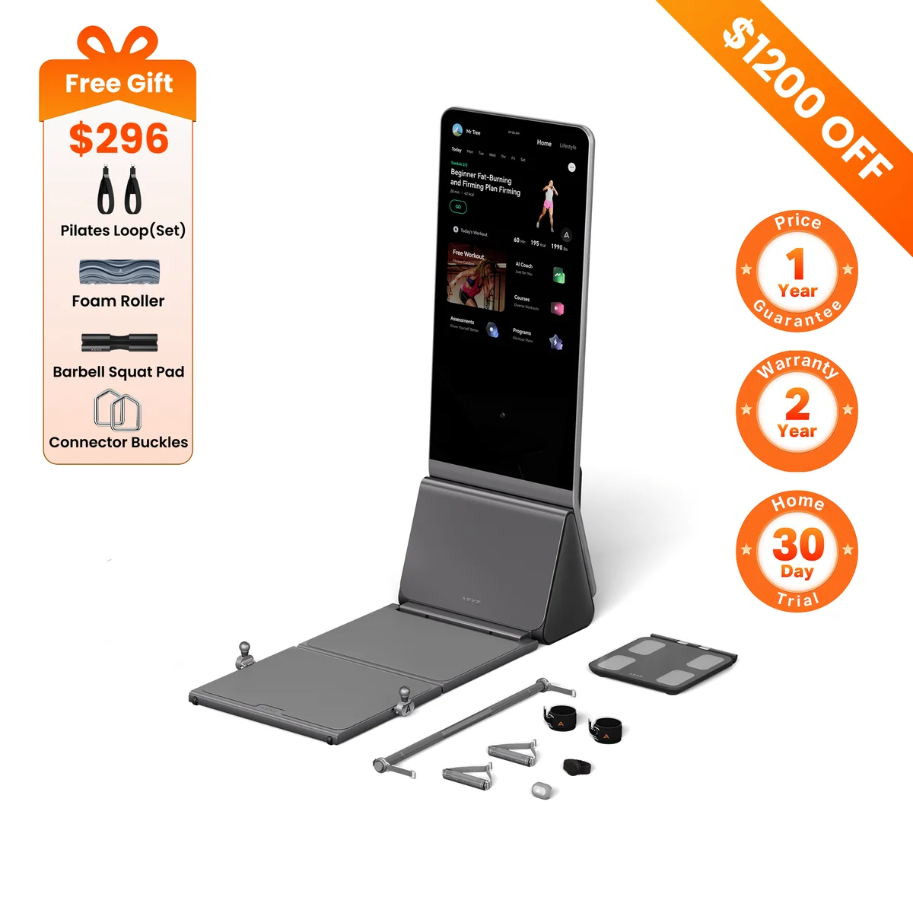
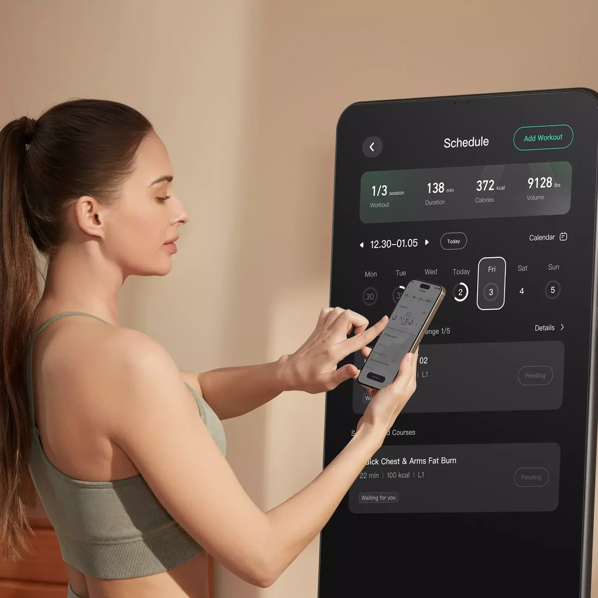
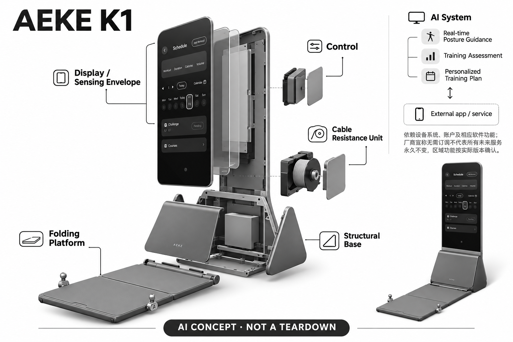

# AEKE K1

**AEKE** · 运动与训练 · 核查 2026-11-04

带视觉动作指导的折叠家用力量屏

消费渠道：个人零售。

## 产品图片与结构参考

### 产品图

AEKE K1官方产品外形图 · 来源：[AEKE · 官方产品图片](<https://aeke.com/products/aeke-home-gym-k1>) · [原始图片](<https://cdn.shopify.com/s/files/1/0650/6558/2756/files/aeke-k1-smart-home-gym_30d3d63b-cbe6-4f61-8a61-e73255721531.webp?v=1793430167&width=1200>)

### 参考图

AEKE K1官方另一角度或使用场景参考 · 来源：[AEKE · 官方产品图片](<https://aeke.com/products/aeke-home-gym-k1>) · [原始图片](<https://cdn.shopify.com/s/files/1/0650/6558/2756/files/AEKE_K1_WOMAN_6.webp?v=1776063756&width=1200>)

### AI 生成爆炸示意

**AI 生成 · 非实物拆机。** 内部为概念推断，不能作为元件布局、BOM 或维修依据。[生成提示词](../../content/hardware/prompts/aeke-k1.txt)

> 外形依据核验参考图；内部位置、模块形状与装配关系仅作AI概念展示。

> 已逐张查看并核对型号。源图未改色/裁切；场景、界面、附件、优惠及效果文案仅为厂商示意，不作为本目录性能或现价依据。

> 分析为基于公开资料的案头研究与 AI 辅助判断，未经用户访谈、销量审计或实物拆机。需求、画像、竞争冷门度、审美及商业机会均为研究假设，不是投资结论。

## 销售与购买

- 状态：在售。已打开AEKE国际站K1商品页，显示具体套餐、US$3,598及ADD TO CART；未将S1 Pro或单独长凳视为本款。

- 地区：国际官网支持配送地区（逐地址确认）

- 价格：所见国际站 US$3,598。套装、长凳和地区价格不同，欧洲页面部分配置库存口径不同；本条以可加入购物车的国际站配置为准。

- 中国大陆：本次核实海外官方渠道，未确认同型号中国大陆官方销售、安装和完整软件服务。支持中文或品牌来自中国均不等同大陆可购买。

- [官方产品 / 商店](<https://aeke.com/products/aeke-home-gym-k1>)

## AI 的实际作用

官方AI系统分析训练状态和动作表现，提供实时姿态指导、身体评估及个性化训练计划。

服务与联网依赖：需要设备系统、账户及相应软件功能；厂商宣称无需订阅不代表所有未来服务永久不变，区域功能按实际版本确认。

## 是否冷门

竞争密集（研究判断）：依据用途与替代品的案头分类；不是销量、市场份额或用户访谈结论。

## 需求与市场

需求假设：用户想在小一些的家庭空间完成有指导的力量训练，并即时了解动作偏差。需要验证的是提示是否准确且不会打断训练，而不是把屏幕尺寸或功能数量当作训练效果。

### 需求假设：在家训练时希望得到即时反馈 · 研究判断

AEKE K1将数字阻力、视觉指导和屏幕课程放在同一训练区域，针对想在家练习却不确定动作是否合适的人。需求需要落到具体动作与反馈时机，而不是泛称需要AI教练；用户是否愿意在训练中看屏幕，以及提示是否真正被采用，都应单独验证。

依据：[AEKE K1国际商店](<https://aeke.com/products/aeke-home-gym-k1>) · [AEKE AI系统](<https://aeke.com/pages/aeke-ai-tech>)

### 价值判断：指导与坚持训练不能混同 · 研究判断

系统能够给出计划和动作提示，不等于用户会按计划训练或取得预期效果，器械便利与行为持续性是不同问题。研究应记录训练启动、完成和放弃的原因，不能把折叠、课程和个性化功能简单相加为更高健康价值，也不推断伤害预防效果。

依据：[AEKE AI系统](<https://aeke.com/pages/aeke-ai-tech>)

### 验证方案：观察原有训练安排如何变化 · 待验证

让已有家庭训练习惯的人在自己的计划中试用K1，记录空间准备、动作反馈、调整阻力和收纳步骤，再与原有器材比较。访谈时回看具体提示是否改变动作，不只问设备是否有科技感，也不以短期体能变化证明算法或器械的效果。

依据：[AEKE K1国际商店](<https://aeke.com/products/aeke-home-gym-k1>) · [AEKE AI系统](<https://aeke.com/pages/aeke-ai-tech>)

## 用户画像

画像推断：愿意在家持续训练、喜欢屏幕带练和数据反馈的人更匹配；需要自由重量竞赛动作或复杂技术指导者需求不同。个性化计划不能自动替代教练对个人动作与状态的评估。

### 画像假设：愿意接受屏幕带练的家庭用户 · 研究判断

较匹配者可能有持续训练意愿、愿意通过屏幕了解动作并能为设备安排固定区域，未必是所有缺少运动的人。喜欢自由重量或无需屏幕的人可能重视不同体验，画像应包含训练习惯、设备管理和空间条件，而非仅按年龄或体型划分。

依据：[AEKE K1国际商店](<https://aeke.com/products/aeke-home-gym-k1>) · [AEKE AI系统](<https://aeke.com/pages/aeke-ai-tech>)

### 使用约束：收纳形态不等于无空间成本 · 研究判断

可折叠结构可能帮助训练后整理，但展开、动作范围和配件存放仍需真实房间支持。购买者还要考虑其他家庭成员如何共用空间与账户，不能从效果图或收起后的外形推断适合任何小户型，也不应只采访决定购买的人。

依据：[AEKE K1国际商店](<https://aeke.com/products/aeke-home-gym-k1>) · [AEKE官方FAQ](<https://aeke.com/pages/faq>)

### 访谈重点：哪一条提示会被信任 · 待验证

请用户回忆过去训练时最不确定的动作，说明会相信设备、视频还是教练的哪种解释，再观察遇到提示冲突时如何选择。对于没有基础的人尤其需要了解理解负担，不能因为系统使用AI就假定用户能正确解读所有评估和指导。

依据：[AEKE AI系统](<https://aeke.com/pages/aeke-ai-tech>) · [AEKE官方FAQ](<https://aeke.com/pages/faq>)

## 竞争与替代

案头判断：与镜面健身屏、数字力量机和传统器材竞争，方向已有多家参与。折叠结构和收费方式可比较，但没有销量、用户访谈或持有成本研究支持它处于低竞争市场。

### 替代方案：传统器材、课程与数字力量机 · 研究判断

K1与其他数字力量设备、健身屏及传统拉索或自由重量方案竞争，线上课程也能满足部分指导需求。比较要明确用户是缺空间、缺计划还是缺反馈，不可只按屏幕和阻力功能数量排序，也不将几项能力集中在一起视为必然更方便。

依据：[AEKE K1国际商店](<https://aeke.com/products/aeke-home-gym-k1>) · [AEKE AI系统](<https://aeke.com/pages/aeke-ai-tech>)

### 差异判断：收费方式需与长期服务一起看 · 研究判断

官方无需订阅的表述可以影响拥有成本预期，但不能直接推断所有未来服务永久不变。与会员型设备比较时，应核对当前可用课程、评估和更新边界，将设备价格与长期维护分别考虑，不能仅以没有月费判断软件服务更可持续。

依据：[AEKE官方FAQ](<https://aeke.com/pages/faq>)

### 比较方法：完成同一训练任务 · 待验证

让用户用K1与现有方案完成相同训练安排，记录准备、看提示、调节、休息和收纳的时间与中断。将动作理解、操作便利和训练偏好分别评价，避免把视觉识别评分当作综合训练效果，也不依据短期使用热情推断长期坚持。

依据：[AEKE K1国际商店](<https://aeke.com/products/aeke-home-gym-k1>) · [AEKE AI系统](<https://aeke.com/pages/aeke-ai-tech>)

## 供应链

官方披露触屏、数字阻力与AI视觉用途，具体相机、电机、主控及整机工厂未公开。推断重要环节包括底座稳定性、活动关节和负载校准，不能根据产品宣传推算供应链成熟度。

### 功能拆分：感知、数字阻力和屏幕协同 · 研究判断

公开功能包含视觉输入、数字阻力与拉索、训练分析、账户计划和显示反馈，这些模块分别承担观察、执行与解释。不能把全部功能归于一颗AI芯片，也不能由外观推断电机、相机或工厂，功能结构仍不同于真实拆机和物料清单。

依据：[AEKE K1国际商店](<https://aeke.com/products/aeke-home-gym-k1>) · [AEKE AI系统](<https://aeke.com/pages/aeke-ai-tech>)

### 制造判断：承载与视觉覆盖需要同时验证 · 研究判断

拉索、底座和活动结构承受训练动作，视觉系统又要求在合适位置观察用户，两者可能对摆放产生共同约束。供应评估应关注稳定性、负载校准与维修，不只看屏幕和算法，本轮没有获得原机公差、寿命测试或制造合同，不能推算可靠性。

依据：[AEKE K1国际商店](<https://aeke.com/products/aeke-home-gym-k1>) · [AEKE AI系统](<https://aeke.com/pages/aeke-ai-tech>)

### 候选选型：显示、视觉和结构分层询证 · 研究判断

BOE可作为训练显示候选，Arducam可讨论视觉输入工程，瑞声可询问部分精密结构协作；拉索承载与数字阻力仍需专门验证。上述企业不是已披露供应商，消费电子经验也不能直接证明适合训练负载，候选必须保留具体不匹配条件。

依据：[AEKE K1国际商店](<https://aeke.com/products/aeke-home-gym-k1>) · [AEKE AI系统](<https://aeke.com/pages/aeke-ai-tech>)

## 技术路径

AI证据是官方实时动作指导与个性化分析系统；这应与普通阻力模式分开。摄像头处理和服务端推理的详细边界未完全披露，厂商评估项目也不能直接视为医学测量或诊断。

### 已披露能力：视觉指导与计划调整 · 官方资料

官方AI系统介绍实时动作指导、评估和个性化训练计划，数字阻力本身则是另一功能层。分析应区分观察、推断与给出建议，不能把系统评估直接看作医学测量，也不能因为界面有实时反馈就推定所有推理都在本机完成。

依据：[AEKE AI系统](<https://aeke.com/pages/aeke-ai-tech>)

### 技术判断：看见姿势与理解个体状态不同 · 研究判断

视觉可以提供动作相关输入，但无法仅凭外观完全了解用户疲劳、疼痛或个人限制，指导仍需用户理解与选择。研究应观察提示是否清楚且可纠正，不把每个偏离识别结果的动作都定义为错误，也不以算法评分代替个人训练判断。

依据：[AEKE AI系统](<https://aeke.com/pages/aeke-ai-tech>)

### 验证方案：记录提示条件和用户回应 · 待验证

在厂商支持的动作与场景中记录站位、遮挡、衣着和提示时机，再观察用户能否理解并正确回应。对于无法解释的评估保留原始过程，必要时让有资质人员复核，不以设备评分作为身体诊断，也不声称本轮已经验证准确率。

依据：[AEKE AI系统](<https://aeke.com/pages/aeke-ai-tech>) · [AEKE官方FAQ](<https://aeke.com/pages/faq>)

## 产品审美

图示观察：纵向屏幕与可折叠地板形成完整训练区域，收起时更接近大型立式家电。实际视觉压力、镜头可见范围和配件摆放取决于房间；效果图并不能证明适合任何小户型。

### 外形判断：训练区与家电形态转换 · 研究判断

纵向屏幕和可折叠底板让K1在训练时成为一个区域，收起后则更接近大型立式设备。设计评价应包含展开、配件摆放和房间通行，而不是只看整洁效果图；即便视觉上纤细，实际操作仍可能要求额外空间与准备。

依据：[AEKE K1国际商店](<https://aeke.com/products/aeke-home-gym-k1>)

### 交互判断：训练中提示应减少认知负担 · 研究判断

用户用力和调整姿势时，不一定适合读取大量信息，提示需要与动作阶段配合。屏幕、声音和阻力变化可能同时影响注意，应观察用户实际使用哪一项，不能把信息丰富称为指导更专业，也不假定所有人都愿意持续看训练分数。

依据：[AEKE AI系统](<https://aeke.com/pages/aeke-ai-tech>)

### 体验验证：在家中完成准备与结束 · 待验证

让用户用真实配件和原有房间安排完成展开、训练、清洁与收纳，记录需要移动家具或寻求他人帮助的步骤。再访问共用空间的家庭成员，了解外观和摆放接受度，比在展示厅体验一组动作更能解释长期使用条件。

依据：[AEKE K1国际商店](<https://aeke.com/products/aeke-home-gym-k1>) · [AEKE官方FAQ](<https://aeke.com/pages/faq>)

## 关键风险

风险包括不同站点库存与套餐差异、姿态误判、配重选择及家庭成员误触。AI指导和保护功能仍需遵守使用说明，不能将宣传中的身体评估理解为医疗检查或伤害预防保证。

### 训练风险：AI提示不保证动作适合个人 · 研究判断

姿态提示和身体评估只能作为辅助信息，用户仍需遵守说明并依据自身状态选择训练，不能据此推断避免伤害或替代专业评估。设备识别正确也未必意味着某项动作适合当前个体，本轮没有医学测试或训练结果数据，不作疗效承诺。

依据：[AEKE AI系统](<https://aeke.com/pages/aeke-ai-tech>) · [AEKE官方FAQ](<https://aeke.com/pages/faq>)

### 购买风险：地区套餐与服务边界不同 · 研究判断

原目录核实的是具体国际商店套餐，其他地区库存、安装与售后不能互相替代，账户和软件权益也需按版本确认。无需订阅的宣传不等于所有未来服务无变化，采购应把运输、空间和维护纳入预算，不能只比较首屏价格。

依据：[AEKE K1国际商店](<https://aeke.com/products/aeke-home-gym-k1>) · [AEKE官方FAQ](<https://aeke.com/pages/faq>)

### 验证安排：保留误判与放弃训练原因 · 待验证

试用中应记录用户忽略提示、无法被识别、调整失败或中途退出的具体情况，区分空间、操作和训练偏好。不要只收集完成课程的正面体验，也不把没有坚持都归因于用户意志，只有理解真实阻碍才能评估设备与指导的作用。

依据：[AEKE AI系统](<https://aeke.com/pages/aeke-ai-tech>) · [AEKE官方FAQ](<https://aeke.com/pages/faq>)

## 机会与验证

市场差异在于把动作理解、阻力训练与家庭收纳集中到一台设备。尚待验证的购买理由是用户是否持续使用指导功能，以及少订阅的价格结构能否在长期软件更新中保持明确。

### 研究方向：让反馈与家庭使用更易理解 · 研究判断

K1可作为研究动作反馈、阻力操作与家庭收纳如何协同的样本，潜在改进未必需要更多评估项目。应观察用户在哪个环节犹豫或误解，再决定改善提示、计划还是配件流程，避免把一站式功能组合当成已经被验证的购买理由。

依据：[AEKE K1国际商店](<https://aeke.com/products/aeke-home-gym-k1>) · [AEKE AI系统](<https://aeke.com/pages/aeke-ai-tech>)

### 执行计划：持续观察实际训练选择 · 待验证

跟踪数周内用户何时启动设备、是否查看指导、何时改用其他器材及为何收起，访谈围绕具体课程和提示展开。把功能使用与训练频率分别记录，不用短期身体变化归因给算法，也不把免费服务预期当作长期付费或留存证据。

依据：[AEKE K1国际商店](<https://aeke.com/products/aeke-home-gym-k1>) · [AEKE官方FAQ](<https://aeke.com/pages/faq>)

### 决策边界：功能集中不等于市场空白 · 研究判断

数字力量与视觉指导已有多种替代，是否存在机会取决于具体用户的操作、空间与服务成本。公开供应能力只能说明可能实现的模块，本轮没有访谈、销量或长期使用数据，不以设备评分、功能数量或冷门程度预测创业成功。

依据：[AEKE K1国际商店](<https://aeke.com/products/aeke-home-gym-k1>) · [AEKE AI系统](<https://aeke.com/pages/aeke-ai-tech>)

## 对应供应链公司

能力候选用于选型研究，不代表本产品实际采用；未公开的供货关系不作推断。

- [boe](../supply-chain/boe.md) — **能力候选 · 非已采用** / 家庭训练课程与反馈显示候选：BOE公开中尺寸及多用途显示业务，可作为K1训练屏的信息输出候选；具体对角尺寸、触控、安装方向和长时间使用条件必须另行确认，不能拿已查平板系列直接替换训练屏，也无公开证据表明BOE向该型号供货。

- [arducam](../supply-chain/arducam.md) — **能力候选 · 非已采用** / 动作观察视觉输入工程候选：Arducam公开多接口相机和定制驱动能力，与K1动作视觉输入层存在对应；但全身视场、站位、遮挡与训练算法配合需要专项验证，普通摄像模组不等于完整姿态指导，也没有该品牌或型号实际采用的点名资料。

- [aac-technologies](../supply-chain/aac-technologies.md) — **能力候选 · 非已采用** / 屏幕及折叠周边精密结构候选：瑞声的精密结构与转轴协同可作为K1显示及折叠周边结构的能力候选，但训练底板和拉索承载不能从消费电子经验直接推定，必须另有负载和耐久验证。当前不表示其供应整机结构，也不涵盖未核实的数字阻力核心机构。

[浏览供应链目录](../supply-chain.md)

## 功能分层示意

这是功能关系，不是实物拆机、真实空间结构或已核实 BOM。

1. **人体感知**：官方AI视觉系统观察动作；功能示意非实物拆机。（官方披露）

2. **训练执行**：数字阻力与拉索附件提供力量训练。（官方披露）

3. **动作分析**：AI系统给出动作指导和训练评估。（官方披露）

4. **个性化计划**：账户档案与历史表现用于计划调整。（官方披露）

5. **屏幕反馈**：屏幕呈现课程和指导，用户决定实际动作。（官方披露）

## 来源

1. [AEKE K1国际商店](<https://aeke.com/products/aeke-home-gym-k1>) — 已打开，具体K1套餐与ADD TO CART可见；地区库存不能互相替代。

2. [AEKE AI系统](<https://aeke.com/pages/aeke-ai-tech>) — 已打开，官方AI训练系统说明。

3. [AEKE官方FAQ](<https://aeke.com/pages/faq>) — 已打开，用于核对设备功能与服务边界。

[返回目录](../hardware-market.md) · [网页分析](https://romanagent.github.io/Roman/#hardware/product/aeke-k1)
