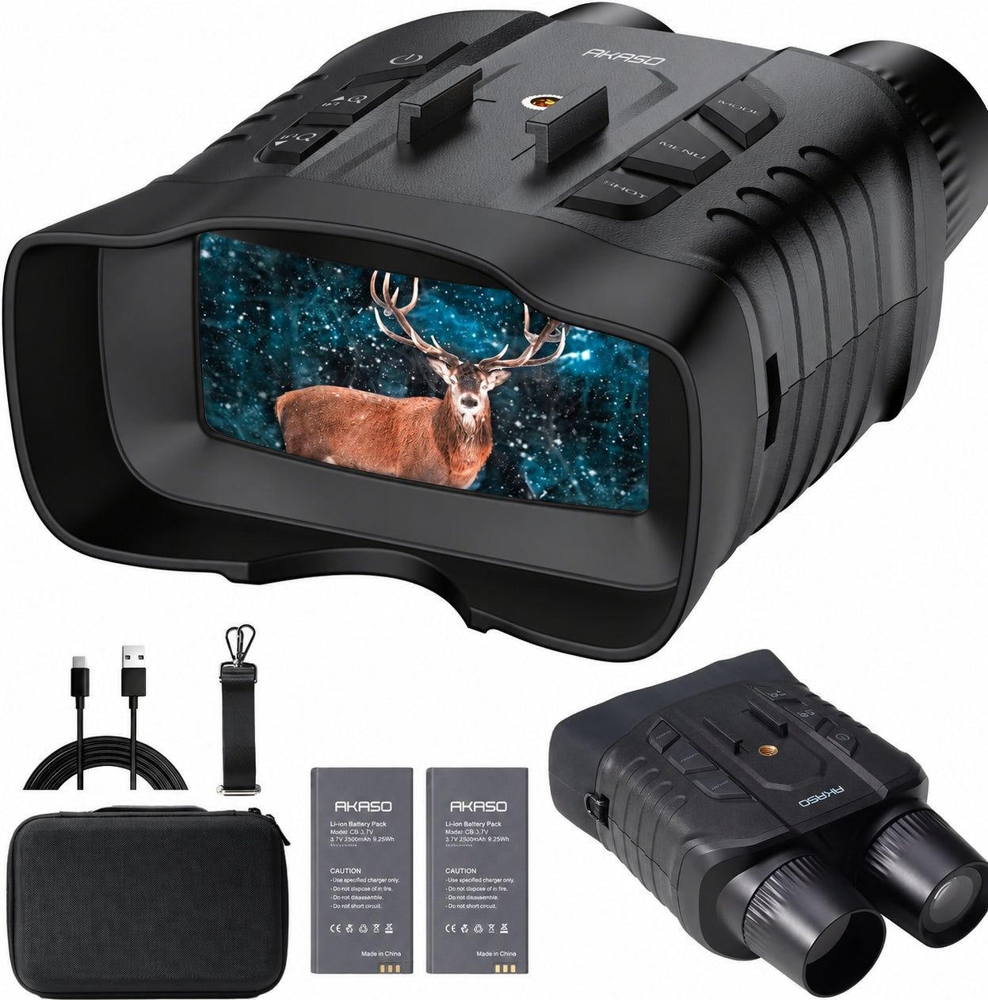
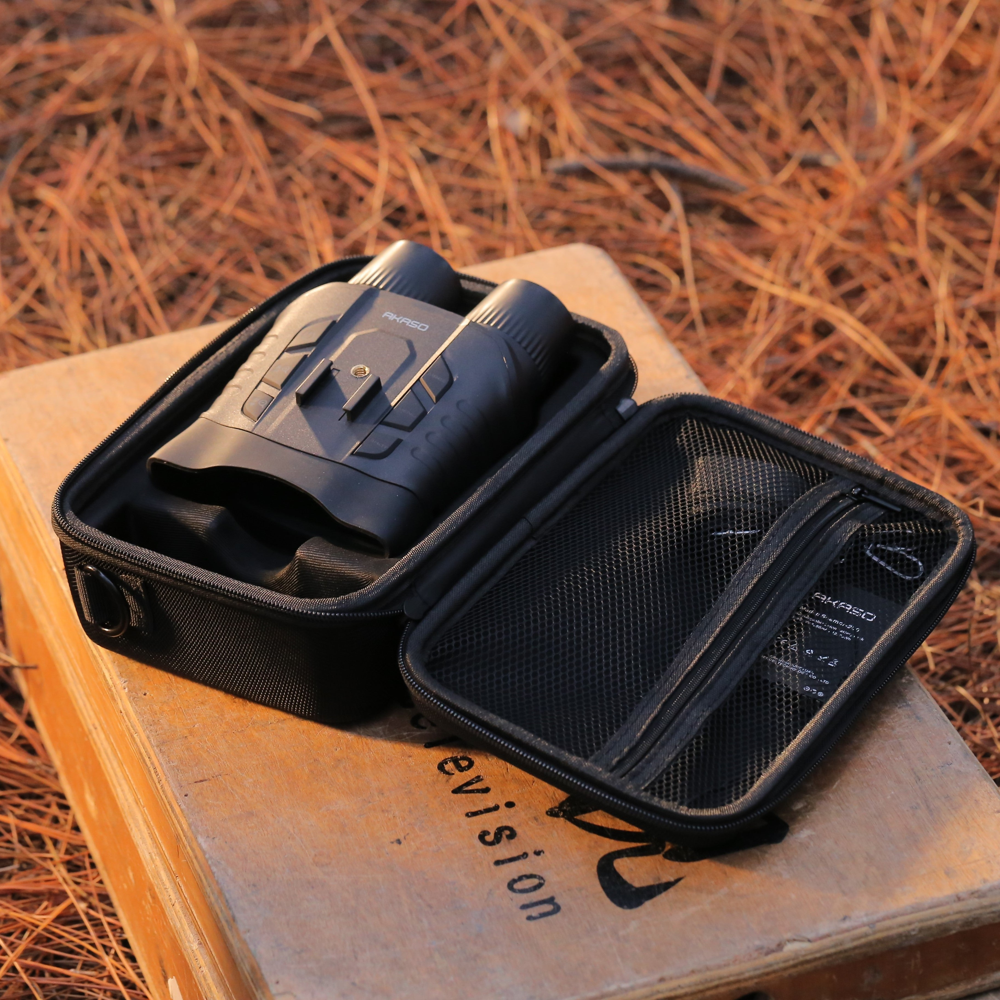
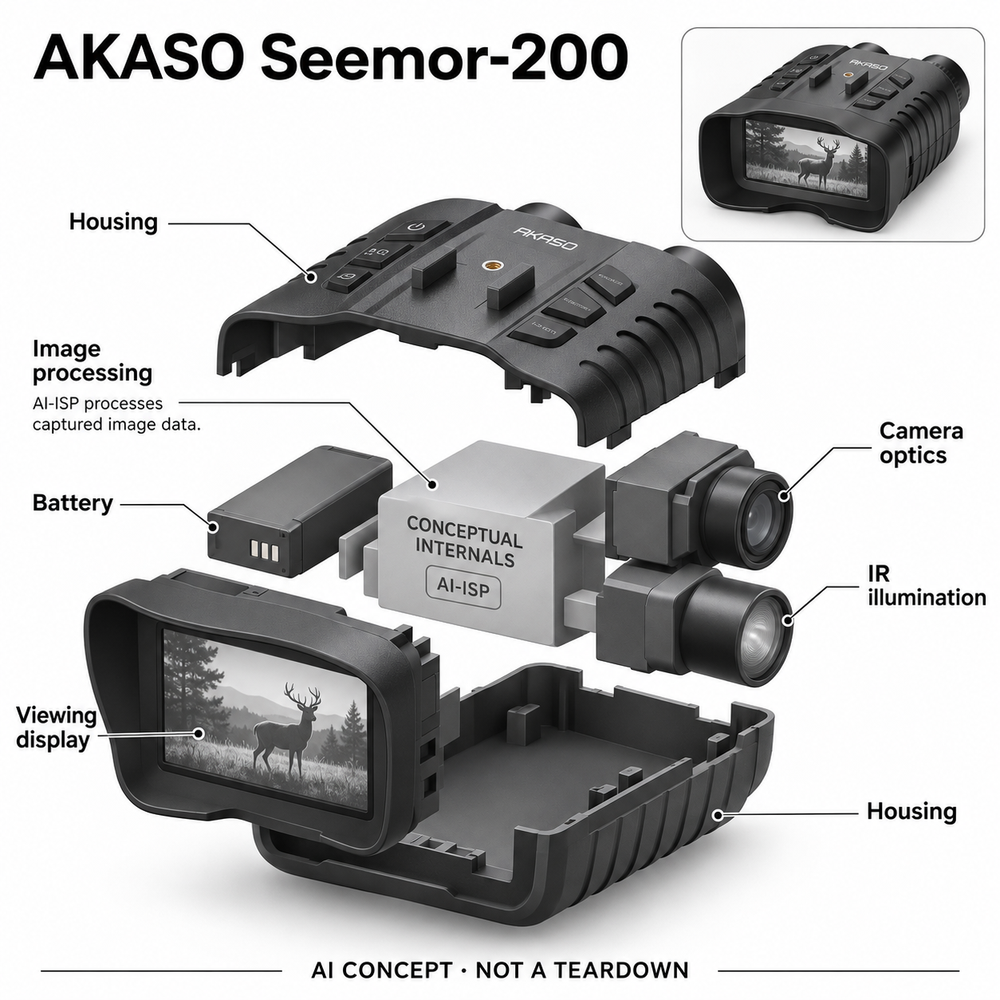

# AKASO Seemor-200

**AKASO** · 影像与创作 · 核查 2026-11-05

用AI图像处理增强低照度观察的手持夜视设备

消费渠道：个人零售。

## 产品图片与结构参考

### 产品图

AKASO Seemor-200 官方产品图 · 来源：[AKASO · 官方资料](<https://shopakaso.com/products/seemor>) · [原始图片](<https://cdn.shopify.com/s/files/1/0632/9037/6374/files/20260623-seemor_s.jpg?v=1782210654>)

### 参考图

AKASO Seemor-200 官方外观与使用参考图 · 来源：[AKASO · 官方资料](<https://shopakaso.com/products/seemor>) · [原始图片](<https://cdn.shopify.com/s/files/1/0632/9037/6374/files/IMG_3594_2.jpg?v=1789114591>)

### AI 生成爆炸示意

**AI 生成 · 非实物拆机。** 内部为概念推断，不能作为元件布局、BOM 或维修依据。[生成提示词](../../content/hardware/prompts/akaso-seemor-200.txt)

> 以已目视核对的官方图片独立生成并完成目视QA；未知内部只作功能概念，不是实际PCB、拆机或供应商BOM。

> 保留官方图片原貌；其中宣传效果或数据不代表本站独立测量。

> 分析为基于公开资料的案头研究与 AI 辅助判断，未经用户访谈、销量审计或实物拆机。需求、画像、竞争冷门度、审美及商业机会均为研究假设，不是投资结论。

## 销售与购买

- 状态：在售。核查日厂家Shop Now链接到官方商店；Standalone变体42983839727798显示US$203.99且公开商品数据available=true，页面有Add to cart和发货说明。不把三脚架或充电套装另计产品。

- 地区：美国（已核官方商店）及商店支持地区

- 价格：官方Standalone变体US$203.99。核查日选定标准组合价格；促销、不同配件组合与税运费另计，不沿用早期发布价。

- 中国大陆：本轮未确认中国大陆该型号官方零售及维修渠道；不得由品牌或制造地区推断国内可购买。

- [官方产品 / 商店](<https://shopakaso.com/products/seemor>)

## AI 的实际作用

官方明确AI-ISP将AI算法作用于相机RAW图像处理，增强低光场景画面；设备另有红外照明与黑白模式，区别于普通光学望远镜。

服务与联网依赖：本机摄像、处理与显示形成观察流程；App用于连接、遥控和素材传输。处理后的颜色并非对现实颜色绝对可靠的测量，也不等于完全黑暗中真实还原。

## 是否冷门

细分专业（研究判断）：低光自然观察是明确兴趣需求，使用时段有限且有便宜替代；AI标签不能证明算法胜过光学和照明差异。

## 需求与市场

案头需求是在露营或自然观察时看清暗处目标，并保留可分享记录。它服务低照度观察而不是普通旅行相机升级；可见性、延迟和携带负担要在相同光照中比较，不能直接采信宣传距离。

### 事实：任务边界 · 官方资料

官方将Seemor-200定位为低照度彩色观察设备，明确介绍AI参与原始图像处理，并另有红外照明和黑白模式。硬件通过后侧屏幕观看，同时支持拍摄记录；厂家官网链接到可购买的标准组合，因此本条讨论的是在售消费观察工具而非实验样机。

依据：[AKASO Seemor官方商店](<https://shopakaso.com/products/seemor>) · [AKASO Seemor-200官方技术页](<https://www.akasotech.com/night-vision-seemor-200>)

### 判断：真实需求 · 研究判断

需求假设是露营、夜间自然观察和户外记录中，用户希望看到肉眼难以辨认的对象，又不必一直举着手机等待夜景曝光。它的价值在观察过程是否更可用，而不是拍出任何时候都真实的颜色；只有偶尔使用的人也可能选择借用或不携带。

依据：[AKASO Seemor官方商店](<https://shopakaso.com/products/seemor>) · [AKASO Seemor-200官方技术页](<https://www.akasotech.com/night-vision-seemor-200>)

### 验证：任务完成 · 待验证

验证应在同一地点按黄昏、月光和更暗条件分组，让参与者完成发现物体、辨认类别和保留记录三个任务。记录观察所需时间、判断置信与误认，而不只展示最好看的画面；再询问实际旅行中愿意为这些少数场景多带多少设备。

依据：[AKASO Seemor官方商店](<https://shopakaso.com/products/seemor>) · [AKASO Seemor-200官方技术页](<https://www.akasotech.com/night-vision-seemor-200>)

## 用户画像

潜在人群是愿意夜间静态观察的户外爱好者和自然记录者。需要步行导航、应急搜救或安全保障的人有不同要求；没有经过对应可靠性验证，不能把消费观察设备当必需安全装备。

### 事实：使用条件 · 官方资料

产品资料展示手持观察、宽屏观看、实体按键及可更换电池，基本工作流不要求另装外接显示器。手机App用于连接和素材处理等辅助操作，和本机观察要区分；本轮只确认官方海外零售，没有验证大陆渠道、售后或具体用户的户外使用能力。

依据：[AKASO Seemor官方商店](<https://shopakaso.com/products/seemor>) · [AKASO Seemor-200官方技术页](<https://www.akasotech.com/night-vision-seemor-200>)

### 判断：人群筛选 · 研究判断

潜在用户包括喜欢自然观察、夜间露营和记录的消费人群，但不同任务对可靠性的要求差异很大。想拍到有趣动物和必须依赖设备判断通行安全不是同一需求；没有对应验证时，不能因为外形专业就把它当成搜救或必需安全装备推荐。

依据：[AKASO Seemor官方商店](<https://shopakaso.com/products/seemor>) · [AKASO Seemor-200官方技术页](<https://www.akasotech.com/night-vision-seemor-200>)

### 验证：参与者差异 · 待验证

访谈可以从最近一次夜间出行问起：当时想看什么、用了什么光源、为何现有工具不够。让不同经验者试持、调焦和切换模式，观察是否理解屏幕画面经过处理；筛选标准应是具体任务与操作习惯，而非笼统把所有户外爱好者列为用户。

依据：[AKASO Seemor官方商店](<https://shopakaso.com/products/seemor>) · [AKASO Seemor-200官方技术页](<https://www.akasotech.com/night-vision-seemor-200>)

## 竞争与替代

替代包括手电、普通望远镜、相机夜景和其它数字夜视设备。AI-ISP可能提升可看性，但光学、红外照明和算法贡献需分开；不能把降噪后的平滑图像等同于额外真实细节。

### 事实：方案范围 · 官方资料

厂家给出的AI-ISP解释是将人工智能算法融入图像信号处理，与普通双目光学望远镜有不同成像路径。前部摄像与红外照明也不能误当成两个传统目镜；相机夜景、手电辅助、其它数字夜视和光学观察分别有自己的输出与使用条件。

依据：[AKASO Seemor官方商店](<https://shopakaso.com/products/seemor>) · [AKASO Seemor-200官方技术页](<https://www.akasotech.com/night-vision-seemor-200>)

### 判断：替代关系 · 研究判断

竞争判断应拆开光学、传感、照明和算法的贡献。更亮的屏幕不一定代表能辨认更多细节，平滑噪声也可能掩盖纹理；手电在某些短距任务中更直接，手机则减少额外负担。只有在限定任务下比较，才有资格讨论AI处理是否带来实际优势。

依据：[AKASO Seemor官方商店](<https://shopakaso.com/products/seemor>) · [AKASO Seemor-200官方技术页](<https://www.akasotech.com/night-vision-seemor-200>)

### 验证：比较方法 · 待验证

测试时使用相同对象和照明，分别记录肉眼、手机、手电及Seemor的发现与辨认结果，保留失败画面。若无法控制光照或距离，就不发布设备排名；还应比较连续观察和短时拍照两种任务，避免用某一种模式的优势推断所有低光场景。

依据：[AKASO Seemor官方商店](<https://shopakaso.com/products/seemor>) · [AKASO Seemor-200官方技术页](<https://www.akasotech.com/night-vision-seemor-200>)

## 供应链

机身含摄像光学、红外照明、处理显示、电池与外壳密封。具体工厂和处理芯片未披露；候选镜头、显示及电池公司只是工程匹配，还需验证温差、眩光和低电量下的表现。

### 事实：功能组成 · 官方资料

可公开确认的功能模块是摄像光学、图像处理、红外照明、显示、连接与更换电池，实际芯片、镜头供应商和工厂没有披露。产品图片只支持外观与配件识别，不足以重建内部堆叠；供应关联因此保持为候选，不假装掌握了实际物料清单。

依据：[AKASO Seemor官方商店](<https://shopakaso.com/products/seemor>) · [AKASO Seemor-200官方技术页](<https://www.akasotech.com/night-vision-seemor-200>)

### 判断：交付约束 · 研究判断

工程判断，夜间观察需要平衡屏幕亮度、镜头杂散光、处理延迟、电池和壳体密封，任何一项不足都会影响体验。加入AI并不能取消低温供电、握持防滑和显示可读性的要求；从样机到稳定出货，应关注成像一致性及售后而不只看算法演示。

依据：[AKASO Seemor官方商店](<https://shopakaso.com/products/seemor>) · [AKASO Seemor-200官方技术页](<https://www.akasotech.com/night-vision-seemor-200>)

### 验证：选型缺口 · 待验证

可向镜头、显示和电池候选公司提出明确场景与温度条件，要求提供测试方法，再决定是否适合进一步集成。成机测试要覆盖低电量、屏幕反光和重复开关，检查附件替换与维修路径；在没有品牌证据前，不将候选能力写成AKASO实际采用。

依据：[AKASO Seemor官方商店](<https://shopakaso.com/products/seemor>) · [AKASO Seemor-200官方技术页](<https://www.akasotech.com/night-vision-seemor-200>)

## 技术路径

AI-ISP在原始图像处理链里改善低照度输出，和后期生成任意画面不同。红外黑白模式提供另一照明路径；算法处理颜色和噪声的代价应通过原始场景对照判断，不把厂家色彩百分比当测量。

### 事实：AI机制 · 官方资料

官方技术页明确AI-ISP在相机原始数据处理中提升低光画面，同时提供彩色与红外模式。已披露机制足以区分其与纯光学产品，但没有公开模型结构或完整测试数据；页面上的色彩比例、远距离和其它效果宣传，本目录不转写为独立实测结论。

依据：[AKASO Seemor官方商店](<https://shopakaso.com/products/seemor>) · [AKASO Seemor-200官方技术页](<https://www.akasotech.com/night-vision-seemor-200>)

### 判断：系统边界 · 研究判断

分析上，低光信号本就不足，增强过程需要在噪声、细节和颜色之间取舍。若算法推断某处颜色或纹理，观看者不能把所有处理后信息当成确定事实；红外照明下的黑白输出又是另一条路径，不能笼统宣称完全黑暗仍能得到真实彩色场景。

依据：[AKASO Seemor官方商店](<https://shopakaso.com/products/seemor>) · [AKASO Seemor-200官方技术页](<https://www.akasotech.com/night-vision-seemor-200>)

### 验证：算法与体验 · 待验证

技术验证可在可控暗室放置已知颜色与细节的物体，逐步降低照度并记录延迟、拖影和误辨。对移动对象另测，不能用静止样片替代；如果设备不能导出原始数据，也应明确比较的是最终观察画面，而非直接宣称传感器或模型本身更强。

依据：[AKASO Seemor官方商店](<https://shopakaso.com/products/seemor>) · [AKASO Seemor-200官方技术页](<https://www.akasotech.com/night-vision-seemor-200>)

## 产品审美

黑色双筒轮廓容易让人联想到传统望远镜，但后部实际是一块宽观察屏。握持纹理和实体按键有利于暗处寻找操作，推断上还要看戴手套、眼镜遮光和长时举持，而非外观参数。

### 事实：外观与交互 · 官方资料

真实官方图显示黑色防滑纹理壳体、顶部实体按钮、前方两处筒状开口和后侧宽观察屏，配有收纳与电池等标准附件。虽然轮廓近似双筒望远镜，观看界面实际不是双目镜；结构图会明确区分摄像光学、红外照明和显示，避免凭外观误读。

依据：[AKASO Seemor官方商店](<https://shopakaso.com/products/seemor>) · [AKASO Seemor-200官方技术页](<https://www.akasotech.com/night-vision-seemor-200>)

### 判断：使用中的形态 · 研究判断

交互分析要关注在暗处能否凭触觉找到按钮、戴手套能否控制，以及眼镜和遮光罩是否互相干涉。屏幕既使多人轮流观看方便，也可能让使用者的眼睛重新适应黑暗；外观上的专业感不能代替这些真实使用成本，更不能自动证明舒适。

依据：[AKASO Seemor官方商店](<https://shopakaso.com/products/seemor>) · [AKASO Seemor-200官方技术页](<https://www.akasotech.com/night-vision-seemor-200>)

### 验证：日常接受度 · 待验证

观察参与者在不看按键的情况下开机、切换模式和更换电池，记录误操作与放下休息的频次。再比较挂在身上、放进包里和支撑观察的选择，询问何时觉得设备多余；不从单张宣传图推断长时握持、材料触感或防护效果已经得到验证。

依据：[AKASO Seemor官方商店](<https://shopakaso.com/products/seemor>) · [AKASO Seemor-200官方技术页](<https://www.akasotech.com/night-vision-seemor-200>)

## 关键风险

主要风险是低光误判、屏幕眩光影响自身暗适应，以及把算法增强当成确定信息。页面与素材存在不同电池标注，本条不写未经统一确认的容量；应用边界限于普通消费观察。

### 事实：已知限制 · 官方资料

官方页面有彩色及红外模式和多项性能宣传，素材中电池标注与网页存在差异，本条因此不写未经统一核实的容量。标准组合与其它配件组合也需要按当前SKU区分；海外现货不代表本轮已核大陆配送、维修或所有App功能可正常使用。

依据：[AKASO Seemor官方商店](<https://shopakaso.com/products/seemor>) · [AKASO Seemor-200官方技术页](<https://www.akasotech.com/night-vision-seemor-200>)

### 判断：失效影响 · 研究判断

风险判断集中在暗处误辨、对增强图像的过度信任、屏幕光影响周围观察，以及电池或天气条件变化造成中断。设备不应因为有AI就被当作安全保障；普通自然观察者可以容忍一次失败，依赖它作关键判断的人却需要更严格证据和备份。

依据：[AKASO Seemor官方商店](<https://shopakaso.com/products/seemor>) · [AKASO Seemor-200官方技术页](<https://www.akasotech.com/night-vision-seemor-200>)

### 验证：风险处理 · 待验证

可模拟低电量、雾气、强光反射和移动目标，记录设备如何提示限制及用户会否误解。测试图像应保留原始场景说明，避免把算法输出用作未经核验的事实证明；同时确认退货、附件替换和维护条款，这是风险验证计划而非已通过的认证。

依据：[AKASO Seemor官方商店](<https://shopakaso.com/products/seemor>) · [AKASO Seemor-200官方技术页](<https://www.akasotech.com/night-vision-seemor-200>)

## 机会与验证

机会假设在自然观察和露营的短时共享体验。可在黄昏、月光和遮挡条件下分别记录发现、辨认和拍摄结果，比较手电与手机方案，并访谈用户是否愿意为少数夜间场景携带额外设备。

### 判断：可尝试切口 · 研究判断

机会假设是让低频但具体的夜间自然活动更容易共享，例如营地轮流观察动物和记录短片。相比再推出一台普通动作相机，这个需求在光照与观看方式上有明确差异；但低频意味着潜在购买量和复购可能受限，不能把冷门直接称为蓝海。

依据：[AKASO Seemor官方商店](<https://shopakaso.com/products/seemor>) · [AKASO Seemor-200官方技术页](<https://www.akasotech.com/night-vision-seemor-200>)

### 判断：商业边界 · 研究判断

商业分析应考虑使用季节、携带率、维修与电池替换，用户是否能用已有手机或灯具完成多数任务也很重要。持续软件订阅未必是适合此场景的收费方式；现有资料不足以判断任何盈利模式，应先明确用户究竟为何愿意多携带一件工具。

依据：[AKASO Seemor官方商店](<https://shopakaso.com/products/seemor>) · [AKASO Seemor-200官方技术页](<https://www.akasotech.com/night-vision-seemor-200>)

### 验证：下一步调研 · 待验证

建议和自然观察社群开展数次实际活动，记录每次设备被拿出与收起的原因、成功辨认及误判案例。结束时询问愿意购买、借用还是完全不用，并与替代工具的表现对照；通过行为与访谈形成下一轮假设，不用模型评分预测市场成功。

依据：[AKASO Seemor官方商店](<https://shopakaso.com/products/seemor>) · [AKASO Seemor-200官方技术页](<https://www.akasotech.com/night-vision-seemor-200>)

## 对应供应链公司

能力候选用于选型研究，不代表本产品实际采用；未公开的供货关系不作推断。

- [e-con-systems](../supply-chain/e-con-systems.md) — **能力候选 · 非已采用** / 低光摄像模组工程候选：e-con Systems公开的相机与嵌入式视觉能力可作为低光采集路线的技术询问对象，需进一步验证光学、接口及功耗条件。Seemor并未披露使用该公司模组，本关联只说明功能匹配方向，不代表现售部件能直接替换。

- [tianma](../supply-chain/tianma.md) — **能力候选 · 非已采用** / 手持观察屏候选：天马有中小尺寸显示与模组工程能力，可用于评估手持观察屏的亮度、温度和光学贴合要求；具体尺寸与参数仍需独立确认。没有证据表明Seemor采用天马面板，本项不意味着供应合同或真实物料清单。

- [sunwoda](../supply-chain/sunwoda.md) — **能力候选 · 非已采用** / 更换式电池与保护设计候选：欣旺达消费电池业务具备电芯及电池系统相关能力，可作为低温手持设备补能和保护方案的评估方向。AKASO的实际供应来源与本轮资料中的容量差异尚未统一，故只列候选，不推断电池厂或可替代型号。

[浏览供应链目录](../supply-chain.md)

## 功能分层示意

这是功能关系，不是实物拆机、真实空间结构或已核实 BOM。

1. **摄像采集**：前端镜头与图像传感器获取低光场景。（官方披露）

2. **红外照明**：独立红外照明配合红外黑白模式，不是第二个目镜。（官方披露）

3. **AI图像处理**：AI-ISP参与原始图像处理以增强低照度画面。（官方披露）

4. **观察与记录**：后侧宽屏、本地记录及App连接支持观看和传输。（官方披露）

5. **电源与机身**：更换式电池、实体按键与手持外壳；内部布置仅作概念。（官方披露）

## 来源

1. [AKASO Seemor官方商店](<https://shopakaso.com/products/seemor>) — 实际打开并读取公开商品数据；标准变体203.99美元可售，型号与配件图片。

2. [AKASO Seemor-200官方技术页](<https://www.akasotech.com/night-vision-seemor-200>) — 实际打开；AI-ISP对RAW图像处理、彩色及红外模式、显示与连接。未将宣传比例或距离写成实测结论。

[返回目录](../hardware-market.md) · [网页分析](https://romanagent.github.io/Roman/#hardware/product/akaso-seemor-200)
