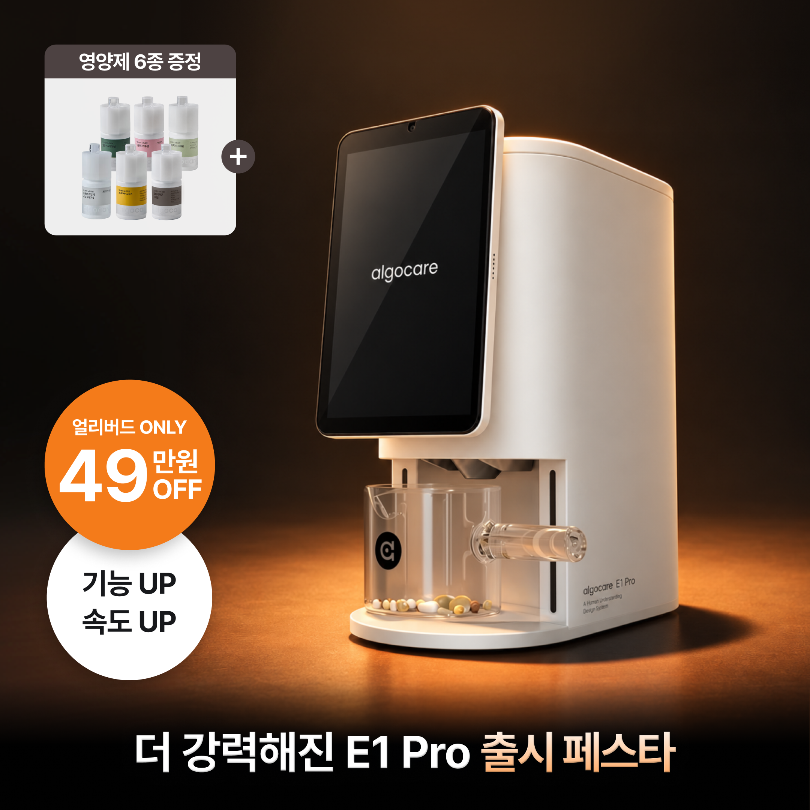
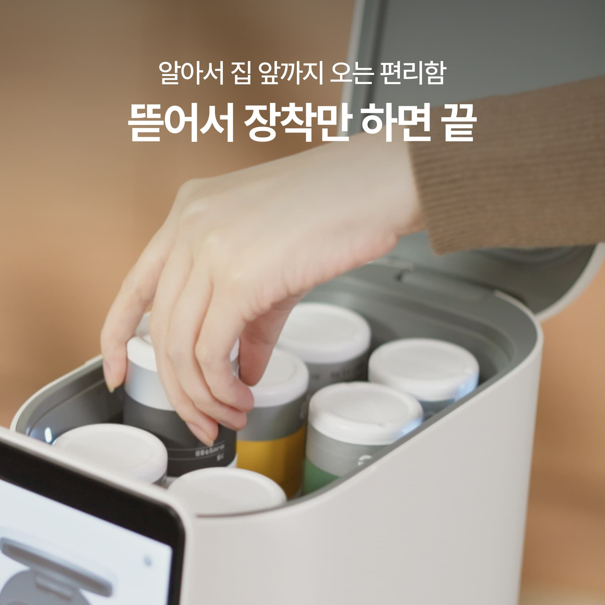
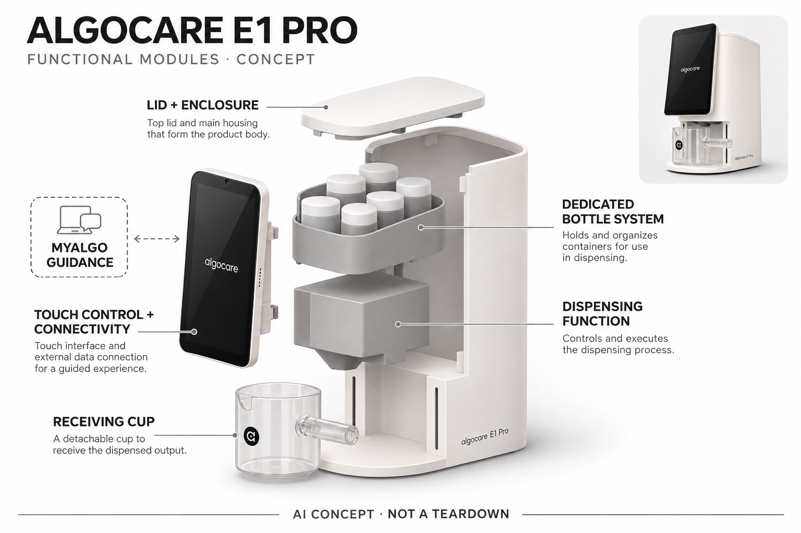

# Algocare E1 Pro

**Algocare** · 居家健康 · 核查 2026-11-05

把家庭成员的营养建议连接到专用颗粒分发与补充管理

消费渠道：个人零售。

## 产品图片与结构参考

### 产品图

官方E1 Pro当前商品展示（含促销文案） · 来源：[Algocare · 官方图片](<https://www.algocare.ai/products/E1Pro-purchase>) · [原始图片](<https://contents.algocare.link/pdp-layout-media/2026/10/30/143bf5e2-7173-4116-88cf-d24ff13bc0f3.png>)

### 参考图

当前Pro商品页的专用营养瓶安装参考 · 来源：[Algocare · 官方图片](<https://www.algocare.ai/products/E1Pro-purchase>) · [原始图片](<https://contents.algocare.link/pdp-layout-media/2026/07/30/d5c0ae50-4142-4c4e-9405-fd088681f788.jpg>)

### AI 生成爆炸示意

**AI 生成 · 非实物拆机。** 内部为概念推断，不能作为元件布局、BOM 或维修依据。[生成提示词](../../content/hardware/prompts/algocare-e1-pro.txt)

> 依据已核验官方外形与公开功能生成；未知内部仅为概念功能块，不代表原机电路板、芯片或实际布局。

> 已核对对应型号与地区版本，原图未改色或语义编辑；促销与效果文案为官方图内容，不构成独立验证。

> 分析为基于公开资料的案头研究与 AI 辅助判断，未经用户访谈、销量审计或实物拆机。需求、画像、竞争冷门度、审美及商业机会均为研究假设，不是投资结论。

## 销售与购买

- 状态：在售。2026-11-05实际浏览生产官网E1 Pro购买页，有立即购买按钮，页面优惠价₩1340000并含六种体验装；另有正式租赁入口。本条采用买断零售，不把标注STAGING的.link站作销售依据。

- 地区：韩国

- 价格：当前韩站页面优惠价 ₩1,340,000。E1 Pro含六种体验装，对比价₩1833750，具体优惠资格以结算为准；持续专用营养耗材另购。租赁有前期优惠与长期合同，月租和赠送积分不混作买断价或现金返还。

- 中国大陆：确认韩国个人家庭购买与本地租赁，未核实中国大陆官方销售、配送、应用开户与补充剂进口条件。不能把可访问韩文网站等同国内能持续取得耗材和服务。

- [官方产品 / 商店](<https://www.algocare.ai/products/E1Pro-purchase>)

## AI 的实际作用

官方MyAlgo通过对话及用户提交资料辅助生成个体营养组合与计划，连接E1系列专用颗粒分发；服务条款明确使用外部大语言模型。不是现场检测人体营养缺乏或自动诊断。

服务与联网依赖：依赖应用账户、网络、用户信息及专用营养瓶；算法建议、实际分发与真实摄入不同，推荐需适用性复核，不能承诺无副作用或代替专业营养医疗意见。

## 是否冷门

细分专业（研究判断）：对话式营养建议连接家庭颗粒分发有独立实体执行环节，区别测量设备及普通提醒盒；专用耗材、适用性与信息质量限制普适性。

## 需求与市场

需求假设：已经有合理补充计划的家庭可能希望减少取瓶、分配和补货步骤，多成员系统能集中整理记录。AI建议是否必要与机械分发是否方便应分别评估，不能从规律出料推断营养改善，也不能假设所有人都需要额外补充剂。

### 产品任务与边界 · 研究判断

需求假设：已经有合理补充计划的家庭可能希望减少取瓶、分配和补货步骤，多成员系统能集中整理记录。AI建议是否必要与机械分发是否方便应分别评估，不能从规律出料推断营养改善，也不能假设所有人都需要额外补充剂。

依据：[Algocare E1 Pro当前官方购买页](<https://www.algocare.ai/products/E1Pro-purchase>) · [Algocare官方家庭系统说明](<https://www.algocare.ai/contents/wellness-system-overview>)

### 需求判断 · 研究判断

判断：家庭营养管理中可能存在重复取瓶、忘记补货和多成员计划难整理的问题，设备能把这些步骤集中起来。但机械方便和推荐合理是两件事，若原本没有明确补充需求，就不能因机器能够分发而推导必须开始新的摄入习惯。

依据：[Algocare E1 Pro当前官方购买页](<https://www.algocare.ai/products/E1Pro-purchase>) · [Algocare官方家庭系统说明](<https://www.algocare.ai/contents/wellness-system-overview>)

### 需求验证 · 待验证

验证：先观察有既定适用计划的家庭如何取用与维护库存，再比较设备介入后的净操作负担。记录选择成员、确认组合和清洁补瓶的时间，分发次数只作为流程数据；本研究不以体感改变、厂商故事或用户评价验证营养效果。

依据：[Algocare E1 Pro当前官方购买页](<https://www.algocare.ai/products/E1Pro-purchase>) · [Algocare官方家庭系统说明](<https://www.algocare.ai/contents/wellness-system-overview>)

## 用户画像

画像推断：愿意核对自身适用情况、维护专用耗材并管理家庭账户的人更匹配。家庭成员健康资料与选择可能不同，共用设备不等于适合同一建议；购买者的方便需求不能代替实际使用者的知情和对持续耗材成本的接受。

### 适用行为与条件 · 研究判断

画像推断：愿意核对自身适用情况、维护专用耗材并管理家庭账户的人更匹配。家庭成员健康资料与选择可能不同，共用设备不等于适合同一建议；购买者的方便需求不能代替实际使用者的知情和对持续耗材成本的接受。

依据：[Algocare E1 Pro当前官方购买页](<https://www.algocare.ai/products/E1Pro-purchase>) · [Algocare官方家庭系统说明](<https://www.algocare.ai/contents/wellness-system-overview>)

### 人群取舍 · 研究判断

判断：家庭共享需要每个人理解自己的资料、计划和记录权限，不能只把设备交给一个管理者后默认所有人同意。还有一些用户只需要简单提醒，未必需要对话服务或专用瓶，因此潜在人群应按实际组织困难和接受条件划分。

依据：[Algocare E1 Pro当前官方购买页](<https://www.algocare.ai/products/E1Pro-purchase>) · [Algocare官方家庭系统说明](<https://www.algocare.ai/contents/wellness-system-overview>)

### 画像验证 · 待验证

验证：让不同成员独立完成资料确认、选择本人和检查输出，观察是否容易误选他人组合。访谈中明确长期耗材、应用账户和专业复核的成本，确认需求来自已有行为问题，而不是被看起来精密的屏幕和健康措辞诱导。

依据：[Algocare E1 Pro当前官方购买页](<https://www.algocare.ai/products/E1Pro-purchase>) · [Algocare官方家庭系统说明](<https://www.algocare.ai/contents/wellness-system-overview>)

## 竞争与替代

竞争判断：与人工分装、普通提醒盒、专业营养咨询和单独应用建议竞争，差异是对话建议连接实体配比与补货。E1与E1 Pro属于同核心任务，不用型号升级和租赁礼包增加品类数，比较应包含长期耗材及建议复核负担。

### 比较对象与差异 · 研究判断

竞争判断：与人工分装、普通提醒盒、专业营养咨询和单独应用建议竞争，差异是对话建议连接实体配比与补货。E1与E1 Pro属于同核心任务，不用型号升级和租赁礼包增加品类数，比较应包含长期耗材及建议复核负担。

依据：[Algocare E1 Pro当前官方购买页](<https://www.algocare.ai/products/E1Pro-purchase>) · [Algocare官方家庭系统说明](<https://www.algocare.ai/contents/wellness-system-overview>)

### 竞争判断 · 研究判断

判断：普通分装盒对固定计划更简单，专业咨询更适合判断是否需要补充，而E1 Pro尝试把建议、取用和补货串联。不能因为增加了对话就视为替代上述方案，旧E1与Pro的性能差异也应留在型号分析中，而不是拆成独立需求。

依据：[Algocare E1 Pro当前官方购买页](<https://www.algocare.ai/products/E1Pro-purchase>) · [Algocare官方家庭系统说明](<https://www.algocare.ai/contents/wellness-system-overview>)

### 竞争验证 · 待验证

验证：以同一个家庭的既定日常流程比较人工分装、提醒工具和设备取用，分别计算准备、确认和补货劳动。对AI部分只评价解释是否可追溯、是否承认信息不足，不以建议更多种类或更频繁摄入作为产品表现更好的指标。

依据：[Algocare E1 Pro当前官方购买页](<https://www.algocare.ai/products/E1Pro-purchase>) · [Algocare官方家庭系统说明](<https://www.algocare.ai/contents/wellness-system-overview>)

## 供应链

供应链分析：专用营养瓶、颗粒出料、触屏、电控连接及服务平台共同工作，整机工厂与BOM未知。耗材的一致性、储存和可获得性与硬件一样关键，不能将外部模型合作视为制造披露，也不能推断适配其他品牌药片。

### 功能模块拆分 · 研究判断

模块拆分：机身和前屏组织家庭选择，专用瓶位保存耗材，分发单元将选定颗粒落入接料杯，连接服务保存资料与记录。未知机构只表示功能，不推定可以现场制造新成分、混配处方药或用摄像头检测人体营养水平。

依据：[Algocare E1 Pro当前官方购买页](<https://www.algocare.ai/products/E1Pro-purchase>) · [Algocare官方家庭系统说明](<https://www.algocare.ai/contents/wellness-system-overview>)

### 制造与供应约束 · 研究判断

供应链分析：专用营养瓶、颗粒出料、触屏、电控连接及服务平台共同工作，整机工厂与BOM未知。耗材的一致性、储存和可获得性与硬件一样关键，不能将外部模型合作视为制造披露，也不能推断适配其他品牌药片。

依据：[Algocare E1 Pro当前官方购买页](<https://www.algocare.ai/products/E1Pro-purchase>) · [Algocare官方家庭系统说明](<https://www.algocare.ai/contents/wellness-system-overview>)

### 候选与证据缺口 · 研究判断

候选判断：捷普可作为分发控制与联网电子系统制造的候选，PCH可评估整机和耗材接口的量产准备。没有公开资料证明二者生产E1 Pro；食品接触、颗粒一致性、储存及清洁要求还需专门验证，不能由普通电子制造资质代替。

依据：[Algocare E1 Pro当前官方购买页](<https://www.algocare.ai/products/E1Pro-purchase>) · [Algocare官方家庭系统说明](<https://www.algocare.ai/contents/wellness-system-overview>)

## 技术路径

技术判断：官方说明MyAlgo根据用户资料和对话形成建议，条款披露外部语言模型参与，设备负责输出及记录。模型并不直接检测人体营养状态，出料日志不能证明吞服；宣传中的安全检查也不能被解释为已排除所有相互作用。

### 已披露技术边界 · 研究判断

技术判断：官方说明MyAlgo根据用户资料和对话形成建议，条款披露外部语言模型参与，设备负责输出及记录。模型并不直接检测人体营养状态，出料日志不能证明吞服；宣传中的安全检查也不能被解释为已排除所有相互作用。

依据：[Algocare E1 Pro当前官方购买页](<https://www.algocare.ai/products/E1Pro-purchase>) · [Algocare官方家庭系统说明](<https://www.algocare.ai/contents/wellness-system-overview>)

### 系统难点判断 · 研究判断

判断：MyAlgo从用户提供的资料和对话出发，条款明确可能使用外部语言模型，输出再接到设备计划。系统无法凭取料日志判断是否吞服，更不能据此确认吸收或健康变化；推荐、出料与摄入之间必须保留人工确认的区别。

依据：[Algocare E1 Pro当前官方购买页](<https://www.algocare.ai/products/E1Pro-purchase>) · [Algocare官方家庭系统说明](<https://www.algocare.ai/contents/wellness-system-overview>)

### 技术验证 · 待验证

验证：用不涉及真实私人病史的模拟资料检查系统如何说明信息不足、相互作用提示和计划变更，再测试成员选错或重复操作的纠正路径。出料可靠性需要合适的工程测试，本次只是案头研究，不能声称已检验配比精度或健康安全。

依据：[Algocare E1 Pro当前官方购买页](<https://www.algocare.ai/products/E1Pro-purchase>) · [Algocare官方家庭系统说明](<https://www.algocare.ai/contents/wellness-system-overview>)

## 产品审美

审美判断：浅色台式机身与竖屏接近厨房家电，配套瓶隐藏后可以减少桌面杂乱，但大屏、接杯与开盖空间仍占位置。设计需要清楚展示当前家庭成员和选择，视觉简洁不能掩盖耗材维护、授权及建议来源。

### 外观与交互语言 · 研究判断

审美判断：浅色台式机身与竖屏接近厨房家电，配套瓶隐藏后可以减少桌面杂乱，但大屏、接杯与开盖空间仍占位置。设计需要清楚展示当前家庭成员和选择，视觉简洁不能掩盖耗材维护、授权及建议来源。

依据：[Algocare E1 Pro当前官方购买页](<https://www.algocare.ai/products/E1Pro-purchase>) · [Algocare官方家庭系统说明](<https://www.algocare.ai/contents/wellness-system-overview>)

### 使用中审美判断 · 研究判断

判断：隐藏多只营养瓶能让桌面更整齐，但顶部换瓶和前方接杯仍需要实际空间，大屏还可能让家电显得像医疗终端。界面应让用户看清成员、当前组合和信息来源，不通过专业化视觉制造算法已经诊断身体的印象。

依据：[Algocare E1 Pro当前官方购买页](<https://www.algocare.ai/products/E1Pro-purchase>) · [Algocare官方家庭系统说明](<https://www.algocare.ai/contents/wellness-system-overview>)

### 设计验证 · 待验证

验证：在常见餐边柜和厨房台面模拟开盖、换瓶、取杯与清洁，观察是否存在视线遮挡或动作冲突。让首次接触者解释屏幕上的建议与实际出料记录分别代表什么，确认其不会误以为机器已经检测本人缺乏的营养成分。

依据：[Algocare E1 Pro当前官方购买页](<https://www.algocare.ai/products/E1Pro-purchase>) · [Algocare官方家庭系统说明](<https://www.algocare.ai/contents/wellness-system-overview>)

## 关键风险

风险判断：资料缺漏、家庭成员选错、颗粒堵塞和重复操作都可能影响分发与判断，AI文字还可能让建议显得过度确定。用户应确认适用性与实际输出，服务不能替代专业判断；跨境耗材、账户与合同条件也会限制持续使用。

### 主要失效与依赖 · 研究判断

风险判断：资料缺漏、家庭成员选错、颗粒堵塞和重复操作都可能影响分发与判断，AI文字还可能让建议显得过度确定。用户应确认适用性与实际输出，服务不能替代专业判断；跨境耗材、账户与合同条件也会限制持续使用。

依据：[Algocare E1 Pro当前官方购买页](<https://www.algocare.ai/products/E1Pro-purchase>) · [Algocare官方家庭系统说明](<https://www.algocare.ai/contents/wellness-system-overview>)

### 风险传播判断 · 研究判断

判断：资料过期、重复补充、专用瓶混放和机械卡料都可能影响实际使用，外部模型也可能把不完整信息组织成听起来确定的建议。自动补货还会带来持续费用，现金优惠、租赁合同和赠送积分必须区别理解，避免低估长期依赖。

依据：[Algocare E1 Pro当前官方购买页](<https://www.algocare.ai/products/E1Pro-purchase>) · [Algocare官方家庭系统说明](<https://www.algocare.ai/contents/wellness-system-overview>)

### 风险验证 · 待验证

验证：核对耗材不足、到期、断网和计划冲突时的提示及人工处理流程，检查自动补货能否理解并控制。特殊健康状况与用药需要合适的专业复核；跨境用户须先确认服务与补充剂渠道，本次未进行购买或输入任何个人健康资料。

依据：[Algocare E1 Pro当前官方购买页](<https://www.algocare.ai/products/E1Pro-purchase>) · [Algocare官方家庭系统说明](<https://www.algocare.ai/contents/wellness-system-overview>)

## 机会与验证

机会假设：可从已有补充习惯中的取用和库存管理验证，优先减少重复、遗漏与记录负担，而不是创造不必要摄入需求。若专用耗材或建议复核增加复杂性，自动化价值会下降，机会应以可持续家庭工作流而非健康承诺成立。

### 可能的机会入口 · 研究判断

机会假设：可从已有补充习惯中的取用和库存管理验证，优先减少重复、遗漏与记录负担，而不是创造不必要摄入需求。若专用耗材或建议复核增加复杂性，自动化价值会下降，机会应以可持续家庭工作流而非健康承诺成立。

依据：[Algocare E1 Pro当前官方购买页](<https://www.algocare.ai/products/E1Pro-purchase>) · [Algocare官方家庭系统说明](<https://www.algocare.ai/contents/wellness-system-overview>)

### 机会成立条件 · 研究判断

判断：成立的机会可能是让已有计划执行更清楚、更少重复操作，并方便家人独立取用。若必须不断向AI解释个人状况、维护昂贵专用耗材才能获得便利，整体价值就可能受限，不能用庞大补充剂市场直接推算设备需求。

依据：[Algocare E1 Pro当前官方购买页](<https://www.algocare.ai/products/E1Pro-purchase>) · [Algocare官方家庭系统说明](<https://www.algocare.ai/contents/wellness-system-overview>)

### 下一步验证 · 待验证

验证：用一个持续使用周期记录库存差错、重复取用、清洁与补瓶负担，并分别询问推荐和机械分发的价值。保持摄入适用性与设备便利性两套评价，不以用户买了更多耗材证明成功，也不从短期积极感受推导长期健康收益。

依据：[Algocare E1 Pro当前官方购买页](<https://www.algocare.ai/products/E1Pro-purchase>) · [Algocare官方家庭系统说明](<https://www.algocare.ai/contents/wellness-system-overview>)

## 对应供应链公司

能力候选用于选型研究，不代表本产品实际采用；未公开的供货关系不作推断。

- [jabil](../supply-chain/jabil.md) — **能力候选 · 非已采用** / 分发控制与联网电子制造：捷普公开电子系统制造和测试能力可用于分发控制、连接模块与整机电子验证的候选评估。没有E1 Pro实际制造关系证据；颗粒接触、清洁和耗材一致性需要独立工艺要求，不能据此认定实际供货或安全效果。

- [pch-international](../supply-chain/pch-international.md) — **能力候选 · 非已采用** / 整机与专用耗材接口工程：PCH公开产品开发到制造供应链的服务可对应设备、配套瓶与接料结构的量产准备需求。没有该型号合作披露，只建立能力候选；营养配方、食材质量和医疗适用性不属于这条一般制造链接所能证明的内容。

[浏览供应链目录](../supply-chain.md)

## 功能分层示意

这是功能关系，不是实物拆机、真实空间结构或已核实 BOM。

1. **外壳与触屏**：浅色竖立机身、黑色竖屏和前方接杯区域。（官方披露）

2. **专用瓶位**：顶部装入品牌配套营养瓶，不推定支持任意散装药品。（官方披露）

3. **分发功能**：按选定组合输出颗粒至杯中，内部机构仅画概念。（官方披露）

4. **控制连接与供电**：用户选择、记录及应用联网。（官方披露）

5. **外部MyAlgo服务**：对话和提交资料形成建议，非机内生物化验。（官方披露）

## 来源

1. [Algocare E1 Pro当前官方购买页](<https://www.algocare.ai/products/E1Pro-purchase>) — 实际浏览器核对E1 Pro、₩1340000优惠价和立即购买，六种体验装；未下单，不把租赁首期或积分当现金售价。

2. [Algocare官方家庭系统说明](<https://www.algocare.ai/contents/wellness-system-overview>) — 实际打开E1设备、应用、专用营养瓶及MyAlgo建议路径；作用为厂商声明，未独立验证效果。

3. [Algocare Home官方服务条款](<https://www.algocare.ai/agreements/terms-of-service>) — 实际阅读个人家庭服务、设备购买租赁与外部LLM条款；不作健康建议或法律结论。

4. [Algocare官方家庭使用流程](<https://www.algocare.ai/contents/algocare-routine>) — 实际打开资料输入、触屏取用、记录及补货路径，出料与真正摄入分开理解，未来奖励不作当前功能。

[返回目录](../hardware-market.md) · [网页分析](https://romanagent.github.io/Roman/#hardware/product/algocare-e1-pro)
