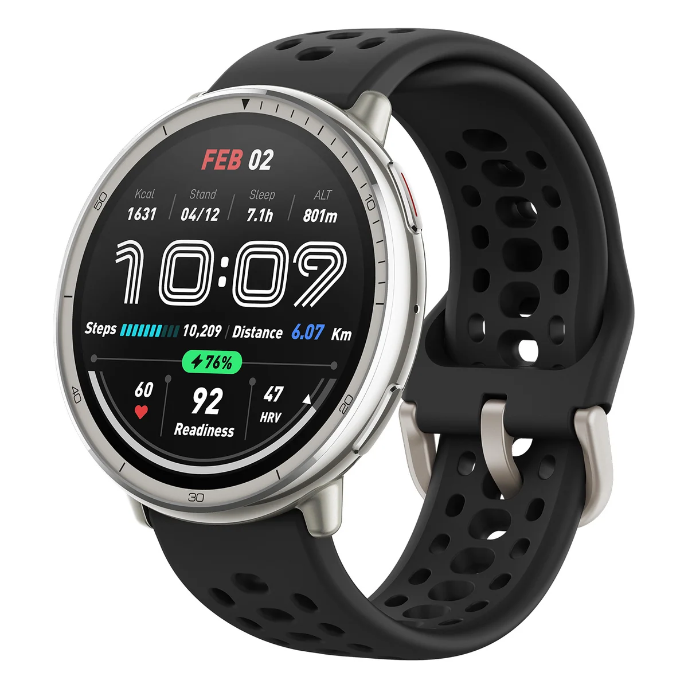
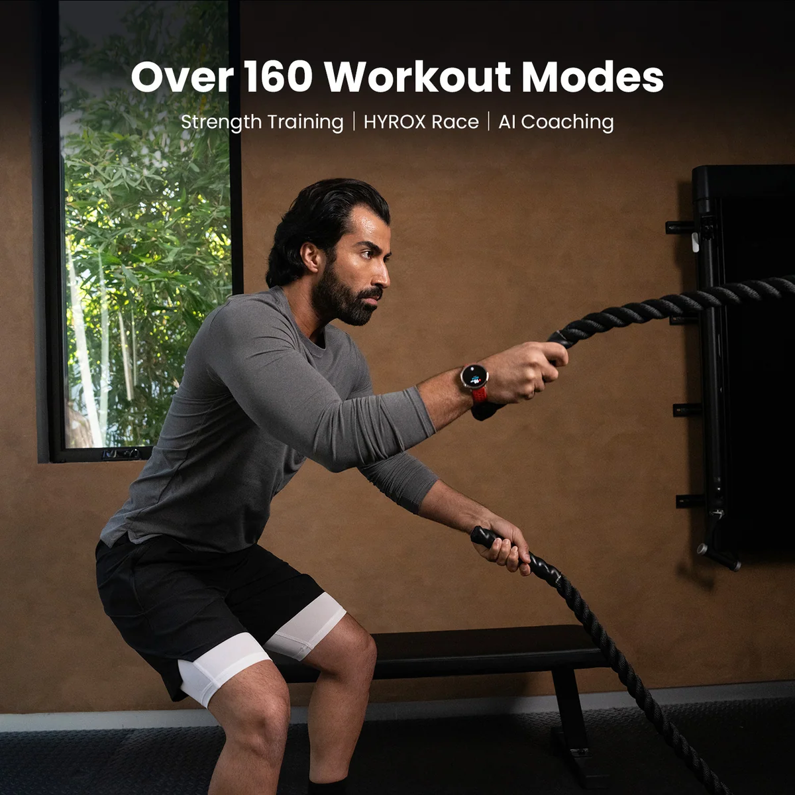
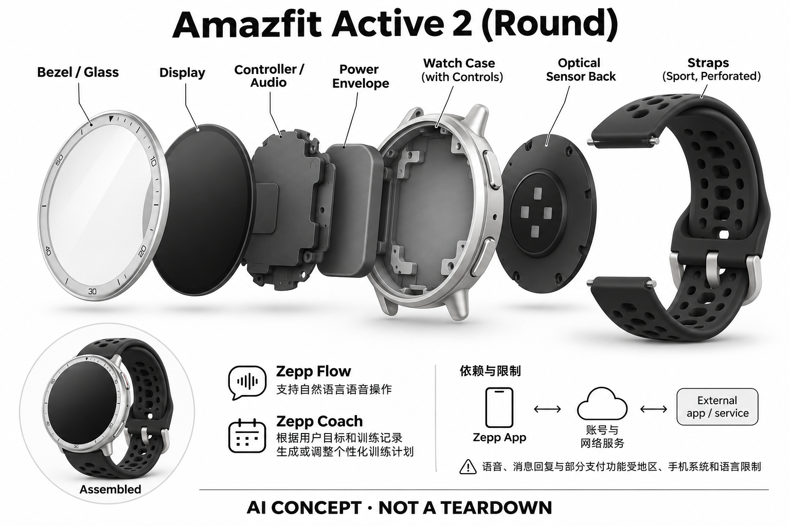

# Amazfit Active 2 (Round)

**Amazfit** · 健康与穿戴 · 核查 2026-11-04

腕上数据与Zepp AI训练规划

消费渠道：个人零售。

## 产品图片与结构参考

### 产品图

Amazfit Active 2 (Round)官方产品外形图 · 来源：[Amazfit · 官方产品图片](<https://us.amazfit.com/products/active-2-round>) · [原始图片](<https://cdn.shopify.com/s/files/1/0406/4500/1379/files/5b0a5ddff4b566c9be47d7d36961a699_c47e96ea-41fd-47b5-a20d-5cb965492df6.jpg?v=1792016798&width=1200>)

### 参考图

Amazfit Active 2 (Round)官方另一角度或使用场景参考 · 来源：[Amazfit · 官方产品图片](<https://us.amazfit.com/products/active-2-round>) · [原始图片](<https://cdn.shopify.com/s/files/1/0406/4500/1379/files/PP-3_24c0be46-fb47-49b8-b2b6-f277661316dc.jpg?v=1770281557&width=1200>)

### AI 生成爆炸示意

**AI 生成 · 非实物拆机。** 内部为概念推断，不能作为元件布局、BOM 或维修依据。[生成提示词](../../content/hardware/prompts/amazfit-active-2-round.txt)

> 外形依据核验参考图；内部位置、模块形状与装配关系仅作AI概念展示。

> 已逐张查看并核对型号。源图未改色/裁切；场景、界面、附件、优惠及效果文案仅为厂商示意，不作为本目录性能或现价依据。

> 分析为基于公开资料的案头研究与 AI 辅助判断，未经用户访谈、销量审计或实物拆机。需求、画像、竞争冷门度、审美及商业机会均为研究假设，不是投资结论。

## 销售与购买

- 状态：在售。已打开当前美国官方商品页，具体配置Add to cart可见；公开商品数据available=true。只计一代产品，颜色、表带与尺寸不重复。

- 地区：所列官方区域或授权零售渠道；配送地址与服务支持需结算确认

- 价格：Black Sport Silicone US$99.99。核查日所见单机或基本配置价；币种、促销、税费、镜片、附件及服务依地区结算，不把颜色或套装重复计数。

- 中国大陆：本次未核实该具体型号在中国大陆的官方销售和完整服务支持；海外在售不等于国内可直接启用全部功能。

- [官方产品 / 商店](<https://us.amazfit.com/products/active-2-round>)

## AI 的实际作用

Zepp Flow支持自然语言语音操作，Zepp Coach根据用户目标和训练记录生成或调整个性化训练计划

服务与联网依赖：需兼容Zepp App、账号和相关网络服务；语音、消息回复与部分支付功能受地区、手机系统和语言限制

## 是否冷门

新兴竞争（研究判断）：按任务与形态作案头分类，无访谈、销量或市场份额证据。

## 需求与市场

需求假设：用较低硬件预算记录日常运动，同时以自然语言完成一些腕上操作。价值应由实际使用频率、任务完成与操作负担验证，不能把AI功能存在或演示流畅当作需求已得到满足。

### 官方｜日常运动与腕上语音 · 官方资料

本型号把圆形触屏、运动与光学输入、声音交互和配套应用结合，公开智能功能包括自然语言操作及根据目标和记录生成训练计划。需求是以较低硬件预算管理日常运动并减少部分触屏步骤，不能把普通计步或传感记录本身都算作生成式人工智能，也不能由助手流畅推断测量准确。

依据：[Amazfit Active 2 (Round)官方商店](<https://us.amazfit.com/products/active-2-round>) · [Zepp官方Active 2功能说明](<https://www.zepp.com/press-release/amazfit-announces-the-active-2-the-ultimate-everyday-smartwatch-for-active-and-healthy-living>)

### 判断｜计划是否帮助持续行动 · 研究判断

用户可能已经能看到运动数据，却不知道如何安排下一次训练，个性化计划有机会减少选择负担。真正价值在于计划是否被理解、执行和合理调整，而不是建议文字看起来专业；如果用户仍不愿运动或频繁忽略提示，更多数据与助手入口未必改变实际习惯。

依据：[Zepp官方Active 2功能说明](<https://www.zepp.com/press-release/amazfit-announces-the-active-2-the-ultimate-everyday-smartwatch-for-active-and-healthy-living>)

### 验证｜语音和训练任务分开 · 待验证

可分别比较语音与触屏完成同一腕上操作，以及有无计划帮助时的训练安排和复盘成本。记录失败、重复和用户主动调整，不把语音识别成功当作训练效果；当前目录没有实机或长期行为研究，不能由官方人工智能功能认定用户会更规律运动或获得特定表现提升。

依据：[Amazfit Active 2 (Round)官方商店](<https://us.amazfit.com/products/active-2-round>) · [Zepp官方Active 2功能说明](<https://www.zepp.com/press-release/amazfit-announces-the-active-2-the-ultimate-everyday-smartwatch-for-active-and-healthy-living>)

## 用户画像

画像推断：规律运动且希望持续复盘，接受App同步并能辨别估算指标与真实身体感受的人。个人的语言、操作习惯、环境和预算会改变适配结果，本次只有案头研究，没有用户访谈或长期使用观察。

### 判断｜预算有限的日常运动者 · 研究判断

希望记录日常活动又不愿投入高价硬件的个人用户，可能更容易关注这个配置，但低价格并不意味着所有功能都适合。应了解用户已有手机、是否戴表和每周运动安排，不能仅按预算定义需求；若只偶尔查看步数，手机或更简单设备也可能足够。

依据：[Amazfit Active 2 (Round)官方商店](<https://us.amazfit.com/products/active-2-round>)

### 判断｜愿意使用应用和理解估算 · 研究判断

训练计划需要目标与记录，用户也要愿意同步、查看并区分算法建议与自己的身体感受。只希望腕上直接给出确定答案的人可能产生过高期待，技术熟练者又可能低估设置负担；画像应包括数据理解、手机与语言条件，而不只列跑步或健身职业标签。

依据：[Zepp官方Active 2功能说明](<https://www.zepp.com/press-release/amazfit-announces-the-active-2-the-ultimate-everyday-smartwatch-for-active-and-healthy-living>)

### 验证｜首次用户与既有运动者 · 待验证

测试应分开观察首次戴智能表的人和已有记录习惯的人，比较设置、佩戴和计划调整过程。还要检查不同手机与语言下的语音及消息功能，不能把一种组合结果推广到所有人；用户是否长期愿意戴着并维护数据，往往比一次功能演示更能解释适配。

依据：[Amazfit Active 2 (Round)官方商店](<https://us.amazfit.com/products/active-2-round>)

## 竞争与替代

案头判断：与成熟运动手表、健身App和普通手环竞争，AI语音与计划不让一般计步自动变成独有技术。这只是用途与替代品比较，不是市场份额或销量结论；专业细分和较少曝光也不代表没有成熟竞争者。

### 判断｜同类日常运动表竞争 · 研究判断

日常运动表、手机应用和基础手环都可能提供部分记录与计划，本型号需要解释语音和训练整理带来的具体收益。较低硬件价只是选择因素，不能单独证明需求或性价比；竞争分析应比较用户真正用到的任务，而不是运动模式总数、表盘数量或人工智能标签。

依据：[Amazfit Active 2 (Round)官方商店](<https://us.amazfit.com/products/active-2-round>)

### 判断｜同生态不同型号的边界 · 研究判断

与同品牌更偏户外或更高配置型号相比，核心训练与语音任务可能重叠，差异需要落到佩戴、操作和具体环境。不能因为框型或价格不同就增加独立需求场景，也不能将其他型号的语言、材料和功能套入本款；选择应按实际任务约束，而非系列等级直接排序。

依据：[Zepp官方Active 2功能说明](<https://www.zepp.com/press-release/amazfit-announces-the-active-2-the-ultimate-everyday-smartwatch-for-active-and-healthy-living>)

### 验证｜同配置与长期成本 · 待验证

比较应使用已核查的圆形和具体表带配置，不把其他形态、颜色或套装重复计算。海外价格与服务范围不能直接代表国行，软件权益和手机条件也需核对；当前没有销量、留存或用户访谈，目录不由低入门价格和功能组合推断市场规模或用户会持续使用。

依据：[Amazfit Active 2 (Round)官方商店](<https://us.amazfit.com/products/active-2-round>)

## 供应链

公开资料可核对圆形触屏、光学健康传感器、惯性传感器、麦克风与扬声器，具体整机工厂、关键模块供应商与BOM本次未确认。制造重点可从形态推断，但不能把品牌所在地、外观相似或营销合作等同代工关系。

### 官方｜传感、交互与软件模块 · 官方资料

公开资料支持圆形显示、光学与惯性输入、麦克风及扬声器，应用承担数据与计划协同。具体主控、传感器厂商、工厂和物料成本未完整披露，不能从品牌传感名称反推芯片来源；目录仅表达功能层关系，不把概念示意或常见手表方案写成真实拆机结论。

依据：[Amazfit Active 2 (Round)官方商店](<https://us.amazfit.com/products/active-2-round>) · [Zepp官方Active 2功能说明](<https://www.zepp.com/press-release/amazfit-announces-the-active-2-the-ultimate-everyday-smartwatch-for-active-and-healthy-living>)

### 判断｜贴肤结构与电池协同 · 研究判断

光学输入需要稳定佩戴，表带松紧、壳体窗口和运动会影响数据，显示与声音交互又增加电源负载。供应链研究应把结构、传感和软件一起验证，不能仅以低价推定器件质量或工厂水平；当前没有装配公差、良率和维修数据，由形态提出的问题应保持为待验证。

依据：[Amazfit Active 2 (Round)官方商店](<https://us.amazfit.com/products/active-2-round>)

### 判断｜光学与惯性候选 · 研究判断

汇顶可作为光学健康输入路线候选，博世传感器可作为运动输入与处理候选，二者均未被本型号点名采用。需要验证贴肤光路、安装方向、接口和功耗，不能直接替换；这些器件能力也不提供 Zepp 的训练模型与服务，测量输入和生成建议应分别核实。

依据：[Amazfit Active 2 (Round)官方商店](<https://us.amazfit.com/products/active-2-round>) · [Zepp官方Active 2功能说明](<https://www.zepp.com/press-release/amazfit-announces-the-active-2-the-ultimate-everyday-smartwatch-for-active-and-healthy-living>)

## 技术路径

Zepp Flow支持自然语言语音操作，Zepp Coach根据用户目标和训练记录生成或调整个性化训练计划。这是厂商披露的功能机制；模型版本、准确率及内部结构未完整公开。架构只表示输入、处理和输出关系，不作为真实拆机或性能实测。

### 官方｜语音操作与计划生成 · 官方资料

Zepp Flow 提供自然语言操作，Zepp Coach 根据目标与训练记录形成个性化安排，应用与相关网络服务参与使用。具体算法和端云部署未完整公开，地区、语言和手机也影响部分功能；目录不把腕上显示的建议视为所有计算都在手表，也不把普通传感输出自动称作人工智能判断。

依据：[Zepp官方Active 2功能说明](<https://www.zepp.com/press-release/amazfit-announces-the-active-2-the-ultimate-everyday-smartwatch-for-active-and-healthy-living>)

### 判断｜输入误差会影响建议 · 研究判断

若佩戴松动、活动漏记或用户目标填写不合适，下游计划可能建立在不完整信息上。系统应让用户看到数据缺失与调整依据，而不是只给出流畅建议；技术评价需要区分传感、活动估算和计划生成，不能因为一层表现好，就推断其他层同样可靠或适合个人。

依据：[Zepp官方Active 2功能说明](<https://www.zepp.com/press-release/amazfit-announces-the-active-2-the-ultimate-everyday-smartwatch-for-active-and-healthy-living>)

### 验证｜数据与操作分别验收 · 待验证

可在用户典型活动中记录佩戴与缺失情况，再检查计划如何响应，同时单独测试语音完成具体操作的成功和重试。不同网络与手机条件应分开记录，避免把服务不可用误认为传感问题；当前没有独立测量或训练效果验证，不以官方演示和估算分数作结果保证。

依据：[Amazfit Active 2 (Round)官方商店](<https://us.amazfit.com/products/active-2-round>) · [Zepp官方Active 2功能说明](<https://www.zepp.com/press-release/amazfit-announces-the-active-2-the-ultimate-everyday-smartwatch-for-active-and-healthy-living>)

## 产品审美

图示观察：圆形金属外观配运动表带，在普通腕表和运动追踪之间取舍。宣传图片只能帮助理解外观和摆放方式，不能证明每个人的舒适度、长时使用体验或实际材料触感。

### 判断｜圆形日常表的接受度 · 研究判断

圆形外观可能容易融入日常穿搭，用户也可能希望它同时承担时间、消息和运动工具。审美评价应观察真实工作与活动中的佩戴，而不是只看表盘效果；具体脸面尺寸之外的腕围、表带和接触感需要实物，官方图片不能证明所有用户全天佩戴都舒适。

依据：[Amazfit Active 2 (Round)官方商店](<https://us.amazfit.com/products/active-2-round>)

### 判断｜声音交互的场合限制 · 研究判断

语音可能在双手不便时有用，在安静共享空间却可能打扰或暴露内容，用户不会在所有时刻愿意开口。设计研究应观察语音与触屏如何切换，以及失败后是否容易回退；助手存在不等于用户会频繁使用，界面简洁也不能替代实际操作与社交接受验证。

依据：[Zepp官方Active 2功能说明](<https://www.zepp.com/press-release/amazfit-announces-the-active-2-the-ultimate-everyday-smartwatch-for-active-and-healthy-living>)

### 验证｜日常到运动的连续佩戴 · 待验证

试用应覆盖办公、走动、运动与充电，记录压力、滑动、屏幕可读和语音使用场合。不同表带松紧需要观察数据与舒适的共同变化，不能只为了测量让用户接受不自然佩戴；长期便利应由完整工作日验证，不能由一张宣传图或短时试戴推断。

依据：[Amazfit Active 2 (Round)官方商店](<https://us.amazfit.com/products/active-2-round>)

## 关键风险

运动、睡眠和恢复分数属于辅助估算，不可依据AI计划忽略不适；地理导航、天气和软件支持期限应单独核对。还需核对地区功能、软件更新与售后边界；本目录未进行实机、医学或可靠性测试，不把厂商演示当作结果保证。

### 判断｜估算与健康结论的边界 · 研究判断

运动、睡眠或恢复相关分数属于消费级辅助信息，生成计划也不能替代用户对不适和实际状态的判断。产品研究应观察建议如何表达不确定性，避免把个性化措辞当作专业诊疗或表现保证；当前目录没有医学或独立运动效果测试，不扩大厂商功能说明的范围。

依据：[Zepp官方Active 2功能说明](<https://www.zepp.com/press-release/amazfit-announces-the-active-2-the-ultimate-everyday-smartwatch-for-active-and-healthy-living>)

### 判断｜地区与手机功能差异 · 研究判断

语音、消息和其他服务可能受地区、语言和手机系统限制，海外商品页不能直接代表大陆版本。用户需要核对自己真正需要的功能，而不是只看国际宣传清单；长期更新、账户和导出也影响拥有体验，硬件仍能显示时间不代表所有智能服务始终以同样方式提供。

依据：[Amazfit Active 2 (Round)官方商店](<https://us.amazfit.com/products/active-2-round>) · [Zepp官方Active 2功能说明](<https://www.zepp.com/press-release/amazfit-announces-the-active-2-the-ultimate-everyday-smartwatch-for-active-and-healthy-living>)

### 验证｜错误与缺失应可见 · 待验证

应检查活动漏记、同步失败或语音误操作时系统如何提示，并观察用户能否更正数据与计划。重要训练安排不应只依据单个生成结果机械执行，实际感受和任务条件需要保留；验证目标是帮助理解与选择，而不是把手表分数当作无误的个人状态描述。

依据：[Zepp官方Active 2功能说明](<https://www.zepp.com/press-release/amazfit-announces-the-active-2-the-ultimate-everyday-smartwatch-for-active-and-healthy-living>)

## 机会与验证

市场差异主要在于腕上数据与Zepp AI训练规划。值得进一步验证的购买理由是它能否减少既有任务中的具体步骤，以及硬件、服务与维护的总成本是否符合个人使用频率。

### 判断｜低预算是否覆盖核心任务 · 研究判断

本型号的购买理由应来自在可接受成本下完成稳定记录、查看与部分语音操作，而不是追求全部功能。若用户只需基础运动数据，复杂计划可能很少使用；若确实需要持续安排，则要验证软件是否减轻选择负担，不能用低价与人工智能名称直接推断需求成立。

依据：[Amazfit Active 2 (Round)官方商店](<https://us.amazfit.com/products/active-2-round>)

### 判断｜同任务下的实际差异 · 研究判断

与同品牌其他运动表共享的训练和语音能力，应在场景分组中复用核心需求，差异放在具体佩戴、配置和环境限制。研究应记录用户长期启用哪些功能、哪些被关闭，避免按硬件外观和代际增加场景数量；更重要的是它能否减少真实操作和复盘负担。

依据：[Zepp官方Active 2功能说明](<https://www.zepp.com/press-release/amazfit-announces-the-active-2-the-ultimate-everyday-smartwatch-for-active-and-healthy-living>)

### 验证｜长期习惯与使用成本 · 待验证

后续可跟踪佩戴、计划查看、实际调整、语音失败和同步维护，结合硬件与服务条件判断拥有成本。还需比较手机和更简单设备何时已经足够，理解替代边界；当前目录是案头研究，不以在售、低价或个性化计划宣传认定需求和训练收益已经得到验证。

依据：[Amazfit Active 2 (Round)官方商店](<https://us.amazfit.com/products/active-2-round>) · [Zepp官方Active 2功能说明](<https://www.zepp.com/press-release/amazfit-announces-the-active-2-the-ultimate-everyday-smartwatch-for-active-and-healthy-living>)

## 对应供应链公司

能力候选用于选型研究，不代表本产品实际采用；未公开的供货关系不作推断。

- [goodix](../supply-chain/goodix.md) — **能力候选 · 非已采用** / 腕部光学健康数据采集候选：Active 2 披露光学健康输入，汇顶的光学模块与前端可作为新设计候选。需验证腕部光路、佩戴松紧、运动伪差、接口和功耗，当前没有点名采用；器件能力不能直接证明 Zepp 指标准确或训练建议有效，也不代表本型号的真实传感器来源。

- [bosch-sensortec](../supply-chain/bosch-sensortec.md) — **能力候选 · 非已采用** / 日常运动与姿态输入候选：本型号包含惯性和运动输入，博世传感系统可用于比较安装、采样和主控卸载路线，但没有供货点名。需要在真实腕围、动作和佩戴条件下验证，不能把预置算法当作 Zepp 的实际实现；运动输入也不等同生成式训练计划或医学效果。

[浏览供应链目录](../supply-chain.md)

## 功能分层示意

这是功能关系，不是实物拆机、真实空间结构或已核实 BOM。

1. **实体输入**：圆形触屏、光学健康传感器、惯性传感器、麦克风与扬声器；仅功能层示意，非拆机。（官方披露）

2. **采集与控制**：设备把输入转为可处理的信息并接收用户操作；具体内部布局未知。（分析推断）

3. **AI功能**：Zepp Flow支持自然语言语音操作，Zepp Coach根据用户目标和训练记录生成或调整个性化训练计划（官方披露）

4. **服务依赖**：需兼容Zepp App、账号和相关网络服务；语音、消息回复与部分支付功能受地区、手机系统和语言限制（官方披露）

5. **用户反馈**：用户通过声音、屏幕或配套应用接收结果，并对重要信息复核。（分析推断）

## 来源

1. [Amazfit Active 2 (Round)官方商店](<https://us.amazfit.com/products/active-2-round>) — 已打开商品页并读取公开商品JSON，核实可售具体规格。

2. [Zepp官方Active 2功能说明](<https://www.zepp.com/press-release/amazfit-announces-the-active-2-the-ultimate-everyday-smartwatch-for-active-and-healthy-living>) — 已打开一手页面；产品能力为厂商披露，未进行实机或效果验证。

[返回目录](../hardware-market.md) · [网页分析](https://romanagent.github.io/Roman/#hardware/product/amazfit-active-2-round)
