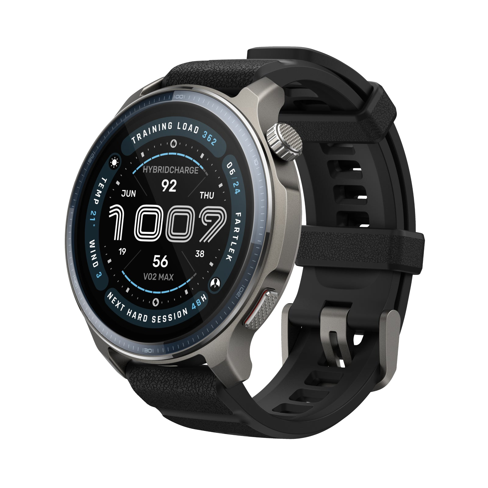
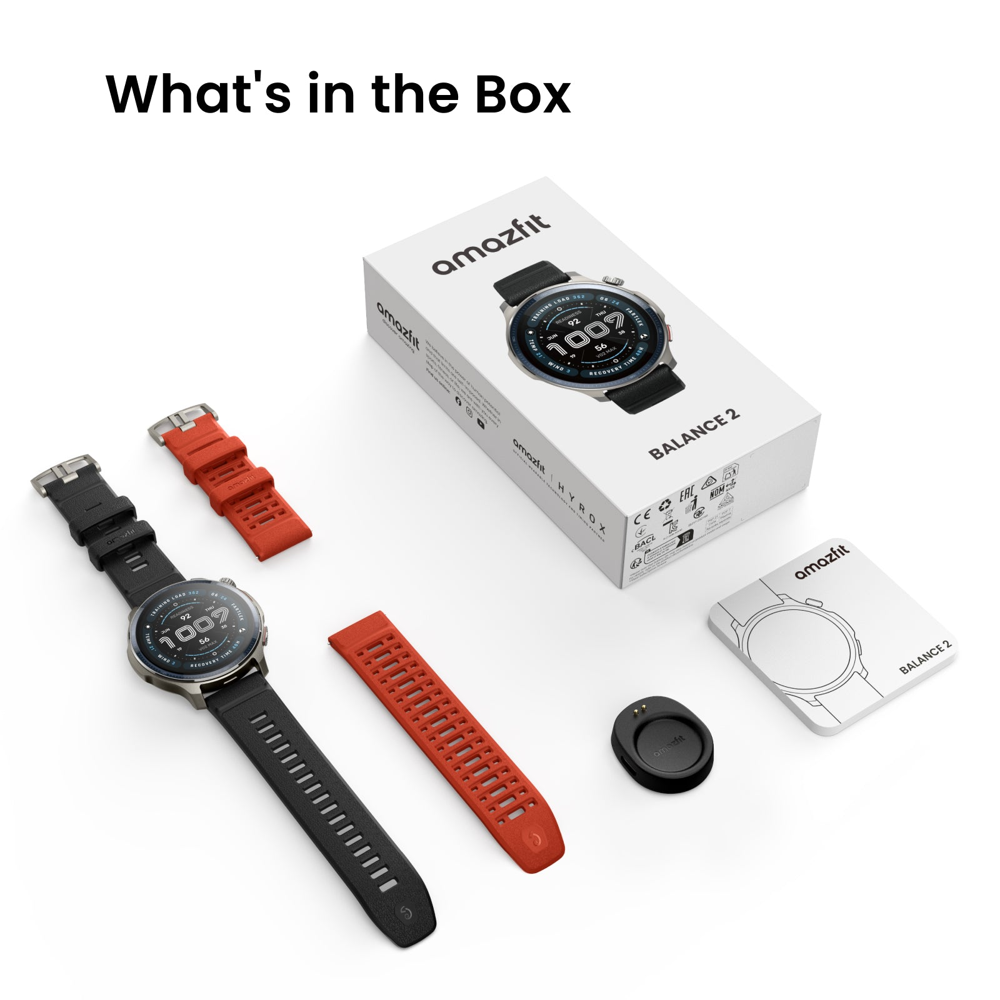
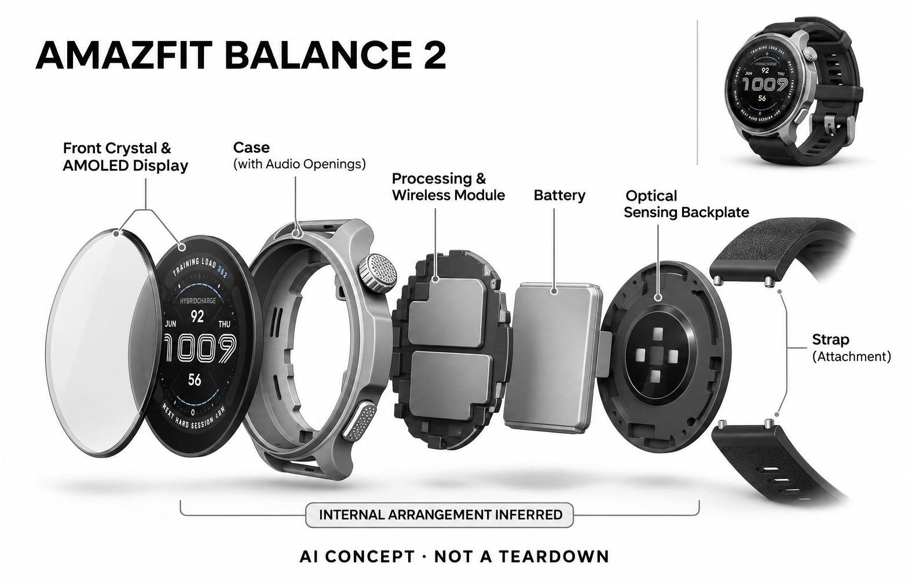

# Amazfit Balance 2

**Amazfit / Zepp Health** · 健康与穿戴 · 核查 2026-11-04

多运动记录与语音控制、AI训练计划结合

消费渠道：个人零售。

## 产品图片与结构参考

### 产品图

Amazfit Balance 2 官方产品图 · 来源：[Amazfit / Zepp Health · 官方图片](<https://us.amazfit.com/products/balance-2>) · [原始图片](<https://cdn.shopify.com/s/files/1/0406/4500/1379/files/Main_Image_3.jpg?v=1784187735>)

### 参考图

Amazfit Balance 2 官方包装与配件参考 · 来源：[Amazfit / Zepp Health · 官方图片](<https://us.amazfit.com/products/balance-2>) · [原始图片](<https://cdn.shopify.com/s/files/1/0406/4500/1379/files/Main_Image__2.jpg?v=1789373522>)

### AI 生成爆炸示意

**AI 生成 · 非实物拆机。** 内部为概念推断，不能作为元件布局、BOM 或维修依据。[生成提示词](../../content/hardware/prompts/amazfit-balance-2.txt)

> 已目视核对产品外形与AI标识；verified不代表内部布局经实物拆机验证。

> 分析为基于公开资料的案头研究与 AI 辅助判断，未经用户访谈、销量审计或实物拆机。需求、画像、竞争冷门度、审美及商业机会均为研究假设，不是投资结论。

## 销售与购买

- 状态：在售。美国官方商品页显示US$299.99及Add to cart，并在同页区分Balance 2、Balance 3与Balance Ultra；本条只记录Balance 2。

- 地区：美国官网、日本官网

- 价格：美国官网 US$299.99。官网当前Balance 2版本标价；同页另有新代际及高级款，不应混入其价格和参数。

- 中国大陆：本次仅完整核实美国官方商店；大陆版本与Zepp Flow语言、地区能力尚未对齐，不把海外AI语音功能直接套用国行。

- [官方产品 / 商店](<https://us.amazfit.com/products/balance-2>)

## AI 的实际作用

生理和运动感知支持Zepp Coach个性化AI训练计划；Zepp Flow提供自然语音控制以及消息回复建议和翻译。

服务与联网依赖：需要Zepp App；Zepp Flow仅在选定地区和语言可用，官网列出的语言不包含中文，部分回复功能要求Android连接。

## 是否冷门

竞争密集（研究判断）：运动手表和AI训练服务已有多家品牌，平台与语言限制影响细分定位。

## 需求与市场

需求假设：运动用户希望在训练、恢复和日常使用之间减少切换，语音操作能在不便触屏时提供价值。应比较它是否减少操作步骤，而不是以支持AI助手作为购买价值的充分证明。

### 官方｜训练与日常腕上交互 · 官方资料

本型号将生理和运动记录用于个性化训练计划，并通过语音提供操作、部分消息回复和翻译辅助。需求是训练、恢复查看与日常事务之间少一些切换，但不同任务的条件并不相同；语音功能受地区、语言和手机影响，不能把海外页面的完整体验直接套到所有购买者。

依据：[Amazfit美国Balance 2官方商店](<https://us.amazfit.com/products/balance-2>)

### 判断｜多用途是否形成连续价值 · 研究判断

用户可能希望一块表从运动延续到工作，让训练记录和消息操作都方便，但功能合并也会增加设置与注意力管理。真正价值取决于哪些任务每天反复发生，以及手表是否减少操作而非增加通知；不能因为同时有计划和助手，就认定用户会长期使用全部智能能力。

依据：[Amazfit美国Balance 2官方商店](<https://us.amazfit.com/products/balance-2>)

### 验证｜训练与日常操作分开测 · 待验证

可分别记录用户安排训练、查看恢复信息和处理一条消息的完整流程，与原有手表或手机比较。语音成功不代表训练建议合适，计划被生成也不代表减少了日常负担；当前目录没有实机或长期观察，需要按任务测量失败、更正和主动关闭功能的情况。

依据：[Amazfit美国Balance 2官方商店](<https://us.amazfit.com/products/balance-2>)

## 用户画像

用户画像推断：有跑步、力量或混合运动安排，愿意用应用查看训练计划的人较匹配。手腕大小、所用手机、语言和习惯运动种类都会影响体验，不能只按宣传运动模式数量选择。

### 判断｜混合运动安排的人 · 研究判断

有跑步、力量或其他重复运动安排，愿意在应用中复盘的人可能更匹配，但运动名称不足以定义需求。用户的腕围、训练频率、手机与语音习惯都会改变体验，不能按模式总数选择；研究应看计划是否解决真实安排问题，而不是把所有积极生活者视为同一画像。

依据：[Amazfit美国Balance 2官方商店](<https://us.amazfit.com/products/balance-2>)

### 判断｜语言与手机是前置条件 · 研究判断

核查页列明 Zepp Flow 的语言范围不包含中文，部分回复能力还要求 Android 连接，这会直接改变适用人群。用户即使喜欢硬件，也可能无法使用预期的语音任务；画像必须包含实际语言和系统，不能以品牌在中国有业务或支持数据同步推定相同功能开放。

依据：[Amazfit美国Balance 2官方商店](<https://us.amazfit.com/products/balance-2>)

### 验证｜不同系统的实际任务 · 待验证

首次体验应按用户自己的手机、地区与语言完成语音控制、消息处理和同步，并记录不可用功能。不同区域官网只能证明当地列售与说明，不能相互替代软件条件；还应观察不用语音时核心记录是否仍有足够价值，避免把一个受限功能当作全部购买理由。

依据：[Amazfit美国Balance 2官方商店](<https://us.amazfit.com/products/balance-2>) · [Amazfit日本Balance 2商店](<https://www.amazfit.jp/products/amazfit-balance2>)

## 竞争与替代

竞争判断：运动智能手表处于拥挤市场，面对Garmin、Huawei、Apple及其他品牌。差异来自训练与恢复流程、续航和跨场景体验；“AI计划”本身不是没有替代产品的细分。

### 判断｜同品牌代际与配置比较 · 研究判断

当前页面同时出现其他代际或高级款，比较时必须保持 Balance 2 的具体配置，不把新款参数当作本款优势。核心训练与日常交互需求可能重叠，代际名称不应自动增加独立场景；用户需要的是哪些改进解决真实问题，而不是仅根据系列位置决定价值。

依据：[Amazfit美国Balance 2官方商店](<https://us.amazfit.com/products/balance-2>)

### 判断｜手机与其他运动表替代 · 研究判断

手机应用可以帮助计划和查看，其他运动表也可能记录相似数据，Balance 2 需要证明腕上整合减少了实际步骤。若用户很少回复消息或调用语音，相关功能可能没有明显收益；竞争评价应按个人高频任务和限制比较，不能只用人工智能助手或运动模式数量排名。

依据：[Amazfit美国Balance 2官方商店](<https://us.amazfit.com/products/balance-2>)

### 验证｜地区价格与服务口径 · 待验证

美国与日本官方商品页可分别提供当地信息，但不能据此推导大陆售价、语音语言或全部服务。应按相同配置、手机和使用频率比较总成本，不把不同代际或表带重复计数；当前没有销量和用户访谈，目录不由官方列售和品牌生态认定市场规模或持续需求。

依据：[Amazfit美国Balance 2官方商店](<https://us.amazfit.com/products/balance-2>) · [Amazfit日本Balance 2商店](<https://www.amazfit.jp/products/amazfit-balance2>)

## 供应链

供应链推断：显示玻璃、金属框架、防水结构、光学传感和表带需在佩戴舒适与耐用间平衡。官方列出材料及传感器但未披露制造工厂，地区固件和地图也增加交付配置复杂度。

### 官方｜传感、显示与交互层 · 官方资料

公开资料支持显示、框架、佩戴结构、光学与运动输入和软件协同，但具体工厂与核心器件来源未完整披露。品牌传感名称不等同芯片厂商，地区固件和应用条件也是交付的一部分；目录只建立功能关系，不从同品牌其他表或概念爆炸示意补出真实物料清单。

依据：[Amazfit美国Balance 2官方商店](<https://us.amazfit.com/products/balance-2>)

### 判断｜舒适与测量共同约束 · 研究判断

表带、窗口和结构需要同时满足舒适与稳定输入，过松可能影响数据，过紧又可能让用户不愿持续佩戴。供应链研究应关注真实腕围和活动，而不是只看材料宣传；当前缺少公差、校准与工厂数据，不能据价格估算良率、成本或所有配置的长期可靠性。

依据：[Amazfit美国Balance 2官方商店](<https://us.amazfit.com/products/balance-2>)

### 判断｜光学与运动候选 · 研究判断

德州仪器的光学前端和博世惯性传感可作为新设计候选，但没有本型号点名采用。选型需验证光路、安装、采样、接口与功耗，不能直接替换或从多功能器件给手表添加未披露测量；这些输入方案也不等于 Zepp 的训练算法、语音模型和地区服务。

依据：[Amazfit美国Balance 2官方商店](<https://us.amazfit.com/products/balance-2>)

## 技术路径

官网明确Zepp Coach、Zepp Flow及生理感知功能。推断运动算法、训练建议和语音任务执行应分别验收，语音回复流畅不能证明运动测量准确；不同手机的权限会改变实际功能。

### 官方｜计划、语音与手机权限 · 官方资料

Zepp Coach 根据记录和目标提供计划，Zepp Flow 承担语音及部分回复辅助，应用与手机权限决定实际功能。官网明确语言与系统限制，不能把腕上操作理解为完全独立计算；具体模型版本和部署未全部公开，目录不以助手流畅程度作为生理或运动测量准确的证据。

依据：[Amazfit美国Balance 2官方商店](<https://us.amazfit.com/products/balance-2>)

### 判断｜个性化需要合适的输入 · 研究判断

训练记录、用户目标和数据缺失会影响建议，系统如果只输出肯定的计划，用户可能忽略输入的不完整。技术评价应区分传感器信号、算法估算和生成内容，并检查调整依据是否可理解；个性化措辞不意味着对每个人都专业适用，也不能替代实际身体与活动反馈。

依据：[Amazfit美国Balance 2官方商店](<https://us.amazfit.com/products/balance-2>)

### 验证｜限制和退化路径 · 待验证

应在不同手机权限、网络和语言设置下测试语音与消息功能，同时单独检查基础运动记录和同步。用户需要知道服务不可用时仍能做什么，不能把失败归为设备完全失效；当前没有独立准确率、训练效果或续航结果，标称表现应在真实功能负载下重新验证。

依据：[Amazfit美国Balance 2官方商店](<https://us.amazfit.com/products/balance-2>)

## 产品审美

审美判断：圆形表盘和运动材料可覆盖训练与日常穿搭，屏幕信息组织比静态表壳更影响使用。较大尺寸与丰富指标也可能让小腕用户或轻度用户感到负担，应结合真实佩戴判断。

### 判断｜运动与工作间的外观 · 研究判断

相对明确户外装备感的产品，用户可能希望本型号更容易在训练与日常穿搭之间延续，但实际接受度取决于腕围、表带和个人风格。官方渲染可以说明设计语言，不能证明材料触感或全天舒适；审美研究应观察用户何时愿意戴着、何时主动换回其他配饰。

依据：[Amazfit美国Balance 2官方商店](<https://us.amazfit.com/products/balance-2>)

### 判断｜语音与通知的注意负担 · 研究判断

自然语言操作可能减少菜单查找，也可能在共享空间不方便使用，消息辅助还会增加腕上信息。设计评价应看用户是否能轻松选择安静触控或忽略提醒，而不是把入口更多当作更易用；如果不断确认和修改占用注意，整合日常功能可能反而增加切换。

依据：[Amazfit美国Balance 2官方商店](<https://us.amazfit.com/products/balance-2>)

### 验证｜全天使用与数据连续性 · 待验证

试用应覆盖办公、运动、睡前摘戴和充电，记录舒适、显示可读、语音使用和数据缺失。不同表带与手机组合应分别观察，不能由短时试戴或单次训练判断全天价值；如果用户经常摘下，数据与建议也会受影响，外观接受度与技术体验需要一起分析。

依据：[Amazfit美国Balance 2官方商店](<https://us.amazfit.com/products/balance-2>)

## 关键风险

风险判断：Zepp Flow有明确地区和语言限制，海外网页能力不能直接等同中国版本。生理指标及训练建议属于消费级参考，不据此作诊疗或保证运动表现；续航也随使用方式变化。

### 判断｜消费估算与健康边界 · 研究判断

生理和恢复相关信息属于消费级参考，训练建议也不能作为诊疗或表现保证。用户应能看到数据不完整与建议的适用条件，不能以一个分数替代实际状态；当前目录没有医学或独立运动验证，不将个性化计划或算法解释扩展成确定健康结论。

依据：[Amazfit美国Balance 2官方商店](<https://us.amazfit.com/products/balance-2>)

### 判断｜海外功能误读 · 研究判断

语言与 Android 条件可能让部分购买者无法使用预期回复功能，不能因为页面能购买或品牌在本地熟悉就忽略。不同地区固件、账户和服务需要按最终配置核对，其他代际功能也不能移植；购买应先确认高频任务是否可用，再评价硬件价格与功能组合。

依据：[Amazfit美国Balance 2官方商店](<https://us.amazfit.com/products/balance-2>) · [Amazfit日本Balance 2商店](<https://www.amazfit.jp/products/amazfit-balance2>)

### 验证｜数据更正与误操作 · 待验证

应测试活动漏记、同步失败和语音误回复时的反馈与撤销，观察用户能否理解原因并恢复。重要消息与训练安排应由用户确认，不能仅因为系统生成就直接采用；可靠体验需要错误可见和可修正，而不是用连续图表或自然语言掩盖输入、权限和网络的限制。

依据：[Amazfit美国Balance 2官方商店](<https://us.amazfit.com/products/balance-2>)

## 机会与验证

市场观察：目录应将语言、手机平台、训练计划、地图和基础服务费用并列。Balance 2仍有购买入口不代表它是最新型号，明确代际可避免用新品宣传误导对旧款能力的理解。

### 判断｜整合任务的条件性价值 · 研究判断

本型号的购买理由应具体到用户在训练与日常操作之间减少了哪些步骤，不能由一块表覆盖更多功能自动成立。若用户主要使用基础记录，语音限制可能影响不大；若购买动机正是回复与翻译，则语言和手机成为关键，差异应在场景分析中明确保留。

依据：[Amazfit美国Balance 2官方商店](<https://us.amazfit.com/products/balance-2>)

### 判断｜同核心需求下的选择 · 研究判断

与其他同生态运动表共享的计划和语音任务，应使用相同场景分组，具体差异放在配置、佩戴和地区限制。研究需要记录长期启用与停用的功能，避免因代际或名称增加创新数量；真正有用的是哪种组合更适合用户的重复任务，而不是型号本身更丰富。

依据：[Amazfit美国Balance 2官方商店](<https://us.amazfit.com/products/balance-2>)

### 验证｜长期使用与真实成本 · 待验证

后续可跟踪计划执行与调整、语音使用、消息更正、佩戴和同步维护，并与原有手机手表组合对照。结合硬件和服务条件判断拥有成本，才能支持持续购买理由；当前目录保持案头研究，不以多功能、官方列售或个性化建议宣称需求与效果已经验证。

依据：[Amazfit美国Balance 2官方商店](<https://us.amazfit.com/products/balance-2>) · [Amazfit日本Balance 2商店](<https://www.amazfit.jp/products/amazfit-balance2>)

## 对应供应链公司

能力候选用于选型研究，不代表本产品实际采用；未公开的供货关系不作推断。

- [texas-instruments](../supply-chain/texas-instruments.md) — **能力候选 · 非已采用** / 腕部光学信号采集前端候选：Balance 2 的生理记录涉及光学输入，德州仪器的 PPG 前端可作为新设计候选。需验证光路、运动伪差、接口和功耗，当前没有点名采用；仅比较光学采集部分，不因候选器件支持其他信号就为手表添加未披露测量，也不能证明 Zepp 指标或计划有效。

- [bosch-sensortec](../supply-chain/bosch-sensortec.md) — **能力候选 · 非已采用** / 运动与姿态输入候选：本型号需要运动输入，博世惯性传感与处理可用于新设计比较，但没有实际供货证据。需在真实腕围、佩戴和活动中验证安装、采样与功耗，不能把其预置算法当作 Zepp 的现用实现；传感能力也不提供语音语言、手机回复或训练建议服务。

[浏览供应链目录](../supply-chain.md)

## 功能分层示意

这是功能关系，不是实物拆机、真实空间结构或已核实 BOM。

1. **运动生理输入**：官方列PPG、运动传感器与定位能力。（官方披露）

2. **算法与计划**：运动恢复指标连接Zepp Coach训练计划。（官方披露）

3. **语音任务**：Zepp Flow控制设置并辅助消息回复。（官方披露）

4. **腕上反馈**：AMOLED、声音和震动提供即时反馈。（官方披露）

5. **手机与地区层**：Zepp App、手机平台及支持语言决定服务范围。（官方披露）

## 来源

1. [Amazfit美国Balance 2官方商店](<https://us.amazfit.com/products/balance-2>) — 含当前加购、规格、Zepp Flow语言及Android限制。

2. [Amazfit日本Balance 2商店](<https://www.amazfit.jp/products/amazfit-balance2>) — 已打开日本官方地区商品页；不据此推断中国大陆版本能力。

[返回目录](../hardware-market.md) · [网页分析](https://romanagent.github.io/Roman/#hardware/product/amazfit-balance-2)
