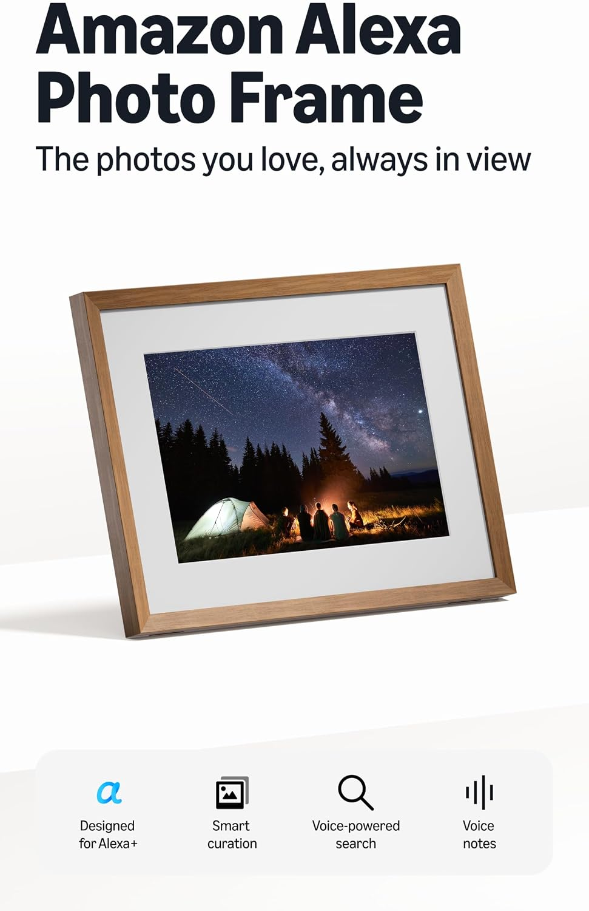
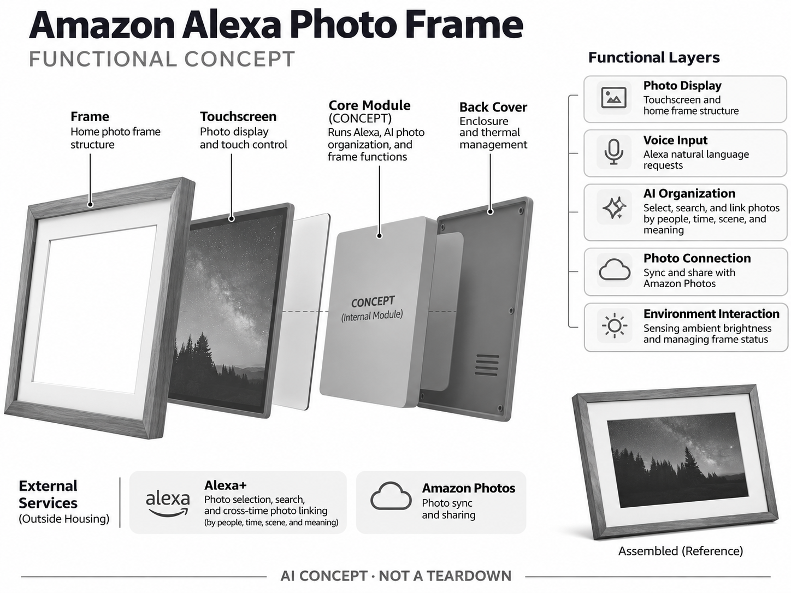

# Amazon Alexa Photo Frame

**Amazon** · 家庭助手 · 核查 2026-11-04

用语义检索和自动选片把家庭照片带回桌面

消费渠道：个人零售。

## 产品图片与结构参考

### 产品图

Amazon Alexa Photo Frame 官方产品图 · 来源：[Amazon · 官方图片](<https://www.amazon.com/dp/B0H3CPKKVN>) · [原始图片](<https://m.media-amazon.com/images/I/71w-v0rFHyL._AC_SL1500_.jpg>)

### 参考图

Amazon Alexa Photo Frame 官方外观、结构或使用参考 · 来源：[Amazon · 官方图片](<https://www.amazon.com/dp/B0H3CPKKVN>) · [原始图片](<https://m.media-amazon.com/images/I/71lVWIH6DOL._AC_SL1500_.jpg>)

### AI 生成爆炸示意

**AI 生成 · 非实物拆机。** 内部为概念推断，不能作为元件布局、BOM 或维修依据。[生成提示词](../../content/hardware/prompts/amazon-alexa-photo-frame.txt)

> 依据官方外观参考与公开功能生成；未披露的内部布局只作概念模块，不构成BOM或真实结构证据。

> 保留官方图片原始内容和出处；画面宣传参数不是本轮独立实测。

> 分析为基于公开资料的案头研究与 AI 辅助判断，未经用户访谈、销量审计或实物拆机。需求、画像、竞争冷门度、审美及商业机会均为研究假设，不是投资结论。

## 销售与购买

- 状态：在售。官方商品链接已打开；2026年10月28日官方页明确available starting at US$199.99，材质与颜色版本只计一款。

- 地区：美国Amazon官方渠道

- 价格：US$199.99起。核查时官方地区参考价，保留原币种；订阅、税运、附件及优惠以结账为准，预订定金不等于整机价格。

- 中国大陆：本轮核实所列海外官方渠道；中国大陆同型号现货、保修及服务可用性未确认。进口前需核对供电、网络、配件和地区条款。

- [官方产品 / 商店](<https://www.amazon.com/dp/B0H3CPKKVN>)

## AI 的实际作用

Alexa+按人物、时间、画面内容和语义选择及检索照片，建立跨时间照片关联；自动同步和环境调光本身不是AI。

服务与联网依赖：与Amazon Photos及网络关联，部分AI功能需要Alexa+；官方写含90天Alexa+，Prime包含相应服务，照片共享权限需配置。

## 是否冷门

新兴竞争（研究判断）：AI相框比通用智能屏更专注且少见，但联网相框已有成熟竞争，情感价值与误展示风险并存。

## 需求与市场

需求假设：家庭照片留在手机里很少被重新观看，用户希望相框自动挑出有意义的内容。应验证选片是否符合家人的偏好、是否避开敏感画面，自动更新频率不能代替情感价值和持续观看。

## 用户画像

画像推断：想给长辈赠送持续更新照片的家庭，以及有大量Amazon Photos内容的用户。购买者和观看者可能不同，远程管理、误传处理与简单语音使用比复杂编辑能力更关键。

## 竞争与替代

竞争判断：与Aura等联网相框、智能屏幕和普通照片打印竞争，语义搜索和跨时间关联形成软件差异。屏幕本身可替代性强，真正壁垒可能在照片库、家庭分享和隐私信任，而非相框外观。

## 供应链

供应链分析：显示面板、触控、麦克风、环境感知和相框材料构成终端；实际工厂与BOM未知。云相册存储、人物识别、内容推理及赠礼售后是持续成本，不能只按显示器硬件估算。

## 技术路径

官方披露按人脸、时间与画面语义选片，并用自然语言寻找照片。技术判断：表情和情绪的推断不等于真实意义，家庭合照与儿童隐私需控制；自动关联结果应容易删除、更正或关闭。

## 产品审美

审美判断：相框的价值在于像家居物件一样安静呈现照片，半哑光屏与实体边框比科技灯效更合适。亮度、夜间关闭、摆放方向和电源线影响真实观感，语音状态不能抢走照片主体。

## 关键风险

风险判断：自动展示可能把敏感照片、陌生截图或不想回忆的人物带到公共空间，分享权限必须易理解。试用期后AI权益可能变化，不能把订阅能力宣传成购买硬件后永久免费拥有。

## 机会与验证

机会假设：以赠礼家庭的长期更新和观看频率验证需求，比较人工选片与AI自动选片的满意度。若用户只需要少量精选照片，可优先做可控的家庭协作，而非追求模型不断制造新关联。

## 功能分层示意

这是功能关系，不是实物拆机、真实空间结构或已核实 BOM。

1. **照片显示**：触屏与家居相框结构。（官方披露）

2. **语音输入**：Alexa自然语言请求。（官方披露）

3. **AI整理**：语义选片、检索与照片关联。（官方披露）

4. **相册连接**：Amazon Photos同步和共享。（官方披露）

5. **环境交互**：亮度感知及状态管理。（官方披露）

## 来源

1. [Amazon Alexa Photo Frame 官方购买页](<https://www.amazon.com/dp/B0H3CPKKVN>) — 实际打开核查当前购买或预订入口，未实际下单；价格与交付按具体地区。

2. [Amazon AI相框官方能力与在售说明](<https://www.aboutamazon.com/news/devices/amazon-alexa-photo-frame>) — 实际打开的官方技术与使用资料，宣传效果并非本轮独立实测。

[返回目录](../hardware-market.md) · [网页分析](https://romanagent.github.io/Roman/#hardware/product/amazon-alexa-photo-frame)
