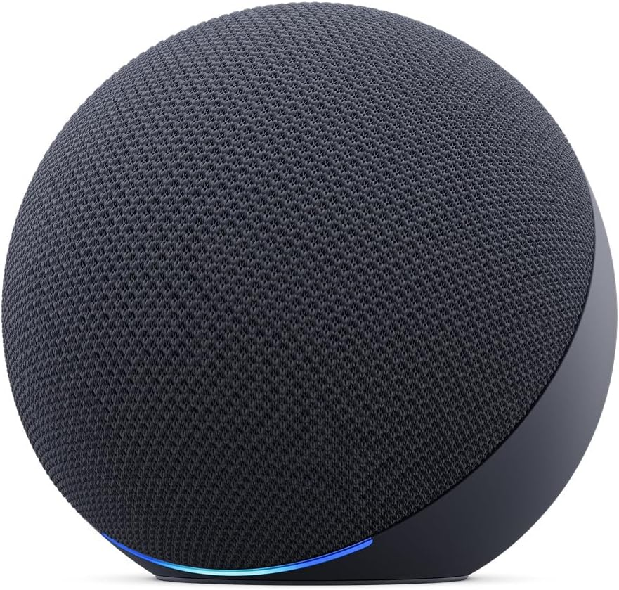
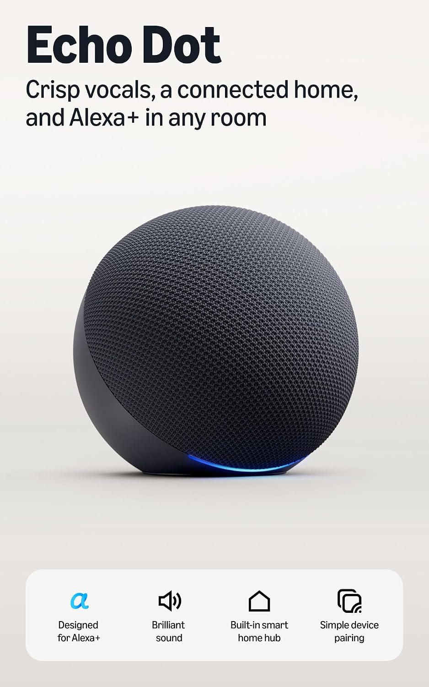
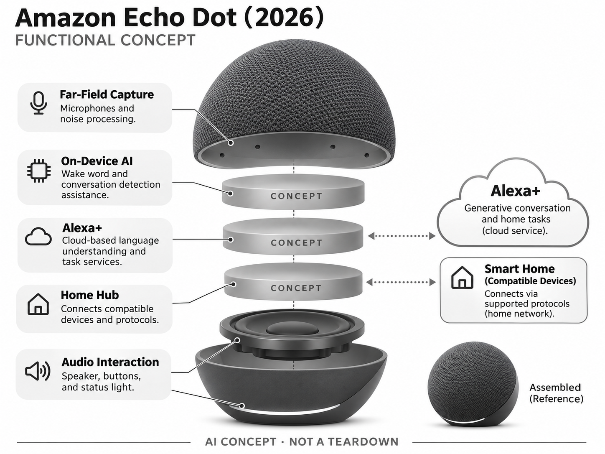

# Amazon Echo Dot（2026）

**Amazon** · 家庭助手 · 核查 2026-11-04

将生成式语音交互放入小型家居音箱

消费渠道：个人零售。

## 产品图片与结构参考

### 产品图

Amazon Echo Dot（2026） 官方产品图 · 来源：[Amazon · 官方图片](<https://www.amazon.com/dp/B0FXN2JWST>) · [原始图片](<https://m.media-amazon.com/images/I/71bK4bwlOuL._AC_SL1500_.jpg>)

### 参考图

Amazon Echo Dot（2026） 官方外观、结构或使用参考 · 来源：[Amazon · 官方图片](<https://www.amazon.com/dp/B0FXN2JWST>) · [原始图片](<https://m.media-amazon.com/images/I/712dCHzdKfL._AC_SL1500_.jpg>)

### AI 生成爆炸示意

**AI 生成 · 非实物拆机。** 内部为概念推断，不能作为元件布局、BOM 或维修依据。[生成提示词](../../content/hardware/prompts/amazon-echo-dot-2026.txt)

> 依据官方外观参考与公开功能生成；未披露的内部布局只作概念模块，不构成BOM或真实结构证据。

> 保留官方图片原始内容和出处；画面宣传参数不是本轮独立实测。

> 分析为基于公开资料的案头研究与 AI 辅助判断，未经用户访谈、销量审计或实物拆机。需求、画像、竞争冷门度、审美及商业机会均为研究假设，不是投资结论。

## 销售与购买

- 状态：在售。实际打开Amazon官方商品页；2026年10月28日官方发布说明新Echo Dot已发货并给出购买链接和价格，按在售收录。

- 地区：美国Amazon官方渠道

- 价格：US$99.99。核查时官方地区参考价，保留原币种；订阅、税运、附件及优惠以结账为准，预订定金不等于整机价格。

- 中国大陆：本轮核实所列海外官方渠道；中国大陆同型号现货、保修及服务可用性未确认。进口前需核对供电、网络、配件和地区条款。

- [官方产品 / 商店](<https://www.amazon.com/dp/B0FXN2JWST>)

## AI 的实际作用

Alexa+提供生成式对话与家庭任务，设备侧AI加速改善对话检测和背景噪声处理；内置家居协议本身不是AI。

服务与联网依赖：需要账号、网络和受支持地区；部分功能需要Alexa+，官方说明其包含在Prime中，音乐内容可能另订阅。

## 是否冷门

竞争密集（研究判断）：入门智能音箱是拥挤市场，差异集中在生态和语音可靠性，非天然冷门方向。

## 需求与市场

需求假设：家庭希望在厨房或桌边快速控制灯光、查询信息和播放内容，不愿频繁拿手机。应验证自然语言是否降低指令学习成本，尤其是多人和噪声环境，而不是只比较聊天回答长度。

## 用户画像

画像推断：已使用Alexa或愿意以低于大屏设备成本进入生态的家庭，可能每个房间配置一台。房间数量不等于需求数量，实际常用位置、隐私接受程度和网络稳定性需要逐户确认。

## 竞争与替代

竞争判断：与Google Home Speaker、旧Echo及手机语音助手竞争，新增家居网关与AI语音前端是差异。成熟生态带来便利也形成锁定，不能把新一代型号视为完全新开辟的消费赛道。

## 供应链

供应链分析：麦克风、扬声器、声学腔体、无线网关和电源共同组成终端，实际制造厂与BOM未知。长期云服务和固件维护需要持续成本，低硬件售价可能依赖生态而非单机利润。

## 技术路径

官方披露设备侧AI加速对话检测与降噪，Alexa+负责复杂语言任务。技术判断：本地识别唤醒与云端推理不同，不能称全部离线AI；语音成功理解也不代表连接的家居动作必定执行。

## 产品审美

审美判断：球形织物外壳适合融入桌面和书架，实体音量与静音控制易于理解。状态光应在远处可读且夜间克制，多房间安装时电源线和摆放高度也会影响家庭整体观感。

## 关键风险

风险判断：误唤醒、共享账号和语音购买权限需要清晰配置，儿童使用还涉及内容边界。Alexa+地区与订阅条件不同，不能将美国的功能清单直接搬到其他国家或认定所有任务永久免费。

## 机会与验证

机会假设：聚焦厨房计时、无障碍控制或家庭清单等高频任务，测量纠错和实际节省步骤。若用户只听音乐，进一步增加对话复杂度未必促进换机，可靠执行和明确状态可能更重要。

## 功能分层示意

这是功能关系，不是实物拆机、真实空间结构或已核实 BOM。

1. **远场采集**：麦克风与噪声处理。（官方披露）

2. **设备侧AI**：唤醒及对话检测辅助。（官方披露）

3. **Alexa+**：云端语言理解与任务服务。（官方披露）

4. **家居网关**：连接兼容设备与协议。（官方披露）

5. **音频交互**：扬声器、按键和状态灯。（官方披露）

## 来源

1. [Amazon Echo Dot（2026） 官方购买页](<https://www.amazon.com/dp/B0FXN2JWST>) — 实际打开核查当前购买或预订入口，未实际下单；价格与交付按具体地区。

2. [Amazon 官方新音箱技术与上市说明](<https://www.aboutamazon.com/news/devices/echo-speaker-lineup>) — 实际打开的官方技术与使用资料，宣传效果并非本轮独立实测。

3. [Amazon 2026新品上市公告](<https://www.aboutamazon.com/news/devices/new-alexa-devices-2026>) — 实际打开，明确新Echo Dot ships today及上市价格；不使用旧代产品状态。

[返回目录](../hardware-market.md) · [网页分析](https://romanagent.github.io/Roman/#hardware/product/amazon-echo-dot-2026)
