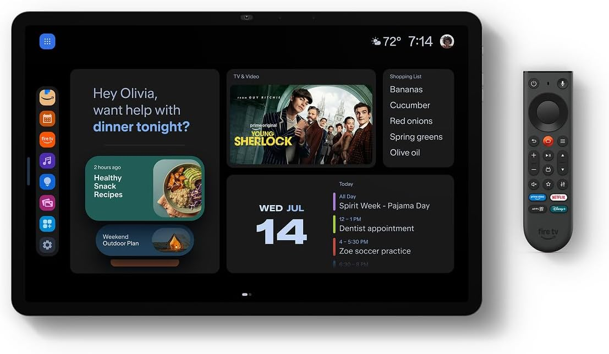
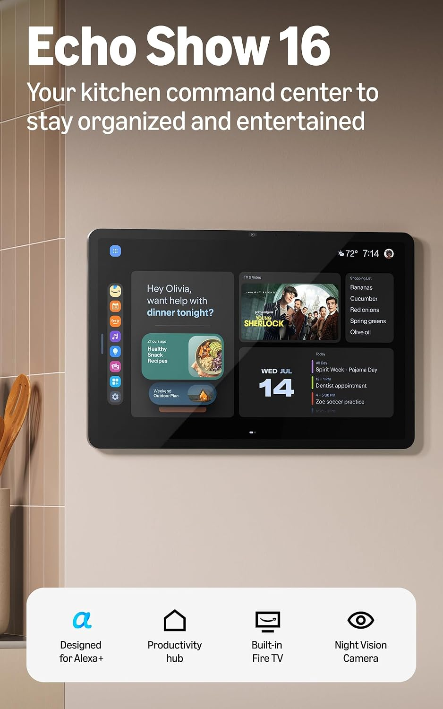
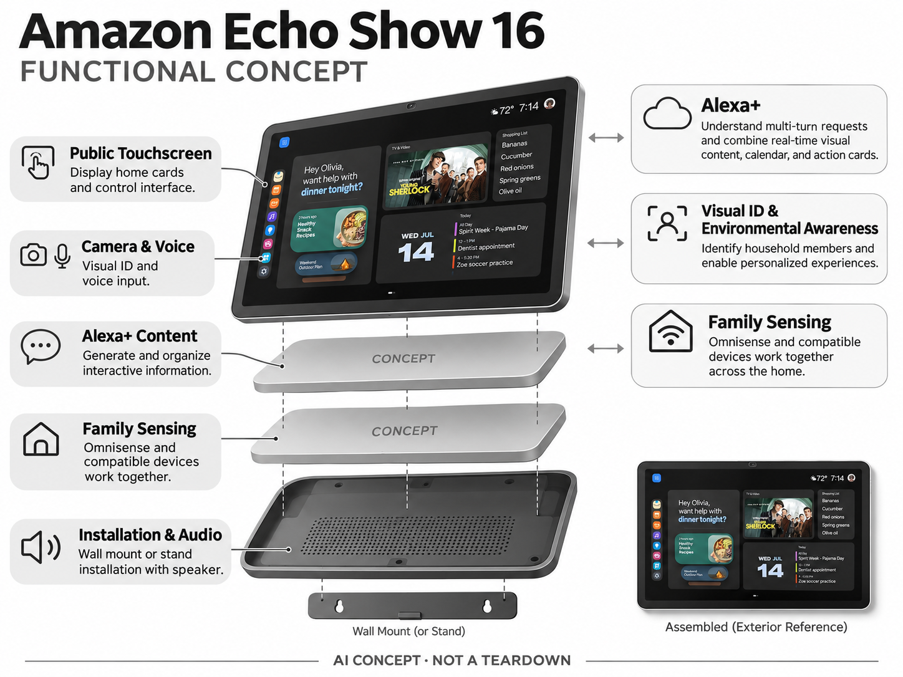

# Amazon Echo Show 16

**Amazon** · 家庭助手 · 核查 2026-11-04

以生成式交互卡片组织家庭日程和控制

消费渠道：消费预订。

## 产品图片与结构参考

### 产品图

Amazon Echo Show 16 官方产品图 · 来源：[Amazon · 官方图片](<https://www.amazon.com/dp/B0G37245M5>) · [原始图片](<https://m.media-amazon.com/images/I/61CD7sLOgDL._AC_SL1500_.jpg>)

### 参考图

Amazon Echo Show 16 官方外观、结构或使用参考 · 来源：[Amazon · 官方图片](<https://www.amazon.com/dp/B0G37245M5>) · [原始图片](<https://m.media-amazon.com/images/I/71vxlYpLodL._AC_SL1500_.jpg>)

### AI 生成爆炸示意

**AI 生成 · 非实物拆机。** 内部为概念推断，不能作为元件布局、BOM 或维修依据。[生成提示词](../../content/hardware/prompts/amazon-echo-show-16.txt)

> 依据官方外观参考与公开功能生成；未披露的内部布局只作概念模块，不构成BOM或真实结构证据。

> 保留官方图片原始内容和出处；画面宣传参数不是本轮独立实测。

> 分析为基于公开资料的案头研究与 AI 辅助判断，未经用户访谈、销量审计或实物拆机。需求、画像、竞争冷门度、审美及商业机会均为研究假设，不是投资结论。

## 销售与购买

- 状态：预售 / 接受延期订单。官方商品链接已实际打开，2026年10月28日发布页明确接受预订、计划年内发货；按预售，不把标准屏和Nanomatte表面版本拆成两款。

- 地区：美国Amazon预订

- 价格：标准屏US$499.99；预售活动减US$100。核查时官方地区参考价，保留原币种；订阅、税运、附件及优惠以结账为准，预订定金不等于整机价格。

- 中国大陆：本轮核实所列海外官方渠道；中国大陆同型号现货、保修及服务可用性未确认。进口前需核对供电、网络、配件和地区条款。

- [官方产品 / 商店](<https://www.amazon.com/dp/B0G37245M5>)

## AI 的实际作用

Alexa+理解多轮请求并组合实时视觉内容、日历和操作卡片，Visual ID与环境感知辅助家庭成员识别及个性化。

服务与联网依赖：需要账号、网络与Alexa+地区支持；部分功能依赖会员，支架另外购买，预售交付时间以订单为准。

## 是否冷门

竞争密集（研究判断）：家庭共享大屏已有多种替代，生成式卡片较新；预售阶段需要验证多人协作而非仅看硬件规模。

## 需求与市场

需求假设：家庭希望把共享日历、购物比较和家居状态放到公共屏幕，减少每人分别查看手机。应验证生成卡片能否降低沟通遗漏，屏幕变大和内容更丰富不必然让多人协作更容易。

### 任务与触发场景 · 研究判断

Echo Show 16的需求可从多人共享的家庭日程、信息查看和语音任务开始，而不只是把聊天助手放大。屏幕能呈现日历、卡片与视觉内容，但是否减少家庭成员之间重复确认，需要真实任务验证。一个更大的显示入口不自动解决信息来源不一致、权限或家人不愿维护的问题。

依据：[Amazon Echo Show 16 官方购买页](<https://www.amazon.com/dp/B0G37245M5>) · [Amazon Echo Show 16 官方预售及技术](<https://www.aboutamazon.com/news/devices/echo-show-16-smart-display>)

### 流程中的收益与代价 · 研究判断

固定共享屏幕可能降低寻找手机和询问家人的步骤，也可能增加账号绑定、日程整理与界面管理。家庭任务与个人信息有不同公开程度，需要明确什么适合放在公共空间。应比较已有手机群聊、纸质日历和普通显示屏的流程，不能把信息集中显示直接视为协调效率提高。

依据：[Amazon Echo Show 16 官方购买页](<https://www.amazon.com/dp/B0G37245M5>) · [Amazon Echo Show 16 官方预售及技术](<https://www.aboutamazon.com/news/devices/echo-show-16-smart-display>)

### 需求如何验证 · 待验证

建议观察家庭安排一次共同活动、查看提醒和处理临时变化的过程，记录信息输入、确认、错误和责任归属。由于该型号在本轮为预售，实际交付和长期使用尚不能验证，不能把发布演示当作现货体验。当前没有入户研究，不推断家庭效率、留存或购买转化。

依据：[Amazon Echo Show 16 官方购买页](<https://www.amazon.com/dp/B0G37245M5>) · [Amazon Echo Show 16 官方预售及技术](<https://www.aboutamazon.com/news/devices/echo-show-16-smart-display>)

## 用户画像

画像推断：有固定厨房或客厅安装位、多人共享日程且已用Alexa的家庭。独居者或已用平板者可能缺少额外价值，访客和不同账号成员的权限边界也会影响共享屏幕是否被持续使用。

### 优先使用者 · 研究判断

优先画像是多人共享安排、已有兼容服务或家庭设备，并愿意维护一个公共信息入口的家庭。真正差异在于信息是否分散及是否经常需要共同确认，而不是家庭人数本身。独居或主要使用个人手机的人，未必能从共享屏幕得到同样收益，需要先识别具体任务。

依据：[Amazon Echo Show 16 官方购买页](<https://www.amazon.com/dp/B0G37245M5>) · [Amazon Echo Show 16 官方预售及技术](<https://www.aboutamazon.com/news/devices/echo-show-16-smart-display>)

### 购买者与使用者 · 研究判断

购买与配置者可能希望汇总信息，其他成员却更重视隐私和少操作。研究应区分谁维护日历、谁接收提醒、谁允许个性化内容显示，以及谁负责纠错。识别家庭成员的功能不意味着系统天然理解所有共享关系，不能用技术能力替代家庭实际的同意和管理方式。

依据：[Amazon Echo Show 16 官方购买页](<https://www.amazon.com/dp/B0G37245M5>) · [Amazon Echo Show 16 官方预售及技术](<https://www.aboutamazon.com/news/devices/echo-show-16-smart-display>)

### 不适配与分层验证 · 待验证

对不愿共享账号、无法固定摆放或所在地区缺少完整服务的人，适配需要重新考虑。建议研究原有纸质和手机方法已足够的家庭，保留不购买理由。预售与交付条件也会影响决策，不能把可预订视为已完成验证或默认所有国家都能获得相同功能。

依据：[Amazon Echo Show 16 官方购买页](<https://www.amazon.com/dp/B0G37245M5>) · [Amazon Echo Show 16 官方预售及技术](<https://www.aboutamazon.com/news/devices/echo-show-16-smart-display>)

## 竞争与替代

竞争判断：与旧Echo Show、平板加支架、家庭日历屏和电视控制界面竞争。生成内容与生态整合有差异，但显示尺寸和防眩表面不是独立赛道，本目录避免把屏面选项当作多个产品。

### 直接与间接替代 · 研究判断

替代方案包括既有智能屏、普通平板、数字家庭日历、手机应用和纸质看板。它们的共享方式、维护、隐私和成本不同，必须固定一次家庭协调任务比较。不能只以屏幕大小、模型名称或显示的卡片数量排名，也不能把所有信息型设备都当成完全相同的助手。

依据：[Amazon Echo Show 16 官方购买页](<https://www.amazon.com/dp/B0G37245M5>) · [Amazon Echo Show 16 官方预售及技术](<https://www.aboutamazon.com/news/devices/echo-show-16-smart-display>)

### 具体差异与条件 · 研究判断

官方描述Alexa+、多轮请求和视觉信息整合，差异可能在语音与共享屏幕之间的衔接。如果最终仍需要到多个个人手机里确认，公共终端的价值会下降。还要核对平台能力是否同样提供给其他型号，避免把云端服务升级全部解释为此款新硬件独有。

依据：[Amazon Echo Show 16 官方购买页](<https://www.amazon.com/dp/B0G37245M5>) · [Amazon Echo Show 16 官方预售及技术](<https://www.aboutamazon.com/news/devices/echo-show-16-smart-display>)

### 同条件比较方法 · 待验证

交付后应比较同一家庭任务的完成、维护和错误恢复，记录账号权益、软件版本与摆放条件。预售阶段可分析公开流程和限制，但不能代替真实使用测试。当前没有同条件竞品实验与销量，因此不把发布时的功能承诺当作市场领先或长期体验结论。

依据：[Amazon Echo Show 16 官方购买页](<https://www.amazon.com/dp/B0G37245M5>) · [Amazon Echo Show 16 官方预售及技术](<https://www.aboutamazon.com/news/devices/echo-show-16-smart-display>)

## 供应链

供应链分析：大屏、触控、相机、音频、环境传感和支架系统共同构成硬件；具体工厂与BOM未披露。墙面安装、散热、待机功耗、面板运输和多年内容服务会形成持续成本。

### 功能与交付拆分 · 研究判断

公开能力支持拆分为显示与触控、声音及视觉输入、连接控制、机身安装和Alexa服务，但完整面板、摄像头与代工关系未公开。软件的家庭信息、账户和设备整合也是交付层。供应链分析不能只列屏幕和主板，更不能从外观与相近产品推定真实BOM。

依据：[Amazon Echo Show 16 官方购买页](<https://www.amazon.com/dp/B0G37245M5>) · [Amazon Echo Show 16 官方预售及技术](<https://www.aboutamazon.com/news/devices/echo-show-16-smart-display>)

### 制造与服务约束 · 研究判断

共享大屏需要在可读性、摆放、输入角度和长期供电之间协调，视觉和声音功能又依赖环境。安装与日常交互可能由不同成员完成，需要明确结构与系统责任。制造验收、服务权限和内容同步应分开验证，预售说明不能证明所有环节已经达到稳定量产体验。

依据：[Amazon Echo Show 16 官方购买页](<https://www.amazon.com/dp/B0G37245M5>) · [Amazon Echo Show 16 官方预售及技术](<https://www.aboutamazon.com/news/devices/echo-show-16-smart-display>)

### 候选公司与导入 · 研究判断

候选公司可从显示交互和带屏终端工程寻找，用于重新开发类似家庭入口。下方公司能力不等于Echo Show 16实际采用，也不默认提供Alexa与家庭服务。应先定义公共空间、任务、输入及维护要求，再核对面板、结构、系统和测试范围，商业条件需正式询问。

依据：[Amazon Echo Show 16 官方购买页](<https://www.amazon.com/dp/B0G37245M5>) · [Amazon Echo Show 16 官方预售及技术](<https://www.aboutamazon.com/news/devices/echo-show-16-smart-display>)

## 技术路径

官方描述动态交互卡片、Visual ID和传感融合。技术判断：生成内容需要与真实日历和设备状态一致，身份识别也可能失败；模型提供的比较或计划应可复核，不能假定所有卡片都准确执行。

### 已知功能与处理链路 · 研究判断

官方介绍多轮Alexa+请求、日历与操作卡片、视觉内容和家庭成员识别等方向。技术分析应拆开采集、身份或环境信息、请求理解、信息整合、动作执行及显示反馈。完整处理器、模型部署与所有权限条件未披露，不由较大屏幕或AI名称推断机内完成全部计算。

依据：[Amazon Echo Show 16 官方购买页](<https://www.amazon.com/dp/B0G37245M5>) · [Amazon Echo Show 16 官方预售及技术](<https://www.aboutamazon.com/news/devices/echo-show-16-smart-display>)

### 主要技术约束 · 研究判断

多用户上下文是关键约束：同一句请求可能涉及个人日历、共同任务或家居控制，系统需要让使用者知道信息和权限来自哪里。识别结果可能不确定，视觉输入也受摆放与环境影响。自然语言响应不能替代明确确认，尤其要区分建议、待批准和已经完成的操作。

依据：[Amazon Echo Show 16 官方购买页](<https://www.amazon.com/dp/B0G37245M5>) · [Amazon Echo Show 16 官方预售及技术](<https://www.aboutamazon.com/news/devices/echo-show-16-smart-display>)

### 系统验证方法 · 待验证

交付后建议测试多成员、模糊时间、日程冲突、设备离线和取消请求，记录显示内容与真实结果是否一致。基础和高级权益分别核对，保留版本与网络条件。预售期间没有独立实测，不能承诺识别准确率、同步稳定性或宣传中的全部能力在每个地区可用。

依据：[Amazon Echo Show 16 官方购买页](<https://www.amazon.com/dp/B0G37245M5>) · [Amazon Echo Show 16 官方预售及技术](<https://www.aboutamazon.com/news/devices/echo-show-16-smart-display>)

## 产品审美

审美判断：薄边框和相框式布局适合公共空间，屏幕长期亮起时的信息密度与广告存在感同样重要。壁挂、台面支架和线缆必须整体考虑，简洁待机界面比持续炫技更符合家居需求。

### 形态与使用环境 · 研究判断

公共家庭屏幕的设计需要平衡持续可见的信息和不打扰生活空间的存在感。大屏有利于远处查看，也可能占据墙面或桌面注意力。审美评价应把观看距离、摆位、线缆和家庭活动一起考虑，而不是只依据正面渲染图或屏幕尺寸判断。

依据：[Amazon Echo Show 16 官方购买页](<https://www.amazon.com/dp/B0G37245M5>) · [Amazon Echo Show 16 官方预售及技术](<https://www.aboutamazon.com/news/devices/echo-show-16-smart-display>)

### 交互与身体体验 · 研究判断

日历、照片、卡片和对话内容需要清楚的层级，避免一个公共界面同时承载太多个人任务。语音操作后的结果应能在屏幕上被确认，触控失败也应有恢复入口。应观察未参与配置的成员能否理解当前状态，不能用可定制程度替代日常易用性。

依据：[Amazon Echo Show 16 官方购买页](<https://www.amazon.com/dp/B0G37245M5>) · [Amazon Echo Show 16 官方预售及技术](<https://www.aboutamazon.com/news/devices/echo-show-16-smart-display>)

### 长期维护与设计验证 · 待验证

交付后可观察清洁、位置调整、账号变化和信息维护，记录家庭是否持续更新内容以及哪些信息被忽略。预售阶段无法确认材料、安装与耐久表现，不由视觉风格保证长期便利。设计的价值应从真实共享任务中判断，而不是只看最初展示是否令人印象深刻。

依据：[Amazon Echo Show 16 官方购买页](<https://www.amazon.com/dp/B0G37245M5>) · [Amazon Echo Show 16 官方预售及技术](<https://www.aboutamazon.com/news/devices/echo-show-16-smart-display>)

## 关键风险

风险判断：当前为预售，发货和部分软件体验仍需到货后确认。共享屏可能暴露日历、照片与购买记录，摄像头和语音权限需可见可控；AI生成卡片不能直接视作已核实的家庭事实。

### 主要失败情形 · 研究判断

主要风险包括共享信息误显示、家庭成员或权限判断错误、日历和设备状态不同步，以及生成回答被误认为已执行。共享屏幕可能影响没有主动使用设备的人，因此需要清楚的控制与状态。技术识别不能自动解决家庭边界，必须观察实际管理和纠错方式。

依据：[Amazon Echo Show 16 官方购买页](<https://www.amazon.com/dp/B0G37245M5>) · [Amazon Echo Show 16 官方预售及技术](<https://www.aboutamazon.com/news/devices/echo-show-16-smart-display>)

### 购买与持续服务 · 研究判断

该型号本轮为预售，交付日期、配置与服务范围仍需按实际订单核对。发布展示不代表所有功能已经可用，地区、语言、账号与订阅也可能限制体验。参考价格不能覆盖所有安装、配套和持续费用，国内购买与完整服务不能由海外预订入口推定。

依据：[Amazon Echo Show 16 官方购买页](<https://www.amazon.com/dp/B0G37245M5>) · [Amazon Echo Show 16 官方预售及技术](<https://www.aboutamazon.com/news/devices/echo-show-16-smart-display>)

### 风险验证及停止条件 · 待验证

可在交付后的试用中设定信息无法可靠同步、家人不愿维护、权限反馈不清楚或任务仍反复回到手机等停止条件。预售阶段应保留未验证状态，不用发布热度当成需求证据。当前没有独立使用、销量或长期服务数据，不对商业成功和家庭效率作保证。

依据：[Amazon Echo Show 16 官方购买页](<https://www.amazon.com/dp/B0G37245M5>) · [Amazon Echo Show 16 官方预售及技术](<https://www.aboutamazon.com/news/devices/echo-show-16-smart-display>)

## 机会与验证

机会假设：以家庭真实的一周计划测试任务交接和找信息时间，比较普通共享日历屏。若主要使用停留在天气和照片，复杂生成交互可能增加负担，应优先提供稳定、可预测的公共界面。

### 可检验的差异 · 研究判断

可探索的差异在于让家庭共同任务的责任和状态更明确，而不是只把更多信息放在屏幕上。一个好的入口可能让成员少问一次、少重复录入并知道是否需要自己行动。创业方向应从这些可观察的协调问题出发，避免把共享屏幕和大模型的组合直接视为新需求。

依据：[Amazon Echo Show 16 官方购买页](<https://www.amazon.com/dp/B0G37245M5>) · [Amazon Echo Show 16 官方预售及技术](<https://www.aboutamazon.com/news/devices/echo-show-16-smart-display>)

### 实现与商业约束 · 研究判断

实现约束包括账户、服务同步、多用户权限、安装和长期内容维护。硬件团队需要与软件和服务一起定义交付，屏幕规格不能单独解释价值。当前没有制造成本、服务费用和家庭付费记录，不由预售价推断毛利，也不把现有智能家居用户总量当作目标市场。

依据：[Amazon Echo Show 16 官方购买页](<https://www.amazon.com/dp/B0G37245M5>) · [Amazon Echo Show 16 官方预售及技术](<https://www.aboutamazon.com/news/devices/echo-show-16-smart-display>)

### 下一阶段验证 · 待验证

下一步可以先用低成本共享界面原型验证日程、提醒和责任确认，再判断是否需要专门的大屏设备。实际交付后记录主动使用、维护和错误恢复，而非仅统计屏幕亮起时长。若纸质看板或手机已经满足任务，应允许研究结论保留原方案。

依据：[Amazon Echo Show 16 官方购买页](<https://www.amazon.com/dp/B0G37245M5>) · [Amazon Echo Show 16 官方预售及技术](<https://www.aboutamazon.com/news/devices/echo-show-16-smart-display>)

## 对应供应链公司

能力候选用于选型研究，不代表本产品实际采用；未公开的供货关系不作推断。

- [boe](../supply-chain/boe.md) — **能力候选 · 非已采用** / 共享家庭屏幕显示与触控候选：京东方公开显示与交互能力可用于重新设计共享家庭终端时评估面板和触控。观看距离、结构、亮度、交互和系统接口需一起验证，不能只匹配尺寸；没有证据确认Echo Show 16采用其面板。

- [huaqin](../supply-chain/huaqin.md) — **能力候选 · 非已采用** / 带屏家庭终端系统工程候选：华勤公开智能家居与带屏终端工程可作为新方案整合入口，需明确显示、声音、视觉、账号与维护的责任。制造服务不自动包含Alexa授权和家庭信息同步，本条不确认该型号由华勤代工。

[浏览供应链目录](../supply-chain.md)

## 功能分层示意

这是功能关系，不是实物拆机、真实空间结构或已核实 BOM。

1. **公共触屏**：显示家庭卡片与控制界面。（官方披露）

2. **摄像语音**：视觉身份和语音输入。（官方披露）

3. **Alexa+内容**：生成和组织交互信息。（官方披露）

4. **家庭感知**：Omnisense与兼容设备联动。（官方披露）

5. **安装音频**：支架/墙面安装与扬声器。（官方披露）

## 来源

1. [Amazon Echo Show 16 官方购买页](<https://www.amazon.com/dp/B0G37245M5>) — 实际打开核查当前购买或预订入口，未实际下单；价格与交付按具体地区。

2. [Amazon Echo Show 16 官方预售及技术](<https://www.aboutamazon.com/news/devices/echo-show-16-smart-display>) — 实际打开的官方技术与使用资料，宣传效果并非本轮独立实测。

[返回目录](../hardware-market.md) · [网页分析](https://romanagent.github.io/Roman/#hardware/product/amazon-echo-show-16)
