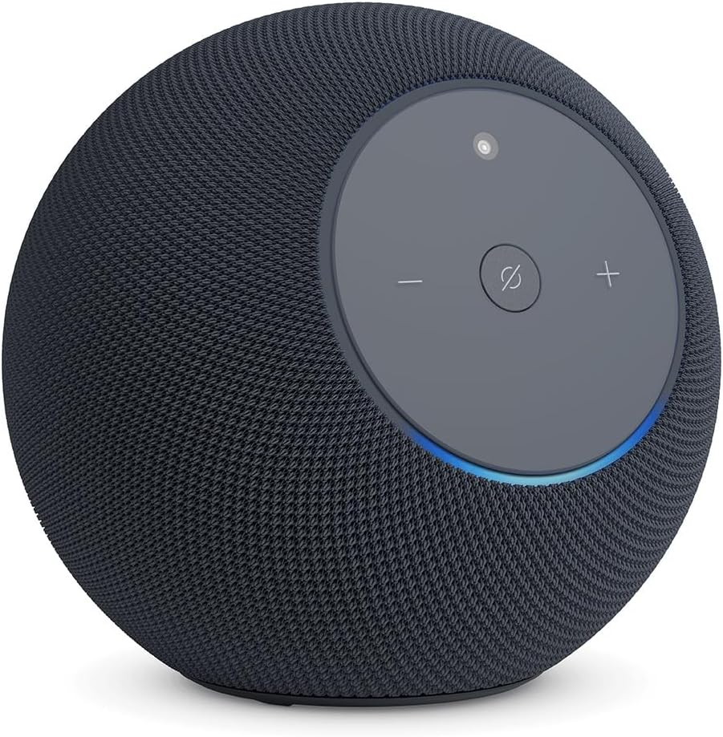
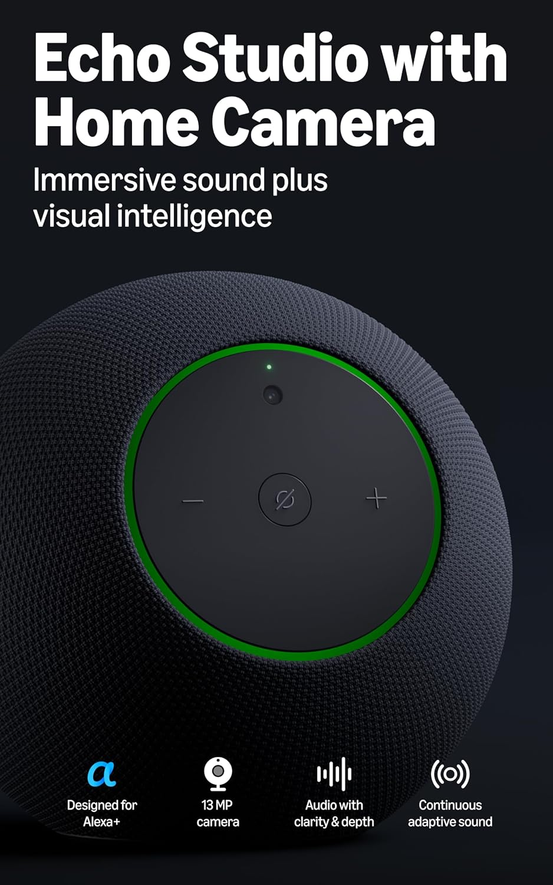
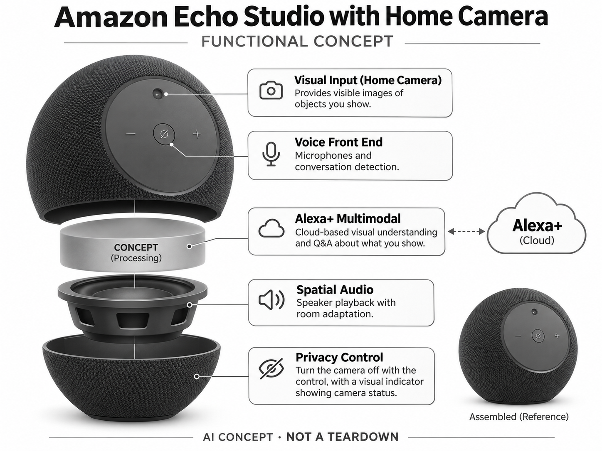

# Amazon Echo Studio with Home Camera

**Amazon** · 家庭助手 · 核查 2026-11-04

把看物问答加入家庭音乐音箱

消费渠道：个人零售。

## 产品图片与结构参考

### 产品图

Amazon Echo Studio with Home Camera 官方产品图 · 来源：[Amazon · 官方图片](<https://www.amazon.com/dp/B0CVJSF8JR>) · [原始图片](<https://m.media-amazon.com/images/I/71+TTOtg1UL._AC_SL1500_.jpg>)

### 参考图

Amazon Echo Studio with Home Camera 官方外观、结构或使用参考 · 来源：[Amazon · 官方图片](<https://www.amazon.com/dp/B0CVJSF8JR>) · [原始图片](<https://m.media-amazon.com/images/I/7141lT0wzqL._AC_SL1500_.jpg>)

### AI 生成爆炸示意

**AI 生成 · 非实物拆机。** 内部为概念推断，不能作为元件布局、BOM 或维修依据。[生成提示词](../../content/hardware/prompts/amazon-echo-studio-home-camera.txt)

> 依据官方外观参考与公开功能生成；未披露的内部布局只作概念模块，不构成BOM或真实结构证据。

> 保留官方图片原始内容和出处；画面宣传参数不是本轮独立实测。

> 分析为基于公开资料的案头研究与 AI 辅助判断，未经用户访谈、销量审计或实物拆机。需求、画像、竞争冷门度、审美及商业机会均为研究假设，不是投资结论。

## 销售与购买

- 状态：在售。实际打开官方购买链接；2026年10月28日Amazon发布页明确带Home Camera型号已发货、US$249.99，区别于无摄像头Studio。

- 地区：美国Amazon官方渠道

- 价格：US$249.99。核查时官方地区参考价，保留原币种；订阅、税运、附件及优惠以结账为准，预订定金不等于整机价格。

- 中国大陆：本轮核实所列海外官方渠道；中国大陆同型号现货、保修及服务可用性未确认。进口前需核对供电、网络、配件和地区条款。

- [官方产品 / 商店](<https://www.amazon.com/dp/B0CVJSF8JR>)

## AI 的实际作用

摄像头给Alexa+提供视觉输入，可识别用户展示的物品并解释信息，音频系统还根据房间适配播放；不把未上线功能写成可用。

服务与联网依赖：云端视觉与对话需要Alexa+及网络；官方称部分Fire TV视频通话功能稍后提供，麦克风和摄像头可关闭。

## 是否冷门

新兴竞争（研究判断）：视觉音箱比普通语音音箱少见，但与智能屏和手机强竞争；隐私与实际高频任务是验证重点。

## 需求与市场

需求假设：用户希望不拿手机就询问眼前物品，例如包装和桌游规则，同时保留高质量音乐体验。应验证看物问答是否足够高频，不能因摄像头加入音箱就推定家庭愿意让它长期观看房间。

## 用户画像

画像推断：已用Alexa、重视客厅音乐且愿意尝试视觉交互的家庭，与只需语音控制的用户不同。设备放置高度、镜头方向和展示物品的距离会影响使用，不能由音箱用户基数直接推算需求。

## 竞争与替代

竞争判断：与无摄像头Studio、智能屏幕及手机多模态助手竞争。它保留音箱形态同时增加视觉，但手机通常更容易对准物品；是否值得独立硬件，需要比较实际任务成功率和隐私成本。

## 供应链

供应链分析：扬声器、声学腔体、麦克风、相机与本地处理模块需要在紧凑机身协同，实际工厂及BOM未知。回声处理、热设计、镜头防污和长期云推理成本都影响产品交付。

## 技术路径

官方披露视觉识物与Alexa+问答、房间音频适配。技术判断：包装文字、距离和光照影响识别，模型可能误解物品或规则；视觉识别应给出可复核内容，不应把回答准确性视作必然。

## 产品审美

审美判断：织物音箱更易融入客厅，但镜头会改变用户对物件的感受，运行指示和关闭方式需要明显。屏幕缺席使回答依赖声音，长解释、隐私提示和物品对准反馈应保持简洁。

## 关键风险

风险判断：室内视觉和语音数据可能涉及其他家庭成员，需清晰权限与物理控制。商品识别若关联购买应防止误操作，尚未上线的Fire TV通话不能提前计入当前价值或作为已可用卖点。

## 机会与验证

机会假设：研究用户在厨房、桌游和无障碍场景中是否愿意主动展示物品，比较手机拍摄方案。若视觉使用很少，采用明确的按需开启和短反馈流程，可能比持续环境感知更容易获得信任。

## 功能分层示意

这是功能关系，不是实物拆机、真实空间结构或已核实 BOM。

1. **视觉输入**：Home Camera提供可见物品画面。（官方披露）

2. **语音前端**：麦克风和对话检测。（官方披露）

3. **Alexa+多模态**：云端看物理解与问答。（官方披露）

4. **空间音频**：扬声器与房间适配。（官方披露）

5. **隐私控制**：关闭控制及视觉工作指示。（官方披露）

## 来源

1. [Amazon Echo Studio with Home Camera 官方购买页](<https://www.amazon.com/dp/B0CVJSF8JR>) — 实际打开核查当前购买或预订入口，未实际下单；价格与交付按具体地区。

2. [Amazon 官方视觉音箱说明](<https://www.aboutamazon.com/news/devices/echo-speaker-lineup>) — 实际打开的官方技术与使用资料，宣传效果并非本轮独立实测。

3. [Amazon 2026新品上市公告](<https://www.aboutamazon.com/news/devices/new-alexa-devices-2026>) — 实际打开，明确带摄像头型号ships today，不与旧Studio合并。

[返回目录](../hardware-market.md) · [网页分析](https://romanagent.github.io/Roman/#hardware/product/amazon-echo-studio-home-camera)
