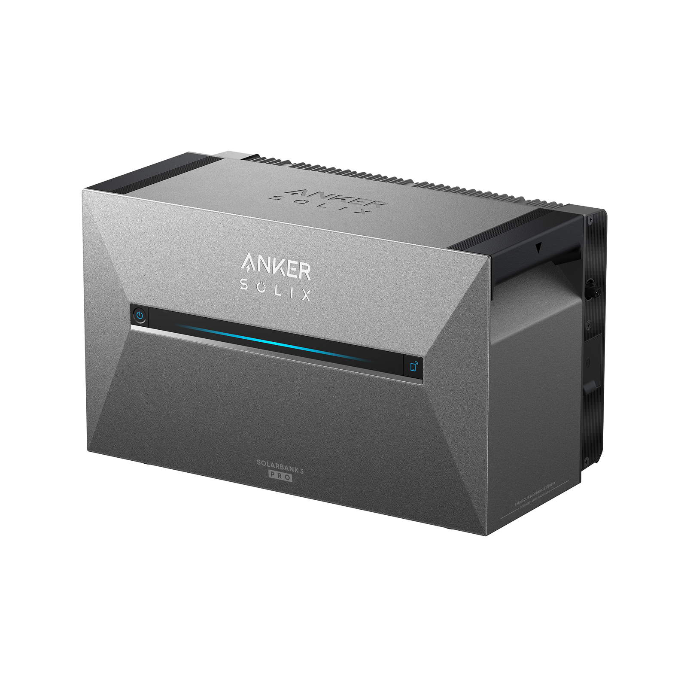
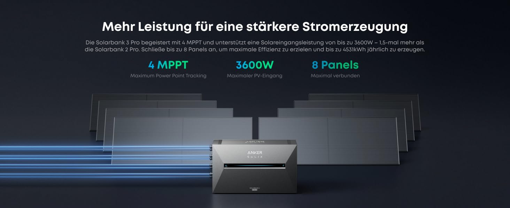
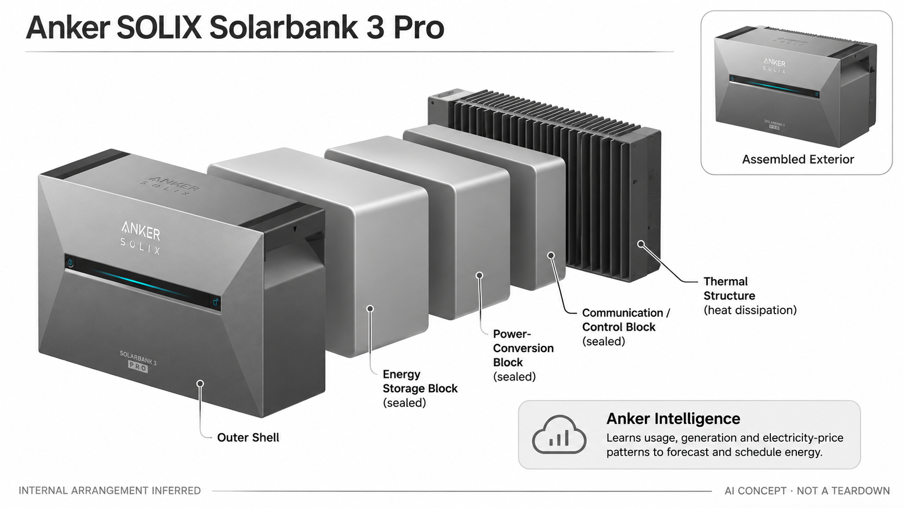

# Anker SOLIX Solarbank 3 E2700 Pro

**Anker SOLIX** · 家庭能源 · 核查 2026-11-04

面向住户阳台光伏的储能设备，以AI预测安排充放电。

消费渠道：个人零售。

## 产品图片与结构参考

### 产品图

Anker SOLIX Solarbank 3 E2700 Pro官方产品图 · 来源：[Anker SOLIX](<https://www.anker.com/de/products/a17c5>) · [原始图片](<https://cdn.shopify.com/s/files/1/1054/0698/8369/files/A17C53Z1_10667d0d-0e7f-412c-a54c-80f0afff708c.png?v=1784771812&width=1600>)

### 参考图

官方光伏输入组合参考；太阳能板需按套餐另行确认，图中数值为厂商宣传 · 来源：[Anker SOLIX](<https://www.anker.com/de/products/a17c5>) · [原始图片](<https://m.media-amazon.com/images/S/aplus-media-library-service-media/cf7994fc-c6bb-4874-9c7e-1c1394375394.__CR0,1,1464,600_PT0_SX1464_V1___.jpg>)

### AI 生成爆炸示意

**AI 生成 · 非实物拆机。** 内部为概念推断，不能作为元件布局、BOM 或维修依据。[生成提示词](../../content/hardware/prompts/anker-solix-solarbank-3-pro.txt)

> 分析为基于公开资料的案头研究与 AI 辅助判断，未经用户访谈、销量审计或实物拆机。需求、画像、竞争冷门度、审美及商业机会均为研究假设，不是投资结论。

## 销售与购买

- 状态：在售。德国官方产品页同时提供加入购物车和立即订购按钮。扩展电池、面板与不同套装不拆分计数；本条仅核实当前所列地区。

- 地区：德国官方商店

- 价格：德国官方页 €1,299。为所标地区和配置的核查参考；活动、税费、物流及可选服务以实际结算为准，不进行汇率换算或保证最低价。

- 中国大陆：本轮核查德国版与当地销售方案。中国大陆型号、计量设备、安装和售后需单独确认，不能把欧版并网产品直接当作国内通用配置。

- [官方产品 / 商店](<https://www.anker.com/de/products/a17c5>)

## AI 的实际作用

Anker Intelligence Smart Mode学习家庭用电、发电和价格模式，预测后续需求并调整储能策略；普通定时充电本身不作为AI能力。

服务与联网依赖：App、联网、可兼容计量设备及当地电价方案影响完整功能。断开计量或使用模式变化时预测可能偏差，不承诺固定省钱数额。

## 是否冷门

新兴竞争（研究判断）：家庭能源预测是较少被普通消费电子目录覆盖的场景，但储能硬件竞争激烈，价值高度依赖住户条件。

## 需求与市场

需求假设：已有或准备安装阳台光伏的住户，希望把发电与家庭用电错峰匹配，减少频繁手动设置。是否值得购买取决于真实用电曲线、安装环境和电价，不能把宣传年节省额套到所有家庭。

### 任务与触发场景 · 研究判断

这款储能设备的任务是把家庭发电、用电和可适用电价之间的时间差转成更合理的能源使用安排。AI的研究重点在预测与调度，而不是电池充放电本身。需求必须结合实际家庭负载和计量条件判断，不能由一次演示或厂商节省金额推定所有用户都能获得相同收益。

依据：[Solarbank 3 Pro 德国官方店](<https://www.anker.com/de/products/a17c5>) · [Anker Smart Mode 官方FAQ](<https://support.ankersolix.com/de/s/article/Was-ist-der-Smart-Modus-Wie-profitierst-du-davon>)

### 流程中的收益与代价 · 研究判断

具备家庭光伏或储能规划的人，可能希望减少手动设置时间并更好利用发电；但增加设备也意味着安装空间、计量适配、维护与服务依赖。需要把没有储能、手动时段策略和自动预测分别比较。若家庭用电模式与适用价格缺少差异，预测能力未必足以解释新增投入。

依据：[Solarbank 3 Pro 德国官方店](<https://www.anker.com/de/products/a17c5>) · [Anker Smart Mode 官方FAQ](<https://support.ankersolix.com/de/s/article/Was-ist-der-Smart-Modus-Wie-profitierst-du-davon>)

### 需求如何验证 · 待验证

建议在已有合法适配的系统和专业支持下记录发电、负载、预测与实际执行，比较相同条件的策略差异，不向用户提供接线改装步骤。另记录人工干预和异常恢复时间。当前没有实际家庭电量账单或长期测试，因此不计算统一回本期，也不保证固定节省比例。

依据：[Solarbank 3 Pro 德国官方店](<https://www.anker.com/de/products/a17c5>) · [Anker Smart Mode 官方FAQ](<https://support.ankersolix.com/de/s/article/Was-ist-der-Smart-Modus-Wie-profitierst-du-davon>)

## 用户画像

画像推断：有适合光伏条件的自住房家庭或获准安装的租住者，愿意理解能源App和配件组合。没有可用光照、固定电价差很小或经常搬家的人，可能得到不同的消费价值。

### 优先使用者 · 研究判断

优先画像是有稳定住所、合适能源场景，并愿意管理App和相关计量设备的家庭。既有光伏、设备空间和日常负载比单纯收入水平更能解释适配程度。购买者需要了解储能硬件与预测服务的分工，不能只因关注环保或AI就假设愿意承担长期维护和安装成本。

依据：[Solarbank 3 Pro 德国官方店](<https://www.anker.com/de/products/a17c5>) · [Anker Smart Mode 官方FAQ](<https://support.ankersolix.com/de/s/article/Was-ist-der-Smart-Modus-Wie-profitierst-du-davon>)

### 购买者与使用者 · 研究判断

家庭可能由一人研究和购买，其他成员却改变日常用电模式或负责异常处理。需要明确谁查看数据、谁允许调整策略以及谁联系售后，避免预测系统与家庭实际习惯脱节。能源账单的支付者与设备操作者也可能不同，两者应分别评价投入和操作负担。

依据：[Solarbank 3 Pro 德国官方店](<https://www.anker.com/de/products/a17c5>) · [Anker Smart Mode 官方FAQ](<https://support.ankersolix.com/de/s/article/Was-ist-der-Smart-Modus-Wie-profitierst-du-davon>)

### 不适配与分层验证 · 待验证

没有适配空间、可用计量或目标地区服务条件的人，不应仅按官网价格判断适合购买。建议研究租住、常搬迁和用电不稳定的家庭为何放弃，记录其真实约束。国内能否购买、使用哪些型号及获得完整服务需要单独核验，品牌来源不能替代地区适配证据。

依据：[Solarbank 3 Pro 德国官方店](<https://www.anker.com/de/products/a17c5>) · [Anker Smart Mode 官方FAQ](<https://support.ankersolix.com/de/s/article/Was-ist-der-Smart-Modus-Wie-profitierst-du-davon>)

## 竞争与替代

竞争判断：它与其他阳台储能、简单定时储能和直接用电策略竞争。AI预测可能减少管理负担，但不是唯一区别；硬件寿命、售后和本地安装适配往往同样重要，不能因AI标签忽略成熟竞争。

### 直接与间接替代 · 研究判断

替代方案包括其他家用储能系统、既有逆变或能源管理方案，以及不使用AI的定时策略。它们的安装、兼容、功率与服务条件不同，应以同一家庭任务比较，不能只看电池容量或广告中的省钱数字。AI预测只占完整系统的一部分，不能单独代表所有储能性能。

依据：[Solarbank 3 Pro 德国官方店](<https://www.anker.com/de/products/a17c5>) · [Anker Smart Mode 官方FAQ](<https://support.ankersolix.com/de/s/article/Was-ist-der-Smart-Modus-Wie-profitierst-du-davon>)

### 具体差异与条件 · 研究判断

Anker Intelligence的差异在于学习用电、发电和价格模式后安排策略，但它是否优于简单计划，取决于输入数据和家庭变化。若预测经常需要人工修正，自动化优势会被削弱。应区分硬件转换效率、存储能力和算法决策，避免把任意提升统一归因于AI。

依据：[Solarbank 3 Pro 德国官方店](<https://www.anker.com/de/products/a17c5>) · [Anker Smart Mode 官方FAQ](<https://support.ankersolix.com/de/s/article/Was-ist-der-Smart-Modus-Wie-profitierst-du-davon>)

### 同条件比较方法 · 待验证

比较时应固定可用计量、负载、价格与环境条件，记录预测偏差、执行偏差、人工介入和服务费用。还要检查断开网络或数据缺失时的行为。当前没有同条件长期测试和成本审计，不做品牌收益排名，也不把官方促销价当作全生命周期费用。

依据：[Solarbank 3 Pro 德国官方店](<https://www.anker.com/de/products/a17c5>) · [Anker Smart Mode 官方FAQ](<https://support.ankersolix.com/de/s/article/Was-ist-der-Smart-Modus-Wie-profitierst-du-davon>)

## 供应链

公开产品页说明储能和变换等主要模块，具体电芯供应商、控制芯片与完整BOM未核实。分析关注电源安全、散热、计量兼容、耐候及本地售后，制造成本不能从零售价直接反推。

### 功能与交付拆分 · 研究判断

系统可按电池与保护、电力变换、计量输入、通信控制、外壳散热及AI服务分层研究。官方能力不能提供全部电芯、功率器件和工厂的实际身份，生成图也不构成BOM。分析应把设备制造、软件策略、配套计量和售后支持分别明确，才能形成完整交付责任。

依据：[Solarbank 3 Pro 德国官方店](<https://www.anker.com/de/products/a17c5>) · [Anker Smart Mode 官方FAQ](<https://support.ankersolix.com/de/s/article/Was-ist-der-Smart-Modus-Wie-profitierst-du-davon>)

### 制造与服务约束 · 研究判断

储能量产约束同时涉及电气设计、热管理、批次一致性、持续运行及不同配置适配，不能只从某个电芯的标称参数判断整机质量。供应商替换还可能改变控制和验证要求。具体设计与测试应由适当专业团队完成，本目录不提供电池改装、接线或保护参数建议。

依据：[Solarbank 3 Pro 德国官方店](<https://www.anker.com/de/products/a17c5>) · [Anker Smart Mode 官方FAQ](<https://support.ankersolix.com/de/s/article/Was-ist-der-Smart-Modus-Wie-profitierst-du-davon>)

### 候选公司与导入 · 研究判断

下方电池和控制器件公司是重新开发同类系统的能力候选，需带目标应用、接口、环境与验证要求询问。不能把消费电池经验泛化为任意储能配置合格，也不能据此确认Solarbank实际采用关系。报价、供应连续性、服务主体及目标市场资料均需要逐项目核对。

依据：[Solarbank 3 Pro 德国官方店](<https://www.anker.com/de/products/a17c5>) · [Anker Smart Mode 官方FAQ](<https://support.ankersolix.com/de/s/article/Was-ist-der-Smart-Modus-Wie-profitierst-du-davon>)

## 技术路径

官方FAQ说明Smart Mode会学习历史用电和发电模式，并结合价格安排能量计划。它属于系统层面的预测与调度，不能推断为所有计算都在电池本体离线完成，数据质量会影响结果。

### 已知功能与处理链路 · 研究判断

官方Smart Mode说明强调学习家庭模式并预测需求，再调整储能策略。可理解为数据输入、预测、策略选择、执行和反馈几个环节；电池与电力转换负责执行，不是语言模型。具体模型与所有部署细节未披露，不能凭AI名称推断使用何种芯片或训练方案。

依据：[Solarbank 3 Pro 德国官方店](<https://www.anker.com/de/products/a17c5>) · [Anker Smart Mode 官方FAQ](<https://support.ankersolix.com/de/s/article/Was-ist-der-Smart-Modus-Wie-profitierst-du-davon>)

### 主要技术约束 · 研究判断

技术约束来自计量可用性、价格信息、发电变化与家庭临时负载。预测错误未必来自模型本身，也可能是输入缺失或配置不一致，需要能定位原因。系统应让用户区分预测、计划和已经发生的能量流，避免把界面估计值误认为最终账单或确定节省。

依据：[Solarbank 3 Pro 德国官方店](<https://www.anker.com/de/products/a17c5>) · [Anker Smart Mode 官方FAQ](<https://support.ankersolix.com/de/s/article/Was-ist-der-Smart-Modus-Wie-profitierst-du-davon>)

### 系统验证方法 · 待验证

建议由专业人员在适配系统中记录数据质量、预测误差、策略变化和执行结果，覆盖天气、作息及负载变化，并检查弱网和设备异常时的降级。算法评价应与硬件测试分开。当前没有实测数据，不承诺具体节能效果、长期电池寿命或全部配置的兼容性。

依据：[Solarbank 3 Pro 德国官方店](<https://www.anker.com/de/products/a17c5>) · [Anker Smart Mode 官方FAQ](<https://support.ankersolix.com/de/s/article/Was-ist-der-Smart-Modus-Wie-profitierst-du-davon>)

## 产品审美

设计观察：紧凑箱式结构适合与阳台设备一同布置，但接口、线缆和扩展电池会改变实际占地。消费者体验包括安装后的视觉整洁、维护入口和App可理解性，不只是单个箱体的外观。

### 形态与使用环境 · 研究判断

家用储能设备需要在生活空间与工程设备之间取得平衡，外壳应让用户识别其用途和状态，同时适应实际放置环境。较整洁的表面或隐藏接口不自动意味着易维护。审美评价应包含设备本体、配套线缆、计量设施和用户查看状态的位置，而不只看官方产品渲染图。

依据：[Solarbank 3 Pro 德国官方店](<https://www.anker.com/de/products/a17c5>) · [Anker Smart Mode 官方FAQ](<https://support.ankersolix.com/de/s/article/Was-ist-der-Smart-Modus-Wie-profitierst-du-davon>)

### 交互与身体体验 · 研究判断

App中的预测、历史数据和控制选项需要有清楚层级，让家庭知道系统为何调整、正在做什么及何时需要处理。过多能量动画可能让人难以找到真实状态，过少信息又不利于判断异常。应测试普通使用者能否区分数据尚未更新、通信中断和实际执行变化。

依据：[Solarbank 3 Pro 德国官方店](<https://www.anker.com/de/products/a17c5>) · [Anker Smart Mode 官方FAQ](<https://support.ankersolix.com/de/s/article/Was-ist-der-Smart-Modus-Wie-profitierst-du-davon>)

### 长期维护与设计验证 · 待验证

建议在真实适配场景观察清洁、状态检查、维护联系与配置交接，记录哪些操作需要工具或专业帮助。还应观察扩展或迁移配置后界面是否仍清楚。当前没有热、噪声或长期外壳测试，不由视觉风格推断可靠性，也不把整齐安装图当作所有家庭的实际体验。

依据：[Solarbank 3 Pro 德国官方店](<https://www.anker.com/de/products/a17c5>) · [Anker Smart Mode 官方FAQ](<https://support.ankersolix.com/de/s/article/Was-ist-der-Smart-Modus-Wie-profitierst-du-davon>)

## 关键风险

关键风险是地区电力环境、配件兼容、预测误差和安装维护费用。不同电价与计量条件会改变收益；本目录没有提供电气接线方案、统一回本期限或保证性的省钱结论。

### 主要失败情形 · 研究判断

主要产品风险是预测和实际家庭行为不一致，用户却把自动计划视为最优结果。输入缺失、临时大负载、服务变化和设备故障都会影响效果，需要清楚的状态和恢复方式。研究应关注用户是否能够理解这些边界，不能只看是否提供自动模式或算法名称。

依据：[Solarbank 3 Pro 德国官方店](<https://www.anker.com/de/products/a17c5>) · [Anker Smart Mode 官方FAQ](<https://support.ankersolix.com/de/s/article/Was-ist-der-Smart-Modus-Wie-profitierst-du-davon>)

### 购买与持续服务 · 研究判断

地区电价、计量和系统配置会影响完整功能，设备与可选配件也可能分别收费。海外参考价格不代表国内型号、安装或售后适用。应把硬件、配套、服务和维护费用分开核对，尤其不能将厂商基于特定条件计算的节省结果直接用于自己的家庭或采购决策。

依据：[Solarbank 3 Pro 德国官方店](<https://www.anker.com/de/products/a17c5>) · [Anker Smart Mode 官方FAQ](<https://support.ankersolix.com/de/s/article/Was-ist-der-Smart-Modus-Wie-profitierst-du-davon>)

### 风险验证及停止条件 · 待验证

评估前应确认适配条件、支持边界和异常处理流程，再由专业团队验证技术安全与性能。若数据无法追溯、预测结果难以解释或长期成本不明确，就不宜只凭AI卖点推进采购。当前没有独立家庭账单与成本资料，不计算回本年限或承诺投资收益。

依据：[Solarbank 3 Pro 德国官方店](<https://www.anker.com/de/products/a17c5>) · [Anker Smart Mode 官方FAQ](<https://support.ankersolix.com/de/s/article/Was-ist-der-Smart-Modus-Wie-profitierst-du-davon>)

## 机会与验证

值得验证的是家庭是否真正减少手动调度，并在完整成本下获得可感知价值。后续应比较同一住户的使用记录、维护时间和不同策略，而不是用品牌测算案例代替消费者实证。

### 可检验的差异 · 研究判断

有价值的差异可能是让家庭更容易理解并管理能源系统，减少重复配置和无效人工干预。对于不同负载习惯，最优产品形态未必相同：有的家庭需要简单清楚的计划，有的才需要复杂预测。创业机会应从这些具体摩擦出发，而不是把储能加上AI名称当成新市场。

依据：[Solarbank 3 Pro 德国官方店](<https://www.anker.com/de/products/a17c5>) · [Anker Smart Mode 官方FAQ](<https://support.ankersolix.com/de/s/article/Was-ist-der-Smart-Modus-Wie-profitierst-du-davon>)

### 实现与商业约束 · 研究判断

实现约束包括硬件可靠性、计量接口、地区服务和持续支持，单靠模型难以完成整个交付。新的团队还要面对售后与安装协作，而不只是应用开发。当前没有供应商报价、实际故障和用户续用数据，不能据设备价格推测利润空间或可进入性。

依据：[Solarbank 3 Pro 德国官方店](<https://www.anker.com/de/products/a17c5>) · [Anker Smart Mode 官方FAQ](<https://support.ankersolix.com/de/s/article/Was-ist-der-Smart-Modus-Wie-profitierst-du-davon>)

### 下一阶段验证 · 待验证

下一阶段可以研究已有储能用户如何发现和处理预测偏差，记录人工干预与信息理解，再测试更清楚的状态和策略界面。若核心问题其实是安装或计量不稳定，应先解决系统基础。确认用户收益后才进入新硬件选型，且所有工程验证仍需适当专业支持。

依据：[Solarbank 3 Pro 德国官方店](<https://www.anker.com/de/products/a17c5>) · [Anker Smart Mode 官方FAQ](<https://support.ankersolix.com/de/s/article/Was-ist-der-Smart-Modus-Wie-profitierst-du-davon>)

## 对应供应链公司

能力候选用于选型研究，不代表本产品实际采用；未公开的供货关系不作推断。

- [sunwoda](../supply-chain/sunwoda.md) — **能力候选 · 非已采用** / 电源系统与电池方案能力候选：欣旺达公开电池和电源系统相关业务，可作为重新研究家庭储能时的供应能力入口。具体电芯体系、保护、寿命、环境与项目认证需逐项确认，不能由消费电池经验直接推定适配；本目录未确认Solarbank由其供货。

- [texas-instruments](../supply-chain/texas-instruments.md) — **能力候选 · 非已采用** / 计量与控制器件能力候选：TI公开模拟、电源和嵌入式器件可支持新方案的控制与信号研究，但功率架构、通信接口和整机验证必须由专业团队选定。能力范围不构成Solarbank实际料号证明，也不能当成可直接替换的电气方案。

[浏览供应链目录](../supply-chain.md)

## 功能分层示意

这是功能关系，不是实物拆机、真实空间结构或已核实 BOM。

1. **数据输入**：用电、发电或计量数据为系统提供输入。（官方披露）

2. **预测与策略**：厂商AI服务根据使用模式进行预测与调度。（官方披露）

3. **储能与变换**：电池和电力变换模块执行能量转移。（官方披露）

4. **连接与界面**：App和通信承载设置、监测及支持服务。（官方披露）

5. **结构与维护**：安装、散热和耐候要求需按当地配置确认。（分析推断）

## 来源

1. [Solarbank 3 Pro 德国官方店](<https://www.anker.com/de/products/a17c5>) — 核查时购物车和订购入口可见，所示德国配置价1299欧元。

2. [Anker Smart Mode 官方FAQ](<https://support.ankersolix.com/de/s/article/Was-ist-der-Smart-Modus-Wie-profitierst-du-davon>) — 已实看动态页面：KI学习用电、发电和价格模式；说明数据变化与预测限制。

[返回目录](../hardware-market.md) · [网页分析](https://romanagent.github.io/Roman/#hardware/product/anker-solix-solarbank-3-pro)
