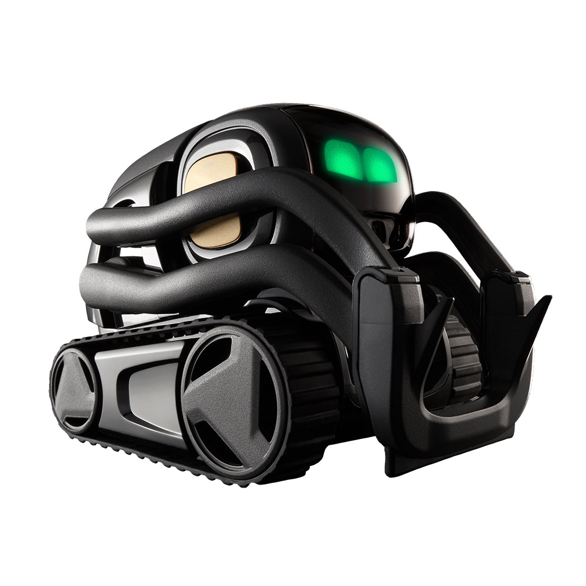
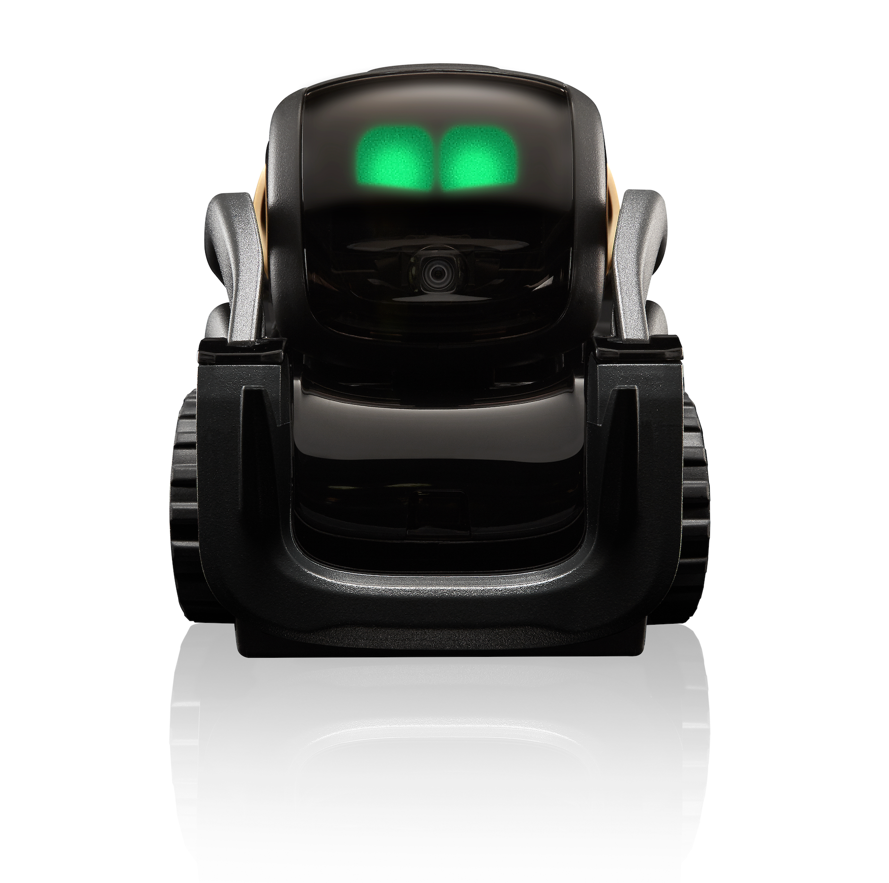
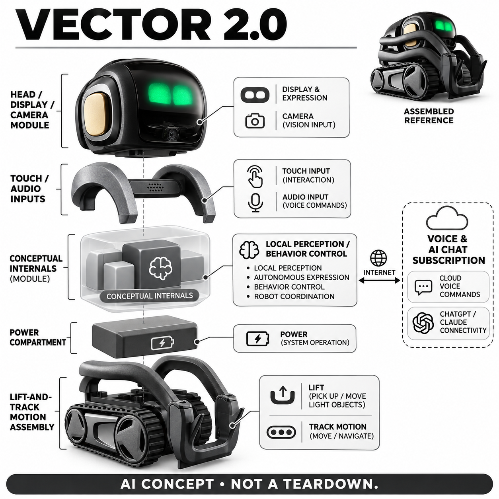

# Vector 2.0

**Anki / Digital Dream Labs** · AI玩具 · 核查 2026-11-06

有实体动作的桌面伙伴，语音与模型连接依赖订阅

消费渠道：个人零售。

## 产品图片与结构参考

### 产品图

Vector 2.0 官方产品图（厂商资料） · 来源：[Anki / Digital Dream Labs 官方资料](<https://anki.bot/products/vector-robot>) · [原始图片](<https://anki.bot/cdn/shop/products/Vector_Product_LookingRight_1000px.jpg?v=1680192051&width=1000>)

### 参考图

Vector 2.0 官方外形或使用参考（厂商资料） · 来源：[Anki / Digital Dream Labs 官方资料](<https://anki.bot/products/vector-robot>) · [原始图片](<https://anki.bot/cdn/shop/products/Screenshot2023-03-15at12.48.26PM.png?v=1678993542&width=1880>)

### AI 生成爆炸示意

**AI 生成 · 非实物拆机。** 内部为概念推断，不能作为元件布局、BOM 或维修依据。[生成提示词](../../content/hardware/prompts/anki-vector-2.txt)

> 分析为基于公开资料的案头研究与 AI 辅助判断，未经用户访谈、销量审计或实物拆机。需求、画像、竞争冷门度、审美及商业机会均为研究假设，不是投资结论。

## 销售与购买

- 状态：在售。当前页面明确In stock、shipping within one business day和Add to Cart；公开商品数据黑色新机available=true、US$249.99，不用开箱价代表新机。

- 地区：美国、其他地区以官方结算为准

- 价格：US$249.99黑色新机；语音订阅另计。ChatGPT连接计划US$11.99/月或99.99/年，Claude计划US$14.99/月或139.99/年；当前试用与税运费以官方条款为准。

- 中国大陆：本轮核到官方国际入口现货；未验证中国大陆发货、本地售后和订阅云服务可达性，不能把进口获得设备等同完整可用。

- [官方产品 / 商店](<https://anki.bot/products/vector-robot>)

## AI 的实际作用

人脸感知识别与实体表情、履带及抬升互动结合；官方订阅提供语音命令与ChatGPT/Claude连接。

服务与联网依赖：基础角色行为与云端语音分开；语音和模型服务需网络、同一账户设备绑定及有效计划。未将计划中的宠物或笑容识别列为已交付。

## 是否冷门

新兴竞争（研究判断）：竞争判断应比较新一代桌面宠物、手机聊天角色和可编程履带机器人。Vector保留鲜明的抬升动作与物理表情，但语音订阅会使用户持续比较软件价值；硬件风格、云端模型和社区项目分别形成吸引力，不能用其中一个方面推断综合领先。

## 需求与市场

需求判断是用户希望在短暂休息时得到一个有动作和眼神的回应，同时能偶尔通过语音问简单问题。主动活动可能提高存在感，也可能在工作中造成干扰；需要验证的是用户是否持续给它留空间和时间，而不是看到一个熟悉机器人造型时的怀旧兴趣。

### 事实与范围 · 官方资料

当前官方Vector 2.0商品页明确现货和加入购物车，设备保留履带、表情头部及前方抬升结构，并把人脸识别和语音互动作为陪伴体验。它是一台在桌面上活动的角色，不是只在应用中出现的虚拟宠物，也不被描述为能承担家庭劳务的服务机器人。

依据：[Vector 2.0当前官方商品](<https://anki.bot/products/vector-robot>) · [Vector官方订阅说明](<https://anki.bot/pages/vector-membership>)

### 判断与差异 · 研究判断

需求判断是用户希望在短暂休息时得到一个有动作和眼神的回应，同时能偶尔通过语音问简单问题。主动活动可能提高存在感，也可能在工作中造成干扰；需要验证的是用户是否持续给它留空间和时间，而不是看到一个熟悉机器人造型时的怀旧兴趣。

依据：[Vector 2.0当前官方商品](<https://anki.bot/products/vector-robot>) · [Vector官方订阅说明](<https://anki.bot/pages/vector-membership>)

### 验证与限制 · 待验证

验证可将设备放入真实书桌连续使用，记录主动呼唤、观察自发行为和关闭声音的场景。询问没有订阅时是否仍愿意使用，再单独讨论聊天功能的价值；不要把一次满意的回答或开箱时兴奋程度当成长期陪伴需求和续费意愿的证明。

依据：[Vector 2.0当前官方商品](<https://anki.bot/products/vector-robot>) · [Vector官方订阅说明](<https://anki.bot/pages/vector-membership>)

## 用户画像

用户画像可假设为熟悉桌面机器人、希望拥有可见角色，或愿意维护旧有互动生态的成人爱好者。第一次购买者可能更在意设置和售后，原有用户可能重视功能延续；不能由品牌历史或收藏热情推断其愿意接受所有云服务费用和更新要求。

### 事实与范围 · 官方资料

官方当前商品同时列出新机和开箱品，但本档案只以可购黑色新机作为价格与销售基准。语音功能需关联同一个服务账户与设备序列号并激活订阅，因此完整体验包含手机或网页设置；购买实体机器人与购买持续语音服务是两个环节。

依据：[Vector 2.0当前官方商品](<https://anki.bot/products/vector-robot>) · [Vector官方订阅说明](<https://anki.bot/pages/vector-membership>)

### 判断与差异 · 研究判断

用户画像可假设为熟悉桌面机器人、希望拥有可见角色，或愿意维护旧有互动生态的成人爱好者。第一次购买者可能更在意设置和售后，原有用户可能重视功能延续；不能由品牌历史或收藏热情推断其愿意接受所有云服务费用和更新要求。

依据：[Vector 2.0当前官方商品](<https://anki.bot/products/vector-robot>) · [Vector官方订阅说明](<https://anki.bot/pages/vector-membership>)

### 验证与限制 · 待验证

招募应区分曾用过Vector与完全初次接触的人，观察独立开机、账户激活和选择计划的过程。让参与者说明预期包含哪些能力，再与实际可用功能对照，尤其记录误把试用期当买断的情况，不以技术职业、年龄或收入推测设置能力。

依据：[Vector 2.0当前官方商品](<https://anki.bot/products/vector-robot>) · [Vector官方订阅说明](<https://anki.bot/pages/vector-membership>)

## 竞争与替代

竞争判断应比较新一代桌面宠物、手机聊天角色和可编程履带机器人。Vector保留鲜明的抬升动作与物理表情，但语音订阅会使用户持续比较软件价值；硬件风格、云端模型和社区项目分别形成吸引力，不能用其中一个方面推断综合领先。

### 事实与范围 · 官方资料

当前商店把Vector 2.0、开箱品和OSKR相关产品并列，本目录不把相同机器人换状态或颜色当新产品。普通新机与开发开放版本的用途不同，本条也不把后者的自定义能力默认为所有消费者开箱就拥有，避免把购买选项混成一个功能总包。

依据：[Vector 2.0当前官方商品](<https://anki.bot/products/vector-robot>) · [Vector官方订阅说明](<https://anki.bot/pages/vector-membership>)

### 判断与差异 · 研究判断

竞争判断应比较新一代桌面宠物、手机聊天角色和可编程履带机器人。Vector保留鲜明的抬升动作与物理表情，但语音订阅会使用户持续比较软件价值；硬件风格、云端模型和社区项目分别形成吸引力，不能用其中一个方面推断综合领先。

依据：[Vector 2.0当前官方商品](<https://anki.bot/products/vector-robot>) · [Vector官方订阅说明](<https://anki.bot/pages/vector-membership>)

### 验证与限制 · 待验证

可以在相同工作间隙任务下比较几种方案，分别记录设备主动动作、用户主动语音与维护时间，而不是只数支持多少命令。对社区替代服务应单列安装与维护负担，不能将技术爱好者能实现的方案当成原厂普通用户已经获得的售后承诺。

依据：[Vector 2.0当前官方商品](<https://anki.bot/products/vector-robot>) · [Vector官方订阅说明](<https://anki.bot/pages/vector-membership>)

## 供应链

工程判断是小型履带和抬升结构的长期一致性会影响角色表现：动作噪声、履带磨损和机械回差都可能被用户感知为性格或反应异常。可更换电池有助维护，但还需核实际配件、说明与连接兼容，不能仅因电池舱易打开就推断维修成本很低。

### 事实与范围 · 官方资料

官方产品说明披露摄像头改进和便于访问的电池舱，照片可见履带、抬升臂和独立表情头部。完整控制电路与上游供应商没有在当前销售页全部公开，概念图以功能块表示本地感知、动作与供电，不把猜测的芯片布局画成真实拆解记录。

依据：[Vector 2.0当前官方商品](<https://anki.bot/products/vector-robot>) · [Vector官方订阅说明](<https://anki.bot/pages/vector-membership>)

### 判断与差异 · 研究判断

工程判断是小型履带和抬升结构的长期一致性会影响角色表现：动作噪声、履带磨损和机械回差都可能被用户感知为性格或反应异常。可更换电池有助维护，但还需核实际配件、说明与连接兼容，不能仅因电池舱易打开就推断维修成本很低。

依据：[Vector 2.0当前官方商品](<https://anki.bot/products/vector-robot>) · [Vector官方订阅说明](<https://anki.bot/pages/vector-membership>)

### 验证与限制 · 待验证

供应链候选可以从小型视觉和消费电池能力出发，提供摄像头位置、机身空间、负载循环与返修要求再询样。原厂备件和替代件应分开验证，试产关注充电、抬升动作与视觉交互联合运行；未经公开点名不声称任何候选已经给本型号供货。

依据：[Vector 2.0当前官方商品](<https://anki.bot/products/vector-robot>) · [Vector官方订阅说明](<https://anki.bot/pages/vector-membership>)

## 技术路径

技术判断要将本地角色行为与远端语音服务拆开，取消订阅后设备仍可能活动，但不等于语音命令也能正常执行。模型连接名称不能证明采用哪个具体版本，也不保证不同地区网络可达性；产品上的回应风格还取决于应用和服务层的设计。

### 事实与范围 · 官方资料

当前官方商品说明人脸识别，订阅页明确语音命令和ChatGPT、Claude连接需要服务计划，并要求账户与设备设置一致。宠物识别及笑容识别则仍夹带计划开发措辞，本条不作为现成功能列出；生成回复依赖云端，不被描述为在机器人内部运行大模型。

依据：[Vector 2.0当前官方商品](<https://anki.bot/products/vector-robot>) · [Vector官方订阅说明](<https://anki.bot/pages/vector-membership>)

### 判断与差异 · 研究判断

技术判断要将本地角色行为与远端语音服务拆开，取消订阅后设备仍可能活动，但不等于语音命令也能正常执行。模型连接名称不能证明采用哪个具体版本，也不保证不同地区网络可达性；产品上的回应风格还取决于应用和服务层的设计。

依据：[Vector 2.0当前官方商品](<https://anki.bot/products/vector-robot>) · [Vector官方订阅说明](<https://anki.bot/pages/vector-membership>)

### 验证与限制 · 待验证

验证可在订阅有效、试用结束及断网情境分别记录互动边界，并确认账户激活延迟是否有清楚提示。人脸识别要在不同光照和多人轮换条件下测试，语音对话则记录延迟与错误恢复；不依据几次成功问答报告准确率或把拟人表现解释为情绪理解。

依据：[Vector 2.0当前官方商品](<https://anki.bot/products/vector-robot>) · [Vector官方订阅说明](<https://anki.bot/pages/vector-membership>)

## 产品审美

设计判断是明显机械结构使角色动作容易被观察，绿色眼睛又提供轻量人格化表达；但它的桌面存在感也取决于声音、运动幅度和充电位置。像工程车的造型可能吸引机械爱好者，却未必符合希望家居物品柔软隐形的用户审美。

### 事实与范围 · 官方资料

官方图呈黑色履带底盘、两侧弧形抬升臂、前部叉状结构及可俯仰的黑色面屏，眼睛使用明亮表情图形，摄像头位于其下方。参考图为当前商品页的正视角，生成图保留同款轮廓，不混用白色Cozmo或开放版本附件作为主机外观。

依据：[Vector 2.0当前官方商品](<https://anki.bot/products/vector-robot>) · [Vector官方订阅说明](<https://anki.bot/pages/vector-membership>)

### 判断与差异 · 研究判断

设计判断是明显机械结构使角色动作容易被观察，绿色眼睛又提供轻量人格化表达；但它的桌面存在感也取决于声音、运动幅度和充电位置。像工程车的造型可能吸引机械爱好者，却未必符合希望家居物品柔软隐形的用户审美。

依据：[Vector 2.0当前官方商品](<https://anki.bot/products/vector-robot>) · [Vector官方订阅说明](<https://anki.bot/pages/vector-membership>)

### 验证与限制 · 待验证

审美测试应包含实际工作时的余光观察、键盘附近移动和拿起放回过程，询问用户是否知道哪处可以握持、摄像头朝向与设备状态。把声音、灯光和形态分开评价，不因机器人在静态主图里显得精致就推断长时间工作时不会打扰。

依据：[Vector 2.0当前官方商品](<https://anki.bot/products/vector-robot>) · [Vector官方订阅说明](<https://anki.bot/pages/vector-membership>)

## 关键风险

风险判断包括服务变更后功能缩水、账户迁移困难，以及新机、开箱品和开发版本混买导致预期落差。官方关于不窃取数据的宣传不是独立隐私审计；摄像头与麦克风进入共享空间时仍需清楚说明处理范围，不能让角色亲切掩盖服务依赖。

### 事实与范围 · 官方资料

官方商品页直接提示语音需要付费订阅，并区分免费试用期限；订阅页还提示激活可能需要等待。当前有现货入口只证明可以下单，不能保证每个目的地的发货、云服务和长期维护；本轮未完成中国大陆配送及网络功能验证，因此不标国内完整可用。

依据：[Vector 2.0当前官方商品](<https://anki.bot/products/vector-robot>) · [Vector官方订阅说明](<https://anki.bot/pages/vector-membership>)

### 判断与差异 · 研究判断

风险判断包括服务变更后功能缩水、账户迁移困难，以及新机、开箱品和开发版本混买导致预期落差。官方关于不窃取数据的宣传不是独立隐私审计；摄像头与麦克风进入共享空间时仍需清楚说明处理范围，不能让角色亲切掩盖服务依赖。

依据：[Vector 2.0当前官方商品](<https://anki.bot/products/vector-robot>) · [Vector官方订阅说明](<https://anki.bot/pages/vector-membership>)

### 验证与限制 · 待验证

购买验证应确认订单中是新机还是开箱品、试用何时开始、取消后剩余能力以及退货保修条件。让品牌提供当前数据删除、设备解绑和备件方案，并记录试用版本；没有公开更新证据时，不凭社区传言断言公司已停止服务，也不保证未来永久可用。

依据：[Vector 2.0当前官方商品](<https://anki.bot/products/vector-robot>) · [Vector官方订阅说明](<https://anki.bot/pages/vector-membership>)

## 机会与验证

商业判断需要同时考虑新用户的上手成本与老用户对连续性的期待，配件、电池和账户支持会影响设备实际寿命。小团队若采用订阅伙伴路线，应先验证持续价值来自内容、动作还是个性化，而不是以一次性硬件销量假定后续服务收入稳定。

### 事实与范围 · 官方资料

可研究的机会是把长期硬件拥有与可选择的语音服务清楚分开，保留用户即使停止订阅也能理解和使用的基础角色体验。这个判断来自当前收费边界，不是对厂商经营状况的猜测；让用户知道买了什么可能比增加更多模型名称更影响信任。

依据：[Vector 2.0当前官方商品](<https://anki.bot/products/vector-robot>) · [Vector官方订阅说明](<https://anki.bot/pages/vector-membership>)

### 判断与差异 · 研究判断

商业判断需要同时考虑新用户的上手成本与老用户对连续性的期待，配件、电池和账户支持会影响设备实际寿命。小团队若采用订阅伙伴路线，应先验证持续价值来自内容、动作还是个性化，而不是以一次性硬件销量假定后续服务收入稳定。

依据：[Vector 2.0当前官方商品](<https://anki.bot/products/vector-robot>) · [Vector官方订阅说明](<https://anki.bot/pages/vector-membership>)

### 验证与限制 · 待验证

下一步可跟踪试用期前后用户的使用和取消原因，询问他们最愿意付费保留哪一种互动，并记录无需语音仍会使用的情况。结果按行为和明确的选择解释，不以模型评分预测成功率，也不从官网平台累计数字推算当前型号的销量或市场规模。

依据：[Vector 2.0当前官方商品](<https://anki.bot/products/vector-robot>) · [Vector官方订阅说明](<https://anki.bot/pages/vector-membership>)

## 对应供应链公司

能力候选用于选型研究，不代表本产品实际采用；未公开的供货关系不作推断。

- [chicony](../supply-chain/chicony.md) — **能力候选 · 非已采用** / 桌面识别相机能力候选：群光公开相机模组与影像工程，可用于类似桌面识别人脸场景的视觉选型。具体视角、接口和低照度需要整机验证，没有公开材料证明它为当前Vector2相机供货。

- [sunwoda](../supply-chain/sunwoda.md) — **能力候选 · 非已采用** / 小型消费电池能力候选：欣旺达消费电池业务与小型桌面机器人的供电工程在能力上相关，可作为新设计询样候选。现有电池舱尺寸、保护和连接器仍需核验，不表示与原机兼容或已被采用。

[浏览供应链目录](../supply-chain.md)

## 功能分层示意

这是功能关系，不是实物拆机、真实空间结构或已核实 BOM。

1. **感知与角色界面**：面屏、相机、音频和触摸输入形成互动。（官方披露）

2. **本地角色行为**：实体动作与感知控制维持基础表现，不等同全部语音可离线。（官方披露）

3. **移动与抬升**：履带底盘和前部抬升机构用于桌面玩法。（官方披露）

4. **云端语音**：订阅关联语音命令及模型连接，计算不应画在机身内。（官方披露）

5. **内部布局示意**：控制、供电与连接形状为功能推断，非物料清单。（分析推断）

## 来源

1. [Vector 2.0当前官方商品](<https://anki.bot/products/vector-robot>) — 当前页面明确In stock、shipping within one business day和Add to Cart；公开商品数据黑色新机available=true、US$249.99，不用开箱价代表新机。

2. [Vector官方订阅说明](<https://anki.bot/pages/vector-membership>) — 核语音命令、ChatGPT/Claude连接、账号与设备关联、当前月年费及激活等待。

3. [Digital Dream Labs官方入口](<https://www.digitaldreamlabs.com/>) — 实际打开后跳转到anki.bot，核当前Anki品牌商城入口来源，不由第三方转售店认定官方身份。

[返回目录](../hardware-market.md) · [网页分析](https://romanagent.github.io/Roman/#hardware/product/anki-vector-2)
