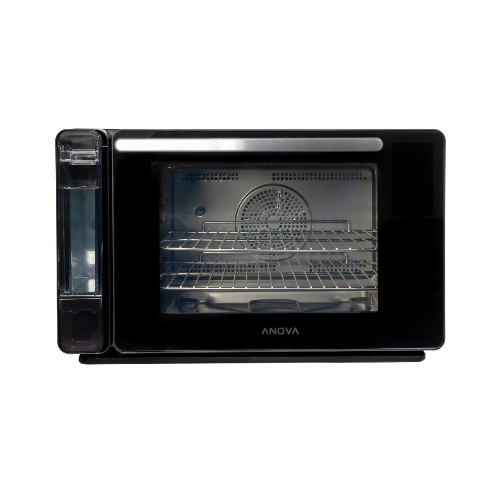
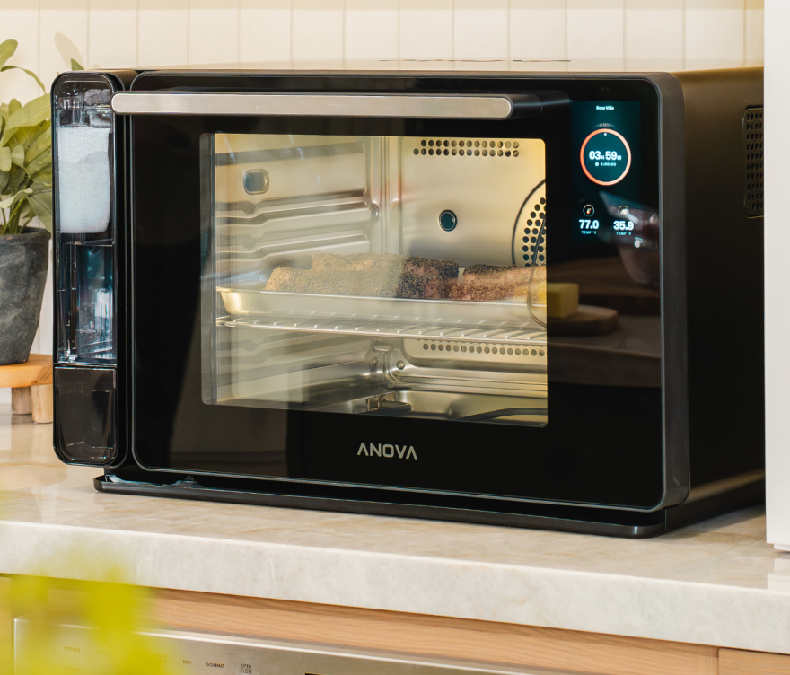
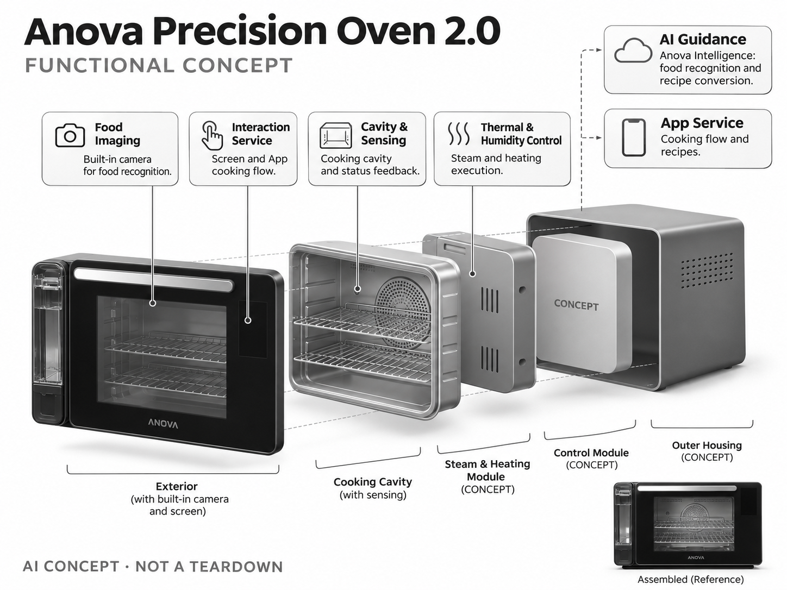

# Anova Precision Oven 2.0

**Anova** · 厨房与烹饪 · 核查 2026-11-04

带食物识别和食谱转换的台面蒸烤箱

消费渠道：个人零售。

## 产品图片与结构参考

### 产品图

Anova Precision Oven 2.0 官方产品图 · 来源：[Anova · 官方图片](<https://anovaculinary.com/products/anova-precision-oven>) · [原始图片](<https://cdn.shopify.com/s/files/1/0619/7487/2253/files/AnovaPrecisionOven2.0straighton_lightoff.jpg?v=1757350290&width=1200>)

### 参考图

Anova Precision Oven 2.0 官方外观、结构或使用参考 · 来源：[Anova · 官方图片](<https://anovaculinary.com/products/anova-precision-oven>) · [原始图片](<https://cdn.shopify.com/s/files/1/0619/7487/2253/files/ProductImage01.png?v=1757350291&width=1200>)

### AI 生成爆炸示意

**AI 生成 · 非实物拆机。** 内部为概念推断，不能作为元件布局、BOM 或维修依据。[生成提示词](../../content/hardware/prompts/anova-precision-oven-2.txt)

> 保留官方图片原始内容和出处；画面宣传参数不是本轮独立实测。

> 分析为基于公开资料的案头研究与 AI 辅助判断，未经用户访谈、销量审计或实物拆机。需求、画像、竞争冷门度、审美及商业机会均为研究假设，不是投资结论。

## 销售与购买

- 状态：在售。美国官网商品页显示US$1,299、Add to cart及配送说明，型号明确为Precision Oven 2.0。

- 地区：美国官方商店

- 价格：US$1,299。核查时官方地区参考价，保留原币种；订阅、税运、附件及优惠以结账为准，预订定金不等于整机价格。

- 中国大陆：本轮核实所列海外官方渠道；中国大陆同型号现货、保修及服务可用性未确认。进口前需核对供电、网络、配件和地区条款。

- [官方产品 / 商店](<https://anovaculinary.com/products/anova-precision-oven>)

## AI 的实际作用

内置相机支持食物识别，Anova Intelligence提供烹饪引导及食谱转换；蒸汽和温控是执行基础，不能单独作为AI证据。

服务与联网依赖：联网与App用于智能引导和食谱能力，基础手动烹饪与AI服务需区分；用户负责食材处理、装盘及清洁。

## 是否冷门

细分专业（研究判断）：高端家庭蒸烤是细分兴趣消费，AI识别仍面临食谱和食物多样性；普通蒸烤箱是强替代。

## 需求与市场

需求假设：家庭烘焙或备餐用户希望减少不同烤箱、蒸汽和配方参数间的试错。应比较识别后需要人工纠正多少次、最终熟度是否一致，而不是把预置菜单数量当作智能水平。

## 用户画像

画像推断：有较大台面、愿学习蒸汽烹饪且在意重复结果的家庭烹饪爱好者，可能已使用低温慢煮设备。只需快速加热的用户未必愿意为相机和配方转换付费，应按任务而非收入细分。

## 竞争与替代

竞争判断：与普通蒸烤箱、嵌入式智能烤箱和其他视觉烹饪设备竞争。开放食谱转换是差异，但空间、清洁和食物识别范围同样限制价值，不能从AI名称推定比熟练手动设置更好。

## 供应链

供应链分析：加热元件、蒸汽水路、温度湿度反馈、相机和门体密封共同决定结果，工厂及BOM未披露。水垢、镜头蒸汽、热循环和售后更换件是关键可靠性问题，不仅是计算模块成本。

## 技术路径

官方说明食物识别和Anova Intelligence引导。技术判断：相同外形可能对应不同厚度与初温，视觉识别只能提供起点；配方转换应让用户复核，不能把模型输出直接当作食物安全保证。

## 产品审美

审美判断：黑色玻璃门和简洁面板适合现代厨房，但大体积和水箱位置会影响台面布局。开门空间、蒸汽排出、擦洗便利和关机状态的视觉安静，应与展示屏一起评估。

## 关键风险

风险判断：摄像头和联网服务增加维护与隐私边界，食谱转换错误可能造成食材浪费。应确认地区电压、软件服务条件与维修支持，蒸汽清洁和水路保养也不会因AI功能而消失。

## 机会与验证

机会假设：用家庭常做的面包、烤肉和复热任务验证识别是否降低操作负担，记录改参数和失败次数。若价值来自稳定蒸汽与温控，可优先提升基础可靠性，而非不断增加聊天式功能。

## 功能分层示意

这是功能关系，不是实物拆机、真实空间结构或已核实 BOM。

1. **食物成像**：内置相机供食物识别。（官方披露）

2. **AI引导**：识别与食谱转换服务。（官方披露）

3. **热湿控制**：蒸汽和加热执行。（官方披露）

4. **腔体与传感**：烹饪腔及状态反馈功能层。（官方披露）

5. **交互服务**：屏幕与App烹饪流程。（官方披露）

## 来源

1. [Anova Precision Oven 2.0 官方购买页](<https://anovaculinary.com/products/anova-precision-oven>) — 实际打开核查当前购买或预订入口，未实际下单；价格与交付按具体地区。

2. [Anova Oven 2.0 官方AI说明](<https://anovaculinary.com/pages/anova-precision-oven>) — 实际打开的官方技术与使用资料，宣传效果并非本轮独立实测。

[返回目录](../hardware-market.md) · [网页分析](https://romanagent.github.io/Roman/#hardware/product/anova-precision-oven-2)
