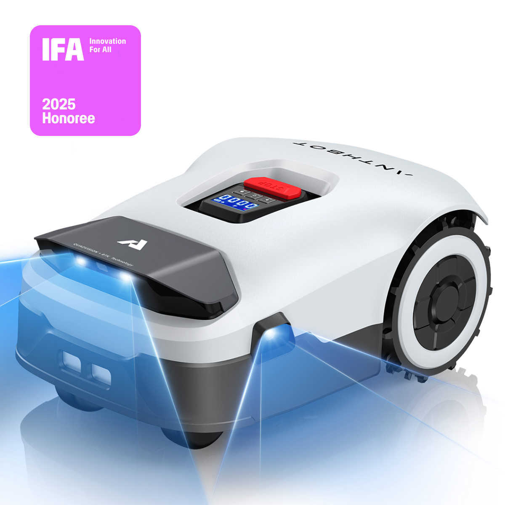
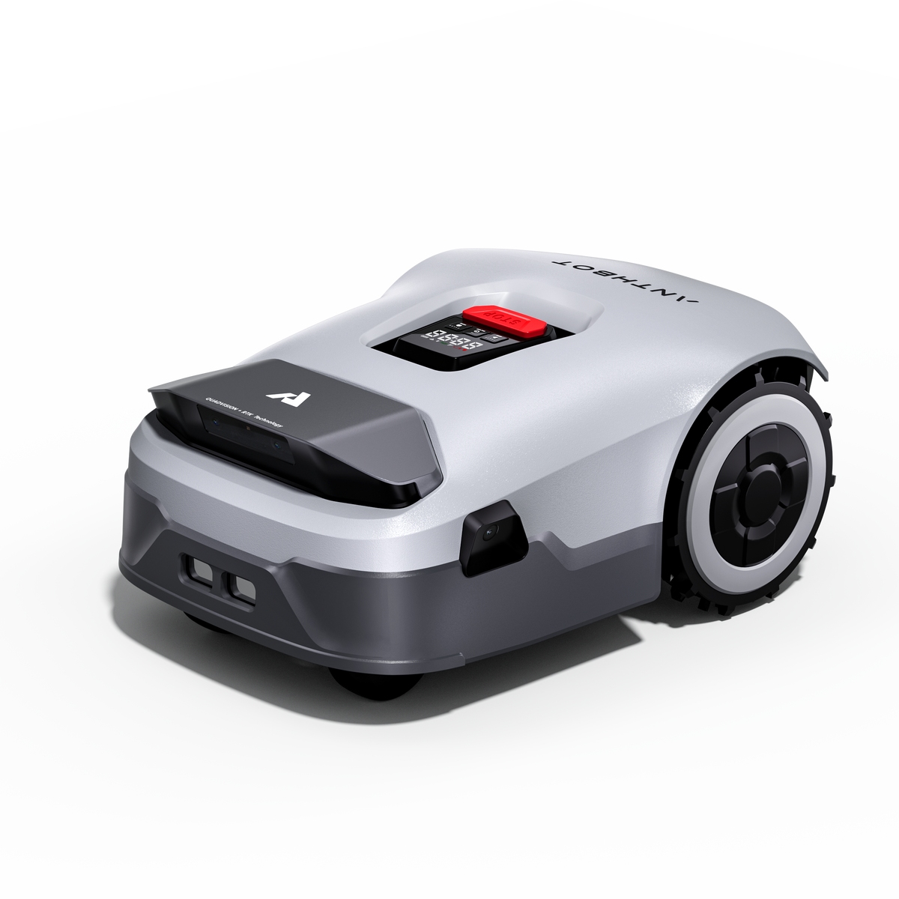
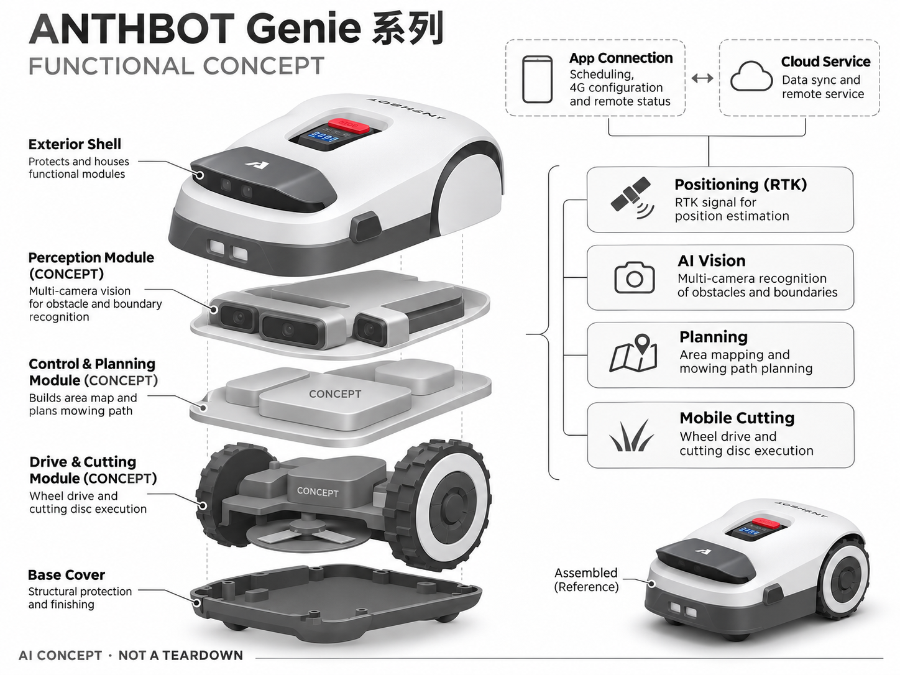

# ANTHBOT Genie 系列

**ANTHBOT** · 庭院与自然 · 核查 2026-11-04

以多相机和RTK融合覆盖家庭草坪维护

消费渠道：个人零售。

## 产品图片与结构参考

### 产品图

ANTHBOT Genie 系列 官方产品图 · 来源：[ANTHBOT · 官方图片](<https://anthbot.com/products/genie-robot-lawn-mower>) · [原始图片](<https://cdn.shopify.com/s/files/1/0761/6403/8958/files/f04fbc442a2f0a11aa9fb8efa0a1b314.png?v=1765874263&width=1200>)

### 参考图

ANTHBOT Genie 系列 官方外观、使用场景或功能参考图 · 来源：[ANTHBOT · 官方图片](<https://anthbot.com/products/genie-robot-lawn-mower>) · [原始图片](<https://cdn.shopify.com/s/files/1/0761/6403/8958/files/lQLPJxFHoUQlZ0fNCcTNCcSwm73MPkqJk28I_vDUOXX3AA_2500_2500.png?v=1765874263&width=1200>)

### AI 生成爆炸示意

**AI 生成 · 非实物拆机。** 内部为概念推断，不能作为元件布局、BOM 或维修依据。[生成提示词](../../content/hardware/prompts/anthbot-genie.txt)

> 保留官方图原始内容与出处；画面中的宣传参数不视为本轮独立实测。

> 以Genie共同机身与功能系列收录，不按电池容量或覆盖面积变体计数。

> 分析为基于公开资料的案头研究与 AI 辅助判断，未经用户访谈、销量审计或实物拆机。需求、画像、竞争冷门度、审美及商业机会均为研究假设，不是投资结论。

## 销售与购买

- 状态：在售。官方商品页提供Genie配置选择、Add to Cart与Buy Now；600/1000/3000按同一系列收录，不用面积和电池变体凑数。

- 地区：美国官方商店

- 价格：US$699起（所查600e配置）。核查时官方页面参考，价格保留原币种；套装、配件、订阅、税运及地区条件分别确认，不把容量版本重复计数。

- 中国大陆：本轮核实海外官方销售；中国大陆同型号现货、售后与云服务未确认。庭院条件、物种范围或定位服务也需按地区验证。

- [官方产品 / 商店](<https://anthbot.com/products/genie-robot-lawn-mower>)

## AI 的实际作用

全频段RTK与多相机AI视觉结合，进行障碍识别、边界判断和弱信号区域导航。

服务与联网依赖：需按具体配置确认4G和赠送服务，基础定位、App调度与远程访问不是同一种依赖；区域支持另行核对。

## 是否冷门

细分专业（研究判断）：机器人割草是专业家庭场景，已有多个RTK加视觉品牌；竞争不因AI多摄配置而消失。

## 需求与市场

需求假设：房主希望在有树荫与多个区域的庭院减少漏割和人工挪机。应比较边界重建、弱信号恢复和通知负担，更多相机并不自动等于更少人工接管，需要完整季节的实际记录。

## 用户画像

画像推断：有多个草坪分区、愿设置App地图且需要规律割草的家庭用户。选型应根据边界、窄道和坡度，而不是只看面积；技术维护能力较弱的用户更需要清晰的故障恢复流程。

## 竞争与替代

竞争判断：RTK加视觉路线已经有多家品牌，竞争包含价格、地图体验、备件与服务。低起价不代表各配置权益相同，创业分析应把4G、安装附件和长期维修放到同一成本框架。

## 供应链

供应链分析：相机标定、定位天线、控制板、轮驱、电池与刀盘构成系统。供应商和BOM未知；户外摄像头污染、传感器更换后的标定以及不同地区无线认证，是重要交付工作。

## 技术路径

官方披露多相机AI避障与RTK融合。技术判断：需要验证动物、玩具和细小物体的漏检，以及GPS不足时的漂移；官网识别类别数量不能当作真实家庭环境的安全保证或准确率。

## 产品审美

审美判断：产品外观偏工具化，清晰的停止控制和可见状态优先于装饰。基站、天线和线缆影响庭院整洁，清洗与换刀步骤也是用户感知设计的一部分，不能只评价机身造型。

## 关键风险

风险判断：刀片与自主移动要求用户管理儿童宠物活动区域，AI识别不能替代安全边界。订阅赠送期限、地区定位和型号配件差异都可能增加后续成本，跨境购买需特别核对保修。

## 机会与验证

机会假设：研究普通房主如何理解地图错误和恢复流程，验证安装指导与维护服务是否提升可用性。若用户无法顺利救援，增加识别对象数量可能不如减少故障步骤更有价值。

## 功能分层示意

这是功能关系，不是实物拆机、真实空间结构或已核实 BOM。

1. **定位**：RTK信号支持位置估计。（官方披露）

2. **AI视觉**：多相机识别障碍与边界。（官方披露）

3. **规划**：区域地图和割草路径。（官方披露）

4. **移动切割**：轮驱与刀盘执行。（官方披露）

5. **App连接**：调度、4G配置和远程状态。（官方披露）

## 来源

1. [ANTHBOT Genie 系列 官方商品页](<https://anthbot.com/products/genie-robot-lawn-mower>) — 已实际打开并核查购买与交付入口；未实际下单。

2. [ANTHBOT 官方视觉与导航介绍](<https://official.anthbot.com/>) — 已实际打开的官方能力、服务或维护说明；不代表独立实测。

[返回目录](../hardware-market.md) · [网页分析](https://romanagent.github.io/Roman/#hardware/product/anthbot-genie)
