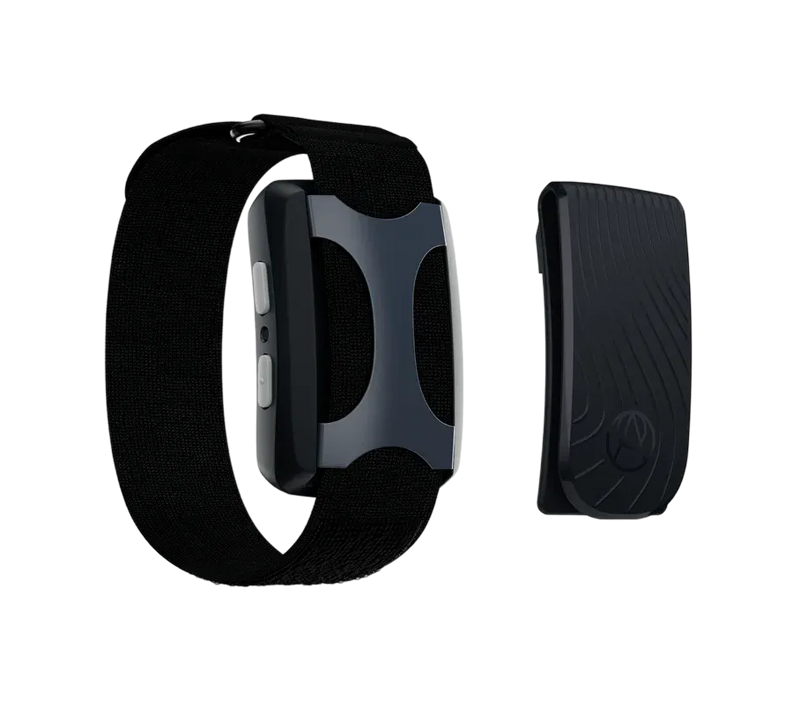
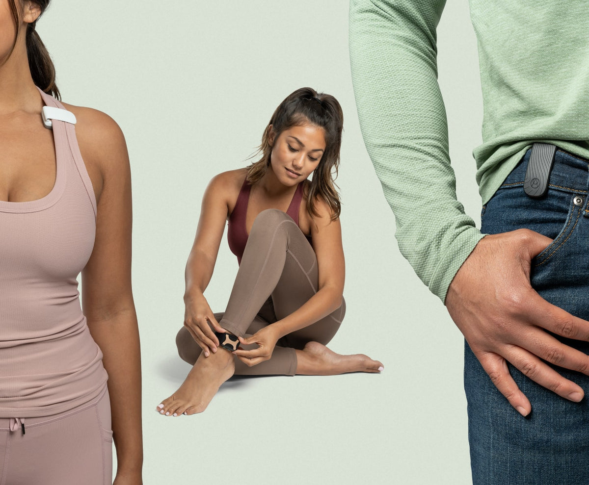
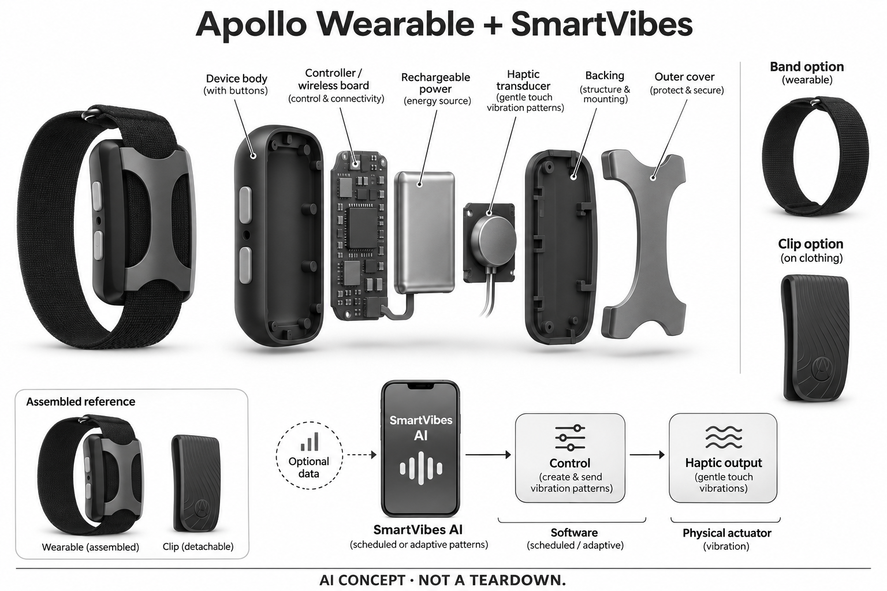

# Apollo Wearable + SmartVibes AI

**Apollo Neuro** · 健康与穿戴 · 核查 2026-11-05

依据个人模式安排触觉反馈的无屏穿戴设备

消费渠道：个人零售。

## 产品图片与结构参考

### 产品图

所核Apollo Stealth设备、腕带与可拆衣物夹 · 来源：[Apollo Neuro · 官方产品图片](<https://apolloneuro.com/products/apollo-wearable-1-year-ai-membership-starter-kit>) · [原始图片](<https://cdn.shopify.com/s/files/1/0267/8341/6517/files/switch-stealth.png?v=1769614222&width=1200>)

### 参考图

Apollo官方腕带与衣物夹佩戴参考；不由人物推断健康效果 · 来源：[Apollo Neuro · 官方产品图片](<https://apolloneuro.com/blogs/news/introducing-apollo-clip>) · [原始图片](<https://apolloneuro.com/cdn/shop/articles/wearing-apollo-clip-on-tanktop-ankle-and-belt.jpg?v=1660852726&width=1200>)

### AI 生成爆炸示意

**AI 生成 · 非实物拆机。** 内部为概念推断，不能作为元件布局、BOM 或维修依据。[生成提示词](../../content/hardware/prompts/apollo-smartvibes.txt)

> 已视觉检查外形、灰阶、文本和数据路径；未知内部为概念模块，不代表实际拆机、完整BOM或医疗效果。

> 实际逐张查看并核对具体型号，保留厂家原图；参考场景和人物不能证明效果，历史图像与当前购买条件分别核查。

> 分析为基于公开资料的案头研究与 AI 辅助判断，未经用户访谈、销量审计或实物拆机。需求、画像、竞争冷门度、审美及商业机会均为研究假设，不是投资结论。

## 销售与购买

- 状态：在售。当前官方具体整机与一年SmartVibes组合US$448、Add to cart，公开商品JSON各所列配色available=true；不是单独App或仅展示的未来硬件。

- 地区：美国、加拿大、欧洲：具体地址按订单确认、澳大利亚、新西兰

- 价格：US$448（整机＋1年SmartVibes组合）。按当前具体商品记录，不借旧落地页优惠价；后续会员与设备使用权益需确认，当前FAQ将设备使用与会员绑定，不能承诺基础功能永久免费。

- 中国大陆：厂家当前国际配送说明未列中国大陆，未核到大陆正式服务；国际页面可访问不等于当地可订购。

- [官方产品 / 商店](<https://apolloneuro.com/products/apollo-wearable-1-year-ai-membership-starter-kit>)

## AI 的实际作用

SmartVibes学习个人睡眠模式，并依据数据自动安排触觉振动；可选接入Oura等额外数据，不等于设备直接读取情绪或脑电。

服务与联网依赖：需要App、账户与有效SmartVibes方案；完整输入传感器与模型执行位置未披露，设备飞行模式可工作不证明全部AI服务离线。

## 是否冷门

新兴竞争（研究判断）：与只记录状态的穿戴不同，重点是软件驱动的触觉输出；与脑电声音头带共享部分睡眠需求但执行路径不同，无本研究疗效、访谈或销量证据。

## 需求与市场

需求假设是用户希望在休息前后获得较少操作的触觉反馈，不必反复选择时间和程序。自动安排可能降低操作负担，也可能在不合适时刻产生打扰；是否有价值取决于本人对振动、佩戴和控制权的接受度，不能从“个性化”名称推断睡眠或情绪一定改善。

### 官方｜模式学习连接触觉输出 · 官方资料

Apollo是可输出振动的无屏穿戴设备，SmartVibes说明其学习个人睡眠模式后依据数据自动启动相应反馈。它不是只保存曲线的追踪器，也不是通过头皮电极采集脑电的头带；本条AI依据在配套软件与触觉安排的结合，不能把所有手动程序或定时功能本身称为人工智能。

依据：[Apollo当前整机与SmartVibes组合商品](<https://apolloneuro.com/products/apollo-wearable-1-year-ai-membership-starter-kit>) · [SmartVibes官方机制说明，2026-03更新](<https://help.apolloneuro.com/hc/en-us/articles/38609616324503-SmartVibes>)

### 判断｜减少手动选择是否值得佩戴 · 研究判断

需求假设是用户希望在休息前后获得较少操作的触觉反馈，不必反复选择时间和程序。自动安排可能降低操作负担，也可能在不合适时刻产生打扰；是否有价值取决于本人对振动、佩戴和控制权的接受度，不能从“个性化”名称推断睡眠或情绪一定改善。

依据：[Apollo当前整机与SmartVibes组合商品](<https://apolloneuro.com/products/apollo-wearable-1-year-ai-membership-starter-kit>) · [SmartVibes官方机制说明，2026-03更新](<https://help.apolloneuro.com/hc/en-us/articles/38609616324503-SmartVibes>)

### 验证｜记录触发时点与本人感受 · 待验证

可在符合厂家适用条件的前提下观察程序何时启动、用户是否注意到，以及是否需要暂停或调整。应将自动触发、手动计划与主观感受分别记录，不以一次觉得放松代表长期效果；本研究没有个人试用或睡眠测量，不承诺治疗、减药或避免夜醒。

依据：[SmartVibes官方机制说明，2026-03更新](<https://help.apolloneuro.com/hc/en-us/articles/38609616324503-SmartVibes>) · [Apollo当前FAQ](<https://apolloneuro.com/pages/apollo-neuro-faqs>)

## 用户画像

有些人可能偏好触觉而不希望睡前播放声音，有些人则容易被振动打断。是否愿意管理充电、会员和手机连接，也会影响持续使用；用户画像应从本人选择的场景出发，而不是把压力、失眠或某种诊断名称直接等同需要该设备，更不能替个人作健康适配判断。

### 官方｜腕带和衣物夹提供不同佩戴方式 · 官方资料

当前组合包含设备、可调腕带、衣物夹和充电线，用户可按产品说明选择佩戴位置。机身按钮与App提供控制，但不同位置的体感并不完全相同；目录只记录厂家公开的佩戴方式，不把官方模特或“任意位置”宣传理解为所有个人条件都能舒适或安全使用。

依据：[Apollo当前整机与SmartVibes组合商品](<https://apolloneuro.com/products/apollo-wearable-1-year-ai-membership-starter-kit>) · [Apollo官方佩戴夹与腕带说明](<https://apolloneuro.com/blogs/news/introducing-apollo-clip>)

### 判断｜感官偏好与生活安排影响采用 · 研究判断

有些人可能偏好触觉而不希望睡前播放声音，有些人则容易被振动打断。是否愿意管理充电、会员和手机连接，也会影响持续使用；用户画像应从本人选择的场景出发，而不是把压力、失眠或某种诊断名称直接等同需要该设备，更不能替个人作健康适配判断。

依据：[SmartVibes官方机制说明，2026-03更新](<https://help.apolloneuro.com/hc/en-us/articles/38609616324503-SmartVibes>) · [Apollo当前FAQ](<https://apolloneuro.com/pages/apollo-neuro-faqs>)

### 验证｜确认停止与调整都容易完成 · 待验证

试用可核对穿戴、启动、改变强度、停止和充电的完整过程，观察在不看手机时是否仍能理解状态。若需要他人帮助，应明确支持范围并保留本人选择；本轮只核公开资料，没有真实触觉、皮肤或睡眠反馈，不能凭设备体积推定低打扰体验。

依据：[Apollo当前整机与SmartVibes组合商品](<https://apolloneuro.com/products/apollo-wearable-1-year-ai-membership-starter-kit>) · [Apollo当前FAQ](<https://apolloneuro.com/pages/apollo-neuro-faqs>) · [Apollo官方佩戴夹与腕带说明](<https://apolloneuro.com/blogs/news/introducing-apollo-clip>)

## 竞争与替代

Elemind和FRENZ主要以自身信号适配声音，Apollo在这里通过个人模式安排身体触觉；共同休息需求不应被品牌数重复计算。另一方面，固定振动程序缺少相同的数据适配流程；比较应关注输入来源、执行方式、打扰和停止路径，不能仅以反馈形式新颖推定效果更好。

### 官方｜当前订单包含明确会员期限 · 官方资料

所核商品是整机与一年SmartVibes组合，当前FAQ将设备使用与有效会员绑定；旧介绍中基础与付费能力的划分不能直接覆盖现行订单。不同页面还有型号称谓与续航口径差异，因此目录采用具体商品名称和价格，不擅自改为新代次，也不承诺一年后所有功能仍免费。

依据：[Apollo当前整机与SmartVibes组合商品](<https://apolloneuro.com/products/apollo-wearable-1-year-ai-membership-starter-kit>) · [Apollo当前FAQ](<https://apolloneuro.com/pages/apollo-neuro-faqs>)

### 判断｜与脑电声音反馈和固定振动分开比较 · 研究判断

Elemind和FRENZ主要以自身信号适配声音，Apollo在这里通过个人模式安排身体触觉；共同休息需求不应被品牌数重复计算。另一方面，固定振动程序缺少相同的数据适配流程；比较应关注输入来源、执行方式、打扰和停止路径，不能仅以反馈形式新颖推定效果更好。

依据：[SmartVibes官方机制说明，2026-03更新](<https://help.apolloneuro.com/hc/en-us/articles/38609616324503-SmartVibes>) · [Apollo当前FAQ](<https://apolloneuro.com/pages/apollo-neuro-faqs>)

### 验证｜比较保持相同的个人目标 · 待验证

可以在本人明确的休息或反馈目标下比较原有方式、手动程序和自动安排，记录操作次数、佩戴负担与停止原因。硬件和会员成本需要一起考虑，外部穿戴设备若使用也应单列；没有独立用户和效果数据时，不把更少操作等同更好健康结果或商业需求。

依据：[Apollo当前整机与SmartVibes组合商品](<https://apolloneuro.com/products/apollo-wearable-1-year-ai-membership-starter-kit>) · [SmartVibes官方机制说明，2026-03更新](<https://help.apolloneuro.com/hc/en-us/articles/38609616324503-SmartVibes>)

## 供应链

同类新设计中，同一个执行器装在不同外壳、腕带和佩戴位置，用户感受可能不同；简单改变振动强度也不等于更合适反馈。供应研究需要结合波形控制、结构耦合、噪声和功耗，而不是从某个振动器件目录直接推导对睡眠或情绪的作用。

### 官方｜执行器与电子控制未点名完整供应商 · 官方资料

公开资料确认触觉输出、无线连接、按钮和充电结构，但没有完整披露执行器、主控、电池和工厂的具体供应关系。商品所称美国制造只是厂家地点表述，不足以推定全部零件来源；概念图使用通用控制、供电和触觉模块，没有添加心率、脑电或电刺激电极。

依据：[Apollo当前整机与SmartVibes组合商品](<https://apolloneuro.com/products/apollo-wearable-1-year-ai-membership-starter-kit>) · [Apollo当前FAQ](<https://apolloneuro.com/pages/apollo-neuro-faqs>)

### 判断｜触感取决于结构耦合与控制 · 研究判断

同类新设计中，同一个执行器装在不同外壳、腕带和佩戴位置，用户感受可能不同；简单改变振动强度也不等于更合适反馈。供应研究需要结合波形控制、结构耦合、噪声和功耗，而不是从某个振动器件目录直接推导对睡眠或情绪的作用。

依据：[Apollo当前整机与SmartVibes组合商品](<https://apolloneuro.com/products/apollo-wearable-1-year-ai-membership-starter-kit>) · [Apollo官方佩戴夹与腕带说明](<https://apolloneuro.com/blogs/news/introducing-apollo-clip>)

### 验证｜候选只覆盖执行和连接能力 · 待验证

触觉器件候选需验证安装方式、重复控制和体感，无线候选则核对App同步、断连和低功耗条件。所列公司没有Apollo点名采用证据，也不包含SmartVibes模型与程序许可；能够输出振动或连接手机，只证明某一功能层可研究，不能视为整套产品效果已成立。

依据：[Apollo当前整机与SmartVibes组合商品](<https://apolloneuro.com/products/apollo-wearable-1-year-ai-membership-starter-kit>) · [SmartVibes官方机制说明，2026-03更新](<https://help.apolloneuro.com/hc/en-us/articles/38609616324503-SmartVibes>) · [Apollo官方佩戴夹与腕带说明](<https://apolloneuro.com/blogs/news/introducing-apollo-clip>)

## 技术路径

软件从一段记录中形成安排，可能识别常见时间模式，但并不因此知道用户为何睡得不佳或当前真实情绪。日程改变、记录缺失或外部数据不同，都可能影响提示的合适程度；技术评价需要区分可观察数据、推断安排和用户感受，避免把个性化描述扩展为生理诊断。

### 官方｜额外穿戴数据为可选输入 · 官方资料

SmartVibes官方说明可以接入Oura数据获得更个性化的安排，同时使用App内的个人睡眠相关信息。完整传感硬件和模型执行位置没有充分公开，因此不能断言Apollo直接测得全部心率或脑电，也不能因机身支持飞行模式，就推定训练、账户与全部AI服务都不依赖网络。

依据：[SmartVibes官方机制说明，2026-03更新](<https://help.apolloneuro.com/hc/en-us/articles/38609616324503-SmartVibes>) · [Apollo当前FAQ](<https://apolloneuro.com/pages/apollo-neuro-faqs>)

### 判断｜学习周期不等于理解身体原因 · 研究判断

软件从一段记录中形成安排，可能识别常见时间模式，但并不因此知道用户为何睡得不佳或当前真实情绪。日程改变、记录缺失或外部数据不同，都可能影响提示的合适程度；技术评价需要区分可观察数据、推断安排和用户感受，避免把个性化描述扩展为生理诊断。

依据：[SmartVibes官方机制说明，2026-03更新](<https://help.apolloneuro.com/hc/en-us/articles/38609616324503-SmartVibes>)

### 验证｜在数据不完整时检查行为 · 待验证

可核对外部账户断开、手机离线、设备未佩戴或日程变化后，自动程序如何处理，以及用户能否查看和修改安排。需要确认旧计划不会被误认为实时识别结果；本目录没有算法准确率或连续睡眠试验，不采用官网的分钟数和相对药物表现作为独立事实。

依据：[SmartVibes官方机制说明，2026-03更新](<https://help.apolloneuro.com/hc/en-us/articles/38609616324503-SmartVibes>) · [Apollo当前FAQ](<https://apolloneuro.com/pages/apollo-neuro-faqs>)

## 产品审美

同一设备在腕部、脚踝或衣物上的拿取、固定和充电过程并不相同，用户可能只愿意保留一种方式。外观低调与实际体感也要分开评价；照片中与衣服自然融合，不意味着睡姿、衣物厚度和活动时不会产生干扰，审美应结合本人生活情境观察。

### 官方｜无屏机身与两个侧面控制键 · 官方资料

官方产品图显示圆角机身、金属固定结构、两个侧面按钮和可拆衣物夹，腕带从固定结构中穿过。设备没有用于显示指标的表屏或可见摄像头；生成图保留这些外部特征，内部触觉模块的具体形状仅为概念，不代表已经核实执行器类型、数量或电路布局。

依据：[Apollo当前整机与SmartVibes组合商品](<https://apolloneuro.com/products/apollo-wearable-1-year-ai-membership-starter-kit>) · [Apollo官方佩戴夹与腕带说明](<https://apolloneuro.com/blogs/news/introducing-apollo-clip>)

### 判断｜附件的日常便利可能决定使用频率 · 研究判断

同一设备在腕部、脚踝或衣物上的拿取、固定和充电过程并不相同，用户可能只愿意保留一种方式。外观低调与实际体感也要分开评价；照片中与衣服自然融合，不意味着睡姿、衣物厚度和活动时不会产生干扰，审美应结合本人生活情境观察。

依据：[Apollo当前整机与SmartVibes组合商品](<https://apolloneuro.com/products/apollo-wearable-1-year-ai-membership-starter-kit>) · [Apollo官方佩戴夹与腕带说明](<https://apolloneuro.com/blogs/news/introducing-apollo-clip>)

### 验证｜比较佩戴与收纳而非只看颜色 · 待验证

可记录换用腕带和衣物夹时的安装、取下、充电与收纳步骤，并检查是否容易丢失附件。把外观偏好、固定稳定和振动感受分别询问，不将某一配色或套装算作新的需求；本轮没有真机触感、耐久或长期佩戴测试，相关体验保持待验证。

依据：[Apollo当前整机与SmartVibes组合商品](<https://apolloneuro.com/products/apollo-wearable-1-year-ai-membership-starter-kit>) · [Apollo官方佩戴夹与腕带说明](<https://apolloneuro.com/blogs/news/introducing-apollo-clip>)

## 关键风险

若用户把所有夜间变化都交给软件解释，可能忽略其他生活或健康因素，也可能因振动不合适而增加负担。自动安排应保留可理解、可停止的控制，用户不需要为满足算法持续佩戴；研究应观察失败和不适配情况，而不是只记录开启功能后的积极描述。

### 官方｜产品宣传不能替代个人效果证据 · 官方资料

官方帮助和商品页包含睡眠改善、相对药物效果及安全性宣传，但本研究没有独立验证这些结果，也不将它们作为保证。当前FAQ还提示设备含磁性部件，需要按自身适用条件核对；目录描述的是触觉反馈工具及其服务，不把它写成可自行治疗疾病或替代用药的设备。

依据：[SmartVibes官方机制说明，2026-03更新](<https://help.apolloneuro.com/hc/en-us/articles/38609616324503-SmartVibes>) · [Apollo当前FAQ](<https://apolloneuro.com/pages/apollo-neuro-faqs>)

### 判断｜自动执行也可能带来不需要的打扰 · 研究判断

若用户把所有夜间变化都交给软件解释，可能忽略其他生活或健康因素，也可能因振动不合适而增加负担。自动安排应保留可理解、可停止的控制，用户不需要为满足算法持续佩戴；研究应观察失败和不适配情况，而不是只记录开启功能后的积极描述。

依据：[SmartVibes官方机制说明，2026-03更新](<https://help.apolloneuro.com/hc/en-us/articles/38609616324503-SmartVibes>) · [Apollo当前FAQ](<https://apolloneuro.com/pages/apollo-neuro-faqs>)

### 验证｜核对会员、数据和地区支持 · 待验证

购买前应确认一年后的权益、账户连接与数据处理条件，并核对实际配送和售后地区。厂家国际列表未列中国大陆，不能把网站可访问当作当地服务完整；本目录未提交个人健康数据，也不建议根据设备或App提示自行改变医疗、心理支持或药物安排。

依据：[Apollo当前整机与SmartVibes组合商品](<https://apolloneuro.com/products/apollo-wearable-1-year-ai-membership-starter-kit>) · [Apollo当前FAQ](<https://apolloneuro.com/pages/apollo-neuro-faqs>) · [Apollo国际订单与配送地区](<https://help.apolloneuro.com/hc/en-us/articles/360051308834-International-orders-availability-shipping-and-fees>)

## 机会与验证

后续可关注用户是否愿意保留自动安排、何时转回手动程序，以及哪些场景宁愿不接受触觉反馈。若个性化只增加设置和解释成本，价值可能有限；需求验证应该以本人可控的体验为基础，而不是依赖“神经科学”标签或大量效果百分比建立信心。

### 官方｜触觉适配与声音适配保留机制差异 · 官方资料

本条以Apollo代表依据个人模式安排触觉反馈的实现，不按颜色、腕带和衣物夹拆成多个创新硬件。它与睡眠声音头带可共享上层任务，但输入与执行路径不同；保留这一差异有助于比较真正的使用取舍，而不是将同一改善休息目标按品牌无限扩张。

依据：[Apollo当前整机与SmartVibes组合商品](<https://apolloneuro.com/products/apollo-wearable-1-year-ai-membership-starter-kit>) · [SmartVibes官方机制说明，2026-03更新](<https://help.apolloneuro.com/hc/en-us/articles/38609616324503-SmartVibes>)

### 判断｜先判断是否减少了本人操作负担 · 研究判断

后续可关注用户是否愿意保留自动安排、何时转回手动程序，以及哪些场景宁愿不接受触觉反馈。若个性化只增加设置和解释成本，价值可能有限；需求验证应该以本人可控的体验为基础，而不是依赖“神经科学”标签或大量效果百分比建立信心。

依据：[SmartVibes官方机制说明，2026-03更新](<https://help.apolloneuro.com/hc/en-us/articles/38609616324503-SmartVibes>) · [Apollo当前FAQ](<https://apolloneuro.com/pages/apollo-neuro-faqs>)

### 验证｜跟踪长期保留的具体程序 · 待验证

可以记录数周内实际使用、暂停、充电、会员和外部数据变化，并观察哪些反馈被主动保留或放弃。当前仅有公开资料和现售商品证据，没有用户访谈、销量或本研究疗效测试；应允许设备只在少量场景有用，或个人最终选择不继续使用的结论。

依据：[Apollo当前整机与SmartVibes组合商品](<https://apolloneuro.com/products/apollo-wearable-1-year-ai-membership-starter-kit>) · [SmartVibes官方机制说明，2026-03更新](<https://help.apolloneuro.com/hc/en-us/articles/38609616324503-SmartVibes>) · [Apollo当前FAQ](<https://apolloneuro.com/pages/apollo-neuro-faqs>)

## 对应供应链公司

能力候选用于选型研究，不代表本产品实际采用；未公开的供货关系不作推断。

- [precision-microdrives](../supply-chain/precision-microdrives.md) — **能力候选 · 非已采用** / 同类触觉反馈穿戴的执行器与耦合研究：Precision Microdrives公开微型振动和消费触觉应用能力，可研究同类设备的波形控制、安装耦合、声音与能耗，但不等于Apollo的专有Vibes程序或临床效果。未发现厂家点名采用证据，具体执行器和结构仍须验证；候选不能由一般振动能力推断能够改善睡眠或情绪。

- [nordic-semiconductor](../supply-chain/nordic-semiconductor.md) — **能力候选 · 非已采用** / 同类触觉反馈设备的低功耗连接候选：Nordic低功耗无线平台可研究App到触觉控制器的指令、同步与断连恢复，需核对实际协议、固件和电源约束。没有Apollo采用来源，也不包含SmartVibes模式学习和第三方账户服务；此链接仅是相近新设计连接层候选，不代表本机芯片或全部AI可离线运行。

[浏览供应链目录](../supply-chain.md)

## 功能分层示意

这是功能关系，不是实物拆机、真实空间结构或已核实 BOM。

1. **数据与记录**：App使用个人睡眠相关记录，可选连接外部穿戴数据；完整传感链未披露。（官方披露）

2. **模式学习**：SmartVibes根据个人模式安排自动反馈，具体模型不公开。（官方披露）

3. **无线与控制**：App及机身按钮管理振动程序，Bluetooth连接配套设备。（官方披露）

4. **触觉执行**：机身输出可感知振动，不是脑电采集或电极式神经刺激。（官方披露）

5. **佩戴与供电**：可充电设备配合腕带或衣物夹，具体接触与体感需本人确认。（官方披露）

## 来源

1. [Apollo当前整机与SmartVibes组合商品](<https://apolloneuro.com/products/apollo-wearable-1-year-ai-membership-starter-kit>) — 已打开及核公开JSON：US$448、各配色可售，含一年会员、腕带、夹和充电线；Made in USA为厂家自述，工厂未点名。

2. [SmartVibes官方机制说明，2026-03更新](<https://help.apolloneuro.com/hc/en-us/articles/38609616324503-SmartVibes>) — 已打开学习个人睡眠模式、自动启动与可选Oura整合；不采用优于药物、睡眠时长等宣传数字为效果保证。

3. [Apollo当前FAQ](<https://apolloneuro.com/pages/apollo-neuro-faqs>) — 已打开当前会员要求、触觉输出、飞行模式和磁性部件；页面混有2.0称谓，不据此更改所核商品型号或拼接续航参数。

4. [Apollo国际订单与配送地区](<https://help.apolloneuro.com/hc/en-us/articles/360051308834-International-orders-availability-shipping-and-fees>) — 已打开美国以外接受加拿大、欧洲、澳大利亚、新西兰订单的说明；不把这些地区概括成全球配送。

5. [Apollo官方佩戴夹与腕带说明](<https://apolloneuro.com/blogs/news/introducing-apollo-clip>) — 已打开官方旧佩戴参考，外形与当前所核组合一致；仅用作佩戴和附件结构，不把旧价格、服务或效果宣传当现行条件。

[返回目录](../hardware-market.md) · [网页分析](https://romanagent.github.io/Roman/#hardware/product/apollo-smartvibes)
