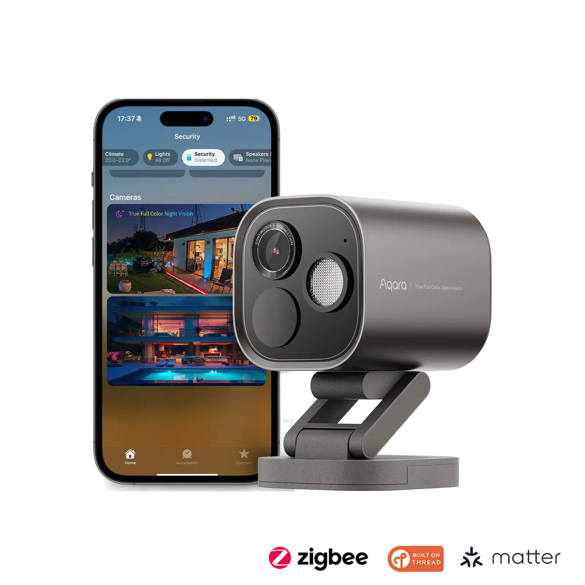
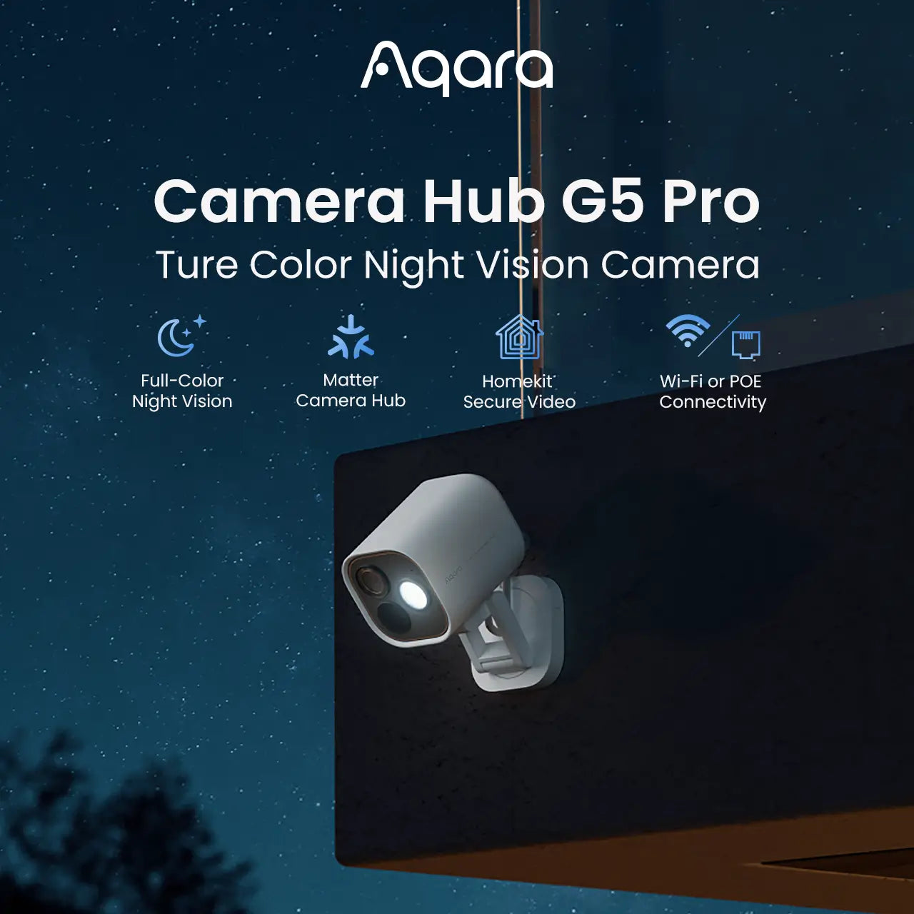
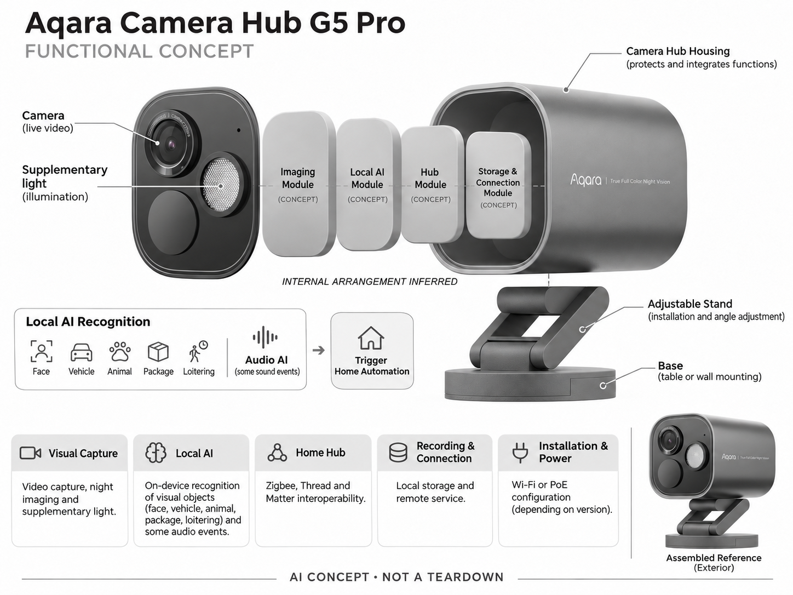

# Aqara Camera Hub G5 Pro

**Aqara** · 家庭安防 · 核查 2026-11-04

将户外摄像头与本地智能家居网关合并

消费渠道：个人零售。

## 产品图片与结构参考

### 产品图

Aqara Camera Hub G5 Pro 官方产品图 · 来源：[Aqara · 官方图片](<https://us.aqara.com/products/camera-hub-g5-pro>) · [原始图片](<https://us.aqara.com/cdn/shop/files/g5-black-wifi.webp?v=1748514684>)

### 参考图

Aqara Camera Hub G5 Pro 官方外观、结构或使用参考 · 来源：[Aqara · 官方图片](<https://us.aqara.com/products/camera-hub-g5-pro>) · [原始图片](<https://us.aqara.com/cdn/shop/files/Camera-G5-features_1.webp?v=1755674231>)

### AI 生成爆炸示意

**AI 生成 · 非实物拆机。** 内部为概念推断，不能作为元件布局、BOM 或维修依据。[生成提示词](../../content/hardware/prompts/aqara-camera-hub-g5-pro.txt)

> 保留官方图片原始内容和出处；画面宣传参数不是本轮独立实测。

> 分析为基于公开资料的案头研究与 AI 辅助判断，未经用户访谈、销量审计或实物拆机。需求、画像、竞争冷门度、审美及商业机会均为研究假设，不是投资结论。

## 销售与购买

- 状态：在售。美国官方商店显示Add to cart，商品JSON available=true；Wi-Fi与PoE连接版本合并为一个G5 Pro，不按颜色及套装重复计数。

- 地区：美国官方商店

- 价格：US$199.99。核查时官方地区参考价，保留原币种；订阅、税运、附件及优惠以结账为准，预订定金不等于整机价格。

- 中国大陆：本轮核实所列海外官方渠道；中国大陆同型号现货、保修及服务可用性未确认。进口前需核对供电、网络、配件和地区条款。

- [官方产品 / 商店](<https://us.aqara.com/products/camera-hub-g5-pro>)

## AI 的实际作用

本地视觉AI识别人脸、车辆、动物、包裹及滞留，音频AI识别部分声音事件，并触发家庭自动化。

服务与联网依赖：本地识别和自动化可在部分断网场景运行，远程查看及云存储依赖网络和服务；Matter与HomeKit功能边界分别核对。

## 是否冷门

竞争密集（研究判断）：家用安防竞争充分；户外本地AI兼网关是较窄组合，并非无人覆盖的蓝海。

## 需求与市场

需求假设：房主希望少看无关录像，并把门口事件连接到灯光或家居提示。应评估误报、事件检索和断网后的可用功能，识别类别多不代表家庭更容易配置或实际更安全。

## 用户画像

画像推断：已有Aqara或Apple Home生态、愿意设置自动化的房主，尤其需要户外观察和网关整合。租住用户与只想简单录像的人可能不需要协议整合，应按安装和维护意愿细分。

## 竞争与替代

竞争判断：与独立户外摄像头、HomeBase系统和单独智能网关竞争。合并设备可减少盒子，也增加兼容性和单点故障影响；本地AI是明确差异，但同类隐私主张已较普遍。

## 供应链

供应链分析：相机、补光、无线协议、算力、存储和户外密封需要整合，具体代工及BOM未知。不同供电版本、热设计、防水与多年固件维护会影响总成本，不能只按相机模组报价估算。

## 技术路径

官方披露本地视觉及音频识别和联动能力。技术判断：人脸与车牌式外观识别受角度光照影响，声音也可能混淆；应提供误报纠正和明确置信边界，不能保证每个事件被正确理解。

## 产品审美

审美判断：支架与圆角机身应融入门廊和外墙，补光亮度与镜头存在感需要平衡。供电走线、安装角度和便于擦拭的外壳决定真实观感，产品图的干净背景无法体现施工后的效果。

## 关键风险

风险判断：家庭门口可能拍到邻居和访客，人脸识别应有清晰权限及删除路径。协议兼容不等于所有平台功能完全一致，云订阅、设备故障和网关离线都可能影响依赖它的联动。

## 机会与验证

机会假设：以少而可信的事件联动切入，验证用户是否能独立设置并修复误触发。若主要价值来自跨平台安装服务，优先完善引导与本地故障恢复，可能比继续增加识别类别更有效。

## 功能分层示意

这是功能关系，不是实物拆机、真实空间结构或已核实 BOM。

1. **视觉采集**：摄像、夜间成像及补光。（官方披露）

2. **本地AI**：视觉对象和音频事件识别。（官方披露）

3. **家庭网关**：Zigbee、Thread和Matter关联能力。（官方披露）

4. **记录连接**：本地存储与远程服务。（官方披露）

5. **安装供电**：Wi-Fi或PoE配置按版本。（官方披露）

## 来源

1. [Aqara Camera Hub G5 Pro 官方购买页](<https://us.aqara.com/products/camera-hub-g5-pro>) — 实际打开核查当前购买或预订入口，未实际下单；价格与交付按具体地区。

2. [Aqara G5 Pro 官方产品说明](<https://www.aqara.com/en/product/camera-hub-g5-pro/>) — 实际打开的官方技术与使用资料，宣传效果并非本轮独立实测。

[返回目录](../hardware-market.md) · [网页分析](https://romanagent.github.io/Roman/#hardware/product/aqara-camera-hub-g5-pro)
