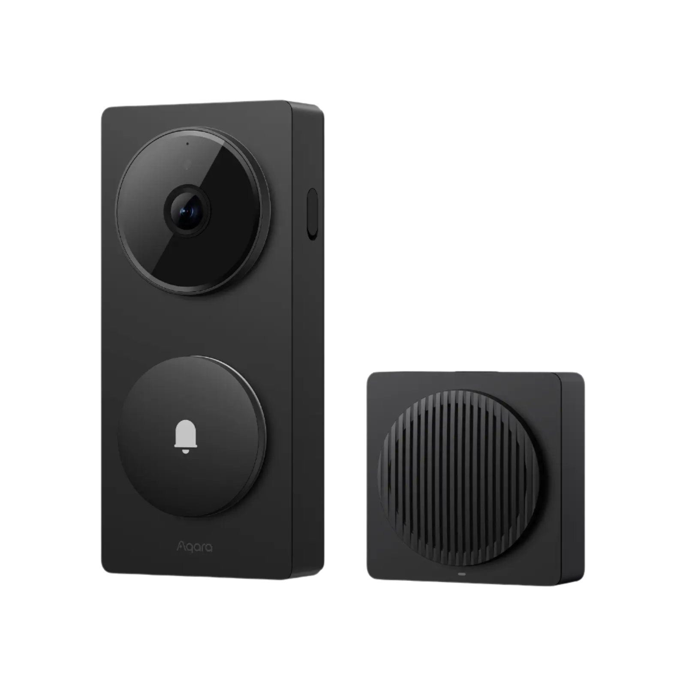
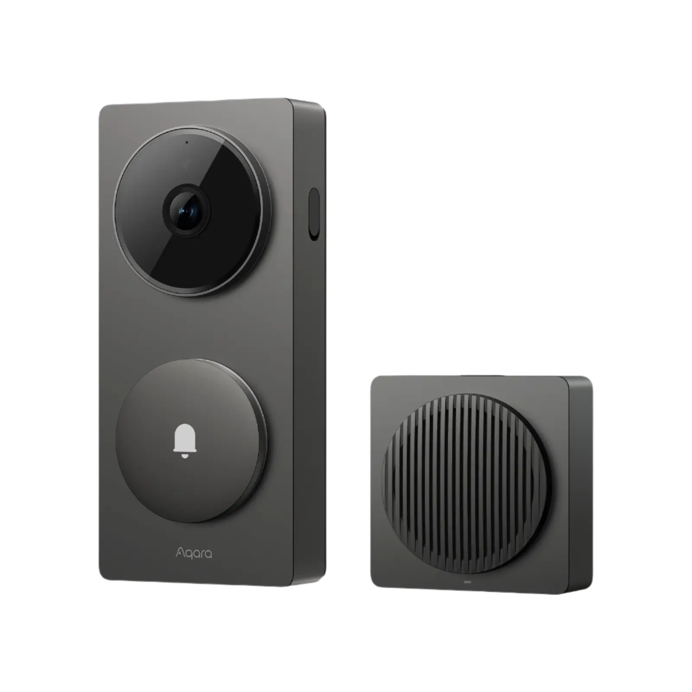
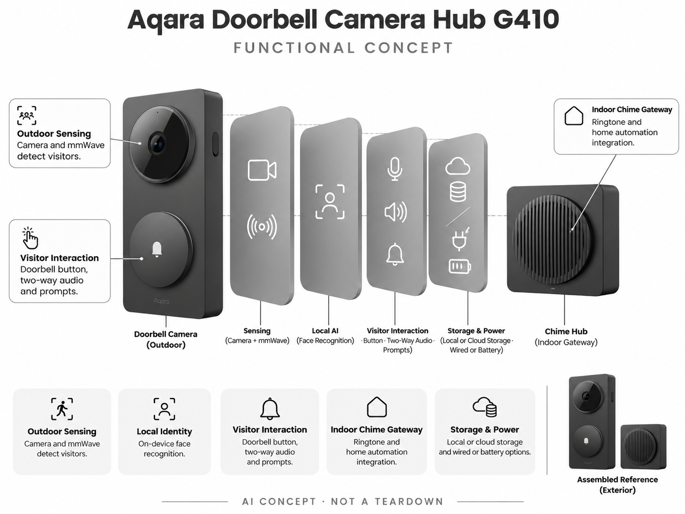

# Aqara Doorbell Camera Hub G410

**Aqara** · 家庭安防 · 核查 2026-11-04

具备本地人脸识别和室内网关的门铃

消费渠道：个人零售。

## 产品图片与结构参考

### 产品图

Aqara Doorbell Camera Hub G410 官方产品图 · 来源：[Aqara · 官方图片](<https://us.aqara.com/collections/smart-cameras>) · [原始图片](<https://us.aqara.com/cdn/shop/files/AqaraSmartVideoDoorbellG410_1.webp?v=1751944817>)

### 参考图

Aqara Doorbell Camera Hub G410 官方外观、结构或使用参考 · 来源：[Aqara · 官方图片](<https://us.aqara.com/collections/smart-cameras>) · [原始图片](<https://us.aqara.com/cdn/shop/files/AqaraSmartVideoDoorbellG410_2.webp?v=1754468031>)

### AI 生成爆炸示意

**AI 生成 · 非实物拆机。** 内部为概念推断，不能作为元件布局、BOM 或维修依据。[生成提示词](../../content/hardware/prompts/aqara-doorbell-g410.txt)

> 保留官方图片原始内容和出处；画面宣传参数不是本轮独立实测。

> 分析为基于公开资料的案头研究与 AI 辅助判断，未经用户访谈、销量审计或实物拆机。需求、画像、竞争冷门度、审美及商业机会均为研究假设，不是投资结论。

## 销售与购买

- 状态：在售。美国官方摄像头商店集合页明确G410、US$144.99、Add to cart与Buy now；旧独立链接失效，保留实际可售入口。

- 地区：美国官方商店

- 价格：US$144.99。核查时官方地区参考价，保留原币种；订阅、税运、附件及优惠以结账为准，预订定金不等于整机价格。

- 中国大陆：本轮核实所列海外官方渠道；中国大陆同型号现货、保修及服务可用性未确认。进口前需核对供电、网络、配件和地区条款。

- [官方产品 / 商店](<https://us.aqara.com/collections/smart-cameras>)

## AI 的实际作用

门铃端的人脸识别与毫米波在场感知辅助区分访客和滞留，室内铃声网关连接家庭自动化。

服务与联网依赖：人脸识别在设备侧；远程查看、云录像和第三方生态各有条件，官方说明RTSP需有线供电。

## 是否冷门

竞争密集（研究判断）：门铃本身是成熟市场，兼本地人脸和网关的组合较细分，但安装与生态竞争强。

## 需求与市场

需求假设：家庭希望及时知道谁到门口，同时减少树影或经过行人的无关提示。应分别测试毫米波在场检测和人脸判断，门铃响起、录像可查与身份识别是不同层次的价值。

## 用户画像

画像推断：有独立门口或允许安装门铃的家庭，尤其已使用Apple Home或Aqara设备者。公寓门外公共空间、旧门铃电源和无线覆盖可能限制部署，不能把家庭数量直接视为可达市场。

## 竞争与替代

竞争判断：与Ring、Nest、Tapo门铃和普通视频门铃竞争，室内铃声兼网关及本地人脸是差异。已有生态和历史录像迁移会形成转换成本，硬件参数领先不必然让用户更换整套系统。

## 供应链

供应链分析：门外相机、毫米波模块、按钮、供电和室内铃声网关共同组成产品；芯片供应商与BOM未披露。户外密封、门口信号、持续供电和按键耐久是量产交付重点。

## 技术路径

官方披露设备端人脸识别与毫米波在场检测。技术判断：帽子、背光和安装高度都会影响识别，雷达只能提供存在信息而非身份；自动化应避免把一次人脸推断直接当作高风险动作授权。

## 产品审美

审美判断：门铃是访客第一眼看到的家居物件，按钮位置、状态提示和安装厚度比复杂界面更重要。室内铃声盒与供电线也属于整体设计，电池模式和有线模式的施工观感不同。

## 关键风险

风险判断：人脸资料、门口录像及访客告知需要妥善管理；识别错误不能作为排除危险或确认身份的保证。RTSP等功能依赖供电方式，购买前需按实际安装条件核对而不是只看协议图标。

## 机会与验证

机会假设：围绕老门铃改装和跨生态使用做需求访谈，记录安装失败、误报和录像查找时间。若客户最大的难点是施工和网络，可靠的安装包与诊断工具可能比更多AI功能更有价值。

## 功能分层示意

这是功能关系，不是实物拆机、真实空间结构或已核实 BOM。

1. **门外感知**：相机与毫米波观察访客。（官方披露）

2. **本地身份**：设备端人脸识别。（官方披露）

3. **访客交互**：按钮、双向音频和提示。（官方披露）

4. **室内铃声网关**：铃声与家庭协议联动。（官方披露）

5. **存储供电**：本地或云存储及有线/电池选项。（官方披露）

## 来源

1. [Aqara Doorbell Camera Hub G410 官方购买页](<https://us.aqara.com/collections/smart-cameras>) — 实际打开核查当前购买或预订入口，未实际下单；价格与交付按具体地区。

2. [Aqara G410 官方技术](<https://www.aqara.com/en/product/doorbell-camera-hub-g410/>) — 实际打开的官方技术与使用资料，宣传效果并非本轮独立实测。

[返回目录](../hardware-market.md) · [网页分析](https://romanagent.github.io/Roman/#hardware/product/aqara-doorbell-g410)
