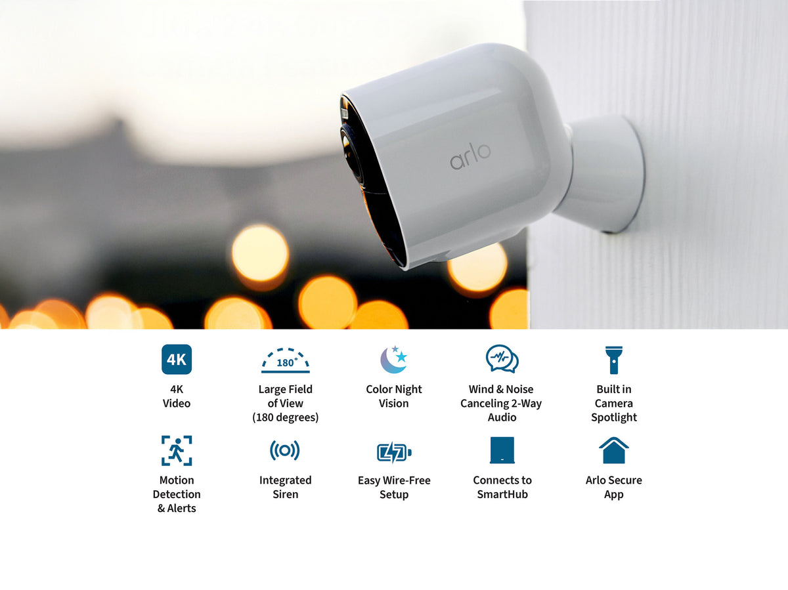
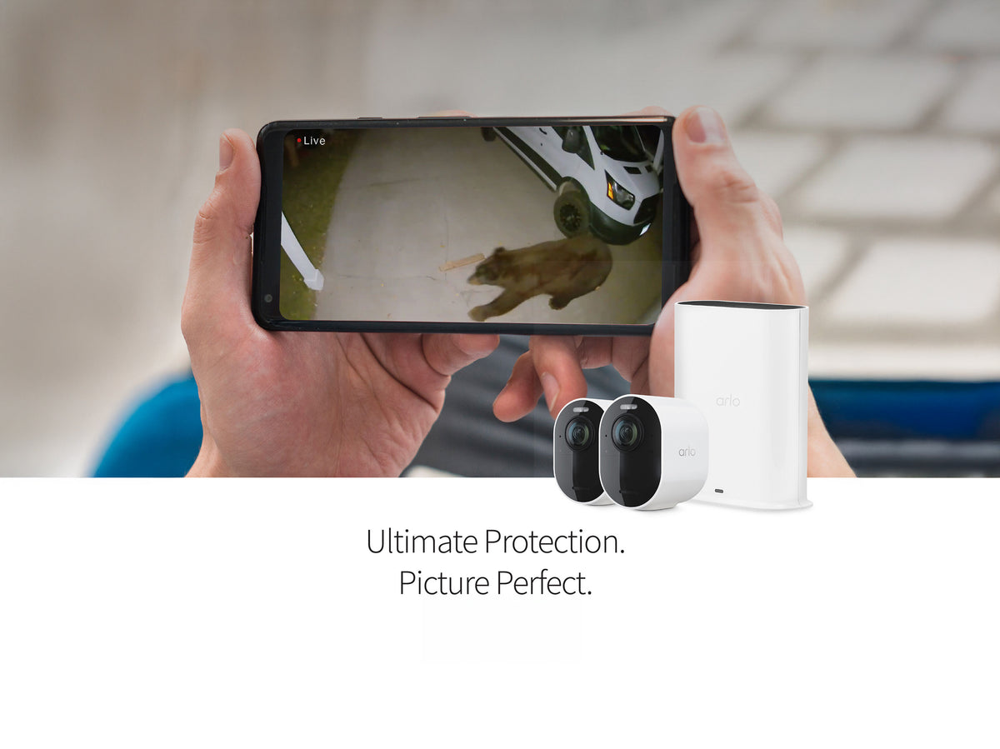
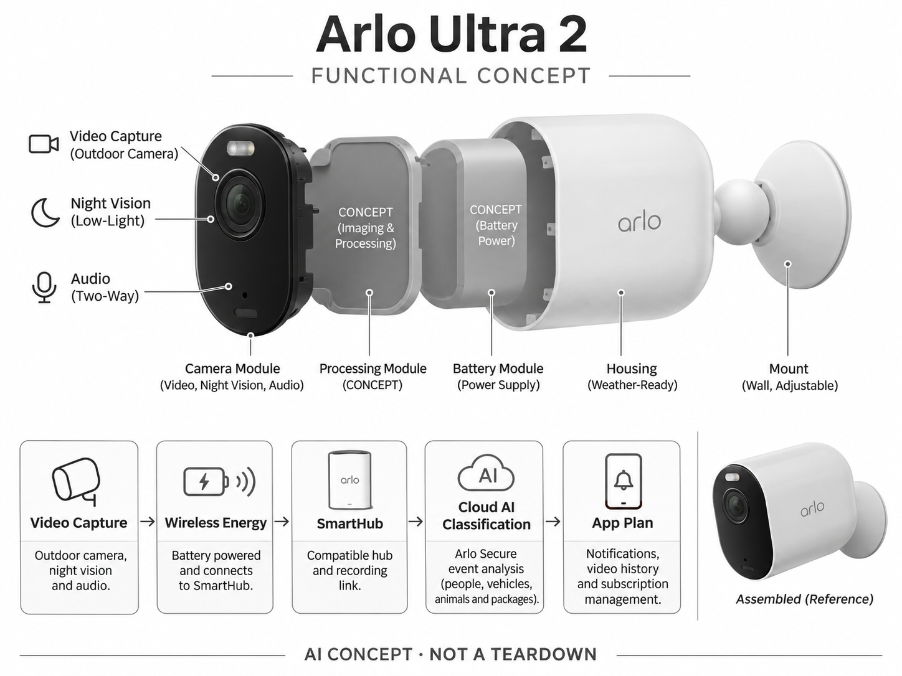

# Arlo Ultra 2

**Arlo** · 家庭安防 · 核查 2026-11-04

通过订阅AI事件分类管理家用无线录像

消费渠道：个人零售。

## 产品图片与结构参考

### 产品图

Arlo Ultra 2 官方产品图 · 来源：[Arlo · 官方图片](<https://us.arlo.com/products/arlo-ultra-2>) · [原始图片](<https://cdn.shopify.com/s/files/1/0916/3567/9551/files/ultra2-info-carousel-1cc.jpg?v=1762378359&width=1200>)

### 参考图

Arlo Ultra 2 官方外观、结构或使用参考 · 来源：[Arlo · 官方图片](<https://us.arlo.com/products/arlo-ultra-2>) · [原始图片](<https://cdn.shopify.com/s/files/1/0916/3567/9551/files/ultra2-info-carousel-2.jpg?v=1762378359&width=1200>)

### AI 生成爆炸示意

**AI 生成 · 非实物拆机。** 内部为概念推断，不能作为元件布局、BOM 或维修依据。[生成提示词](../../content/hardware/prompts/arlo-ultra-2.txt)

> 依据官方外观参考与公开功能生成；未披露的内部布局只作概念模块，不构成BOM或真实结构证据。

> 保留官方图片原始内容和出处；画面宣传参数不是本轮独立实测。

> 分析为基于公开资料的案头研究与 AI 辅助判断，未经用户访谈、销量审计或实物拆机。需求、画像、竞争冷门度、审美及商业机会均为研究假设，不是投资结论。

## 销售与购买

- 状态：在售。官网Ultra 2商品页仍提供配置，实际读取公开商品JSON available=true、price=18999；不与Ultra 3代混淆。

- 地区：美国官方商店

- 价格：US$189.99起（商品公开数据）。核查时官方地区参考价，保留原币种；订阅、税运、附件及优惠以结账为准，预订定金不等于整机价格。

- 中国大陆：本轮核实所列海外官方渠道；中国大陆同型号现货、保修及服务可用性未确认。进口前需核对供电、网络、配件和地区条款。

- [官方产品 / 商店](<https://us.arlo.com/products/arlo-ultra-2>)

## AI 的实际作用

结合Arlo Secure对录像进行人物、车辆、动物和包裹分类；高级自然语言摘要等取决于型号、地区和订阅，不默认全部已开通。

服务与联网依赖：需兼容SmartHub和App；AI告警与云存储主要依赖付费方案，购买摄像头不等于获得永久完整AI服务。

## 是否冷门

竞争密集（研究判断）：无线家庭安防已有强品牌竞争，订阅AI并非冷门；价值取决于安装生态和长期服务体验。

## 需求与市场

需求假设：家庭希望从大量户外运动录像中快速找出人、车或包裹事件，而不是不断检查无关提醒。应比较分类后节省的回看时间与订阅成本，不能把录像分辨率提升等同更可靠的安全判断。

## 用户画像

画像推断：已有Arlo基站或愿意采用其云服务的房主，可能需要无线安装和多台相机管理。对订阅敏感、要求完全本地运行的家庭需求不同，应该明确摄像头与基站的完整使用条件。

## 竞争与替代

竞争判断：与eufy、Nest、Ring及本地录像系统竞争，Arlo的价值包括云服务体验和现有生态。Ultra 2虽已有后续型号，当前可售并不等于更值得购买，需要把软件寿命和配件兼容纳入比较。

## 供应链

供应链分析：可充电相机、光学模组、无线、密封和SmartHub构成系统，实际工厂及BOM未披露。换电池、户外老化、视频带宽与云推理成本影响长期服务，不应只看促销硬件价格。

## 技术路径

官方方案说明视觉对象分类及部分AI摘要能力。技术判断：分类和文字说明可能漏掉上下文，功能需按Ultra 2实际支持范围复核；不能把面向全系列的最新计划功能全部写成单台相机已具备。

## 产品审美

审美判断：小型圆角机身便于挂在外墙和门廊，但支架朝向、充电取下动作与安装高度决定日常体验。家庭摄像头的状态与视野应可理解，简洁外形不应掩盖持续拍摄的事实。

## 关键风险

风险判断：高级AI和云历史需要持续付费，部分识别受地区限制，试用结束后功能会变化。账号泄露、网络中断、误报和漏报都可能影响体验，不能用分类结果替代人工确认可疑事件。

## 机会与验证

机会假设：研究已有基站用户为何扩容或退出订阅，比较云摘要是否真正减少查看负担。若用户主要需要可靠录像，本地存储和透明计划边界可能比更多生成式描述更有商业价值。

## 功能分层示意

这是功能关系，不是实物拆机、真实空间结构或已核实 BOM。

1. **视频采集**：户外相机、夜视与音频。（官方披露）

2. **无线能源**：电池供电及基站连接。（官方披露）

3. **SmartHub**：兼容基站与记录链路。（官方披露）

4. **云AI分类**：Arlo Secure事件分析。（官方披露）

5. **App计划**：通知、历史与订阅管理。（官方披露）

## 来源

1. [Arlo Ultra 2 官方购买页](<https://us.arlo.com/products/arlo-ultra-2>) — 实际打开核查当前购买或预订入口，未实际下单；价格与交付按具体地区。

2. [Arlo Secure 官方AI功能与计划](<https://us.arlo.com/pages/arlo-secure>) — 实际打开的官方技术与使用资料，宣传效果并非本轮独立实测。

3. [官方公开商品库存数据](<https://us.arlo.com/products/arlo-ultra-2.js>) — 实际读取商店公开商品JSON，available为true；不是只凭页面存在判断在售。

[返回目录](../hardware-market.md) · [网页分析](https://romanagent.github.io/Roman/#hardware/product/arlo-ultra-2)
