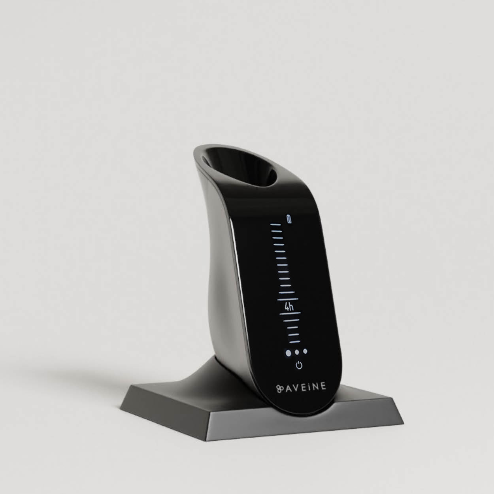
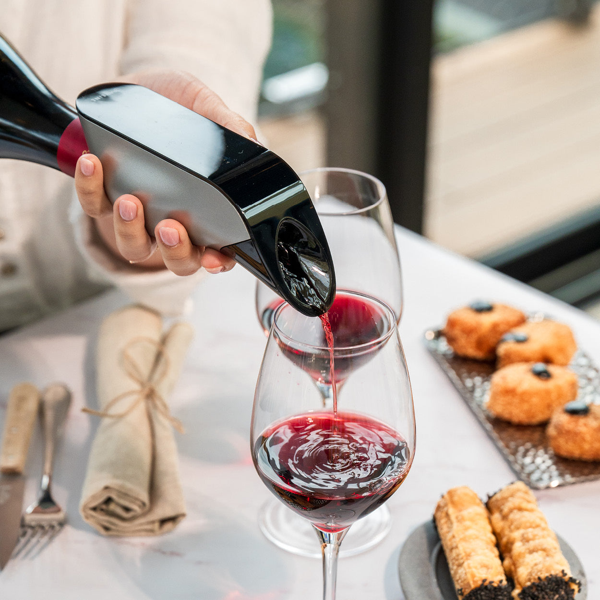
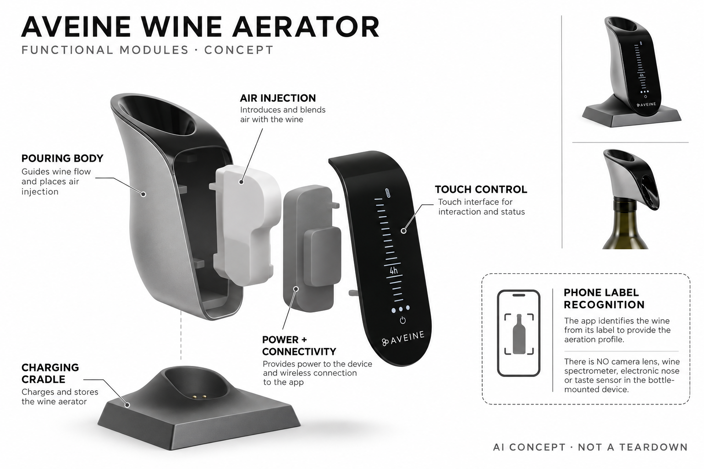

# Aveine Wine Aerator

**Aveine** · 厨房与食物管理 · 核查 2026-11-04

从酒标识别与推荐连接到逐杯主动充氧的便携设备

消费渠道：个人零售。

## 产品图片与结构参考

### 产品图

官方充氧器与充电底座 · 来源：[Aveine · 官方图片](<https://www.aveine.com/products/aveine>) · [原始图片](<https://cdn.shopify.com/s/files/1/0019/3603/1796/files/aerateur-vin-aveine-socle.jpg?v=1720168048>)

### 参考图

官方倒酒使用场景 · 来源：[Aveine · 官方图片](<https://www.aveine.com/products/aveine>) · [原始图片](<https://cdn.shopify.com/s/files/1/0019/3603/1796/files/aerateur-vin-aveine-original2.jpg?v=1720168048>)

### AI 生成爆炸示意

**AI 生成 · 非实物拆机。** 内部为概念推断，不能作为元件布局、BOM 或维修依据。[生成提示词](../../content/hardware/prompts/aveine-wine-aerator.txt)

> 依据已核验官方外形与公开功能生成；未知内部仅为概念功能块，不代表原机电路板、芯片或实际布局。

> 已目视核对当前商品页面对应外形，原图未改色或语义编辑；图片中的营销和适用年龄不替代具体说明。

> 分析为基于公开资料的案头研究与 AI 辅助判断，未经用户访谈、销量审计或实物拆机。需求、画像、竞争冷门度、审美及商业机会均为研究假设，不是投资结论。

## 销售与购买

- 状态：在售。官方当前商品页€359及Add to cart；FAQ明确网站购买、从法国发货并支持国际配送，型号为当前Aveine aerator，不混入旧ES或旅行套装。

- 地区：法国、欧洲、其他国际地区按结算确认

- 价格：官方当前 €359。同一设备可单独购买，刻字、携带包和套装不另算新品；实际税费与跨境运费以地区结算为准，旧2021年价格不沿用。

- 中国大陆：官网FAQ声明全球配送，但本次未验证中国大陆结算、进口与售后；不将中文经销信息或历史展会作为当前国内官方库存证据。

- [官方产品 / 商店](<https://www.aveine.com/products/aveine>)

## AI 的实际作用

官方技术资料明确使用AI和数据库识别手机扫描的酒标，再把推荐充氧设置传给设备；推荐规则含专家决策树，不能将全部算法都称为机器学习。

服务与联网依赖：手机识别与数据库服务需要相应应用连接，设备触屏可手动设置；具体当前识别模型版本未披露，AI不在瓶口设备上直接嗅闻或品尝。

## 是否冷门

细分专业（研究判断）：个人逐杯充氧是小众兴趣任务，视觉识别到实体注气具有工作流差异；清洗、瓶型及偏好主观性限制广泛采用。

## 需求与市场

需求假设：个人品鉴爱好者希望逐杯调整充氧并减少提前准备醒酒器的步骤，标签识别帮助选择起点。价值应由本人感受和重复使用验证，不能把设备刻度等同精确经过相同小时数，也不能用AI推荐宣称客观提升所有酒液品质。

### 产品任务与边界 · 研究判断

需求假设：个人品鉴爱好者希望逐杯调整充氧并减少提前准备醒酒器的步骤，标签识别帮助选择起点。价值应由本人感受和重复使用验证，不能把设备刻度等同精确经过相同小时数，也不能用AI推荐宣称客观提升所有酒液品质。

依据：[Aveine当前官方商品页](<https://www.aveine.com/products/aveine>) · [Aveine官方FAQ](<https://www.aveine.com/pages/faq>)

### 需求判断 · 研究判断

逐杯注气与把整瓶提前倒进醒酒器是不同工作方式，设备可能让用户更快尝试并比较自己的偏好。标签识别只提供起点，不决定所有酒的最佳状态；需求应围绕准备与复现的便利，不把一次主观喜欢转换成对化学变化或品质提升的客观保证。

依据：[Aveine当前官方商品页](<https://www.aveine.com/products/aveine>) · [Aveine官方FAQ](<https://www.aveine.com/pages/faq>)

### 需求验证 · 待验证

需求验证可由自愿且符合当地饮用条件的成年人比较正常少量品鉴流程，记录准备、调整、清洗和再次使用，而非鼓励增加摄入。评价以个人体验为限，不作健康收益推论，也不以机器小时刻度直接证明与传统醒酒经过相同时间完全等效。

依据：[Aveine当前官方商品页](<https://www.aveine.com/products/aveine>) · [Aveine官方FAQ](<https://www.aveine.com/pages/faq>)

## 用户画像

画像推断：愿意清洁设备、使用应用并尝试同瓶不同设置的成年个人爱好者较匹配。偶尔饮用或偏好简单工具的人需求不同，瓶口与保养也限制场景；不根据消费能力或身份推定偏好，不把使用设备当作增加饮酒的理由。

### 适用行为与条件 · 研究判断

画像推断：愿意清洁设备、使用应用并尝试同瓶不同设置的成年个人爱好者较匹配。偶尔饮用或偏好简单工具的人需求不同，瓶口与保养也限制场景；不根据消费能力或身份推定偏好，不把使用设备当作增加饮酒的理由。

依据：[Aveine当前官方商品页](<https://www.aveine.com/products/aveine>) · [Aveine官方FAQ](<https://www.aveine.com/pages/faq>)

### 人群取舍 · 研究判断

愿意尝试不同设置、记录偏好并维护设备的人，和只想直接开瓶的人有不同需求。瓶型、携带习惯、应用接受度与清洗责任都会影响价值，画像应关注具体行为，不以收入、社会身份或懂酒程度给人贴标签，更不将硬件作为增加饮酒的理由。

依据：[Aveine当前官方商品页](<https://www.aveine.com/products/aveine>) · [Aveine官方FAQ](<https://www.aveine.com/pages/faq>)

### 画像验证 · 待验证

画像验证应观察用户真实瓶型、准备方式和对应用建议的采用，记录不能适配或认为步骤增加的人。对只使用固定设置者保留手动方案价值，不把赠礼者喜欢外观等同收礼者持续采用；任何体验研究都不应要求改变个人健康或饮用限制。

依据：[Aveine当前官方商品页](<https://www.aveine.com/products/aveine>) · [Aveine官方FAQ](<https://www.aveine.com/pages/faq>)

## 竞争与替代

竞争判断：与醒酒器、被动充氧器、手动经验和手机识酒应用竞争，差异是识别后连接可调主动注气。当前Original与旧ES、刻字或附件不重复计数；应比较便利、清洗与实际偏好，不把联网本身或宣传小时数当AI优势。

### 比较对象与差异 · 研究判断

竞争判断：与醒酒器、被动充氧器、手动经验和手机识酒应用竞争，差异是识别后连接可调主动注气。当前Original与旧ES、刻字或附件不重复计数；应比较便利、清洗与实际偏好，不把联网本身或宣传小时数当AI优势。

依据：[Aveine当前官方商品页](<https://www.aveine.com/products/aveine>) · [Aveine官方FAQ](<https://www.aveine.com/pages/faq>)

### 竞争判断 · 研究判断

被动充氧器和醒酒器简单且不需充电，主动设备提供可调控制并能从手机建议获得起点，但增加清理和软件依赖。AI标签识别与专家规则不是同一技术，竞争分析不能把普通数据库查询、决策树和实际空气注入都视为学习模型优势。

依据：[Aveine当前官方商品页](<https://www.aveine.com/products/aveine>) · [Aveine官方FAQ](<https://www.aveine.com/pages/faq>)

### 竞争验证 · 待验证

竞争验证可比较同样任务下的准备、可调范围、重复设置和清洁负担，口感评价由个人自行表达。旧ES、刻字和附件套装不扩成多种需求，历史媒体资料只解释技术起源；不能用不同年份的价格、保修或宣传性能直接判断当前产品更优。

依据：[Aveine当前官方商品页](<https://www.aveine.com/products/aveine>) · [Aveine官方FAQ](<https://www.aveine.com/pages/faq>)

## 供应链

供应链分析：瓶口密封、液体通道、注气执行、触屏、电池连接与应用数据库共同工作，具体整机工厂和BOM未披露。材料接触、残留和可清洗性影响长期使用，不能凭技术资料一个芯片型号推导整套成本或实际制造伙伴。

### 功能模块拆分 · 研究判断

瓶口适配、注气执行、液体通路、触屏、电池充电和蓝牙连接构成实体层，标签图像与数据库位于手机服务。公开资料没有完整机电布局，概念图应使用封闭功能块；长期残留、密封与材料接触需要验证，不以单个已知芯片推导整个BOM。

依据：[Aveine当前官方商品页](<https://www.aveine.com/products/aveine>) · [Aveine官方FAQ](<https://www.aveine.com/pages/faq>)

### 制造与供应约束 · 研究判断

供应链分析：瓶口密封、液体通道、注气执行、触屏、电池连接与应用数据库共同工作，具体整机工厂和BOM未披露。材料接触、残留和可清洗性影响长期使用，不能凭技术资料一个芯片型号推导整套成本或实际制造伙伴。

依据：[Aveine当前官方商品页](<https://www.aveine.com/products/aveine>) · [Aveine官方FAQ](<https://www.aveine.com/pages/faq>)

### 候选与证据缺口 · 研究判断

USI可作为蓝牙和低功耗控制整合候选，Protolabs可支持瓶口接口与外壳原型，两者没有Aveine点名采用证据。空气计量、食品接触和可清洗性需要额外专业验证，通用电子或加工能力不能直接证明完整液路符合要求，也不能代替实际工厂询证。

依据：[Aveine当前官方商品页](<https://www.aveine.com/products/aveine>) · [Aveine官方FAQ](<https://www.aveine.com/pages/faq>)

## 技术路径

技术判断：官方2021技术资料明确酒标AI识别，当前FAQ保留扫描与推荐路径，并解释专家决策树及相似酒匹配。应区分视觉识别、规则建议和空气注入，当前模型细节未公开，不能虚构气味传感、分子检测或生成新酒味能力。

### 已披露技术边界 · 研究判断

技术判断：官方2021技术资料明确酒标AI识别，当前FAQ保留扫描与推荐路径，并解释专家决策树及相似酒匹配。应区分视觉识别、规则建议和空气注入，当前模型细节未公开，不能虚构气味传感、分子检测或生成新酒味能力。

依据：[Aveine官方FAQ](<https://www.aveine.com/pages/faq>) · [Aveine官方技术媒体资料](<https://cdn.aveine.paris/website/press-kit-en.pdf>) · [Aveine当前应用路径](<https://www.aveine.com/pages/mobile-application>)

### 系统难点判断 · 研究判断

2021年官方技术资料明确标签识别使用AI，当前FAQ仍描述扫描、数据库与专家决策树推荐，因此应把历史技术与现行路径并列说明。具体当前模型没有公开，不应自行添加新聊天助手、气味识别或分子分析，也不能把规则越多当作机器学习越先进。

依据：[Aveine官方FAQ](<https://www.aveine.com/pages/faq>) · [Aveine官方技术媒体资料](<https://cdn.aveine.paris/website/press-kit-en.pdf>) · [Aveine当前应用路径](<https://www.aveine.com/pages/mobile-application>)

### 技术验证 · 待验证

技术验证应使用已知标签核对识别与推荐设置，检查不识别时是否要求用户补充以及手动调整是否保留。硬件层只做说明允许的正常操作，不拆改泵或灌入其他液体；不能因为手机返回一个时间就认为真实注气量和品鉴效果已经独立验证。

依据：[Aveine官方FAQ](<https://www.aveine.com/pages/faq>) · [Aveine官方技术媒体资料](<https://cdn.aveine.paris/website/press-kit-en.pdf>) · [Aveine当前应用路径](<https://www.aveine.com/pages/mobile-application>)

## 产品审美

审美判断：金属便携机身与小触屏接近酒具，安装在瓶口后会改变重心和倒酒手感。清洗水迹、出液残留与充电底座影响观感，应展示真实比例和手持操作，而不是只用高端餐桌场景暗示专业效果或普遍审美优越。

### 外观与交互语言 · 研究判断

审美判断：金属便携机身与小触屏接近酒具，安装在瓶口后会改变重心和倒酒手感。清洗水迹、出液残留与充电底座影响观感，应展示真实比例和手持操作，而不是只用高端餐桌场景暗示专业效果或普遍审美优越。

依据：[Aveine当前官方商品页](<https://www.aveine.com/products/aveine>) · [Aveine官方FAQ](<https://www.aveine.com/pages/faq>)

### 使用中审美判断 · 研究判断

弧形黑色触屏与银色侧身接近日常酒具，方形充电底座方便固定放置，但瓶口增加的体量会改变握持和重心。实际设计评价应包括倒出、滴落、冲洗和收纳，而不是只看餐桌氛围；原厂数字刻度也不宜在概念图中变成独立科学保证。

依据：[Aveine当前官方商品页](<https://www.aveine.com/products/aveine>) · [Aveine官方FAQ](<https://www.aveine.com/pages/faq>)

### 设计验证 · 待验证

设计验证可观察不同适配瓶型下的拿取、查看屏幕与清洁，记录潮湿手部操作和底座摆位是否便利。让用户自行评价材质与外形，不把奢华场景当作品质证明，也不隐藏瓶口接口或将手机识别画成设备上的摄像镜头。

依据：[Aveine当前官方商品页](<https://www.aveine.com/products/aveine>) · [Aveine官方FAQ](<https://www.aveine.com/pages/faq>)

## 关键风险

风险判断：瓶型不适配、清洗不足、服务变化和识别错误可能影响体验，用户仍需确认材料与使用说明。AI建议属于品鉴参考，不保证健康或适合任何人，当前国际配送也需具体地区确认，不能沿用旧宣传的保修或价格。

### 主要失效与依赖 · 研究判断

风险判断：瓶型不适配、清洗不足、服务变化和识别错误可能影响体验，用户仍需确认材料与使用说明。AI建议属于品鉴参考，不保证健康或适合任何人，当前国际配送也需具体地区确认，不能沿用旧宣传的保修或价格。

依据：[Aveine当前官方商品页](<https://www.aveine.com/products/aveine>) · [Aveine官方FAQ](<https://www.aveine.com/pages/faq>)

### 风险传播判断 · 研究判断

残留、瓶口不匹配和电池不足可能影响使用，应用识别错误又会给出不合适的推荐起点。模型和专家规则均不能保证个人喜欢结果，材料及清洁需要遵循说明；全球配送字样也不能证明具体进口、售后和耗材在中国大陆都已落实。

依据：[Aveine当前官方商品页](<https://www.aveine.com/products/aveine>) · [Aveine官方FAQ](<https://www.aveine.com/pages/faq>)

### 风险验证 · 待验证

风险验证应检查当前地区政策、保修、配对、更新与清洁，采用官方允许的正常流程，不自行试验危险材料。保持审美和品鉴参考定位，不把设备与健康、安全饮用或减少酒精影响联系起来；历史技术文档中的旧价格和权益不用于今日购买判断。

依据：[Aveine当前官方商品页](<https://www.aveine.com/products/aveine>) · [Aveine官方FAQ](<https://www.aveine.com/pages/faq>)

## 机会与验证

机会假设：可从逐杯可调和容易复现个人偏好的场景验证，不必追求识别所有酒款。若普通醒酒器已足够，应用和充电可能增加负担；应记录维护与再使用，不用酒类总市场或味觉权威叙事直接推导智能硬件需求。

### 可能的机会入口 · 研究判断

机会假设：可从逐杯可调和容易复现个人偏好的场景验证，不必追求识别所有酒款。若普通醒酒器已足够，应用和充电可能增加负担；应记录维护与再使用，不用酒类总市场或味觉权威叙事直接推导智能硬件需求。

依据：[Aveine当前官方商品页](<https://www.aveine.com/products/aveine>) · [Aveine官方FAQ](<https://www.aveine.com/pages/faq>)

### 机会成立条件 · 研究判断

机会在于逐杯调整和偏好复现，使个体探索更容易，而不是宣称算法比人更懂所有酒。若用户只想省事，普通工具可能更适合；创业项目可以先验证清洗与可重复控制，再决定是否需要识别模型、数据库规模和持续云端服务。

依据：[Aveine当前官方商品页](<https://www.aveine.com/products/aveine>) · [Aveine官方FAQ](<https://www.aveine.com/pages/faq>)

### 下一步验证 · 待验证

下一步可跟踪少量正常品鉴场景中的设置、手动覆盖和再次使用，记录哪些用户认为额外步骤有意义。对口感保持主观与有条件的解释，不用酒类市场总额、组合刻度或专家权威推算销量，也不把案头分析写成已经开展过盲测研究。

依据：[Aveine当前官方商品页](<https://www.aveine.com/products/aveine>) · [Aveine官方FAQ](<https://www.aveine.com/pages/faq>)

## 对应供应链公司

能力候选用于选型研究，不代表本产品实际采用；未公开的供货关系不作推断。

- [usi](../supply-chain/usi.md) — **能力候选 · 非已采用** / 蓝牙控制与便携能源电子整合：USI公开无线和系统级电子能力可对应应用连接与低功耗控制，但不包括注气计量、酒液接触和清洗验证；未见Aveine型号点名合作，候选不等同实际模组、整机工厂或推荐算法供应。

- [protolabs](../supply-chain/protolabs.md) — **能力候选 · 非已采用** / 瓶口接口与可清洗外壳原型：Protolabs的加工及原型服务可用于瓶口接口、外壳与装配评估，但食品接触、密封和注气路径需要专门确认；没有Aveine实际采用证据，不以通用制造能力推定本机已满足全部液体使用要求。

[浏览供应链目录](../supply-chain.md)

## 功能分层示意

这是功能关系，不是实物拆机、真实空间结构或已核实 BOM。

1. **瓶口接口**：与适配瓶口连接并形成倒酒路径。（官方披露）

2. **主动充氧**：倒出时注入空气，具体内部通路不作假拆机。（官方披露）

3. **触屏控制**：本机可选择或调整充氧设置。（官方披露）

4. **能源与蓝牙**：电池、充电底座和应用连接。（官方披露）

5. **手机识别与推荐**：标签AI识别、数据库及专家规则建议形成软件层。（官方披露）

## 来源

1. [Aveine当前官方商品页](<https://www.aveine.com/products/aveine>) — 实际打开€359加购与当前设备说明；不沿用旧ES或套装价格。

2. [Aveine官方FAQ](<https://www.aveine.com/pages/faq>) — 实际打开扫描、专家决策树、相似酒匹配及法国国际配送；规则不全部当AI。

3. [Aveine官方技术媒体资料](<https://cdn.aveine.paris/website/press-kit-en.pdf>) — 实际打开2021年官方文档，第5页明确酒标识别用AI和数据库；仅用于历史技术路径，当前价格、保修与销售以现页为准。

4. [Aveine当前应用路径](<https://www.aveine.com/pages/mobile-application>) — 实际打开现有标签扫描、数据库和推荐控制路径；未声称当前模型版本或新聊天功能已验证。

[返回目录](../hardware-market.md) · [网页分析](https://romanagent.github.io/Roman/#hardware/product/aveine-wine-aerator)
