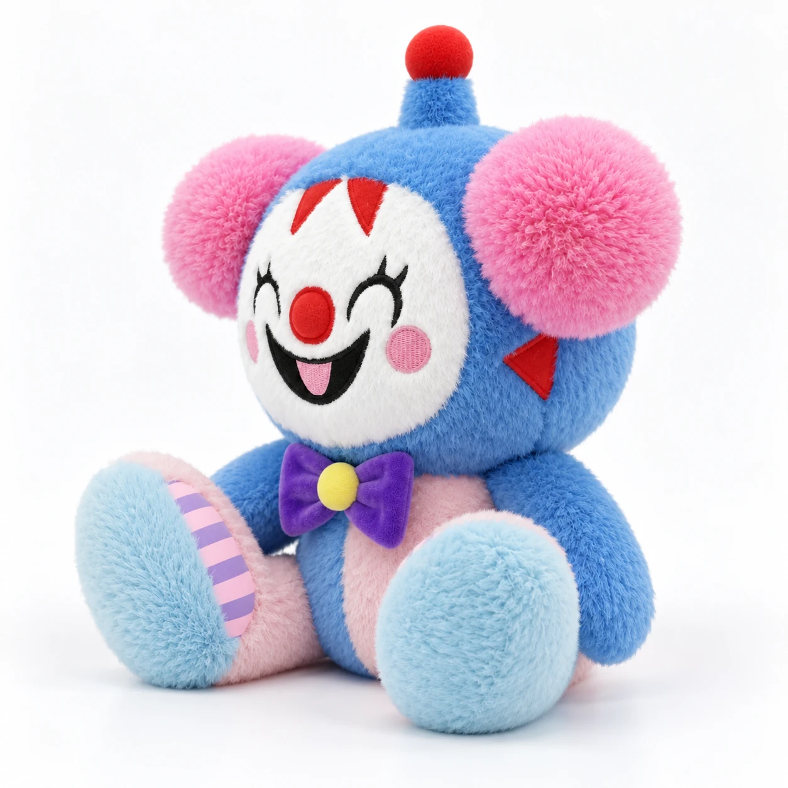
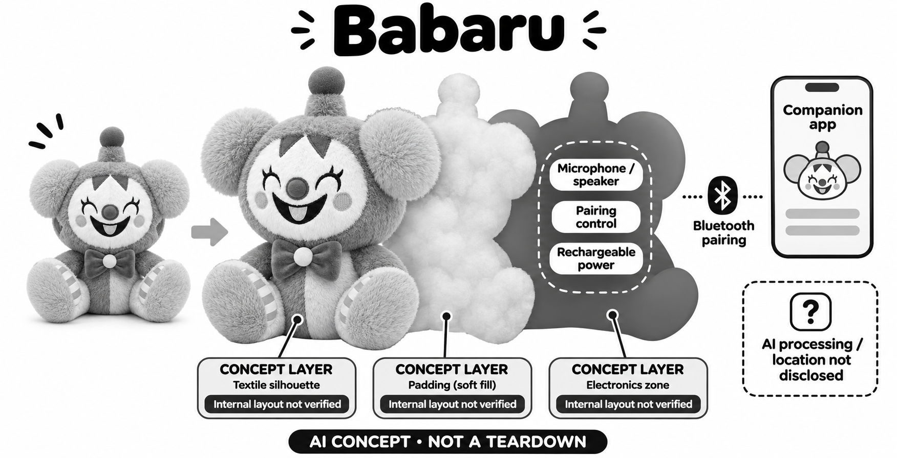

# Babaru Talking Plush

**Babaru** · AI玩具 · 核查 2026-11-06

通过配套应用设置的角色对话毛绒，兼容和资料规则仍需确认

消费渠道：个人零售。

## 产品图片与结构参考

### 产品图

官方Babaru正面外观 · 来源：[产品品牌官网](<https://www.babaru.ai/shop>) · [原始图片](<https://www.babaru.ai/static/c517c361556acbda3ac5/product-gallery-01-optimized.webp>)

### 参考图

官方Babaru斜侧外观 · 来源：[产品品牌官网](<https://www.babaru.ai/shop>) · [原始图片](<https://www.babaru.ai/static/2900923ce76e24a77ca1/product-gallery-02-optimized.webp>)

### AI 生成爆炸示意

**AI 生成 · 非实物拆机。** 内部为概念推断，不能作为元件布局、BOM 或维修依据。[生成提示词](../../content/hardware/prompts/babaru.txt)

> 内置ImageGen按本产品官方参考独立生成；未知内部为概念层，不是BOM或维修依据。

> 图片保留官方原貌；效果、安全与性能宣传不代表本目录独立验证。

> 分析为基于公开资料的案头研究与 AI 辅助判断，未经用户访谈、销量审计或实物拆机。需求、画像、竞争冷门度、审美及商业机会均为研究假设，不是投资结论。

## 销售与购买

- 状态：在售。官方商店显示US$199、数量与Buy Now，购买链接指向官方checkout，配送页说明已确认订单处理；本轮未付款或验证实物交付。服务兼容资料仍有缺口，单独注明。

- 地区：官网支持的国际结算目的地，逐地址确认

- 价格：US$199。官网称无订阅与标准运费包含，国际税费和具体地址需结算确认；不存在已核实的完整运行兼容与长期服务承诺。

- 中国大陆：官方支持语言列中文，但没有公开完整配送国家和设备兼容清单；未核实中国大陆正式渠道、可用App、网络与售后。

- [官方产品 / 商店](<https://www.babaru.ai/shop>)

## AI 的实际作用

官方说明AI即时生成对话，孩子直接向毛绒说话，可围绕问题、故事和语言进行互动；模型、推理位置和每次请求的服务链没有完整披露。

服务与联网依赖：设置使用配套应用与Bluetooth，官方明确不承诺离线运行，并要求购买前确认手机是否需一直在旁及网络条件；不能沿用其他地区页面的完全手机本地推理宣传。

## 是否冷门

新兴竞争（研究判断）：角色性格与即兴故事属于对话毛绒的共同竞争方向；兼容和服务透明度是重要比较点，无销量或独立使用证据支持领先判断。

## 需求与市场

鲜明表情和幽默性格可能帮助孩子开始交流，但持续价值取决于回复能否跟上孩子的想象，而不是角色说话越多越好。需求研究应观察家庭原有讲故事和玩偶游戏有哪些困难，再判断即时回答是否改善这些环节；不能从新奇外形直接推算购买需求。

### 事实｜角色围绕即兴问答与故事展开 · 官方资料

官方将Babaru描述为能即时生成回复的毛绒，玩法包括提出问题、改变故事和语言交流，并明确AI可能误解或给出不准确回答。它不是有真实认知和情绪的人，当前资料也没有披露基础模型版本；目录因此只确认对话机制与玩法，不采用教育成果承诺。

依据：[Babaru官方商店](<https://www.babaru.ai/shop>) · [Babaru官方家长说明](<https://www.babaru.ai/for-parents>)

### 判断｜角色吸引力需要转化为持续玩法 · 研究判断

鲜明表情和幽默性格可能帮助孩子开始交流，但持续价值取决于回复能否跟上孩子的想象，而不是角色说话越多越好。需求研究应观察家庭原有讲故事和玩偶游戏有哪些困难，再判断即时回答是否改善这些环节；不能从新奇外形直接推算购买需求。

依据：[Babaru官方商店](<https://www.babaru.ai/shop>)

### 验证｜先确认一次完整使用链是否成立 · 待验证

由于兼容信息不完整，后续应先核实应用下载、配对和持续对话能否在目标设备完成，再研究孩子的游戏体验。若核心链路尚不能确认，角色宣传就不足以支持采用；本轮没有实物、账号或访谈证据，不声称已验证交付质量和家庭收益。

依据：[Babaru官方商店](<https://www.babaru.ai/shop>) · [Babaru官方家长说明](<https://www.babaru.ai/for-parents>)

## 用户画像

家庭除了孩子之外，还需要有成人理解应用兼容、网络和账户安排。若每次使用都必须保留某台手机在旁，会改变便携性与共享设备的习惯；这一条件目前未充分公开，用户画像应保留这种不确定性，而不是默认买来即可独立全天使用。

### 事实｜当前年龄定位为八岁以上 · 官方资料

家长页面把产品定位为八岁及以上，并要求成人引导设置和使用。网站场景插图不能取代这一明确口径，也不能由毛绒外形推定适合幼儿；它的用途是游戏和对话，官方也说明不提供专业意见或紧急帮助，目录不扩展成照护或治疗工具。

依据：[Babaru官方家长说明](<https://www.babaru.ai/for-parents>)

### 判断｜采用者需要能处理手机依赖 · 研究判断

家庭除了孩子之外，还需要有成人理解应用兼容、网络和账户安排。若每次使用都必须保留某台手机在旁，会改变便携性与共享设备的习惯；这一条件目前未充分公开，用户画像应保留这种不确定性，而不是默认买来即可独立全天使用。

依据：[Babaru官方商店](<https://www.babaru.ai/shop>) · [Babaru官方家长说明](<https://www.babaru.ai/for-parents>)

### 验证｜关注家长设置与儿童期待是否一致 · 待验证

可以让成人说明当前版本有哪些控制，再观察孩子能否理解玩具会出错、如何停止和什么时候需要找真人帮助。测试不应依赖私人家庭经历来展示个性化；若具体应用权限和资料处理仍未说明，应先解决信息缺口，不用流畅对话掩盖管理问题。

依据：[Babaru官方家长说明](<https://www.babaru.ai/for-parents>)

## 竞争与替代

对话毛绒越来越多，外观和语言表演容易被模仿，家长可能更重视是否知道买回去如何使用、资料如何处理和出错找谁。明确边界可以减少后续支持负担；相反，如果大量条件只能逐个询问，初始角色吸引力可能难以抵消购买与维护的不确定性。

### 事实｜公开销售与功能披露程度不同 · 官方资料

商店提供数量、价格和购买入口，配送页说明订单确认后处理；同时商品页明确没有已核实的兼容设备列表。可见销售路径能够支持市场目录收录，却不代表完整服务已被本研究验证；比较其他产品时需要把这些未充分说明的部分一起呈现。

依据：[Babaru官方商店](<https://www.babaru.ai/shop>) · [Babaru官方配送说明](<https://www.babaru.ai/shipping>)

### 判断｜服务透明度本身影响竞争力 · 研究判断

对话毛绒越来越多，外观和语言表演容易被模仿，家长可能更重视是否知道买回去如何使用、资料如何处理和出错找谁。明确边界可以减少后续支持负担；相反，如果大量条件只能逐个询问，初始角色吸引力可能难以抵消购买与维护的不确定性。

依据：[Babaru官方商店](<https://www.babaru.ai/shop>) · [Babaru官方家长说明](<https://www.babaru.ai/for-parents>)

### 验证｜与已明确兼容的替代方案比较 · 待验证

比较时可以把同一手机、语言和家庭网络作为条件，记录从购买资料到完成首次对话所需确认的问题。不能把Babaru较丰富的性格文案直接与其他产品真实功能作比较；本研究没有成本、退货或满意度数据，不据资料缺口断言整个品牌的商业表现。

依据：[Babaru官方商店](<https://www.babaru.ai/shop>) · [Babaru官方家长说明](<https://www.babaru.ai/for-parents>)

## 供应链

角色有较大头部、耳朵和领结，外形设计会影响抱持、摆放和声音路径。类似产品需要在不破坏角色表情的前提下处理采音、出声和电源维护，但这些设计取舍不能由外部照片反推出；供应研究应把毛绒结构和电子功能视为同一系统。

### 事实｜采音播报与电池有有限说明 · 官方资料

官方列出内置扬声器、麦克风和可充电电池，并明确电芯规格不是整机运行时长保证。具体主控、声学布局、充电实现和生产厂商未披露，图片也不能确认内部结构；目录仅作功能拆分，概念图不采用精确电芯形状、料号或维修拆装推断。

依据：[Babaru官方商店](<https://www.babaru.ai/shop>)

### 判断｜大头毛绒与声学开孔需要协调 · 研究判断

角色有较大头部、耳朵和领结，外形设计会影响抱持、摆放和声音路径。类似产品需要在不破坏角色表情的前提下处理采音、出声和电源维护，但这些设计取舍不能由外部照片反推出；供应研究应把毛绒结构和电子功能视为同一系统。

依据：[Babaru官方商店](<https://www.babaru.ai/shop>)

### 验证｜供应候选只服务新设计研究 · 待验证

低功耗配对和MEMS采音公司可提供同类方案的技术入口，但需先定义真实连接协议、手机要求与噪声环境。当前没有Babaru点名器件或制造关系，因此候选不代表原机实际采用；厂商业务能力也不能替代配套应用、模型内容和售后服务的验证。

依据：[Babaru官方商店](<https://www.babaru.ai/shop>)

## 技术路径

AI对话可能由本地设备或外部服务承担，不同路径会改变延迟、兼容和资料控制。对创业研究而言，这个分工比角色会说多少种语言更基础；如果模型位置和依赖未知，就不宜据无订阅价格估算云成本，也不能推断它天然具备更好的隐私。

### 事实｜不能把Bluetooth设置写成完全离线 · 官方资料

商品说明应用和Bluetooth用于设置，并明确不承诺离线运行，要求确认持续手机和互联网条件。与其他地区或旧版页面的宣传不一致时，应保留当前版本的边界；目录不会把连接方式直接解释为生成模型全部在手机或毛绒内部运行。

依据：[Babaru官方商店](<https://www.babaru.ai/shop>)

### 判断｜技术评估应先确认计算位置 · 研究判断

AI对话可能由本地设备或外部服务承担，不同路径会改变延迟、兼容和资料控制。对创业研究而言，这个分工比角色会说多少种语言更基础；如果模型位置和依赖未知，就不宜据无订阅价格估算云成本，也不能推断它天然具备更好的隐私。

依据：[Babaru官方商店](<https://www.babaru.ai/shop>) · [Babaru官方家长说明](<https://www.babaru.ai/for-parents>)

### 验证｜用公开样本检查依赖与失败恢复 · 待验证

获得实际设备后，可确认手机离开、应用后台、网络中断和重启时哪些功能仍在，记录是否有清楚提示。再检查对话误解与语言切换，而不是先追求复杂演示；本轮只访问公开材料，没有安装程序、抓取私有接口或验证模型性能。

依据：[Babaru官方商店](<https://www.babaru.ai/shop>)

## 产品审美

鲜明表情可能让一些孩子容易记住角色，也可能让另一些家庭不感兴趣，审美不能只按可爱程度排序。需要观察孩子是否愿意持续拿着它讲述自己的想法，以及外形是否遮挡操作；性格和视觉设计应与年龄定位及真实互动保持一致。

### 事实｜小丑式角色外形与电子眼不同 · 官方资料

官方照片展示圆脸、刺绣笑容、圆鼻、大耳、顶部软质突起和领结，眼部属于角色图案。图片没有支持摄像头或电子显示的证据，不能因为造型像机器人就添加视觉传感器；生成结构图会以准确外形和抽象音频模块表达，保持未披露部分的边界。

依据：[Babaru官方商店](<https://www.babaru.ai/shop>)

### 判断｜强烈角色风格具有偏好差异 · 研究判断

鲜明表情可能让一些孩子容易记住角色，也可能让另一些家庭不感兴趣，审美不能只按可爱程度排序。需要观察孩子是否愿意持续拿着它讲述自己的想法，以及外形是否遮挡操作；性格和视觉设计应与年龄定位及真实互动保持一致。

依据：[Babaru官方商店](<https://www.babaru.ai/shop>) · [Babaru官方家长说明](<https://www.babaru.ai/for-parents>)

### 验证｜检查日常拿放与维护是否明确 · 待验证

可以观察不同抱持姿势下的声音、操作识别和收纳，再按照随货说明确认清洁和充电要求。没有公开的维护信息不能用想象补齐，尤其不应把毛绒一律描述成可拆可洗；本目录未触摸实物或测试材料，不据照片证明耐用或安全表现。

依据：[Babaru官方商店](<https://www.babaru.ai/shop>)

## 关键风险

不知道语音在哪里处理、手机是否必须持续连接或如何删除记录，会让家庭难以判断是否符合自身需求。该问题并不证明产品存在具体漏洞，却说明需要更完整的交付材料；生成对话再自然，也不能代替清楚的服务责任和停止使用后的处理安排。

### 事实｜对话隐私通知尚未充分公开 · 官方资料

家长页面明确指出现有网站隐私说明主要涉及购物和联系，玩具与应用对话的已核实通知尚未在该处提供。目录保留这一实际信息缺口，不把网站隐私政策扩展成声音和记忆处理承诺，也不假定所有版本都具备同样的家长控制功能。

依据：[Babaru官方家长说明](<https://www.babaru.ai/for-parents>)

### 判断｜信息不足会增加采用与支持风险 · 研究判断

不知道语音在哪里处理、手机是否必须持续连接或如何删除记录，会让家庭难以判断是否符合自身需求。该问题并不证明产品存在具体漏洞，却说明需要更完整的交付材料；生成对话再自然，也不能代替清楚的服务责任和停止使用后的处理安排。

依据：[Babaru官方商店](<https://www.babaru.ai/shop>) · [Babaru官方家长说明](<https://www.babaru.ai/for-parents>)

### 验证｜先获得版本明确的资料再评估 · 待验证

后续应核对实际供应版本、官方App入口、兼容设备、网络条件及声音和历史的控制方式，再设计家庭试用。没有这些资料时不宜宣称已完成隐私或功能审计；本研究不提交私人信息，也不根据官网未披露内容猜测内部模型、数据留存或商业合作。

依据：[Babaru官方商店](<https://www.babaru.ai/shop>) · [Babaru官方家长说明](<https://www.babaru.ai/for-parents>)

## 机会与验证

这种产品的可研究空间是让孩子以角色为媒介展开故事和问题，同时让家长知道如何设置、维护和退出。差异如果只停在角色性格，可能难以维持；补齐兼容和资料说明可能比增加更多宣传功能更有助于验证是否形成可持续的消费需求。

### 事实｜国际下单需逐目的地确认 · 官方资料

配送说明称支持地区以结算地址表为准，标准运费与国际税费有不同边界。它没有提供足够信息证明所有国家都能获得相同服务，中文支持也不等于大陆正式销售；目录因此使用待核的国内情况，不把地区营销页或可打开网站视为进口完成证据。

依据：[Babaru官方配送说明](<https://www.babaru.ai/shipping>)

### 判断｜机会在把角色创意变成清楚交付 · 研究判断

这种产品的可研究空间是让孩子以角色为媒介展开故事和问题，同时让家长知道如何设置、维护和退出。差异如果只停在角色性格，可能难以维持；补齐兼容和资料说明可能比增加更多宣传功能更有助于验证是否形成可持续的消费需求。

依据：[Babaru官方商店](<https://www.babaru.ai/shop>) · [Babaru官方家长说明](<https://www.babaru.ai/for-parents>)

### 验证｜用完整路径衡量而非只看开场表现 · 待验证

从查阅资料、收到设备、首次连接到几周后的继续使用，都应记录阻碍和退出原因。允许家庭认为普通玩偶或固定内容更合适，才能避免把技术新奇当成市场需求；目前没有实物交付、留存、销量或访谈证据，前景判断仅作为研究方向。

依据：[Babaru官方商店](<https://www.babaru.ai/shop>) · [Babaru官方家长说明](<https://www.babaru.ai/for-parents>) · [Babaru官方配送说明](<https://www.babaru.ai/shipping>)

## 对应供应链公司

能力候选用于选型研究，不代表本产品实际采用；未公开的供货关系不作推断。

- [nordic-semiconductor](../supply-chain/nordic-semiconductor.md) — **能力候选 · 非已采用** / 同类手机配对毛绒的低功耗连接候选：Nordic低功耗无线控制能力可用于同类毛绒和手机配对的研发研究，必须先确认采用的音频与控制协议及手机后台限制。它不证明Babaru使用该芯片，也不解决厂商尚未公开的应用兼容与模型服务边界；当前只有能力候选关系，不能据Bluetooth字样推定具体主控。

- [infineon](../supply-chain/infineon.md) — **能力候选 · 非已采用** / 角色毛绒语音采集器件候选：Infineon MEMS麦克风可作为同类小丑风格毛绒的声音输入研究入口，但大头、长毛和拥抱姿势对采音的影响需要实际测试。具体声孔、阵列和回声处理未知，没有Babaru点名采用证据；选择器件不能替代模型内容、隐私规则和整机安全验证。

[浏览供应链目录](../supply-chain.md)

## 功能分层示意

这是功能关系，不是实物拆机、真实空间结构或已核实 BOM。

1. **角色外形**：圆形小丑风格脸、大耳、顶部软突起与领结，产品图支持外观参考。（官方披露）

2. **语音输入输出**：内置麦克风和扬声器；具体数量、位置及器件型号未公开。（官方披露）

3. **配对与设置**：官方说明应用与Bluetooth用于设置；持续手机与网络依赖需向供应方确认。（官方披露）

4. **对话生成**：即时AI回复已由厂商说明，实际模型和端云计算位置未知，示意图应保留未确定边界。（官方披露）

5. **供电与管理**：商品页列可充电电池及成人维护要求，运行时长与具体家长控制依版本确认。（官方披露）

## 来源

1. [Babaru官方商店](<https://www.babaru.ai/shop>) — 已打开199美元、Buy Now、即时AI、Bluetooth与兼容缺口说明，不将电芯规格换算整机运行时长。

2. [Babaru官方家长说明](<https://www.babaru.ai/for-parents>) — 已打开8岁以上定位，明确玩具/App对话隐私通知尚未公开核实，当前设置随版本确认。

3. [Babaru官方配送说明](<https://www.babaru.ai/shipping>) — 已打开订单处理、结算支持地区和国际税运边界；没有推断所有国家均可直接购买。

[返回目录](../hardware-market.md) · [网页分析](https://romanagent.github.io/Roman/#hardware/product/babaru)
