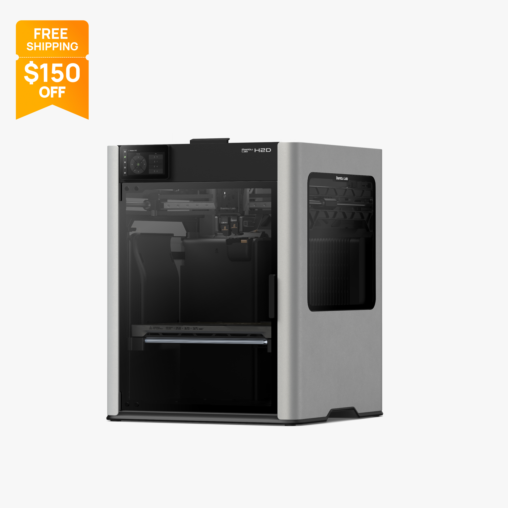
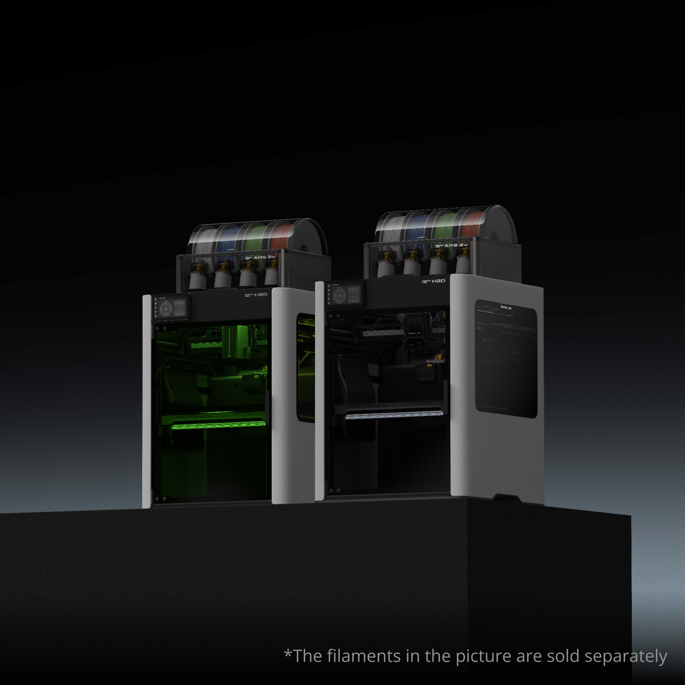
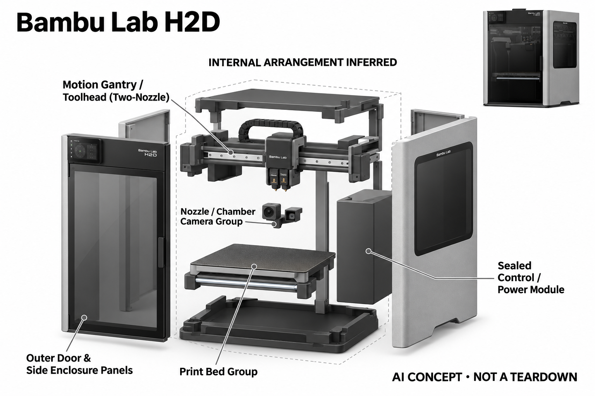

# Bambu Lab H2D

**Bambu Lab** · 专业兴趣工具 · 核查 2026-11-04

用本机视觉检测辅助发现打印失败

消费渠道：个人零售。

## 产品图片与结构参考

### 产品图

Bambu Lab H2D · 官方产品图 · 来源：[Bambu Lab · 官方图片](<https://us.store.bambulab.com/products/h2d>) · [原始图片](<https://store.bblcdn.com/s7/default/b58fc9b7bcd148fd845feb15cac444a1/H2D.jpg>)

### 参考图

Bambu Lab H2D · 官方参考图 · 来源：[Bambu Lab · 官方图片](<https://us.store.bambulab.com/products/h2d>) · [原始图片](<https://store.bblcdn.com/s7/default/11f4bf65d80c4c2d9201d43f3f121bd8/6.jpg>)

### AI 生成爆炸示意

**AI 生成 · 非实物拆机。** 内部为概念推断，不能作为元件布局、BOM 或维修依据。[生成提示词](../../content/hardware/prompts/bambu-lab-h2d.txt)

> 参考图包含AMS及可选激光配置；基础H2D报价不包含全部展示附件。

> 分析为基于公开资料的案头研究与 AI 辅助判断，未经用户访谈、销量审计或实物拆机。需求、画像、竞争冷门度、审美及商业机会均为研究假设，不是投资结论。

## 销售与购买

- 状态：在售。已实际读取美国官方商店公开页面，H2D基础3D打印配置提供Add to Cart和Buy Now。AMS、激光与切割组合均作为可选配置，不重复计数。

- 地区：美国本土官方商店

- 价格：美国官方H2D本体 US$1,599。核查日页面快照；运费、税费、会员和配送区域按官方结算确认，不视为中国到手价。

- 中国大陆：本轮核实所列区域官方商店；未确认中国大陆官方现货、账户及完整服务，不把境外可购等同大陆可用。

- [官方产品 / 商店](<https://us.store.bambulab.com/products/h2d>)

## AI 的实际作用

喷嘴相机与腔内相机支持AI检测缠料、空打和面条状失败；官方说明部分检测在本机NPU运行。自动调平与普通传感联锁不全部归为AI。

服务与联网依赖：打印需要切片、材料配置和定期维护；检测应启用并满足光照要求，灵敏度会影响误报。激光等模块需另购和按条件安装，本条不默认包含。

## 是否冷门

新兴竞争（研究判断）：AI报警与人工维护责任分开形成具体使用场景；本轮没有销量与市场份额证据。

## 需求与市场

需求假设：个人模型制作和多材料打印耗时较长，用户希望更早发现失败，减少材料和时间损失。应比较报警发生时实际挽救了多少打印，而不是仅看相机能否识别明显的失败照片。

## 用户画像

画像推断：有固定工作区、经常制作模型或功能件，并愿意维护设备的个人创作者较匹配。基础打印与可选激光需要不同空间和操作条件，不能将多功能宣传视为任何家庭都适合的一体方案。

## 竞争与替代

竞争判断：桌面打印机与外置监控方案都可提供失败提醒，双喷嘴和完整软件生态形成差异。高端个人制造仍有成熟竞争，AI检测不能独立解释整机价格，也不能替代对实际材料任务的比较。

## 供应链

供应链推断：双喷嘴、运动系统、加热腔和相机需要共同稳定运行，多材料配件增加耗材与维护环节。官方未披露完整工厂和物料成本；热端更换、校准与跨区配件支持都影响长期交付。

## 技术路径

官方检测说明区分喷嘴与腔内视觉，并披露本机NPU处理及光照条件。技术判断应测试不同材料、颜色和失败阶段，记录漏报与误报，不能把报警能力当作打印必成功或无人值守安全保证。

## 产品审美

审美判断：封闭箱体、可视门与集中控制屏让设备更像个人工作台家电，材料系统仍会增加上方体积。运行声音、桌面振动和维护空间影响家庭接受度，整洁渲染不能替代实际工作环境。

## 关键风险

风险判断：AI可能误报或漏报，热端、运动机构和材料处理仍需按说明操作；新增激光模块带来不同使用要求。网络与软件更新也会影响流程，重要任务应保留稳定配置和人工检查。

## 机会与验证

市场观察：可以记录个人创作者一个月的真实打印任务，统计报警后人工介入、节省材料与维护时间。把双喷嘴、材料系统和AI监测分别评估，不用机器参数或自动化程度预测创业项目成功。

## 功能分层示意

这是功能关系，不是实物拆机、真实空间结构或已核实 BOM。

1. **材料与运动**：双喷嘴及运动系统执行切片任务。（官方披露）

2. **视觉输入**：喷嘴和腔内相机观察打印状态。（官方披露）

3. **本机检测**：AI判断缠料、空打与失败形态。（官方披露）

4. **操作反馈**：界面报警、暂停与人工检查维护。（官方披露）

## 来源

1. [H2D美国官方零售页](<https://us.store.bambulab.com/products/h2d>) — 已读取官方公开商品HTML，按基础3D打印配置报价。

2. [H2D官方智能检测手册](<https://wiki.bambulab.com/en/h2/manual/intelligent-detection>) — 已读取官方手册，包含本机NPU、光照和灵敏度说明。

3. [Bambu官方H2D个人制造介绍](<https://blog.bambulab.com/bambu-lab-launches-h2d-to-rethink-personal-manufacturing/>) — 已实际打开官方页面；功能说明不等于独立性能测量。

[返回目录](../hardware-market.md) · [网页分析](https://romanagent.github.io/Roman/#hardware/product/bambu-lab-h2d)
