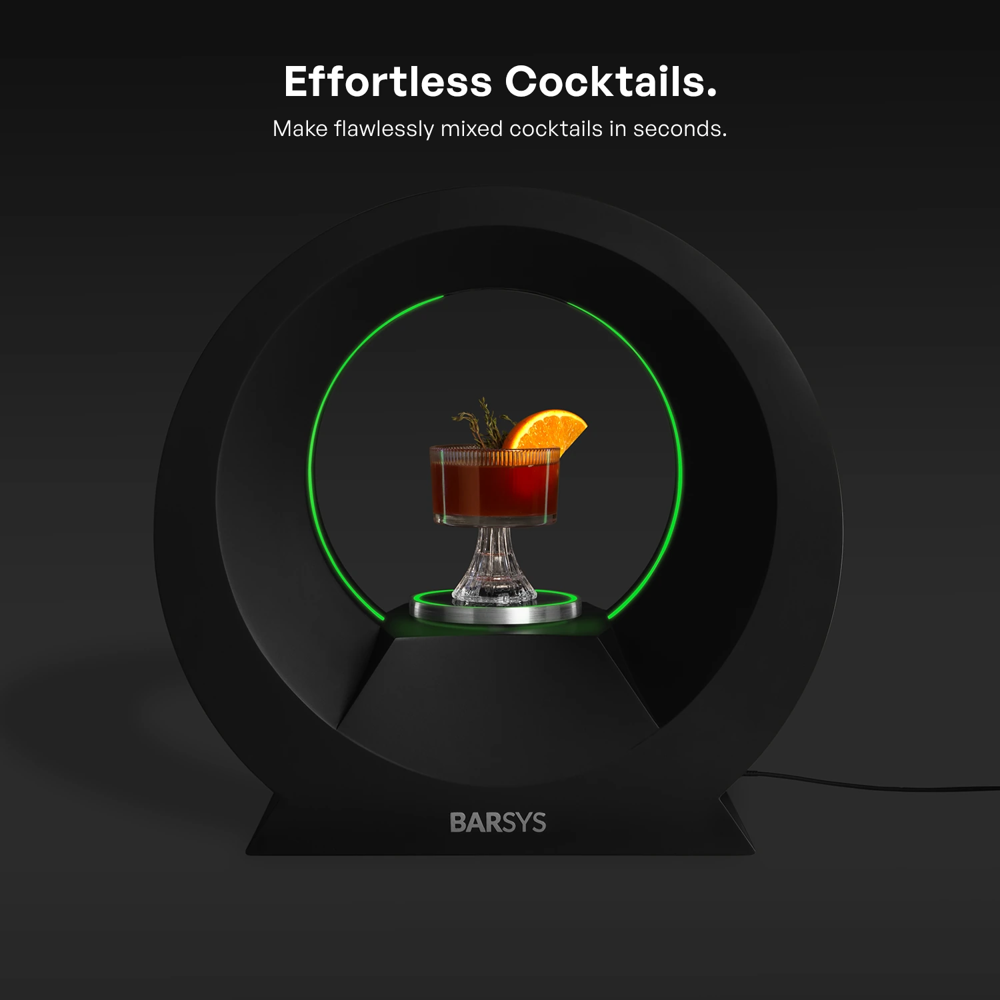
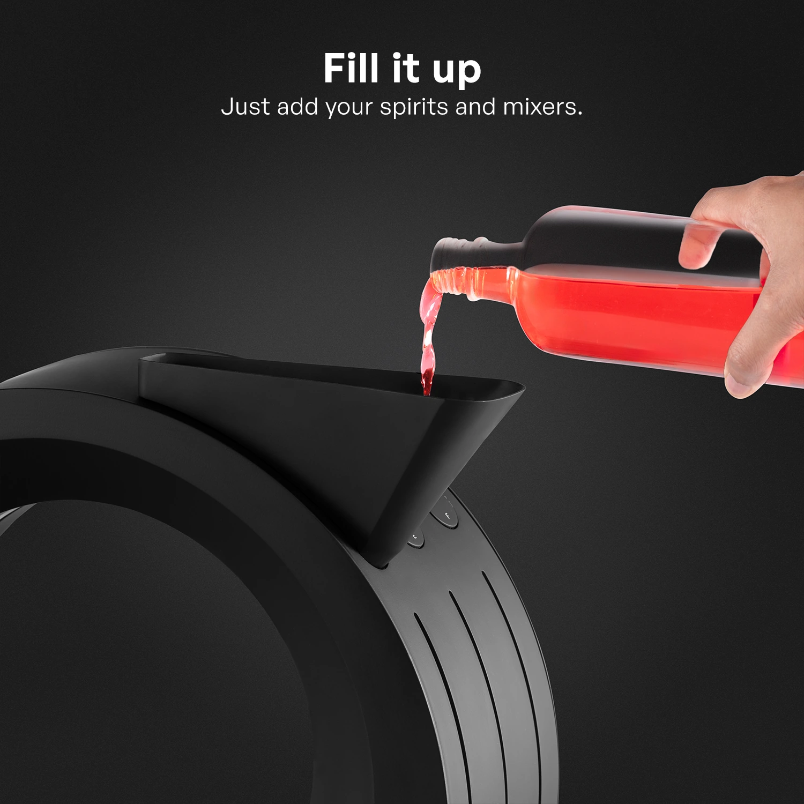
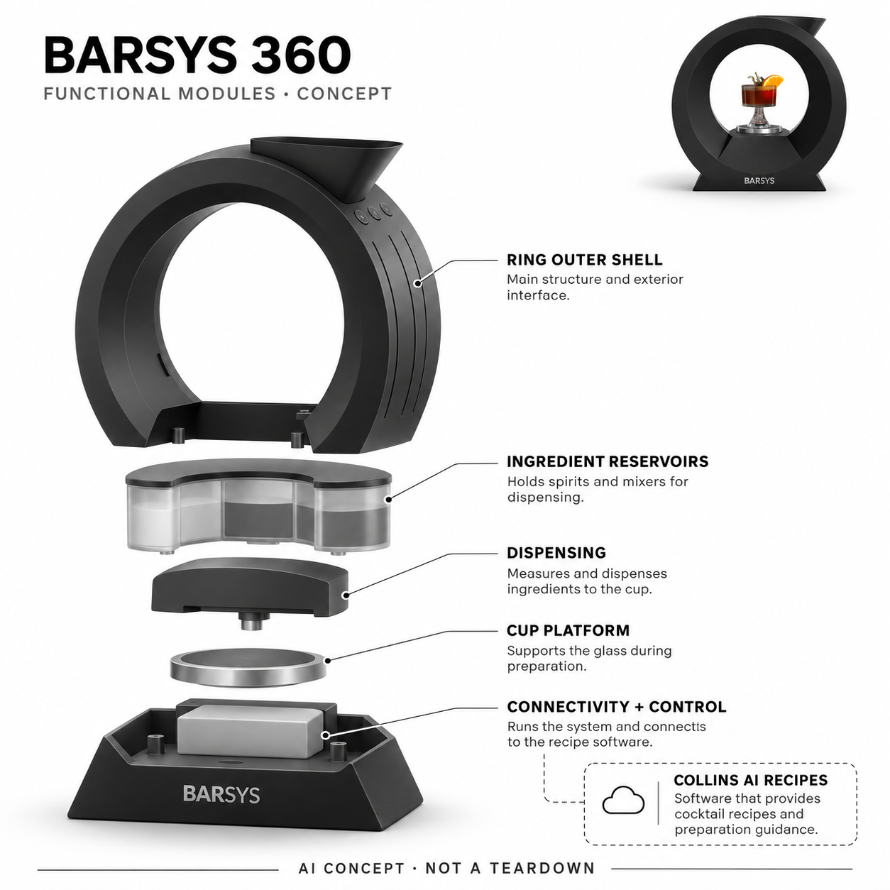

# Barsys 360

**Barsys** · 厨房与食物管理 · 核查 2026-11-04

从AI饮品创意连接到六路液体配比

消费渠道：个人零售。

## 产品图片与结构参考

### 产品图

官方Barsys 360正面 · 来源：[Barsys · 官方图片](<https://us.barsys.com/shop/barsys-360>) · [原始图片](<https://us.barsys.com/images/sterin/2026-10-10/1XVDnwcyTW_nF_QKD1W8E6cRwbYp7qbDE.webp>)

### 参考图

官方原料仓补充方式 · 来源：[Barsys · 官方图片](<https://us.barsys.com/shop/barsys-360>) · [原始图片](<https://us.barsys.com/images/sterin/2026-10-10/110_lbn3g-I_HESlQThlzcL1JB1x-CM-_.webp>)

### AI 生成爆炸示意

**AI 生成 · 非实物拆机。** 内部为概念推断，不能作为元件布局、BOM 或维修依据。[生成提示词](../../content/hardware/prompts/barsys-360.txt)

> 依据已核验官方外形与公开功能生成；未知内部仅为概念功能块，不代表原机电路板、芯片或实际布局。

> 实际查看并核对对应型号，官方原图未改色或语义编辑；营销文字不代表本研究独立验证。

> 分析为基于公开资料的案头研究与 AI 辅助判断，未经用户访谈、销量审计或实物拆机。需求、画像、竞争冷门度、审美及商业机会均为研究假设，不是投资结论。

## 销售与购买

- 状态：在售。官方商店明确黑色In stock与US$375加购，白色缺货；仅计360整机，不加同款颜色、配方套装或手动Coaster。

- 地区：美国

- 价格：US$375。当前黑色整机；用户自备适合原料、冰和装饰，非自动采购；价格与运费按实际订单。

- 中国大陆：美国官方店配送政策明确不向美国以外发货；未确认大陆授权、应用及耗材支持，不把全球品牌展示当作本SKU可直邮。

- [官方产品 / 商店](<https://us.barsys.com/shop/barsys-360>)

## AI 的实际作用

官方Barsys AI App中的Collins/Barbot根据已有原料与偏好提供饮品创意和配方，用户选择兼容食谱后由360自动分发液体。机械定量本身不是AI，最后冰块和装饰仍人工完成。

服务与联网依赖：实时AI请求需联网，机器通过应用与兼容连接执行；六路装料、映射和清洁由用户完成，不声称所有生成食谱可直接安全执行。

## 是否冷门

细分专业（研究判断）：家庭自备原料自动配比是细分娱乐烹饪流程，区别于普通烤箱或语音助手，但使用频率与清洗负担限制市场。

## 需求与市场

需求假设：家庭聚会主持人希望少量杯量取、多参与交流，同时尝试已有原料的新组合。应记录装料、清洗、配方采纳和重复使用，不能把生成更多饮品或自动倒液体等同口味更好或全部调酒步骤完成。

### 产品任务与边界 · 研究判断

需求假设：家庭聚会主持人希望少量杯量取、多参与交流，同时尝试已有原料的新组合。应记录装料、清洗、配方采纳和重复使用，不能把生成更多饮品或自动倒液体等同口味更好或全部调酒步骤完成。

依据：[Barsys 360当前官方商店](<https://us.barsys.com/shop/barsys-360>) · [Barsys官方AI App与Collins](<https://us.barsys.com/app>)

### 需求判断 · 研究判断

自动分发的核心收益可能是聚会时减少重复量取，让主人不必一直守在吧台；生成配方只是扩展选择。若家庭每次只做少数固定饮品，复杂推荐未必比清楚的原料与剂量表更有用，应把招待节奏和准备劳动视为真正待验证需求。

依据：[Barsys 360当前官方商店](<https://us.barsys.com/shop/barsys-360>) · [Barsys官方AI App与Collins](<https://us.barsys.com/app>)

### 需求验证 · 待验证

可从一次完整聚会前后记录装料、实际采用的推荐、出杯、补料和清洗，比较量杯手作。还应观察下一次活动是否继续使用，而非只看首次体验兴奋；不能用配方库大小或自动倒液体的速度推定总体时间和口味都得到改善。

依据：[Barsys 360当前官方商店](<https://us.barsys.com/shop/barsys-360>) · [Barsys官方AI App与Collins](<https://us.barsys.com/app>)

## 用户画像

画像推断：有台面、经常招待且愿维护液体通道的成年用户更匹配，也可用于无酒精饮品。偶尔聚会与重视手作的人需求不同，原料和清洁需要实际操作者接受，不能只从喜欢喝饮料推定设备价值。

### 适用行为与条件 · 研究判断

画像推断：有台面、经常招待且愿维护液体通道的成年用户更匹配，也可用于无酒精饮品。偶尔聚会与重视手作的人需求不同，原料和清洁需要实际操作者接受，不能只从喜欢喝饮料推定设备价值。

依据：[Barsys 360当前官方商店](<https://us.barsys.com/shop/barsys-360>) · [Barsys官方AI App与Collins](<https://us.barsys.com/app>)

### 人群取舍 · 研究判断

设备对成年家庭招待者可能有吸引力，也能服务不含酒精的配方，但不同饮食限制和原料偏好会改变兼容性。家庭必须有人知道各仓实际装了什么，并愿意在活动结束后处理残液，不能把会用手机或喜欢新饮料作为唯一画像条件。

依据：[Barsys 360当前官方商店](<https://us.barsys.com/shop/barsys-360>) · [Barsys官方AI App与Collins](<https://us.barsys.com/app>)

### 画像验证 · 待验证

画像验证应让主人和协助者交换装料与出杯工作，检查命名、仓位和配方是否容易对应。对频率低、台面小或不愿清洗管路的人应单独记录退出原因，不把受访者对环形造型的喜爱当成愿意承担长期维护与耗材的证据。

依据：[Barsys 360当前官方商店](<https://us.barsys.com/shop/barsys-360>) · [Barsys官方AI App与Collins](<https://us.barsys.com/app>)

## 竞争与替代

竞争判断：与手工量杯、预制饮品和胶囊调饮机竞争，区别是自备原料加AI创意后定量执行。只收360，不将不同颜色或小型手动测量器重复计数；应比较完整准备与清洗而不是只看出杯瞬间。

### 比较对象与差异 · 研究判断

竞争判断：与手工量杯、预制饮品和胶囊调饮机竞争，区别是自备原料加AI创意后定量执行。只收360，不将不同颜色或小型手动测量器重复计数；应比较完整准备与清洗而不是只看出杯瞬间。

依据：[Barsys 360当前官方商店](<https://us.barsys.com/shop/barsys-360>) · [Barsys官方AI App与Collins](<https://us.barsys.com/app>)

### 竞争判断 · 研究判断

相比胶囊机器，自备原料保留了选择空间，也带来更高的映射与清洁责任；相比手工调配，自动化执行需要适配设备能力。环形外观和灯效容易成为演示焦点，竞争评估应回到饮品任务，避免把单次展示效果等同持续家庭使用优势。

依据：[Barsys 360当前官方商店](<https://us.barsys.com/shop/barsys-360>) · [Barsys官方AI App与Collins](<https://us.barsys.com/app>)

### 竞争验证 · 待验证

可用同样可得原料比较手作、预调饮品和设备流程，记录饮用者对结果的反馈与操作者的维护负担。把AI建议层单独开关对照，确认新组合是否被再次选择，而不把生成数量、型号颜色或所连接的手机平台视为新增需求种类。

依据：[Barsys 360当前官方商店](<https://us.barsys.com/shop/barsys-360>) · [Barsys官方AI App与Collins](<https://us.barsys.com/app>)

## 供应链

供应链分析：液体容器、通道、计量分发、电源和连接控制共同工作，实际工厂与BOM未披露。黏度、清洁残留、食品接触材料与配方映射决定可靠性，不应虚构制冷压缩机或把分发画成自动搅拌全部过程。

### 功能模块拆分 · 研究判断

硬件功能包括外圈储料空间、食物接触通路、定量分发、杯位与电气控制，应用负责配方选择及AI创意。公开没有详细流路与驱动布局，结构图只表达功能关系；材料清洁、残液管理和可重复计量比是否有独立AI芯片更关键。

依据：[Barsys 360当前官方商店](<https://us.barsys.com/shop/barsys-360>) · [Barsys官方AI App与Collins](<https://us.barsys.com/app>)

### 制造与供应约束 · 研究判断

供应链分析：液体容器、通道、计量分发、电源和连接控制共同工作，实际工厂与BOM未披露。黏度、清洁残留、食品接触材料与配方映射决定可靠性，不应虚构制冷压缩机或把分发画成自动搅拌全部过程。

依据：[Barsys 360当前官方商店](<https://us.barsys.com/shop/barsys-360>) · [Barsys官方AI App与Collins](<https://us.barsys.com/app>)

### 候选与证据缺口 · 研究判断

新金宝可作为小家电与机电装配候选，睿迅可支持外壳和非流体关键结构的原型验证，均未公开获证为本产品供应方。食品接触与卫生设计要另行确认，不能因可加工塑料就推定具备液路安全、计量与整机认证的全部能力。

依据：[Barsys 360当前官方商店](<https://us.barsys.com/shop/barsys-360>) · [Barsys官方AI App与Collins](<https://us.barsys.com/app>)

## 技术路径

技术判断：AI位于官方应用创意与推荐层，硬件执行用户选择的兼容配方，网络和蓝牙路径不同。文本创意不等于可靠口味或正确原料映射，设备需要复核和清洁，不能把普通定量动作全部称为AI。

### 已披露技术边界 · 研究判断

技术判断：AI位于官方应用创意与推荐层，硬件执行用户选择的兼容配方，网络和蓝牙路径不同。文本创意不等于可靠口味或正确原料映射，设备需要复核和清洁，不能把普通定量动作全部称为AI。

依据：[Barsys 360当前官方商店](<https://us.barsys.com/shop/barsys-360>) · [Barsys官方AI App与Collins](<https://us.barsys.com/app>)

### 系统难点判断 · 研究判断

软件把用户原料和偏好变成建议，随后需要把配方对应到实际仓位和设备可执行操作，这两步可能分别出错。生成文本看似合理不意味着剂量正确，更不代表机器能完成冰块、装饰或人工搅拌等所有环节，应清楚展示剩余人工步骤。

依据：[Barsys 360当前官方商店](<https://us.barsys.com/shop/barsys-360>) · [Barsys官方AI App与Collins](<https://us.barsys.com/app>)

### 技术验证 · 待验证

技术验证可使用允许的无酒精原料检查配方映射、装错仓的提示和断连恢复，再测不同黏度下的重复分发。所有饮用安全与限制由使用者独立确认，不用模型解释替代实际食材标签，也不根据一个顺利出杯样例推断全部配方可靠。

依据：[Barsys 360当前官方商店](<https://us.barsys.com/shop/barsys-360>) · [Barsys官方AI App与Collins](<https://us.barsys.com/app>)

## 产品审美

审美判断：环形容器和中央杯位有家庭酒吧辨识度，但瓶口、滴液与清洗路径决定长期观感。装饰灯与黑色外壳不应掩盖容量和当前原料，设备在普通厨房台面上的体量需要实际评估。

### 外观与交互语言 · 研究判断

审美判断：环形容器和中央杯位有家庭酒吧辨识度，但瓶口、滴液与清洗路径决定长期观感。装饰灯与黑色外壳不应掩盖容量和当前原料，设备在普通厨房台面上的体量需要实际评估。

依据：[Barsys 360当前官方商店](<https://us.barsys.com/shop/barsys-360>) · [Barsys官方AI App与Collins](<https://us.barsys.com/app>)

### 使用中审美判断 · 研究判断

圆环让杯子位于视觉中心，能强化家庭招待的仪式感，也使整机在普通厨房里相当显眼。外壳长期接触滴液与手印，顶部补充动作和中央杯位可达性都影响审美体验；应展示使用后的清洁状态，而非只渲染灯带和成品饮料。

依据：[Barsys 360当前官方商店](<https://us.barsys.com/shop/barsys-360>) · [Barsys官方AI App与Collins](<https://us.barsys.com/app>)

### 设计验证 · 待验证

设计验证可观察不同杯形的放入取出、上方灌装与擦拭，确认液体不会让界面信息难辨。与台面其他工具共同布置后再评价体量，不把夜间灯光照片当作日常可读性证据，也不忽略电源线和剩余瓶罐占用的实际空间。

依据：[Barsys 360当前官方商店](<https://us.barsys.com/shop/barsys-360>) · [Barsys官方AI App与Collins](<https://us.barsys.com/app>)

## 关键风险

风险判断：原料错配、黏稠残留和网络错误会影响出杯，用户仍需确认饮用限制与清洁。AI配方不是营养或安全保证，无法替代对酒精、过敏和实际食材的判断；地区购买与售后也需按官方条款确认。

### 主要失效与依赖 · 研究判断

风险判断：原料错配、黏稠残留和网络错误会影响出杯，用户仍需确认饮用限制与清洁。AI配方不是营养或安全保证，无法替代对酒精、过敏和实际食材的判断；地区购买与售后也需按官方条款确认。

依据：[Barsys 360当前官方商店](<https://us.barsys.com/shop/barsys-360>) · [Barsys官方AI App与Collins](<https://us.barsys.com/app>)

### 风险传播判断 · 研究判断

错误的原料标签可能沿AI推荐传播到自动分发，使外观正确的饮品包含不合适成分；清洗不足则会跨次影响结果。系统应让人复核真实仓位和内容，不能把配方生成的流畅性包装成营养、过敏或任何摄入安全方面的专业保证。

依据：[Barsys 360当前官方商店](<https://us.barsys.com/shop/barsys-360>) · [Barsys官方AI App与Collins](<https://us.barsys.com/app>)

### 风险验证 · 待验证

风险验证应检查更换原料、清洗提醒、网络断连及残液处理流程，按照官方允许材料操作。大陆未确认的销售与售后要独立核查，避免只因美区可加购物袋就承诺跨境可用；也不能以自动化为由鼓励增加饮用量或忽略个人限制。

依据：[Barsys 360当前官方商店](<https://us.barsys.com/shop/barsys-360>) · [Barsys官方AI App与Collins](<https://us.barsys.com/app>)

## 机会与验证

机会假设：先验证高频家庭招待的准备与清洁总劳动，再判断AI创意和自动分发各自价值。若用户只做固定饮品，可靠计量可能更重要；不应把生成模型接入或出杯数量直接当作持续需求。

### 可能的机会入口 · 研究判断

机会假设：先验证高频家庭招待的准备与清洁总劳动，再判断AI创意和自动分发各自价值。若用户只做固定饮品，可靠计量可能更重要；不应把生成模型接入或出杯数量直接当作持续需求。

依据：[Barsys 360当前官方商店](<https://us.barsys.com/shop/barsys-360>) · [Barsys官方AI App与Collins](<https://us.barsys.com/app>)

### 机会成立条件 · 研究判断

创业切入点可能在少数常用原料的可靠准备、低维护和清楚的无酒精替代，而不是无限配方生成。若AI只带来一次惊喜却增加装料负担，核心产品应优先改进清洗和复用；应由重复使用数据决定是否保留复杂的推荐交互。

依据：[Barsys 360当前官方商店](<https://us.barsys.com/shop/barsys-360>) · [Barsys官方AI App与Collins](<https://us.barsys.com/app>)

### 下一步验证 · 待验证

下一步可跟踪多次真实家庭招待，对比建议采用、再次制作以及清洗时间，区分主人与饮用者的收益。确认设备留下来的原因是稳定任务价值还是外观展示，再选择机械投入与服务模式，不用AI话题热度或社交分享量推定市场规模。

依据：[Barsys 360当前官方商店](<https://us.barsys.com/shop/barsys-360>) · [Barsys官方AI App与Collins](<https://us.barsys.com/app>)

## 对应供应链公司

能力候选用于选型研究，不代表本产品实际采用；未公开的供货关系不作推断。

- [new-kinpo-group](../supply-chain/new-kinpo-group.md) — **能力候选 · 非已采用** / 小型饮品设备机电整合评估：新金宝集团的家电和消费设备工程可对应储料结构、控制与整机装配，但食品接触液路、清洗和计量必须专项验证；没有Barsys 360点名合作信息，当前是候选能力而非代工事实。

- [rapiddirect](../supply-chain/rapiddirect.md) — **能力候选 · 非已采用** / 环形外壳与非关键结构原型：RapidDirect公开快速加工和模具服务可用于环形外壳、杯位与装配可达性原型评估，但不能仅凭加工能力推定食品接触材料、液路卫生或计量合格；未见Barsys点名采用证据。

- [takasago-electric](../supply-chain/takasago-electric.md) — **能力候选 · 非已采用** / 同类多液路饮品分发的泵阀与计量评估：Barsys将配方转成实体液体分发，高砂的管泵和反馈分液能力可用于研究相近的新设计。含糖、含酒精液体的接触材料、残味、清洗与剂量都必须专项验证，公开泵阀目录不能保证食品适用；没有Barsys点名供货资料，只保留工程能力候选。

[浏览供应链目录](../supply-chain.md)

## 功能分层示意

这是功能关系，不是实物拆机、真实空间结构或已核实 BOM。

1. **原料容器**：六个独立液体原料位由用户装填。（官方披露）

2. **创意服务**：应用AI按原料与口味辅助发现或生成配方。（官方披露）

3. **配方映射**：用户确认兼容食谱与原料位对应。（官方披露）

4. **液体分发**：设备计量分发到杯中，未知泵阀布局只作概念。（官方披露）

5. **人工维护**：加冰装饰与清洁流程仍由用户负责。（官方披露）

## 来源

1. [Barsys 360当前官方商店](<https://us.barsys.com/shop/barsys-360>) — 已打开，黑色有货、白色缺货及六路自动分发明确。

2. [Barsys官方AI App与Collins](<https://us.barsys.com/app>) — 已打开，AI创意、原料管理与兼容硬件连接；实时请求需网络。

3. [Barsys 360官方创意到执行说明](<https://360.barsys.com/>) — 已打开，Collins/Barbot生成饮品与360分发分开；宣传完美结果不作实测。

4. [Barsys美国店配送政策](<https://us.barsys.com/shipping-policy>) — 已打开，明确不向美国外配送；页面运费与促销以订单为准。

[返回目录](../hardware-market.md) · [网页分析](https://romanagent.github.io/Roman/#hardware/product/barsys-360)
