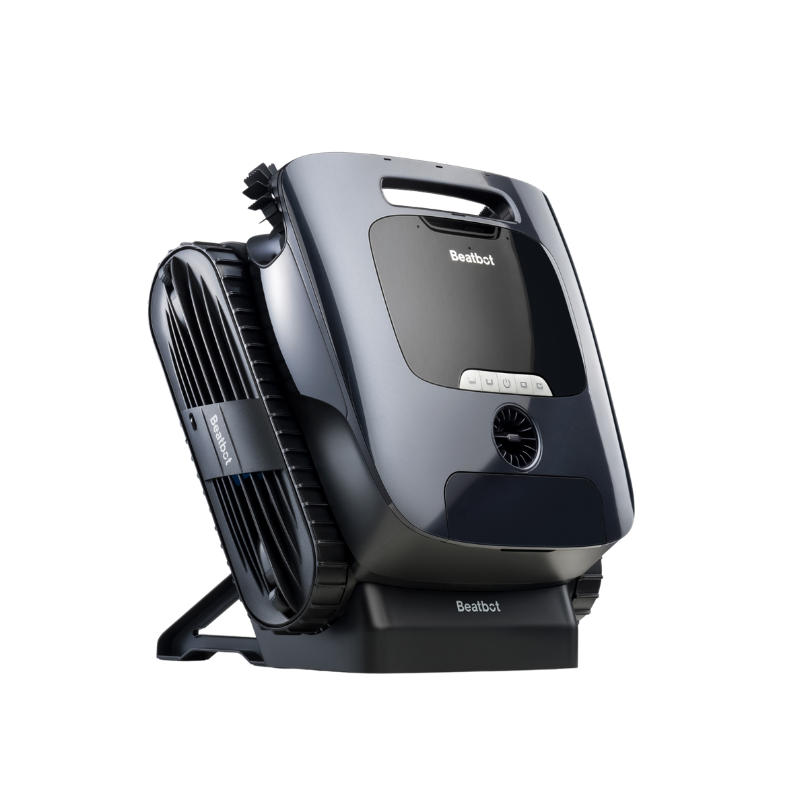
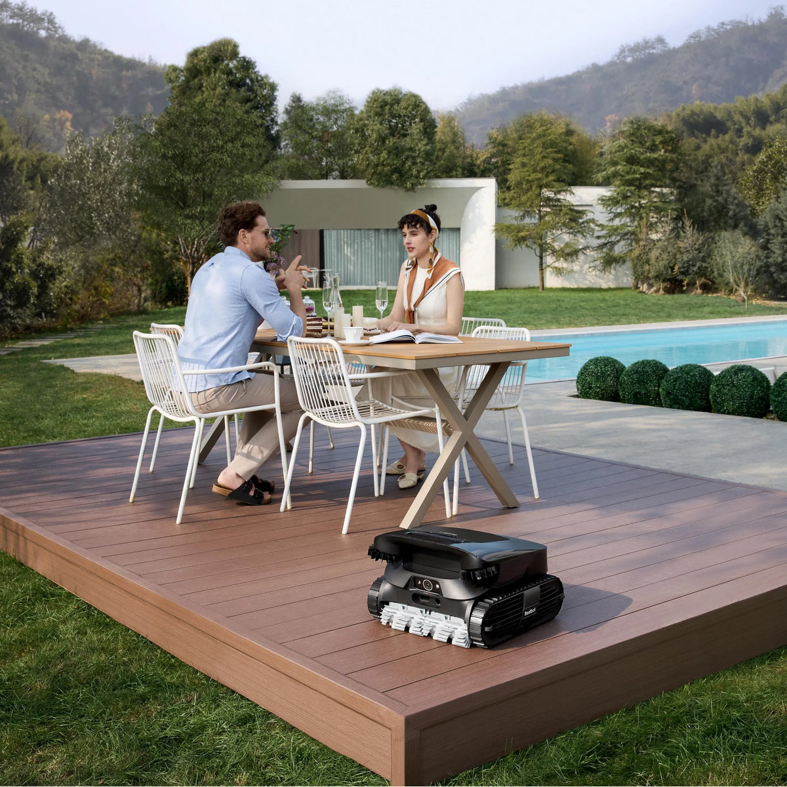
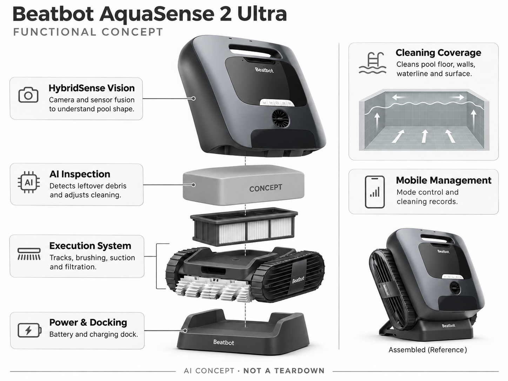

# Beatbot AquaSense 2 Ultra

**Beatbot** · 清洁机器人 · 核查 2026-11-04

利用视觉复查遗漏区域的多模式泳池清洁机

消费渠道：个人零售。

## 产品图片与结构参考

### 产品图

Beatbot AquaSense 2 Ultra 官方产品图 · 来源：[Beatbot · 官方图片](<https://beatbot.com/products/aquasense-2-ultra>) · [原始图片](<https://cdn.shopify.com/s/files/1/0812/9049/4250/files/2_Ultra_New.png?v=1781504434&width=1200>)

### 参考图

Beatbot AquaSense 2 Ultra 官方外观、结构或使用参考 · 来源：[Beatbot · 官方图片](<https://beatbot.com/products/aquasense-2-ultra>) · [原始图片](<https://cdn.shopify.com/s/files/1/0812/9049/4250/files/215A0262_1.webp?v=1760500268&width=1200>)

### AI 生成爆炸示意

**AI 生成 · 非实物拆机。** 内部为概念推断，不能作为元件布局、BOM 或维修依据。[生成提示词](../../content/hardware/prompts/beatbot-aquasense-2-ultra.txt)

> 依据官方外观参考与公开功能生成；未披露的内部布局只作概念模块，不构成BOM或真实结构证据。

> 本图已局部校正：移除上盖重复履带。修订提示词：content/hardware/prompts/beatbot-aquasense-2-ultra-revision.txt。

> 保留官方图片原始内容和出处；画面宣传参数不是本轮独立实测。

> 分析为基于公开资料的案头研究与 AI 辅助判断，未经用户访谈、销量审计或实物拆机。需求、画像、竞争冷门度、审美及商业机会均为研究假设，不是投资结论。

## 销售与购买

- 状态：在售。美国商品页显示Add to Cart、Buy Now与下单后发货说明；技术落地页可能显示不同促销价，记录商品页价格。

- 地区：美国官方商店

- 价格：US$2,699。核查时官方地区参考价，保留原币种；订阅、税运、附件及优惠以结账为准，预订定金不等于整机价格。

- 中国大陆：本轮核实所列海外官方渠道；中国大陆同型号现货、保修及服务可用性未确认。进口前需核对供电、网络、配件和地区条款。

- [官方产品 / 商店](<https://beatbot.com/products/aquasense-2-ultra>)

## AI 的实际作用

HybridSense AI视觉建立泳池理解并发现遗漏杂物，引导追加清洁；同时执行池底、池壁、水线和水面维护。

服务与联网依赖：本机感知结合App控制；用户仍负责滤网清洗、取放和水质管理，不具有X型号的AstroRinse自动洗滤站。

## 是否冷门

细分专业（研究判断）：消费泳池清洁为专业场景，视觉复查是差异但竞争已成熟；不能与普通AquaSense 2版本混为一类。

## 需求与市场

需求假设：家用泳池需要同时处理沉底杂物和漂浮物，用户希望减少多台工具切换。应分别测池底覆盖、水线刷洗和表面捞取效果，不能用模式数量代替全部任务都能完成的证据。

## 用户画像

画像推断：拥有较复杂池形并愿意维护无线机器人的家庭，可能已用过随机碰撞式产品。是否需要高价视觉版本取决于漏清问题和使用频率，简单小池用户未必得到相同收益。

## 竞争与替代

竞争判断：与AquaSense X、WYBOT视觉产品和传统有线清洁器竞争。它强调多区域清洁与视觉复查，维护仍以人工为主；分析时应区分真正传感差异与同系列普通型号的营销命名。

## 供应链

供应链分析：水密电机、摄像模组、电池、履带、滚刷及过滤组件需要长期水下验证。具体供应商及BOM未披露；售后换件、密封老化和锂电运输限制可能比初始电子元件成本更重要。

## 技术路径

官方描述HybridSense AI映射与杂物再次检测。技术判断：视觉复查的收益取决于水清晰度、底色和光线；路径规划、吸附能力与杂物识别应分别验证，不能由某一个演示推定全面可靠。

## 产品审美

审美判断：圆润上盖与履带兼顾家电感和工具属性，抓握与提水后排水体验更关键。泳池边停放时需要稳定、不易绊倒的状态，清洁脏污后能否方便恢复外观也影响长期接受度。

## 关键风险

风险判断：高价多功能设备仍需人工清洗滤网，性能受泳池台阶与几何条件影响。应核对当地保修和配件供应，AI巡检不能替代泳池安全措施，也不提供对水中人员的保护保证。

## 机会与验证

机会假设：以顽固漏清点和用户取放劳动为研究入口，比较基础款、视觉款与人工服务的总投入。若大多数池形简单，轻量、易提取和售后便利可能比扩展AI目标种类更有价值。

## 功能分层示意

这是功能关系，不是实物拆机、真实空间结构或已核实 BOM。

1. **HybridSense视觉**：相机与传感融合观察池形。（官方披露）

2. **AI巡检**：发现残余杂物并调整清洁。（官方披露）

3. **执行机构**：履带、刷洗、吸入和过滤。（官方披露）

4. **能源停靠**：电池与充电底座。（官方披露）

5. **手机管理**：模式控制及清洁记录。（官方披露）

## 来源

1. [Beatbot AquaSense 2 Ultra 官方购买页](<https://beatbot.com/products/aquasense-2-ultra>) — 实际打开核查当前购买或预订入口，未实际下单；价格与交付按具体地区。

2. [AquaSense 2 Ultra 官方能力](<https://beatbot.com/pages/aquasense-2-ultra>) — 实际打开的官方技术与使用资料，宣传效果并非本轮独立实测。

[返回目录](../hardware-market.md) · [网页分析](https://romanagent.github.io/Roman/#hardware/product/beatbot-aquasense-2-ultra)
