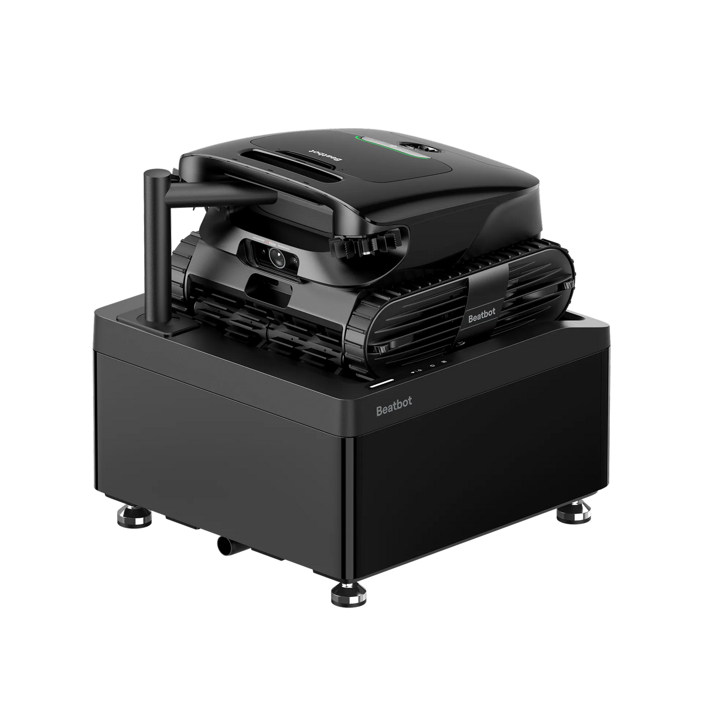
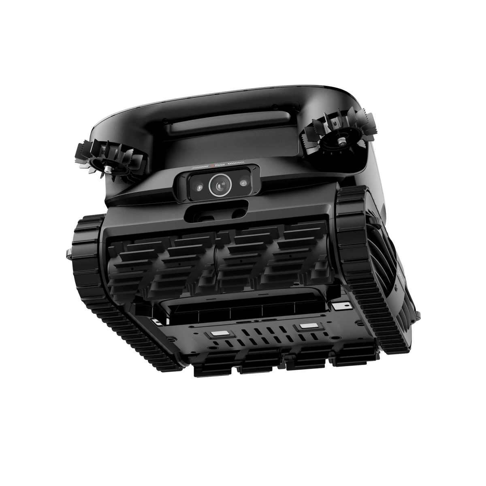
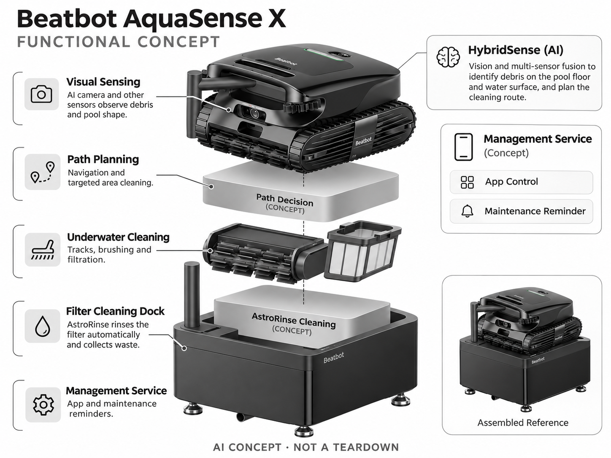

# Beatbot AquaSense X

**Beatbot** · 清洁机器人 · 核查 2026-11-04

将视觉清洁与滤网维护合并的家庭泳池机器人

消费渠道：个人零售。

## 产品图片与结构参考

### 产品图

Beatbot AquaSense X 官方产品图 · 来源：[Beatbot · 官方图片](<https://eu.beatbot.com/products/aquasense-x>) · [原始图片](<https://cdn.shopify.com/s/files/1/0584/1980/6275/files/1_96845366-50b1-4f6a-a373-917fede64cf7.webp?v=1767607295&width=1200>)

### 参考图

Beatbot AquaSense X 官方外观、结构或使用参考 · 来源：[Beatbot · 官方图片](<https://eu.beatbot.com/products/aquasense-x>) · [原始图片](<https://cdn.shopify.com/s/files/1/0584/1980/6275/files/5_7ef1f754-3a13-4ea6-be4b-89f0b4453e3b.webp?v=1767607295&width=1200>)

### AI 生成爆炸示意

**AI 生成 · 非实物拆机。** 内部为概念推断，不能作为元件布局、BOM 或维修依据。[生成提示词](../../content/hardware/prompts/beatbot-aquasense-x.txt)

> 保留官方图片原始内容和出处；画面宣传参数不是本轮独立实测。

> 分析为基于公开资料的案头研究与 AI 辅助判断，未经用户访谈、销量审计或实物拆机。需求、画像、竞争冷门度、审美及商业机会均为研究假设，不是投资结论。

## 销售与购买

- 状态：在售。欧洲商品页提供购买入口，公开商品数据available=true；旧FAQ残留早期预订日期，因此以当前可售库存为准。

- 地区：欧洲官方商店

- 价格：€3,999。核查时官方地区参考价，保留原币种；订阅、税运、附件及优惠以结账为准，预订定金不等于整机价格。

- 中国大陆：本轮核实所列海外官方渠道；中国大陆同型号现货、保修及服务可用性未确认。进口前需核对供电、网络、配件和地区条款。

- [官方产品 / 商店](<https://eu.beatbot.com/products/aquasense-x>)

## AI 的实际作用

HybridSense视觉与其他传感融合，识别池底和水面杂物、规划路线；AstroRinse底座自动清洗滤网，后者是机械自动化而非AI本身。

服务与联网依赖：需用户将设备放入清洗底座；App和网络用于管理，泳池形状、照明、水质与滤网维护影响识别。

## 是否冷门

细分专业（研究判断）：私人泳池为窄场景高客单消费市场，已有多家机器人品牌；滤网自动维护比普通吸尘更细分。

## 需求与市场

需求假设：私家泳池业主希望减少打捞、刷洗和冲洗滤网的反复劳动。自动洗滤网能否节省时间，应把搬运机器人、底座供水和倒垃圾的劳动一起计算，而非只看机器人工作时长。

### 产品任务与边界 · 研究判断

AquaSense X 将水下与水面清洁、视觉找杂物和 AstroRinse 洗滤底座组合起来，任务是减少泳池维护的重复劳动。真正需要评估的是清洁前后用户总共做了多少工作，不能只统计机器人在水中自动运行的时间。

依据：[Beatbot AquaSense X 官方购买页](<https://eu.beatbot.com/products/aquasense-x>) · [AquaSense X 官方技术说明](<https://beatbot.com/pages/aquasense-x>)

### 需求判断 · 研究判断

洗滤底座可能减少直接冲洗脏滤网，但仍涉及搬运、底座供水和废物处理。需求应沿完整维护链路分析，若劳动只是从滤网转移到更复杂底座，自动化并不一定带来净收益，更不能视为完整泳池托管。

依据：[Beatbot AquaSense X 官方购买页](<https://eu.beatbot.com/products/aquasense-x>) · [AquaSense X 官方技术说明](<https://beatbot.com/pages/aquasense-x>)

### 需求验证 · 待验证

可让家庭连续记录放入、取出、搬到底座、清洗与倒垃圾的时间，并检查漏清位置。将整个周期与普通泳池机器人比较，观察哪一步真正减少劳动，避免把宣传中的自动洗滤演示直接换算为免维护承诺。

依据：[Beatbot AquaSense X 官方购买页](<https://eu.beatbot.com/products/aquasense-x>) · [AquaSense X 官方技术说明](<https://beatbot.com/pages/aquasense-x>)

## 用户画像

画像推断：有固定泳池、可布置底座并愿意支付较高首付的房主；频繁有树叶落入泳池的家庭可能更有动力。普通公寓没有相同场景，季节性使用者则需要评估闲置和收纳成本。

### 适用行为与条件 · 研究判断

较匹配拥有固定私人泳池、可布置底座并愿意支付较高首付的家庭，频繁落叶可能提高需求。季节性使用者还需考虑闲置和收纳，普通公寓或临时小池没有相同条件，不能用所有家庭清洁预算推算市场。

依据：[Beatbot AquaSense X 官方购买页](<https://eu.beatbot.com/products/aquasense-x>) · [AquaSense X 官方技术说明](<https://beatbot.com/pages/aquasense-x>)

### 人群取舍 · 研究判断

泳池周边空间、供水及用户搬运能力会影响产品适配，较大设备的取放并非所有人都方便。画像应区分愿意自行维护的房主和已有专业维护服务的家庭，后者可能需要的是减少服务频率而不是完全替代人工。

依据：[Beatbot AquaSense X 官方购买页](<https://eu.beatbot.com/products/aquasense-x>) · [AquaSense X 官方技术说明](<https://beatbot.com/pages/aquasense-x>)

### 画像验证 · 待验证

画像验证应从实际底座选址和取放开始，让主要维护者完成整个流程，记录不愿或无法操作的步骤。再按落叶量、池形和使用季节比较收益，避免仅询问是否喜欢自动清洁而忽略安装与搬运限制。

依据：[Beatbot AquaSense X 官方购买页](<https://eu.beatbot.com/products/aquasense-x>) · [AquaSense X 官方技术说明](<https://beatbot.com/pages/aquasense-x>)

## 竞争与替代

竞争判断：与WYBOT自集污系统、普通泳池机器人及人工维护服务竞争。清洗底座是具体差异，但并不取消化学水质管理，不能把一个清洁环节的自动化当作完整泳池托管。

### 比较对象与差异 · 研究判断

AquaSense X 与 WYBOT 自集污系统、普通泳池机器人和人工服务竞争，洗滤底座是具体区别。不同方案对搬运、返回和废物处理的分工不同，不能因为都带基站就视为同一能力，更不能把机械自动化全部归为 AI。

依据：[Beatbot AquaSense X 官方购买页](<https://eu.beatbot.com/products/aquasense-x>) · [AquaSense X 官方技术说明](<https://beatbot.com/pages/aquasense-x>)

### 竞争判断 · 研究判断

竞争优势需要证明洗滤与视觉带来的收益超过更大系统的安装和维修成本。对于简单泳池，普通设备可能已经足够；对复杂杂物环境，可靠过滤和维护可能比识别类别更重要，应以真实任务而非功能数量比较。

依据：[Beatbot AquaSense X 官方购买页](<https://eu.beatbot.com/products/aquasense-x>) · [AquaSense X 官方技术说明](<https://beatbot.com/pages/aquasense-x>)

### 竞争验证 · 待验证

可在同一泳池比较 X、普通无绳设备和人工维护的总劳动与残余杂物，明确水质管理仍是另一任务。测试需包括底座清洁和收纳，不应只截取机器人运行阶段或用最理想池形代表普遍家庭。

依据：[Beatbot AquaSense X 官方购买页](<https://eu.beatbot.com/products/aquasense-x>) · [AquaSense X 官方技术说明](<https://beatbot.com/pages/aquasense-x>)

## 供应链

供应链分析：水下驱动、密封、电池、摄像头、滤网和底座水路共同决定可靠性；实际代工厂和BOM未知。氯水腐蚀、干湿连接、长期滤网耗材与重物维修运输是交付重点。

### 功能模块拆分 · 研究判断

功能层包括 AI 相机与其他传感、位置和路径决策、水下履带刷洗与过滤、电池密封系统，以及 AstroRinse 水路和废物收集。自动洗滤是机械流程，公开资料没有详细工厂及物料表，不能推定具体芯片或泵阀供方。

依据：[Beatbot AquaSense X 官方购买页](<https://eu.beatbot.com/products/aquasense-x>) · [AquaSense X 官方技术说明](<https://beatbot.com/pages/aquasense-x>)

### 制造与供应约束 · 研究判断

制造约束是长期水下密封、氯水环境、驱动负载、滤网与底座干湿接口的协调。较重整机的维修运输和耗材供应也影响售后，不能只关注电子模组；底座如果难以排水或清理，会成为新的维护集中点。

依据：[Beatbot AquaSense X 官方购买页](<https://eu.beatbot.com/products/aquasense-x>) · [AquaSense X 官方技术说明](<https://beatbot.com/pages/aquasense-x>)

### 候选与证据缺口 · 研究判断

金宝可作为家电电子与塑胶制造候选，SGS 可支持环境、材料和电气测试范围评审。两者没有 AquaSense X 点名合作证据，水下机构与洗滤效果仍需专项验证，制造或检测能力都不能直接证明 AI 杂物识别可靠。

依据：[Beatbot AquaSense X 官方购买页](<https://eu.beatbot.com/products/aquasense-x>) · [AquaSense X 官方技术说明](<https://beatbot.com/pages/aquasense-x>)

## 技术路径

官方披露AI相机与红外、超声等感知融合，支持杂物检测和路径优化。技术判断：反光、浑水及池壁纹理会影响视觉，识别目标数量不是准确率；自动清洗效果需要单独测试。

### 已披露技术边界 · 研究判断

官方 HybridSense 将视觉与其他感知结合，用于杂物识别和路线，而 AstroRinse 负责滤网清洗。技术评价应分开看见杂物、抵达位置、吸入过滤和洗净滤网四个环节，任何一个成功都不能证明完整任务已完成。

依据：[Beatbot AquaSense X 官方购买页](<https://eu.beatbot.com/products/aquasense-x>) · [AquaSense X 官方技术说明](<https://beatbot.com/pages/aquasense-x>)

### 系统难点判断 · 研究判断

反光、浑水和池壁纹理会影响视觉，定位与驱动也可能导致已识别目标没有被清除。系统难点是把感知结果转成有效清洁，并让用户知道残余或异常，而不是仅显示完成；底座清洗性能需要独立于 AI 测试。

依据：[Beatbot AquaSense X 官方购买页](<https://eu.beatbot.com/products/aquasense-x>) · [AquaSense X 官方技术说明](<https://beatbot.com/pages/aquasense-x>)

### 技术验证 · 待验证

验证应覆盖不同水体清晰度、底色、杂物和池形，分别记录识别、覆盖与残留，再检查洗滤后的状态。所有测试应遵循使用条件，不能以目标识别数量、宣传样片或单次干净滤网推断长期全面可靠。

依据：[Beatbot AquaSense X 官方购买页](<https://eu.beatbot.com/products/aquasense-x>) · [AquaSense X 官方技术说明](<https://beatbot.com/pages/aquasense-x>)

## 产品审美

审美判断：机器人和大底座组成完整庭院物件，整洁走线、排水与滤网取出姿势比科技灯效更重要。外观应与泳池设备区融合，同时让用户清楚知道哪里需要清洁或人工接管。

### 外观与交互语言 · 研究判断

机器人与大底座一起成为泳池旁的固定物件，整洁供水、排水和废物处理比科技灯效更重要。外观需要与设备区融合并明确人工接管位置，不能只展示干净机器人而隐藏日常维护中最常接触的脏污部分。

依据：[Beatbot AquaSense X 官方购买页](<https://eu.beatbot.com/products/aquasense-x>) · [AquaSense X 官方技术说明](<https://beatbot.com/pages/aquasense-x>)

### 使用中审美判断 · 研究判断

抓握、搬运和放入底座的姿势影响用户是否愿意持续使用，外形精致不能弥补操作吃力。湿设备停放后的滴水与收纳也属于审美体验，设计应让维护后的场地容易恢复整洁，而不是仅在新品照片中显得高级。

依据：[Beatbot AquaSense X 官方购买页](<https://eu.beatbot.com/products/aquasense-x>) · [AquaSense X 官方技术说明](<https://beatbot.com/pages/aquasense-x>)

### 设计验证 · 待验证

设计验证应观察主要维护者从水中取出到完成底座清洗的全过程，记录握持、滴水和清理困难。还要在真实泳池设备区评估占地与通行，避免用宽阔宣传场景推断所有家庭都能自然放置完整系统。

依据：[Beatbot AquaSense X 官方购买页](<https://eu.beatbot.com/products/aquasense-x>) · [AquaSense X 官方技术说明](<https://beatbot.com/pages/aquasense-x>)

## 关键风险

风险判断：用户仍需搬运、检查滤网与维持水质，AI不保证所有杂物都被发现。底座安装条件、耗材、冬季存放和区域保修会影响总成本，官网早期预订文案也可能与当前库存并存。

### 主要失效与依赖 · 研究判断

风险包括用户低估搬运和水质管理、底座安装不适配、耗材与区域维修，以及 AI 漏检杂物。清洁设备不能替代泳池安全措施，早期预订与当前库存文案也需分开理解，不应从自动化名称推导完全无人照看。

依据：[Beatbot AquaSense X 官方购买页](<https://eu.beatbot.com/products/aquasense-x>) · [AquaSense X 官方技术说明](<https://beatbot.com/pages/aquasense-x>)

### 风险传播判断 · 研究判断

复杂系统可能把简单冲洗问题变成水路、排废和密封故障，若状态不清会增加维护难度。产品应明确哪些步骤自动完成、哪些仍需人工，以及异常时如何恢复，避免用户在期待省事后承担更隐蔽的工作。

依据：[Beatbot AquaSense X 官方购买页](<https://eu.beatbot.com/products/aquasense-x>) · [AquaSense X 官方技术说明](<https://beatbot.com/pages/aquasense-x>)

### 风险验证 · 待验证

风险验证应演练底座供水或排废异常、滤网堵塞和返修流程，并核对冬季存放及地区保修条件。记录用户能否及时理解问题，不能用自动洗滤功能存在就推断任何杂物、水质或使用频率下都免维护。

依据：[Beatbot AquaSense X 官方购买页](<https://eu.beatbot.com/products/aquasense-x>) · [AquaSense X 官方技术说明](<https://beatbot.com/pages/aquasense-x>)

## 机会与验证

机会假设：围绕维护步骤而非吸力参数测试价值，记录一周实际人工分钟和漏清位置。若洗滤网是最大痛点，可优先验证可维护底座和耗材服务，不必同时扩张所有清洁模式。

### 可能的机会入口 · 研究判断

机会在于解决洗滤和搬运这些具体劳动，而不必同时扩展所有泳池清洁模式。新项目可先用现成机器人研究维护步骤，若最大痛点确实在滤网处理，再开发更可清理的底座或耗材服务。

依据：[Beatbot AquaSense X 官方购买页](<https://eu.beatbot.com/products/aquasense-x>) · [AquaSense X 官方技术说明](<https://beatbot.com/pages/aquasense-x>)

### 机会成立条件 · 研究判断

机会成立需要总人工时间减少且故障恢复不更复杂。如果洗滤节省的时间被底座维护抵消，功能创新未形成用户收益；对不同池形和季节应分别评估，避免从少数重度维护家庭外推所有泳池主需求。

依据：[Beatbot AquaSense X 官方购买页](<https://eu.beatbot.com/products/aquasense-x>) · [AquaSense X 官方技术说明](<https://beatbot.com/pages/aquasense-x>)

### 下一步验证 · 待验证

下一步可建立一周完整维护日志，比较人工分钟、残余杂物与耗材处理，再测试简化底座和状态提示。依据哪一步最值得改善决定硬件投入，让自动化围绕真实劳动，而不是围绕更长的规格与模式清单。

依据：[Beatbot AquaSense X 官方购买页](<https://eu.beatbot.com/products/aquasense-x>) · [AquaSense X 官方技术说明](<https://beatbot.com/pages/aquasense-x>)

## 对应供应链公司

能力候选用于选型研究，不代表本产品实际采用；未公开的供货关系不作推断。

- [new-kinpo-group](../supply-chain/new-kinpo-group.md) — **能力候选 · 非已采用** / 泳池清洁系统的家电电子与塑胶制造：金宝公开家电、PCBA及注塑模具业务可对应控制电子和外壳制造评估，但水下密封、驱动和洗滤站需专项能力确认；没有 AquaSense X 点名供货证据，候选不代表实际代工。

- [sgs](../supply-chain/sgs.md) — **能力候选 · 非已采用** / 水下清洁与洗滤底座可靠性测试：SGS 的环境、材料、电气及机械测试可支持机器人与底座的具体可靠性评审，但方法和实验室范围需确认；未见 AquaSense X 合作披露，检测服务也不证明视觉识别或自动洗滤效果。

[浏览供应链目录](../supply-chain.md)

## 功能分层示意

这是功能关系，不是实物拆机、真实空间结构或已核实 BOM。

1. **视觉感知**：AI相机与其他传感观察杂物和池形。（官方披露）

2. **路径决策**：导航与目标区域清洁。（官方披露）

3. **水下清洁**：履带、刷洗和过滤功能。（官方披露）

4. **洗滤底座**：AstroRinse冲洗滤网并收集废物。（官方披露）

5. **管理服务**：App与维护提示，概念功能层。（分析推断）

## 来源

1. [Beatbot AquaSense X 官方购买页](<https://eu.beatbot.com/products/aquasense-x>) — 实际打开核查当前购买或预订入口，未实际下单；价格与交付按具体地区。

2. [AquaSense X 官方技术说明](<https://beatbot.com/pages/aquasense-x>) — 实际打开的官方技术与使用资料，宣传效果并非本轮独立实测。

3. [官方公开商品库存数据](<https://eu.beatbot.com/products/aquasense-x.js>) — 实际读取商店公开商品JSON，available为true；不是只凭页面存在判断在售。

[返回目录](../hardware-market.md) · [网页分析](https://romanagent.github.io/Roman/#hardware/product/beatbot-aquasense-x)
