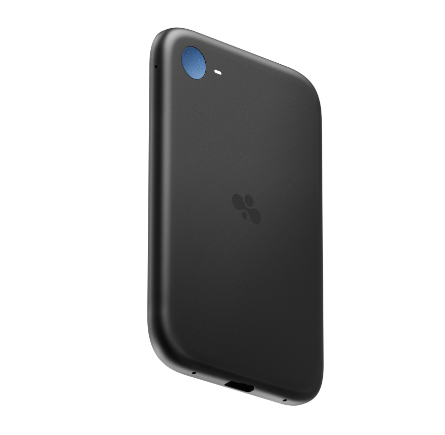
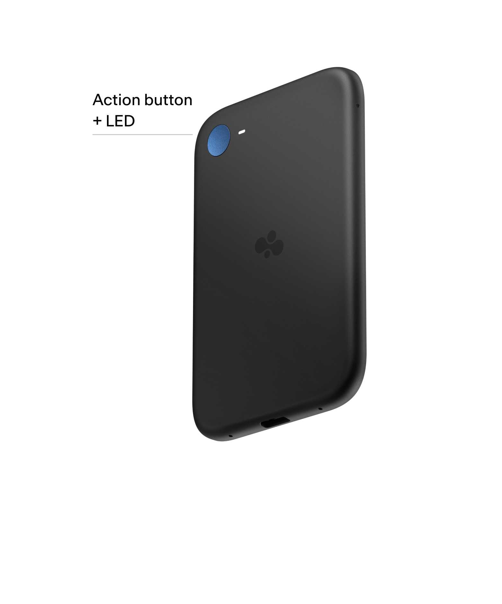
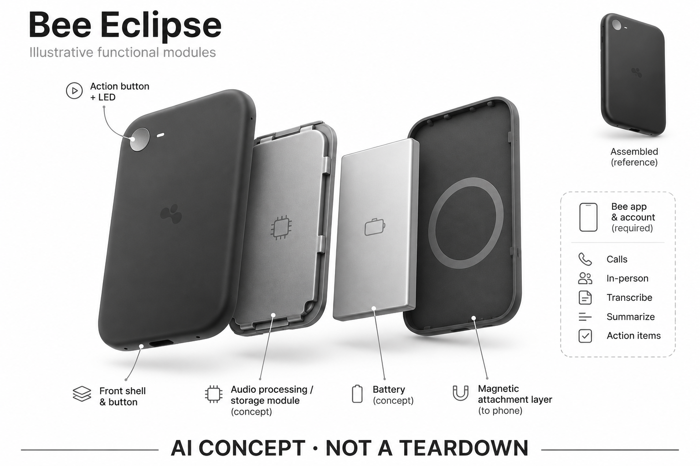

# Bee Eclipse

**Bee / Amazon** · 录音与记忆 · 核查 2026-11-04

已公布的磁吸电话记忆设备，尚未确认开售

消费渠道：个人零售。

## 产品图片与结构参考

### 产品图

Bee Eclipse 官方公布的产品渲染（尚未确认开售） · 来源：[Bee / Amazon · 官方产品图片](<https://bee.computer/products/eclipse>) · [原始图片](<https://cdn.prod.website-files.com/69dd7236d0d093258455ae90/6abc98eaa973bad1b69f5cde_AMZ-Rosey-PDP-D-Specs-Product.png>)

### 参考图

Bee Eclipse 官方按键、指示灯与侧面参考 · 来源：[Bee / Amazon · 官方产品图片](<https://bee.computer/products/eclipse>) · [原始图片](<https://cdn.prod.website-files.com/69dd7236d0d093258455ae90/6ac589b8fa63957e61c1546b_AMZ-Rosey-PDP-M-Specs-Product-View-2.png>)

### AI 生成爆炸示意

**AI 生成 · 非实物拆机。** 内部为概念推断，不能作为元件布局、BOM 或维修依据。[生成提示词](../../content/hardware/prompts/bee-eclipse.txt)

> 外形依据核验参考图；内部位置、模块形状与装配关系仅作AI概念展示。

> 图片按源站提供格式保存，未裁切或改色；厂商渲染/场景示意不代表实机测试。

> 分析为基于公开资料的案头研究与 AI 辅助判断，未经用户访谈、销量审计或实物拆机。需求、画像、竞争冷门度、审美及商业机会均为研究假设，不是投资结论。

## 销售与购买

- 状态：待复核。官方首页仍标为Coming Soon，产品页使用will be available for $99.99与Learn more，而非已确认购买/预订。无明确接受预订证据，因此不标为on_sale或preorder。

- 地区：美国官方发布入口；开售地区待核实

- 价格：公布价 US$99.99（未确认开售）。官方前瞻性公布价，不是已经成交或当前可结算的商品价；部分AI功能预计依赖Bee Pro，具体以最终销售说明为准。

- 中国大陆：尚未确认全球正式开售，更未确认大陆官方渠道与服务。不得把同品牌Frontier的购买入口视作Eclipse已可购买。

- [官方产品 / 商店](<https://bee.computer/products/eclipse>)

## AI 的实际作用

官方公布用途为电话双方与现场谈话的转写、摘要、记忆和待办建议。

服务与联网依赖：需要Bee应用与账户，部分功能需Pro；已公布端侧处理，但整体端云边界与实售功能仍需核查。

## 是否冷门

竞争密集（研究判断）：卡片录音是已有竞品的方向；本款尚未确认开售，不能用公布状态代表市场表现。

## 需求与市场

需求假设：经常通话的人希望把双方表达整理成可回查的行动项，并减少会后手工输入。由于尚未确认开售，不能把宣传演示当成真实需求验证，也无法判断不同手机上的收音稳定性。

## 用户画像

画像推断：电话沟通密集且已使用Bee应用的人可能更容易理解这一形态；佩戴意愿低但随身带手机的人也值得关注。当前没有实售用户调查，不能用品牌其他产品反馈替代本款证据。

## 竞争与替代

案头判断：磁吸卡片录音已与Plaud Note系列直接重叠，新增品牌并不等于新类别。生态集成可能成为差异，但没有销量、独立实测或访谈支持其优势，更不能依据公布价推断市场份额。

## 供应链

官方公布磁吸结构、按键和接口外形，但尚未确认量产交付，本次工厂、核心拾音器件及良率均不明。不能从渲染图推算成本，也不能把同品牌另一设备的制造链直接套用到此款。

## 技术路径

官方描述电话双方处理与部分端侧能力，但未完整解释拾音路径、机型限制和模型部署。架构仅按公布功能抽象；不得将长期电池宣传理解为相同时间的连续录音或离线AI推理。

## 产品审美

图示观察：扁平磁吸形态接近手机配件，配色更生活化；相较手腕设备减少额外佩戴负担。厚度、磁吸稳定性、与无线充电及手机壳的关系仍需实售版本和实机才能判断。

## 关键风险

首要风险是把发布、候补和正式开售混为一谈，其次是电话捕获能力与具体机型、网络和软件版本的限制。厂商公布的功能、价格与续航可能变化，目前不宜据此计算确定的采购方案。

## 机会与验证

市场差异待观察的是Bee能否把电话记录与既有生活记忆服务连接起来。当前最有意义的比较维度是发布承诺、交付状态和最终可用功能之间的差距，而不是提前给出购买结论。

## 功能分层示意

这是功能关系，不是实物拆机、真实空间结构或已核实 BOM。

1. **电话与现场输入**：官方公布处理双方电话和面谈；为概念功能图，非拆机或交付验证。（官方披露）

2. **本机状态**：开始/停止按钮、LED与部分端侧处理，内部器件不明。（官方披露）

3. **手机关联**：磁吸手机并通过Bee应用管理，具体拾音和传输路径未完整披露。（官方披露）

4. **AI记忆**：公布的转写、摘要和待办功能，实际开放范围待开售核实。（官方披露）

5. **查询与行动**：由应用承接搜索和建议使用，是根据用途推导的工作流。（分析推断）

## 来源

1. [Bee · Eclipse 官方产品介绍](<https://bee.computer/products/eclipse>) — 已打开，原文为will be available；未确认预订或结算。

2. [Bee · 官方首页销售状态](<https://bee.computer/>) — 已打开，Eclipse标明Coming Soon；因此归needs_check而非在售或预订。

[返回目录](../hardware-market.md) · [网页分析](https://romanagent.github.io/Roman/#hardware/product/bee-eclipse)
