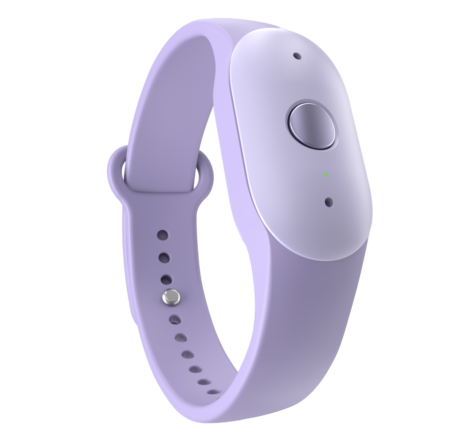
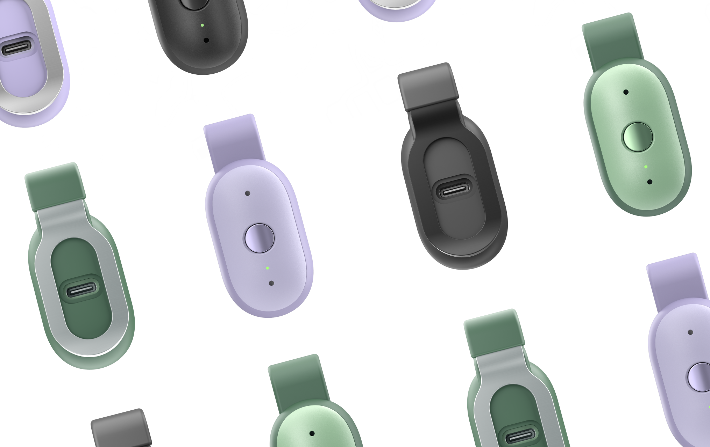
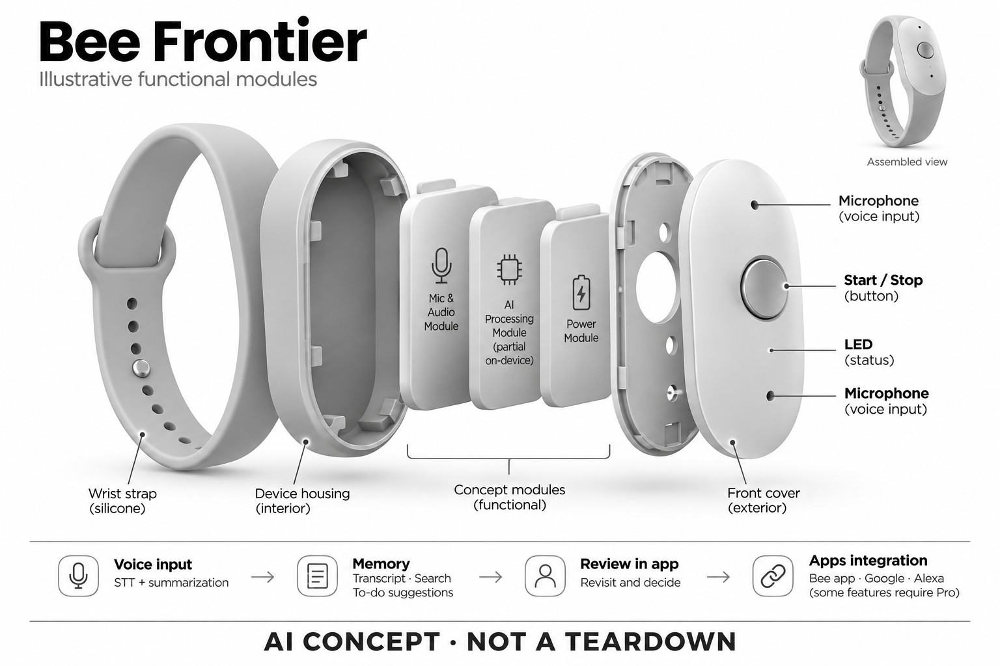

# Bee Frontier

**Bee / Amazon** · 录音与记忆 · 核查 2026-11-04

以一键、长续航和生活上下文组织记忆

消费渠道：个人零售。

## 产品图片与结构参考

### 产品图

Bee Frontier 官方腕带佩戴形态渲染 · 来源：[Bee / Amazon · 官方产品图片](<https://bee.computer/products/frontier>) · [原始图片](<https://cdn.prod.website-files.com/69dd7236d0d093258455ae90/6a0426a8bbd4f2f5c1ba22bb_specs-hero.png>)

### 参考图

Bee Frontier 官方夹持形态与多角度配色参考 · 来源：[Bee / Amazon · 官方产品图片](<https://bee.computer/products/frontier>) · [原始图片](<https://cdn.prod.website-files.com/69dd7236d0d093258455ae90/6acd924c69d698571edbf9de_AMZ-BEE-D-Feature-Carousel-Modular-B.png>)

### AI 生成爆炸示意

**AI 生成 · 非实物拆机。** 内部为概念推断，不能作为元件布局、BOM 或维修依据。[生成提示词](../../content/hardware/prompts/bee-frontier.txt)

> 外形依据核验参考图；内部位置、模块形状与装配关系仅作AI概念展示。

> 图片按源站提供格式保存，未裁切或改色；厂商渲染/场景示意不代表实机测试。

> 分析为基于公开资料的案头研究与 AI 辅助判断，未经用户访谈、销量审计或实物拆机。需求、画像、竞争冷门度、审美及商业机会均为研究假设，不是投资结论。

## 销售与购买

- 状态：在售。Bee官方Frontier产品页显示 US$74.99、Buy on Amazon及Prime配送说明；当前官网已采用Frontier命名，不沿用旧Pioneer的售价或功能。

- 地区：美国（官网导向Amazon.com）

- 价格：US$74.99。官网所见硬件价；部分记忆、任务与应用集成功能需Bee Pro订阅，具体计划和地区价格以官网为准。

- 中国大陆：没有核实大陆官方销售、账号服务或配套应用可用性。Amazon.com购买入口不等同能配送或完整服务中国大陆。

- [官方产品 / 商店](<https://bee.computer/products/frontier>)

## AI 的实际作用

语音识别结合摘要、记忆搜索与待办建议，并可关联授权应用上下文。

服务与联网依赖：依赖Bee应用与账户，部分能力需Pro；官网披露端侧处理，但未完整公开端云任务边界，不据此宣称全离线。

## 是否冷门

新兴竞争（研究判断）：生活记忆与应用上下文结合仍在探索，已有多款可佩戴竞争产品；非量化结论。

## 需求与市场

需求假设：日常碎片承诺和临时安排容易忘记，随身设备可减少掏手机记事的摩擦。需求强度取决于回查是否准确有用，以及用户能否接受在社交场景中明确开启声音处理。

## 用户画像

画像推断：日程较碎、频繁移动并愿意使用配套应用的人可能适合；并非所有健忘用户都需要持续记录。官网的生活场景描述不能作为改善记忆障碍或任何健康问题的疗效证据。

## 竞争与替代

案头判断：与Omi、NotePin、智能手表语音备忘和手机助手重叠，低硬件价格并不决定总使用成本。没有用户访谈、销量或续费证据，不能以Amazon生态推断产品必然被广泛采用。

## 供应链

官网可确认Bee产品及Amazon销售关系、外形、接口和佩戴附件；整机工厂、麦克风供应商与物料成本不明。推断防水、按键寿命和夹具可靠性会影响长期佩戴与售后负担。

## 技术路径

官方披露端侧处理、语音识别和摘要检索，但没有完整模型拓扑。应用集成意味着除硬件外还存在授权数据源；端侧处理一词不足以证明所有转写、记忆和建议都不经过远程服务。

## 产品审美

图示观察：小型圆角设备接近运动手环，可夹衣服且配色柔和，降低商务设备感。佩戴形态同时影响收音和可见性；图片中的轻巧不代表实际佩戴、洗手或衣料摩擦体验已经验证。

## 关键风险

主要风险是谈话内容与关联账号形成更丰富的个人档案，以及长期记忆中误归因或错误建议。需区分硬件价格与订阅功能；官方隐私描述属于厂商承诺，本研究没有独立审计或实机验证。

## 机会与验证

市场差异在于把录音笔记延伸到日程与生活上下文，而非单场会议纪要。尚待验证的购买理由是主动建议是否足够准确、适时和可控，以及用户愿意授予哪些应用访问权限。

## 功能分层示意

这是功能关系，不是实物拆机、真实空间结构或已核实 BOM。

1. **声音与操作**：麦克风、开始/停止按钮、LED；概念功能架构，非拆机图。（官方披露）

2. **设备处理**：官网披露部分端侧处理，未公开完整离线能力边界。（官方披露）

3. **应用上下文**：Bee应用与经授权的Google、Alexa等集成，部分需Pro。（官方披露）

4. **记忆生成**：转写、摘要、搜索与待办建议；具体计算任务位置未完全披露。（官方披露）

5. **用户回查**：用户在应用内回看、搜索并决定是否采纳建议。（分析推断）

## 来源

1. [Bee · Frontier 官方产品页](<https://bee.computer/products/frontier>) — 已打开，US$74.99、Buy on Amazon与Prime配送；未把旧Shopify模板页当成商品证据。

2. [Bee · 当前官方首页](<https://bee.computer/>) — 已打开，区分Frontier与Coming Soon的Eclipse；隐私与集成均作为厂商陈述。

[返回目录](../hardware-market.md) · [网页分析](https://romanagent.github.io/Roman/#hardware/product/bee-frontier)
