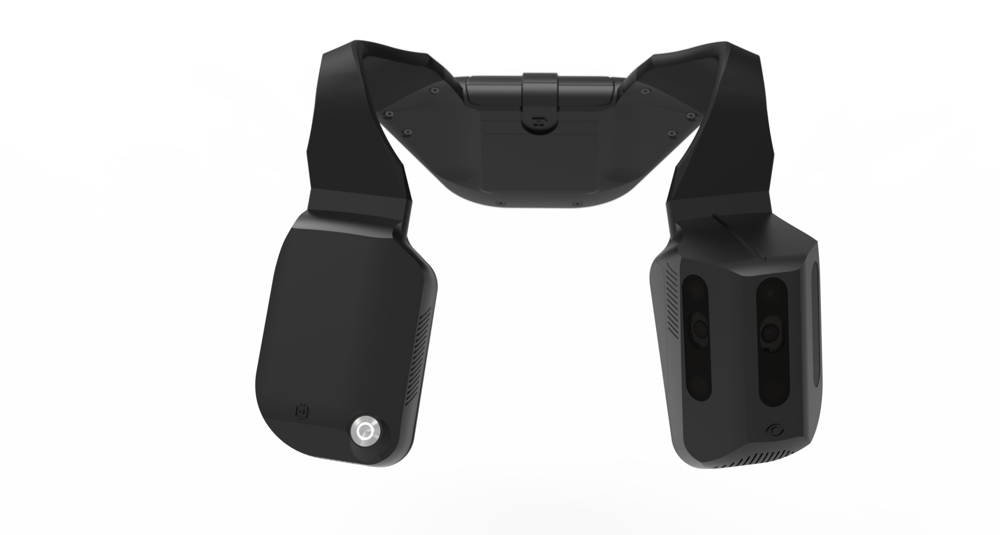
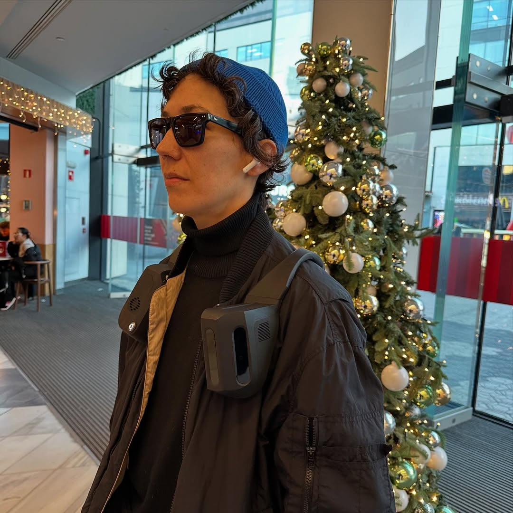
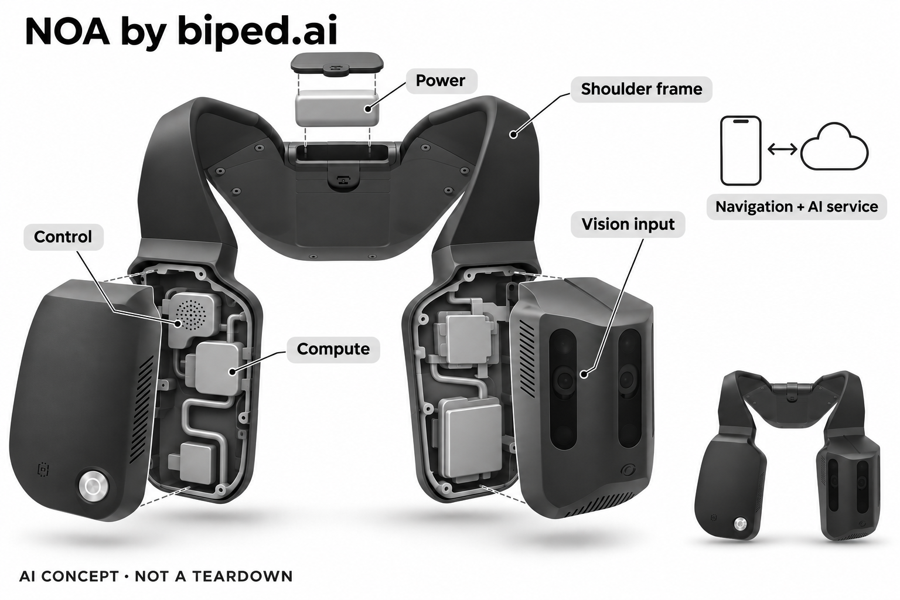

# NOA by biped.ai

**biped.ai** · 无障碍与辅助沟通 · 核查 2026-11-04

肩部视觉感知与空间声音辅助步行

消费渠道：个人零售。

## 产品图片与结构参考

### 产品图

NOA官方双前舱与肩部结构产品图 · 来源：[biped.ai · 官方产品素材](<https://biped.ai/>) · [原始图片](<https://biped.ai/assets/BIP_AICo_DeviceRendering.67_1754687589450-p_oPnhQ0.png>)

### 参考图

NOA官方穿戴场景参考，展示肩部和前舱位置 · 来源：[biped.ai · 官方产品素材](<https://biped.ai/>) · [原始图片](<https://biped.ai/assets/Noa%20Device%20Christmas%20Wishlist_1754690054772-74yPP2DX.jpg>)

### AI 生成爆炸示意

**AI 生成 · 非实物拆机。** 内部为概念推断，不能作为元件布局、BOM 或维修依据。[生成提示词](../../content/hardware/prompts/biped-noa.txt)

> 初稿电池位置与手册不符，已用内置ImageGen修复至后颈；最终视觉核验，未添加相机数量和效果参数。内部几何仍为概念。

> 两张源图已逐张查看，与NOA手册形态一致；未将站点其他眼镜型号素材混入。

> 分析为基于公开资料的案头研究与 AI 辅助判断，未经用户访谈、销量审计或实物拆机。需求、画像、竞争冷门度、审美及商业机会均为研究假设，不是投资结论。

## 销售与购买

- 状态：在售。已通过实际Chrome打开官网链接的Stripe结账：NOA - Plan 1 - Single payment、CHF4,990、数量和支付表单；所见地址国家固定瑞士。未输入个人信息或提交付款。

- 地区：瑞士（实际结账核实）、其他官方分销地区需分别确认

- 价格：CHF4,990（官网单次支付计划）。不采用页面自动换汇人民币作为国内售价；地区、税费、配件与服务以具体订单确认。

- 中国大陆：官网称全球服务，但本次具体订单仅核实瑞士地址；未证明中国大陆直送、地图服务、培训或本地售后。

- [官方产品 / 商店](<https://biped.ai/>)

## AI 的实际作用

深度/红外视觉与AI识别形成障碍提示，AI场景描述帮助理解环境；导航、提示与联网描述是不同功能层。

服务与联网依赖：需白杖或导盲犬等原有辅助、学习声音反馈、配套App及兼容音频输出；部分功能需要Wi-Fi或手机热点，不能视为自主安全导航。

## 是否冷门

细分专业（研究判断）：在同一辅助步行任务中，以肩部宽视野视觉替代单纯手柄测距，属于实现差异；不另宣称独立需求数量或蓝海。

## 需求与市场

需求假设是用户在已经具备基本出行方式时，希望更方便地获知障碍方向、门或周边环境，减少停下拿手机或向别人询问的步骤。视觉输入比单一测距包含更多语义，也会带来识别和信息选择问题；价值应由本人是否更容易获得所需信息衡量，而不只看设备识别了多少物体。

### 官方｜视觉信息通过声音补充出行 · 官方资料

NOA佩戴在肩部，用视觉输入处理障碍与场景，通过声音提供环境及路线信息。官方手册明确它补充白杖或导盲犬，而非替代原有辅助；实体按键和手机应用共同控制功能，因此不能把它描述成自动带人安全行走的机器人，也不能由场景描述流畅推定现场判断一定正确。

依据：[NOA官方用户手册（2025年5月版本）](<https://biped.ai/en/user-manual>) · [biped.ai当前官网与公开产品素材](<https://biped.ai/>)

### 判断｜减少为理解周围而反复询问 · 研究判断

需求假设是用户在已经具备基本出行方式时，希望更方便地获知障碍方向、门或周边环境，减少停下拿手机或向别人询问的步骤。视觉输入比单一测距包含更多语义，也会带来识别和信息选择问题；价值应由本人是否更容易获得所需信息衡量，而不只看设备识别了多少物体。

依据：[NOA官方用户手册（2025年5月版本）](<https://biped.ai/en/user-manual>)

### 验证｜在熟悉环境观察信息负担 · 待验证

可在合适支持下记录本人何时请求描述、哪些提示有帮助、哪些重复或难以理解，并保留原有出行辅助。测试不应为证明设备而进入危险情境，重点是现有流程中哪些步骤变少或变多；本研究没有实机出行观察，也不把厂商案例当作独立安全效果证据。

依据：[NOA官方用户手册（2025年5月版本）](<https://biped.ai/en/user-manual>)

## 用户画像

有些用户更需要简短的障碍方向提示，有些更关心环境语义和路线，接受连续声音的程度也可能不同。肩部重量、衣物和原有工具会影响佩戴意愿，不能只因双手被释放就推定负担降低；画像应由本人常见任务建立，本目录不依据年龄或残余视力替人作适配判断。

### 官方｜学习声音与手机操作是条件 · 官方资料

官方说明使用者需学习声音反馈并完成应用内培训，手机操作和适当的定向行走支持也属于使用流程。肩部结构、音频感知和个人原有辅助需要共同适配，不能依据视觉障碍标签认定人人适合；手册对身体及环境条件的要求应按实际版本和专业支持确认。

依据：[NOA官方用户手册（2025年5月版本）](<https://biped.ai/en/user-manual>)

### 判断｜信息偏好与佩戴能力差异大 · 研究判断

有些用户更需要简短的障碍方向提示，有些更关心环境语义和路线，接受连续声音的程度也可能不同。肩部重量、衣物和原有工具会影响佩戴意愿，不能只因双手被释放就推定负担降低；画像应由本人常见任务建立，本目录不依据年龄或残余视力替人作适配判断。

依据：[NOA官方用户手册（2025年5月版本）](<https://biped.ai/en/user-manual>)

### 验证｜本人完成设置与暂停 · 待验证

试用应确认本人能辨认控制、暂停提示、重复信息并处理手机连接，同时记录需要旁人协助的步骤。将首次培训与熟悉后的操作分开，观察声音是否容易与环境区分；配套教学、维修和持续支持应纳入购买方案，不能把家人完成的演示当作本人独立使用能力。

依据：[NOA官方用户手册（2025年5月版本）](<https://biped.ai/en/user-manual>)

## 竞争与替代

普通白杖与手机提供既有操作路径，智能手柄测距则把部分提示放在握持处，NOA的区别是肩部视觉视野和空间声音处理。它们仍服务相关的辅助步行任务，不应因形态不同就无限增加需求类别；比较应考虑信息范围、学习、重量、网络与原有技能如何配合。

### 官方｜具体订单已核实地区限定 · 官方资料

本轮实际浏览器结账显示NOA单次支付计划、四千九百九十瑞士法郎、数量选择与配送付款表单，所见国家固定瑞士。该证据支持一个明确实物订单，不是邮箱候补；自动人民币换汇与全球宣传不能证明大陆正式销售，其他地区需要分别核实订单、培训和服务。

依据：[NOA官网实物单次支付结账](<https://checkout.biped.ai/b/7sIbMP3un4d92YMeVF>)

### 判断｜与白杖加手机和智能手柄比较 · 研究判断

普通白杖与手机提供既有操作路径，智能手柄测距则把部分提示放在握持处，NOA的区别是肩部视觉视野和空间声音处理。它们仍服务相关的辅助步行任务，不应因形态不同就无限增加需求类别；比较应考虑信息范围、学习、重量、网络与原有技能如何配合。

依据：[NOA官方用户手册（2025年5月版本）](<https://biped.ai/en/user-manual>) · [biped.ai当前官网与公开产品素材](<https://biped.ai/>)

### 验证｜把整套使用成本放在一起 · 待验证

比较时应包含设备、音频附件、手机条件、培训、维护和维修运输，再由本人说明具体信息任务是否更容易完成。不要用视觉语义演示与另一方案的单纯测距直接给出总排名；本目录没有用户访谈、销量或市场份额，不能因专业细分和较高价格推定独特商业空间。

依据：[NOA官方用户手册（2025年5月版本）](<https://biped.ai/en/user-manual>) · [NOA官网实物单次支付结账](<https://checkout.biped.ai/b/7sIbMP3un4d92YMeVF>)

## 供应链

同类新设计必须让视觉模块在不同衣物和肩形下保持合适朝向，否则软件可能处理到与用户前进方向不一致的画面。散热、连接与更换电池也需要在实际佩戴中验证；仅在桌面跑通识别模型不足以证明肩部系统可用，候选芯片不能解决所有机械和教学约束。

### 官方｜前部计算与后颈供电可核实 · 官方资料

手册区分前部视觉和计算控制区域，并把可拆电池放在后颈位置，公开深度及红外相机和连接类别。具体主控、相机料号、完整电路与整机工厂没有确认，品牌研发叙述不能补齐供应链；概念图只采用已知模块位置，其余内部形状和装配关系明确为推断。

依据：[NOA官方用户手册（2025年5月版本）](<https://biped.ai/en/user-manual>)

### 判断｜结构定位会影响视觉输入 · 研究判断

同类新设计必须让视觉模块在不同衣物和肩形下保持合适朝向，否则软件可能处理到与用户前进方向不一致的画面。散热、连接与更换电池也需要在实际佩戴中验证；仅在桌面跑通识别模型不足以证明肩部系统可用，候选芯片不能解决所有机械和教学约束。

依据：[NOA官方用户手册（2025年5月版本）](<https://biped.ai/en/user-manual>)

### 验证｜以佩戴后的系统验证选型 · 待验证

供应研究可分别比较视觉处理与低功耗控制连接，先核对输入接口、模型运行和热量，再观察真实佩戴中的画面稳定与提示时序。候选公司没有被品牌点名，就不能标为现用；同时应保留镜头维护、跌落后检查和维修流程，不根据外观推测物料成本或可靠性。

依据：[NOA官方用户手册（2025年5月版本）](<https://biped.ai/en/user-manual>)

## 技术路径

环境里同时存在多种物体，用户通常只需要与当前行动相关的信息，过量描述可能遮住真正重要的声音。视觉识别到一个物体并不自动知道用户打算去哪里，地图也不能确认所有现场变化；技术评价应关注提示优先级、延迟和不确定性，而不只统计识别类别。

### 官方｜障碍、导航和描述不是同一算法 · 官方资料

NOA手册把空间障碍提示、路线导航和AI场景描述分开，并说明部分功能需要网络连接。设备通过深度及红外视觉采集信息，手机和音频输出参与完整体验；模型、主控和端云分配未完全公开，目录不把所有功能都称为本地离线，也不从相机窗口数猜测具体传感器数量。

依据：[NOA官方用户手册（2025年5月版本）](<https://biped.ai/en/user-manual>)

### 判断｜信息选择比全部播报更重要 · 研究判断

环境里同时存在多种物体，用户通常只需要与当前行动相关的信息，过量描述可能遮住真正重要的声音。视觉识别到一个物体并不自动知道用户打算去哪里，地图也不能确认所有现场变化；技术评价应关注提示优先级、延迟和不确定性，而不只统计识别类别。

依据：[NOA官方用户手册（2025年5月版本）](<https://biped.ai/en/user-manual>)

### 验证｜逐项理解断网与错误提示 · 待验证

可以在安全可控的固定环境中检查网络中断、手机断连和音频输出暂不可用时各功能如何变化，并让本人说明当前还能依靠哪些信息。对误识别、描述遗漏与重复提示分别记录，不在危险路况下测试极限；目录没有实测，不能将一次成功识别推广到所有现场条件。

依据：[NOA官方用户手册（2025年5月版本）](<https://biped.ai/en/user-manual>)

## 产品审美

用户需要在行走前后通过触觉找到暂停、选择与重复入口，清楚区分按键比外观极度隐藏更有实际意义。明显的相机结构也可能影响旁人理解与用户社交感受；设计评价应尊重本人是否愿意公开佩戴辅助设备，不能把看起来先进或低调当作普遍偏好。

### 官方｜肩部框架与双前舱外形 · 官方资料

官方素材显示跨肩连接、两侧前舱和后部结构，计算控制与视觉区域具有不同外观，设备通过衣物和肩部承载。手册还要求适当定位和保持散热通道，图片无法证明所有身形或服饰均能自然贴合；真实佩戴舒适度和长时负担必须由本人及支持人员评估。

依据：[NOA官方用户手册（2025年5月版本）](<https://biped.ai/en/user-manual>) · [biped.ai当前官网与公开产品素材](<https://biped.ai/>)

### 判断｜可触摸控制比隐蔽更重要 · 研究判断

用户需要在行走前后通过触觉找到暂停、选择与重复入口，清楚区分按键比外观极度隐藏更有实际意义。明显的相机结构也可能影响旁人理解与用户社交感受；设计评价应尊重本人是否愿意公开佩戴辅助设备，不能把看起来先进或低调当作普遍偏好。

依据：[NOA官方用户手册（2025年5月版本）](<https://biped.ai/en/user-manual>)

### 验证｜观察穿衣与收纳的完整过程 · 待验证

可在常用外套、背包和坐姿条件下观察戴取、调整、取放电池与收纳，记录是否需要额外帮助。再检查按键能否在不改变视觉模块朝向时操作，以及声音提示是否易于重复；产品图只能确认形态，不能支持重量感、材质接触和长期耐用性的确定结论。

依据：[NOA官方用户手册（2025年5月版本）](<https://biped.ai/en/user-manual>) · [biped.ai当前官网与公开产品素材](<https://biped.ai/>)

## 关键风险

用户可能把清楚的语音理解为现场事实已经完全核实，但摄像范围、遮挡、网络和生成描述都可能出现遗漏。声音反馈也会占用注意，重要问题不应只依赖一个自动输出；本研究不对个人安全出行效果作保证，还需关注相机采集旁人与环境数据时的理解和控制。

### 官方｜手册限制优先于全天候宣传 · 官方资料

当前官网宣传语较宽，但官方手册明确部分雨水、强光或完全黑暗会影响表现，并限制若干天气条件与用途。目录采用这些具体边界，不承诺全天候可靠；它仍是白杖或导盲犬的补充，既有技能、培训和现场判断不能因增加视觉AI而被省略。

依据：[NOA官方用户手册（2025年5月版本）](<https://biped.ai/en/user-manual>) · [biped.ai当前官网与公开产品素材](<https://biped.ai/>)

### 判断｜流畅描述可能遮住识别盲点 · 研究判断

用户可能把清楚的语音理解为现场事实已经完全核实，但摄像范围、遮挡、网络和生成描述都可能出现遗漏。声音反馈也会占用注意，重要问题不应只依赖一个自动输出；本研究不对个人安全出行效果作保证，还需关注相机采集旁人与环境数据时的理解和控制。

依据：[NOA官方用户手册（2025年5月版本）](<https://biped.ai/en/user-manual>)

### 验证｜事先确认失效与支持路径 · 待验证

交付前应确认实际软件版本、培训、适用环境与维修支持，试用中演练如何识别无结果或失联并继续使用原有辅助。记录需要暂停或寻求帮助的原因，避免把设备当作道路通行决定者；这些检查旨在理解产品可靠性边界，不提供具体路线操作或个体医学判断。

依据：[NOA官方用户手册（2025年5月版本）](<https://biped.ai/en/user-manual>) · [NOA官网实物单次支付结账](<https://checkout.biped.ai/b/7sIbMP3un4d92YMeVF>)

## 机会与验证

值得研究的是用户是否能在熟悉出行中少一次为了解环境而停下询问，同时不增加难以理解的提示、穿戴和维护负担。视觉描述的价值可能集中在少数具体场景，不需要宣称全面自主导航；研究应允许本人选择只用部分功能或继续采用更简单的原有方法。

### 官方｜视觉肩戴是实现差异 · 官方资料

NOA把宽视野视觉、声音提示和场景描述放在肩部结构中，与手柄测距或手持拍摄有明显实现差异。它仍服务既有辅助步行中的环境信息任务，目录与相关白杖方案共享核心任务分组，不将新品牌或外壳自动变成新需求；购买理由要落在本人实际获得的信息增量。

依据：[NOA官方用户手册（2025年5月版本）](<https://biped.ai/en/user-manual>) · [biped.ai当前官网与公开产品素材](<https://biped.ai/>)

### 判断｜减少一次求助也需计算新负担 · 研究判断

值得研究的是用户是否能在熟悉出行中少一次为了解环境而停下询问，同时不增加难以理解的提示、穿戴和维护负担。视觉描述的价值可能集中在少数具体场景，不需要宣称全面自主导航；研究应允许本人选择只用部分功能或继续采用更简单的原有方法。

依据：[NOA官方用户手册（2025年5月版本）](<https://biped.ai/en/user-manual>)

### 验证｜由本人选择持续观察任务 · 待验证

后续可记录本人常走路线中主动调用、有效信息、误报、求助和维护情况，分别评价学习后与初次使用的变化。与原有辅助比较时保持适当支持和安全条件，不以短演示替代长期观察；目前没有独立用户或市场数据，不能从公开订单和技术存在推定出行效果及商业需求已验证。

依据：[NOA官方用户手册（2025年5月版本）](<https://biped.ai/en/user-manual>) · [NOA官网实物单次支付结账](<https://checkout.biped.ai/b/7sIbMP3un4d92YMeVF>)

## 对应供应链公司

能力候选用于选型研究，不代表本产品实际采用；未公开的供货关系不作推断。

- [ambarella](../supply-chain/ambarella.md) — **能力候选 · 非已采用** / 同类肩部视觉辅助系统的边缘视觉处理候选：Ambarella公开CVflow视觉计算、图像处理与模型工具，可用于研究肩部多路视觉输入和环境识别的新架构。具体深度相机接口、模型、温升和供电需重新验证，不自动包含导航或生成式场景描述；本轮没有NOA点名采用证据，因此不视为现有计算模块替代件。

- [nordic-semiconductor](../supply-chain/nordic-semiconductor.md) — **能力候选 · 非已采用** / 同类辅助穿戴的BLE控制与状态连接候选：Nordic低功耗无线平台可对应NOA公开的应用控制和状态连接方向，但不应被当作视觉主控或默认承担全部音频传输。需要确认协议、数据量、失联提示与功耗，当前未有点名采用资料；此候选只支持相近系统的控制连接研究，不代表能够复制完整出行功能。

[浏览供应链目录](../supply-chain.md)

## 功能分层示意

这是功能关系，不是实物拆机、真实空间结构或已核实 BOM。

1. **肩部与供电**：支撑跨肩连接前部模组，官方手册把可拆电池放在后颈位置。（官方披露）

2. **视觉采集**：官方手册披露深度与红外相机；具体料号与全部窗口用途不据照片猜测。（官方披露）

3. **环境处理**：对障碍与场景进行处理，具体模型、运算主控和执行分配未完整公开。（官方披露）

4. **应用与连接**：按键和App控制，配合手机、Wi-Fi/热点与音频设备；不同功能联网需求需分开。（官方披露）

5. **声音反馈**：空间提示、路线与描述提供信息补充，不替代白杖、导盲犬或通行判断。（官方披露）

## 来源

1. [NOA官方用户手册（2025年5月版本）](<https://biped.ai/en/user-manual>) — 本轮已打开PDF，核对视觉/声音、连接、培训、后颈电池和使用环境限制；不把旧版配件数量或性能参数直接当当前交付承诺。

2. [NOA官网实物单次支付结账](<https://checkout.biped.ai/b/7sIbMP3un4d92YMeVF>) — 本轮Chrome实际读取NOA单次支付CHF4,990、数量和瑞士配送表单。只读未付款；本地货币自动换算不是大陆销售证明。

3. [biped.ai当前官网与公开产品素材](<https://biped.ai/>) — 本轮web打开无可读正文，公开HTML及站点脚本已读取，核对官网购买链接与NOA产品/佩戴素材；宣传全天候不覆盖手册具体限制。

[返回目录](../hardware-market.md) · [网页分析](https://romanagent.github.io/Roman/#hardware/product/biped-noa)
