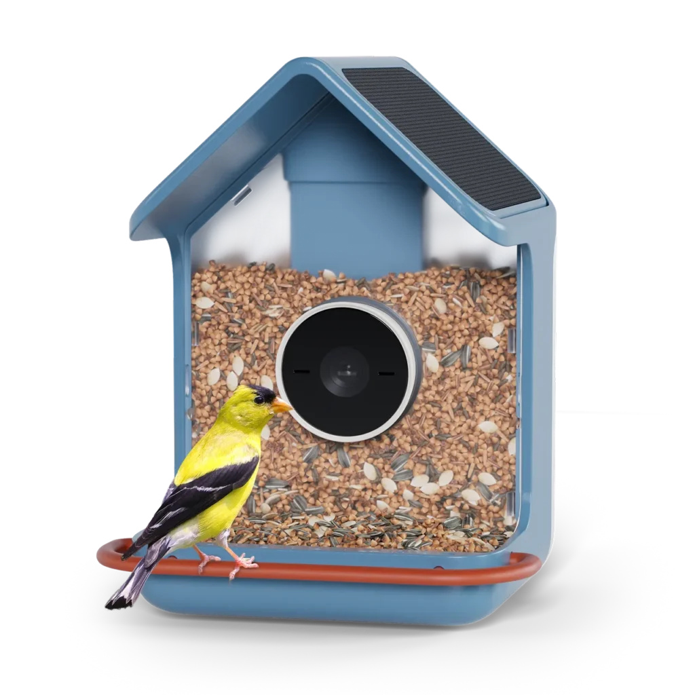
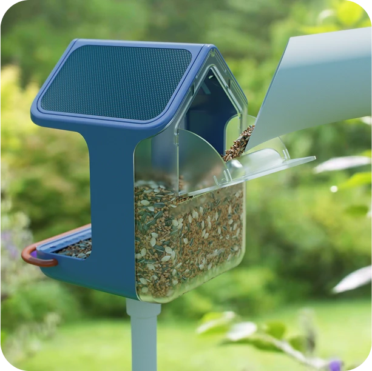
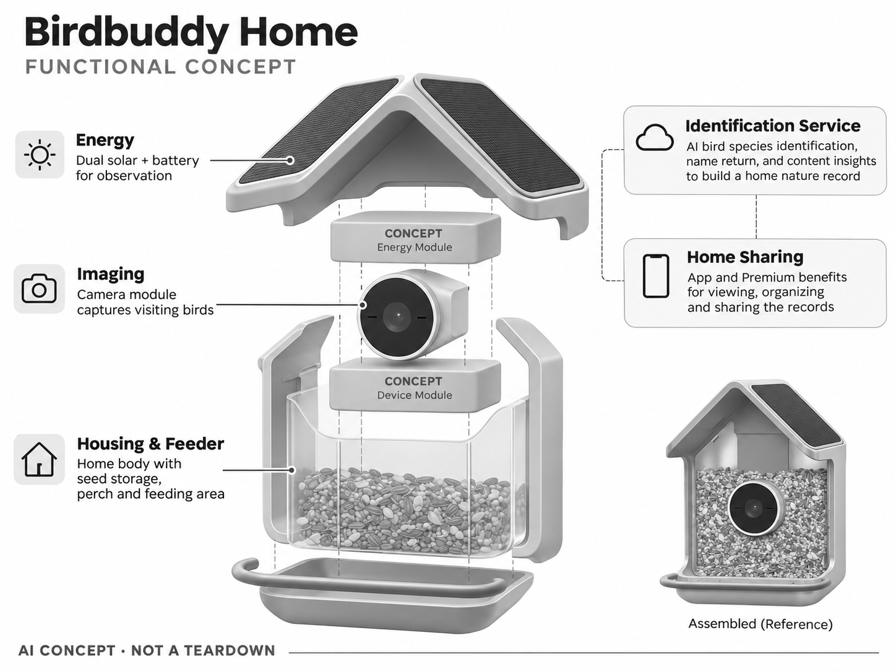

# Birdbuddy Home

**Birdbuddy** · 庭院与自然 · 核查 2026-11-04

通过较完整的庭院机身与AI记录连接家庭观鸟

消费渠道：个人零售。

## 产品图片与结构参考

### 产品图

Birdbuddy Home 官方产品图 · 来源：[Birdbuddy · 官方图片](<https://mybirdbuddy.com/product/birdbuddy-home/>) · [原始图片](<https://mybirdbuddy.com/wp-content/uploads/2025/09/Birdbuddy2_product_image-1024x1024.webp>)

### 参考图

Birdbuddy Home 官方外观、使用场景或功能参考图 · 来源：[Birdbuddy · 官方图片](<https://mybirdbuddy.com/product/birdbuddy-home/>) · [原始图片](<https://mybirdbuddy.com/wp-content/uploads/2025/08/250730_HeroTake00_Seeds2_2560x2560_MO_V1_00000.webp>)

### AI 生成爆炸示意

**AI 生成 · 非实物拆机。** 内部为概念推断，不能作为元件布局、BOM 或维修依据。[生成提示词](../../content/hardware/prompts/birdbuddy-home.txt)

> 依据官方外观参考与公开功能生成；未披露的内部布局只作概念模块，不构成BOM或真实结构证据。

> 保留官方图原始内容与出处；画面中的宣传参数不视为本轮独立实测。

> 分析为基于公开资料的案头研究与 AI 辅助判断，未经用户访谈、销量审计或实物拆机。需求、画像、竞争冷门度、审美及商业机会均为研究假设，不是投资结论。

## 销售与购买

- 状态：在售。官方Home商品页显示US$219和Buy Now；自动识别对应Family Premium选项，首月后年费另计，硬件与服务不混为同一价。

- 地区：美国官方商店

- 价格：US$219（硬件）。核查时官方页面参考，价格保留原币种；套装、配件、订阅、税运及地区条件分别确认，不把容量版本重复计数。

- 中国大陆：本轮核实海外官方销售；中国大陆同型号现货、售后与云服务未确认。庭院条件、物种范围或定位服务也需按地区验证。

- [官方产品 / 商店](<https://mybirdbuddy.com/product/birdbuddy-home/>)

## AI 的实际作用

AI物种识别、命名返回访鸟和内容洞察连接家庭自然记录；与已收录Nook相比是不同机身及双太阳能形态，不按颜色另计。

服务与联网依赖：自动识别与部分内容能力依赖Premium；基础影像、人工识别和高级服务权益不同，具体方案需按当前页核对。

## 是否冷门

细分专业（研究判断）：家庭自然观察是兴趣驱动的细分市场，品牌与内容生态已有竞争，需要验证持续使用而非只看礼物购买。

## 需求与市场

需求假设：已经形成观鸟习惯的家庭可能需要更稳定的供电和更丰富的访鸟记录。应比较维护间隔、漏拍和每周复看次数；比入门款更大或更多太阳能，不必然让所有用户获得等比例价值。

## 用户画像

画像推断：愿长期补粮清洁、希望与家人分享自然观察的庭院用户。购买动机可能来自礼物或园艺兴趣而非AI，需分别验证设备维护者与远程观看者是否都愿持续投入。

## 竞争与替代

竞争判断：同品牌入门Nook、Birdfy多摄产品及普通喂鸟相机都是替代。Home需要证明长期维护和观察体验的增益，不能仅靠套餐或新名称成为独立需求；本条只计一个硬件型号。

## 供应链

供应链分析：户外相机、电池、双太阳能屋顶和食仓结构共同决定可靠性，制造工厂与BOM未披露。重点是阴雨天供电、塑料老化、食品残留与拆装寿命，软件内容成本也应纳入评估。

## 技术路径

官方披露AI识别与会员内容能力。技术判断：个体命名和物种识别是不同任务，不应把人为命名当作已经可靠区分同种个体；地区物种、光照和多鸟遮挡需要独立验证。

## 产品审美

审美判断：家屋式轮廓和大屋顶让它更接近庭院摆件，减少安防相机感。相机位置、落脚台与清洁开口应服务自然观察；太阳能板的角度和安装线材同样影响整体外观。

## 关键风险

风险判断：自动识别的订阅要求可能被一次硬件价格掩盖，云服务变化影响长期体验。喂食卫生和邻居隐私仍需用户管理，鸟类健康提示不应被用于未经专业确认的处理行动。

## 机会与验证

机会假设：围绕家庭共看、老人友好操作或地方自然教育验证价值。先比较低价相机加共享相册与专用产品的使用差异，再决定更复杂的硬件与会员生态是否值得投入。

## 功能分层示意

这是功能关系，不是实物拆机、真实空间结构或已核实 BOM。

1. **外壳食仓**：Home机身、落脚与供粮空间。（官方披露）

2. **成像观察**：摄像模块捕捉访鸟。（官方披露）

3. **能源**：双太阳能与电池支持观察。（官方披露）

4. **识别服务**：鸟种、内容与个体命名功能。（官方披露）

5. **家庭分享**：App与Premium权益。（官方披露）

## 来源

1. [Birdbuddy Home 官方商品页](<https://mybirdbuddy.com/product/birdbuddy-home/>) — 已实际打开并核查购买与交付入口；未实际下单。

2. [Birdbuddy 官方会员说明](<https://mybirdbuddy.com/memberships/>) — 已实际打开的官方能力、服务或维护说明；不代表独立实测。

[返回目录](../hardware-market.md) · [网页分析](https://romanagent.github.io/Roman/#hardware/product/birdbuddy-home)
