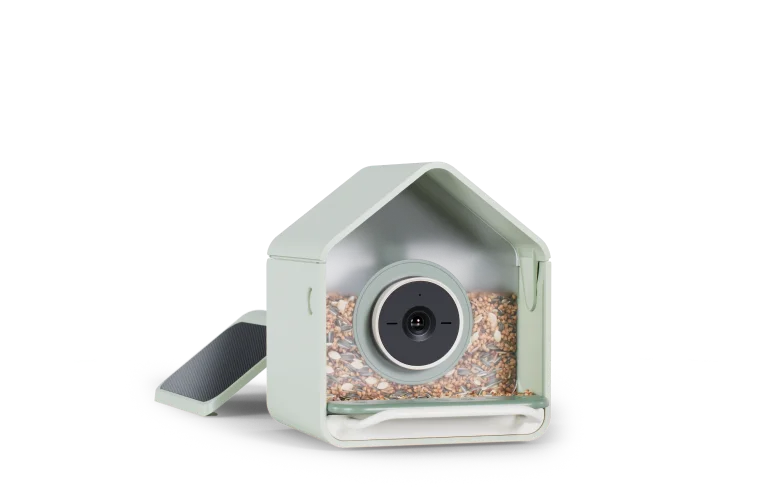
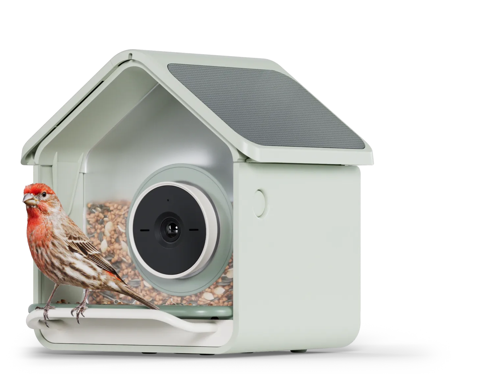
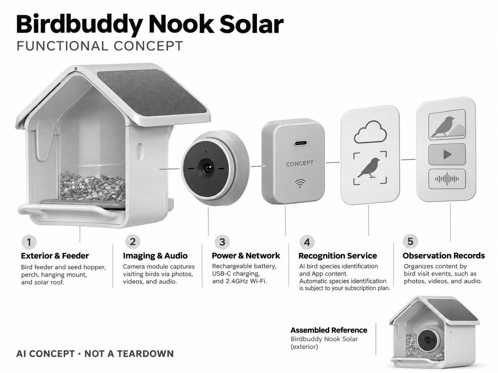

# Birdbuddy Nook Solar

**Birdbuddy** · 庭院与自然 · 核查 2026-11-04

将鸟类识别与家庭自然观察结合的太阳能喂鸟器

## 产品图片与结构参考

### 产品图

官方商品图：Nook Solar 机身与太阳能顶板 · 来源：[Birdbuddy · 官方图片](<https://mybirdbuddy.com/product/birdbuddy-nook-solar/>) · [原始图片](<https://mybirdbuddy.com/wp-content/uploads/2026/10/nook-solar-product.webp>)

### 参考图

官方场景图：Nook Solar 屋顶、镜头与访鸟位置 · 来源：[Birdbuddy · 官方图片](<https://mybirdbuddy.com/product/birdbuddy-nook-solar/>) · [原始图片](<https://mybirdbuddy.com/wp-content/uploads/2026/10/nook-solar-hero.webp>)

### AI 生成爆炸示意

**AI 生成 · 非实物拆机。** 内部为概念推断，不能作为元件布局、BOM 或维修依据。[生成提示词](../../content/hardware/prompts/birdbuddy-nook-solar.txt)

> 依据官方外观参考与公开功能生成；未披露的内部布局只作概念模块，不构成BOM或真实结构证据。

> 图片版权归原权利人；用于产品研究并保留出处。未改变图片色彩或内容。

> 分析为基于公开资料的案头研究与 AI 辅助判断，未经用户访谈、销量审计或实物拆机。需求、画像、竞争冷门度、审美及商业机会均为研究假设，不是投资结论。

## 销售与购买

- 状态：在售。官方商店展示 Nook Solar US$159 选项与 Buy Now。页面将自动识别与 Family Premium 订阅关联，不能把硬件价当作完整 AI 服务总价。

- 地区：美国

- 价格：US$159 + 可选 Family Premium。官方页快照：自动识别对应 Family Premium，展示首月免费后 US$98.99/年；基础档含影像但为手动辨鸟。以当前地区方案为准。

- 中国大陆：本轮未找到中国大陆官方销售与本地 App 服务承诺；识别范围、网络、物流和售后需进一步确认。

- [官方产品 / 商店](<https://mybirdbuddy.com/product/birdbuddy-nook-solar/>)

## AI 的实际作用

摄像头捕获访鸟，AI 对鸟类物种进行识别；自动物种识别受当前订阅方案约束。

服务与联网依赖：需要 2.4GHz Wi-Fi 与 Birdbuddy App；识别服务和会员能力不应视作完全离线或永久随硬件提供。

## 是否冷门

细分专业（研究判断）：属于自然观察与园艺爱好者的细分场景，需求有空间与习惯门槛；已有同类品牌，非无人赛道。

## 需求与市场

需求假设：用户购买的是更容易发现院内自然、记录和分享访鸟的体验，而非安防录像。应验证连续四周的打开频次、分享行为和实际喂养维护投入，礼物购买并不等于长期活跃。

## 用户画像

画像假设：有可放置喂鸟器空间的自然爱好者、亲子家庭及为父母选礼物的人。购买者与使用者可能不同；用户还需愿意补粮、清洁及正确照护野鸟，不能只用科技爱好者画像解释需求。

## 竞争与替代

竞争判断：智能喂鸟器是比通用摄像头更窄的生活方式市场，但 Birdfy 等已有替代方案。差异可能来自识别、内容社区、外观与易清洁结构；这里的专业性不等于已证明的高增长。

## 供应链

供应链推断：防水相机、电池、太阳能板、塑料食仓和挂装结构是主要模块。具体传感器供应商与制造工厂未披露；防晒老化、啮咬、积水和食物接触材料比通用桌面相机更需验证。

## 技术路径

官方披露 AI 鸟种识别与相机模块。技术判断：遮挡、不同季节羽色和地区物种差异会影响识别，鸟类健康提示不能当诊断。模型更新、误识纠正和弱网传输是持续体验的重要部分。

## 产品审美

审美判断：小型屋顶与食仓让技术融入园艺物件，外观更像亲和的生活用品。镜头位置、鸟落脚空间和清洗便利应协同设计；可爱的造型不能妨碍补粮或使食物长期受潮。

## 关键风险

风险判断：自动识别依赖订阅，用户可能低估长期费用；相机也可能拍入邻居或访客。喂养位置、清洁频率与当地野生动物规则应由使用者核对，不能把物种识别准确性作无条件承诺。

## 机会与验证

可验证机会：研究本地鸟种、老人友好分享和学校自然观察场景。先以普通相机与小规模标注验证观察需求及留存，再设计专用外壳，避免仅因 AI 与宠物话题热度进入。

## 功能分层示意

这是功能关系，不是实物拆机、真实空间结构或已核实 BOM。

1. **外壳与食仓**：喂鸟器、落脚件、挂装与太阳能屋顶。（官方披露）

2. **影像与拾音**：相机模组采集访鸟照片、视频及声音。（官方披露）

3. **能源网络**：电池、USB-C 充电和 2.4GHz Wi-Fi。（官方披露）

4. **识别服务**：物种识别与 App 内容，自动识别按会员方案。（官方披露）

5. **观察记录**：按访鸟事件组织内容的功能层示意，不是设备拆机结构。（分析推断）

## 来源

1. [Birdbuddy Nook Solar 官方商店](<https://mybirdbuddy.com/product/birdbuddy-nook-solar/>) — 已打开；商品选项、订阅区分和 AI 物种识别均有明确说明。

2. [Birdbuddy 官方产品目录](<https://mybirdbuddy.com/shop/>) — 已打开；Nook Solar 列价并提供购买入口。

[返回目录](../hardware-market.md) · [网页分析](https://romanagent.github.io/Roman/#hardware/product/birdbuddy-nook-solar)
