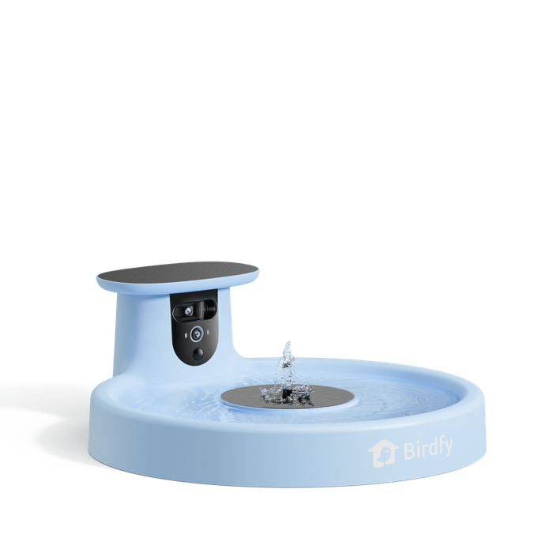
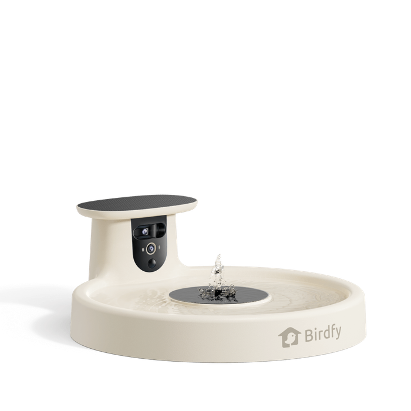
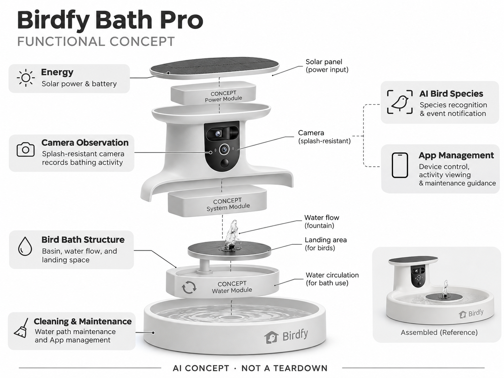

# Birdfy Bath Pro

**Birdfy** · 庭院与自然 · 核查 2026-11-04

把家庭鸟浴转成可记录的自然观察设备

消费渠道：个人零售。

## 产品图片与结构参考

### 产品图

Birdfy Bath Pro 官方产品图 · 来源：[Birdfy · 官方图片](<https://www.birdfy.com/products/birdfy-bath-pro>) · [原始图片](<https://cdn.shopify.com/s/files/1/0782/9346/7416/files/bath_4.png?v=1792726968&width=1200>)

### 参考图

Birdfy Bath Pro 官方外观、使用场景或功能参考图 · 来源：[Birdfy · 官方图片](<https://www.birdfy.com/products/birdfy-bath-pro>) · [原始图片](<https://cdn.shopify.com/s/files/1/0782/9346/7416/files/bath_1.png?v=1792726961&width=1200>)

### AI 生成爆炸示意

**AI 生成 · 非实物拆机。** 内部为概念推断，不能作为元件布局、BOM 或维修依据。[生成提示词](../../content/hardware/prompts/birdfy-bath-pro.txt)

> 依据官方外观参考与公开功能生成；未披露的内部布局只作概念模块，不构成BOM或真实结构证据。

> 保留官方图原始内容与出处；画面中的宣传参数不视为本轮独立实测。

> 两张官方图分别展示蓝色和白色Bath Pro，属于同一型号，未按配色重复收录。

> 分析为基于公开资料的案头研究与 AI 辅助判断，未经用户访谈、销量审计或实物拆机。需求、画像、竞争冷门度、审美及商业机会均为研究假设，不是投资结论。

## 销售与购买

- 状态：在售。官方页明确In Stock、3—7工作日配送和Add to cart；本条按不含支架主机，不将支架或颜色套装重复收录。

- 地区：美国官方商店

- 价格：US$199.99（不含支架）。核查时官方页面参考，价格保留原币种；套装、配件、订阅、税运及地区条件分别确认，不把容量版本重复计数。

- 中国大陆：本轮核实海外官方销售；中国大陆同型号现货、售后与云服务未确认。庭院条件、物种范围或定位服务也需按地区验证。

- [官方产品 / 商店](<https://www.birdfy.com/products/birdfy-bath-pro>)

## AI 的实际作用

集成相机识别访鸟物种并记录洗浴活动，结合太阳能鸟浴和水流结构；水循环本身不算AI。

服务与联网依赖：需要App和家庭网络；AI识别服务与高级会员权益按核查时方案确认，水源清洁和设备维护仍由用户完成。

## 是否冷门

细分专业（研究判断）：鸟浴观察比喂食观察更细分且需要庭院维护，已有普通鸟浴及摄像头替代，不应把窄用户群误判为低竞争。

## 需求与市场

需求假设：用户想观察喂食之外的洗浴行为，同时为野鸟提供可用水源。应评估鸟是否愿意使用、摄像头能否抓到关键动作和清洗频率，不能把造景装饰需求与AI识别价值混为一谈。

### 产品任务与边界 · 研究判断

Bath Pro 把鸟浴盆、水流和 AI 相机结合，任务是观察喂食之外的洗浴活动并记录访鸟。需求包含庭院装饰、水源维护和自然观察三部分，不能因为用户喜欢水景，就推断其同样需要物种识别或愿意持续查看云端内容。

依据：[Birdfy Bath Pro 官方商品页](<https://www.birdfy.com/products/birdfy-bath-pro>) · [Birdfy Bath Pro 官方安装与能力](<https://support.birdfy.com/product/birdfy-bath-pro/>)

### 需求判断 · 研究判断

洗浴行为可能提供普通喂鸟器没有的影像，但设备是否被鸟使用受真实环境影响。用户仍需维护水盆和相机，AI 不会自动解决水源清洁，因此价值应比较有效观察与维护负担，而不是只看水流和鸟类互动的宣传片。

依据：[Birdfy Bath Pro 官方商品页](<https://www.birdfy.com/products/birdfy-bath-pro>) · [Birdfy Bath Pro 官方安装与能力](<https://support.birdfy.com/product/birdfy-bath-pro/>)

### 需求验证 · 待验证

可在实际庭院记录访鸟、有效洗浴片段、通知和清洗工作，比较普通鸟浴加相机的方案。观察四周后用户是否仍主动回看，区分景观欣赏、提供水源和 AI 识别各自带来的价值，不保证安装后一定有鸟使用。

依据：[Birdfy Bath Pro 官方商品页](<https://www.birdfy.com/products/birdfy-bath-pro>) · [Birdfy Bath Pro 官方安装与能力](<https://support.birdfy.com/product/birdfy-bath-pro/>)

## 用户画像

画像推断：有庭院、愿意维护水盆的观鸟爱好者及园艺家庭。与普通摄像头用户不同，他们可能在意季节性访鸟和景观完整度；没有户外水源管理能力的赠礼接收者未必适合。

### 适用行为与条件 · 研究判断

较匹配有庭院、愿维护水盆的自然爱好者和园艺家庭，季节性观察与景观完整度可能比技术参数更重要。赠礼接收者如果没有维护水源的条件，即使喜欢造型也未必适合，画像应包含实际劳动和安装能力。

依据：[Birdfy Bath Pro 官方商品页](<https://www.birdfy.com/products/birdfy-bath-pro>) · [Birdfy Bath Pro 官方安装与能力](<https://support.birdfy.com/product/birdfy-bath-pro/>)

### 人群取舍 · 研究判断

已有鸟浴经验的人可能重视更容易拍到活动，新手可能更需要理解清洁和摆放。不同气候和光照会改变供电与维护，不能把温暖展示庭院里的使用方式推广到所有地区，更不应只依据有户外空间推算市场。

依据：[Birdfy Bath Pro 官方商品页](<https://www.birdfy.com/products/birdfy-bath-pro>) · [Birdfy Bath Pro 官方安装与能力](<https://support.birdfy.com/product/birdfy-bath-pro/>)

### 画像验证 · 待验证

画像验证应让用户完成安装、换水和清洗，再记录谁持续承担维护以及何时放弃查看。对赠礼家庭分别访谈购买者与使用者，识别真正希望观察洗浴的人，避免将园艺装饰偏好误写成强烈 AI 产品需求。

依据：[Birdfy Bath Pro 官方商品页](<https://www.birdfy.com/products/birdfy-bath-pro>) · [Birdfy Bath Pro 官方安装与能力](<https://support.birdfy.com/product/birdfy-bath-pro/>)

## 竞争与替代

竞争判断：普通鸟浴盆加相机、喂鸟器相机和人工观察都是替代，Birdfy的优势在集成与双视角。相比通用喂鸟器更细分，但用户量可能更小，不能把更冷门直接换算为更好的商业机会。

### 比较对象与差异 · 研究判断

Bath Pro 与普通鸟浴盆加相机、喂鸟摄像设备和人工观察竞争，集成与不同观察角度是具体差异。它比通用喂鸟器更细分，也可能有更小用户群，冷门不代表商业机会更好，仍需证明用户愿意承担水路维护。

依据：[Birdfy Bath Pro 官方商品页](<https://www.birdfy.com/products/birdfy-bath-pro>) · [Birdfy Bath Pro 官方安装与能力](<https://support.birdfy.com/product/birdfy-bath-pro/>)

### 竞争判断 · 研究判断

相比干粮食仓，水盆增加飞溅、水垢和清洁任务，影像内容是否足够独特决定额外复杂度是否值得。竞争优势可能在易拆洗和低干扰记录，而不是更高识别数量，普通相机组合也可能满足许多家庭的需求。

依据：[Birdfy Bath Pro 官方商品页](<https://www.birdfy.com/products/birdfy-bath-pro>) · [Birdfy Bath Pro 官方安装与能力](<https://support.birdfy.com/product/birdfy-bath-pro/>)

### 竞争验证 · 待验证

可比较集成产品与普通鸟浴加相机的安装、有效内容和维护时间，明确服务费用。测试应跨越不同天气而非只在晴天拍摄，观察集成是否真正减少操作，避免以洗浴片段新奇感替代长期产品价值。

依据：[Birdfy Bath Pro 官方商品页](<https://www.birdfy.com/products/birdfy-bath-pro>) · [Birdfy Bath Pro 官方安装与能力](<https://support.birdfy.com/product/birdfy-bath-pro/>)

## 供应链

供应链分析：水盆、泵、太阳能、电池与相机防护要同时承受户外环境。供应商及BOM未披露；水垢、生物膜、低温结冰和镜头飞溅是核心测试项，实际维护成本可能高于干式喂鸟器。

### 功能模块拆分 · 研究判断

功能层包括盆体、水流与落脚空间、防溅相机、鸟种和事件识别、太阳能及电池、应用与清洁维护。水循环属于物理功能而非 AI，公开资料没有具体泵、芯片或工厂信息，不能从功能图推断实际内部结构。

依据：[Birdfy Bath Pro 官方商品页](<https://www.birdfy.com/products/birdfy-bath-pro>) · [Birdfy Bath Pro 官方安装与能力](<https://support.birdfy.com/product/birdfy-bath-pro/>)

### 制造与供应约束 · 研究判断

制造约束是水盆、泵、能源和相机在户外共同工作，飞溅会影响镜头，水垢和生物膜会增加清理。低温、排水和材料老化也需评估，不能沿用干式喂鸟器或普通室内摄像头的成本与寿命假设。排水复位后的漏水也应检查。

依据：[Birdfy Bath Pro 官方商品页](<https://www.birdfy.com/products/birdfy-bath-pro>) · [Birdfy Bath Pro 官方安装与能力](<https://support.birdfy.com/product/birdfy-bath-pro/>)

### 候选与证据缺口 · 研究判断

RapidDirect 可支持盆体、泵位及可拆洗结构原型，SGS 可提供材料、电气和环境测试咨询。没有 Bath Pro 点名合作证据，水源维护与鸟类使用需独立研究，检测能力也不能证明物种识别或生态效果。

依据：[Birdfy Bath Pro 官方商品页](<https://www.birdfy.com/products/birdfy-bath-pro>) · [Birdfy Bath Pro 官方安装与能力](<https://support.birdfy.com/product/birdfy-bath-pro/>)

## 技术路径

官方说明AI鸟类识别与洗浴活动通知。技术判断：水花、反射和多只鸟同时进入增加检测难度，模型需要避免把水面变化当动物；鸟类识别结果应可修正，不代替专业物种记录确认。

### 已披露技术边界 · 研究判断

官方说明相机识别访鸟和记录洗浴活动，应用及服务提供通知与历史。技术评价应分开拍到鸟、识别鸟种和筛选行为片段，水流本身不应被描述为智能，自动通知也不代表设备理解了全部洗浴上下文。

依据：[Birdfy Bath Pro 官方商品页](<https://www.birdfy.com/products/birdfy-bath-pro>) · [Birdfy Bath Pro 官方安装与能力](<https://support.birdfy.com/product/birdfy-bath-pro/>)

### 系统难点判断 · 研究判断

水花、反射和多鸟同时进入会干扰成像与检测，系统需要避免把水面变化反复当作动物。模型应保留不确定和人工更正，精选内容也需能回到原片，不能将流畅的活动描述当作专业物种或行为记录结论。

依据：[Birdfy Bath Pro 官方商品页](<https://www.birdfy.com/products/birdfy-bath-pro>) · [Birdfy Bath Pro 官方安装与能力](<https://support.birdfy.com/product/birdfy-bath-pro/>)

### 技术验证 · 待验证

验证应覆盖不同水流、逆光、镜头飞溅和多鸟情境，分别记录漏拍、误触发及物种错误。网络和会员条件也要单独检查，不以一段清晰洗浴视频推断全天候可靠，更不能把观察功能当作水质或动物健康检测。

依据：[Birdfy Bath Pro 官方商品页](<https://www.birdfy.com/products/birdfy-bath-pro>) · [Birdfy Bath Pro 官方安装与能力](<https://support.birdfy.com/product/birdfy-bath-pro/>)

## 产品审美

审美判断：盆形和水流是庭院装饰的一部分，相机突出程度会影响自然感。支架高度、排水清洗与太阳能板的位置同样重要；好看且容易维护的组合比堆叠屏幕与灯效更有价值。

### 外观与交互语言 · 研究判断

盆形和水流构成庭院景观，相机突出程度会影响自然感，太阳能与支架也需要整体协调。审美应首先服务稳定落脚、排水与清洗，不能为了隐藏技术或追求漂亮画面，让用户难以维护水盆和镜窗。

依据：[Birdfy Bath Pro 官方商品页](<https://www.birdfy.com/products/birdfy-bath-pro>) · [Birdfy Bath Pro 官方安装与能力](<https://support.birdfy.com/product/birdfy-bath-pro/>)

### 使用中审美判断 · 研究判断

日常观感不仅是清水和新品外壳，还包括水垢、残留及清洗后的恢复。若拆洗复杂，用户可能减少维护并失去继续摆放的意愿，因此设计应让排水和触达直观，而不是用装饰灯效掩盖最重要的操作。

依据：[Birdfy Bath Pro 官方商品页](<https://www.birdfy.com/products/birdfy-bath-pro>) · [Birdfy Bath Pro 官方安装与能力](<https://support.birdfy.com/product/birdfy-bath-pro/>)

### 设计验证 · 待验证

设计验证可让主要维护者换水、拆洗和调整相机，记录是否需要搬动整套设备及对庭院通行的影响。还应在不同光线下观察镜头与太阳能的视觉关系，避免仅依据漂亮水景照片判断长期家居适配。

依据：[Birdfy Bath Pro 官方商品页](<https://www.birdfy.com/products/birdfy-bath-pro>) · [Birdfy Bath Pro 官方安装与能力](<https://support.birdfy.com/product/birdfy-bath-pro/>)

## 关键风险

风险判断：清洁不足、蚊虫和结冰会影响水源安全，设备AI不负责解决这些基础问题。供水部件和镜头需要维护，云端服务也可能变化；应遵守当地野生动物与用水相关要求。

### 主要失效与依赖 · 研究判断

风险包括清洁不足、蚊虫和结冰等水源维护问题，以及云服务和识别错误。AI 不负责解决这些基础条件，用户需要按当地环境管理设备，不能把有相机和物种标签理解为水源卫生或野鸟健康已经得到保障。

依据：[Birdfy Bath Pro 官方商品页](<https://www.birdfy.com/products/birdfy-bath-pro>) · [Birdfy Bath Pro 官方安装与能力](<https://support.birdfy.com/product/birdfy-bath-pro/>)

### 风险传播判断 · 研究判断

如果水路或镜头维护失败，设备可能仍发送低质量记录，让用户难以发现问题根源。产品应清楚区分能源、相机与水流状态，避免仅靠访鸟通知表达运行正常；长期缺少访鸟也不必然是算法或硬件故障。

依据：[Birdfy Bath Pro 官方商品页](<https://www.birdfy.com/products/birdfy-bath-pro>) · [Birdfy Bath Pro 官方安装与能力](<https://support.birdfy.com/product/birdfy-bath-pro/>)

### 风险验证 · 待验证

风险验证应演练水位变化、泵或网络异常和镜窗污染，检查用户是否能识别并恢复。维护指导需符合实际使用条件，测试不应制造动物风险，也不能从某地区成功使用推断所有气候和庭院都适合。

依据：[Birdfy Bath Pro 官方商品页](<https://www.birdfy.com/products/birdfy-bath-pro>) · [Birdfy Bath Pro 官方安装与能力](<https://support.birdfy.com/product/birdfy-bath-pro/>)

## 机会与验证

机会假设：研究炎热或干旱地区家庭对清洁水源和自然记录的真实投入，先用普通鸟浴与摄像头验证。可从易拆洗、少干扰通知和水质维护切入，而不是只扩大识别物种清单。

### 可能的机会入口 · 研究判断

机会在于把清洁水源维护和低干扰自然记录结合，重点可能是易拆洗与状态解释而非扩大物种清单。新项目可先用普通鸟浴和相机验证观察需求，再决定是否需要集成泵、能源和云服务。

依据：[Birdfy Bath Pro 官方商品页](<https://www.birdfy.com/products/birdfy-bath-pro>) · [Birdfy Bath Pro 官方安装与能力](<https://support.birdfy.com/product/birdfy-bath-pro/>)

### 机会成立条件 · 研究判断

机会成立需要用户愿意持续维护且洗浴记录提供独特价值，如果主要需求是庭院装饰，简单鸟浴可能更合理。对不同气候应分别评估工作量，不把更冷门或更少竞品直接当作更容易盈利的证据。

依据：[Birdfy Bath Pro 官方商品页](<https://www.birdfy.com/products/birdfy-bath-pro>) · [Birdfy Bath Pro 官方安装与能力](<https://support.birdfy.com/product/birdfy-bath-pro/>)

### 下一步验证 · 待验证

下一步可记录换水、清洗、有效片段和复看，比较普通组合与集成方案，再测试更简单维护入口。让真实劳动和内容价值决定硬件复杂度，避免以水景新奇、太阳能或 AI 标签替代持续需求验证。

依据：[Birdfy Bath Pro 官方商品页](<https://www.birdfy.com/products/birdfy-bath-pro>) · [Birdfy Bath Pro 官方安装与能力](<https://support.birdfy.com/product/birdfy-bath-pro/>)

## 对应供应链公司

能力候选用于选型研究，不代表本产品实际采用；未公开的供货关系不作推断。

- [rapiddirect](../supply-chain/rapiddirect.md) — **能力候选 · 非已采用** / 鸟浴盆体与可拆洗水路结构原型：RapidDirect 的模塑和机械原型能力可用于比较盆体、泵位及排水清洗结构，但长期户外、材料接触和鸟类使用需专项验证；没有 Bath Pro 点名供货资料，只列结构候选。

- [sgs](../supply-chain/sgs.md) — **能力候选 · 非已采用** / 户外鸟浴材料与电气环境测试：SGS 的材料、电气和环境测试可支持鸟浴相机与水流部件的具体可靠性评审，但需确认实验室及方法；未见 Bath Pro 合作披露，也不能据此证明水源卫生、鸟种识别或生态效果。

[浏览供应链目录](../supply-chain.md)

## 功能分层示意

这是功能关系，不是实物拆机、真实空间结构或已核实 BOM。

1. **鸟浴结构**：盆体、水流和落脚空间。（官方披露）

2. **相机观察**：防溅相机记录洗浴活动。（官方披露）

3. **AI鸟种**：物种识别与事件通知。（官方披露）

4. **能源**：太阳能与电池供电。（官方披露）

5. **清洁维护**：水路维护和App管理。（官方披露）

## 来源

1. [Birdfy Bath Pro 官方商品页](<https://www.birdfy.com/products/birdfy-bath-pro>) — 已实际打开并核查购买与交付入口；未实际下单。

2. [Birdfy Bath Pro 官方安装与能力](<https://support.birdfy.com/product/birdfy-bath-pro/>) — 已实际打开的官方能力、服务或维护说明；不代表独立实测。

[返回目录](../hardware-market.md) · [网页分析](https://romanagent.github.io/Roman/#hardware/product/birdfy-bath-pro)
