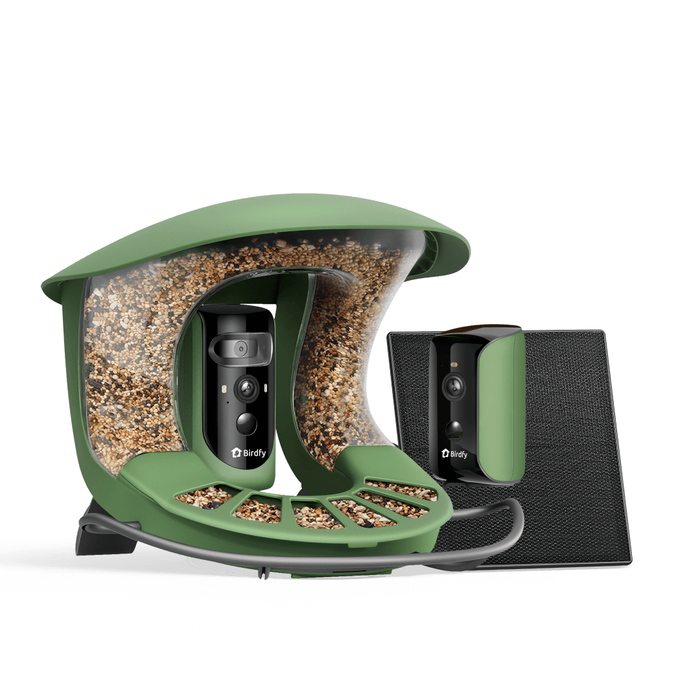
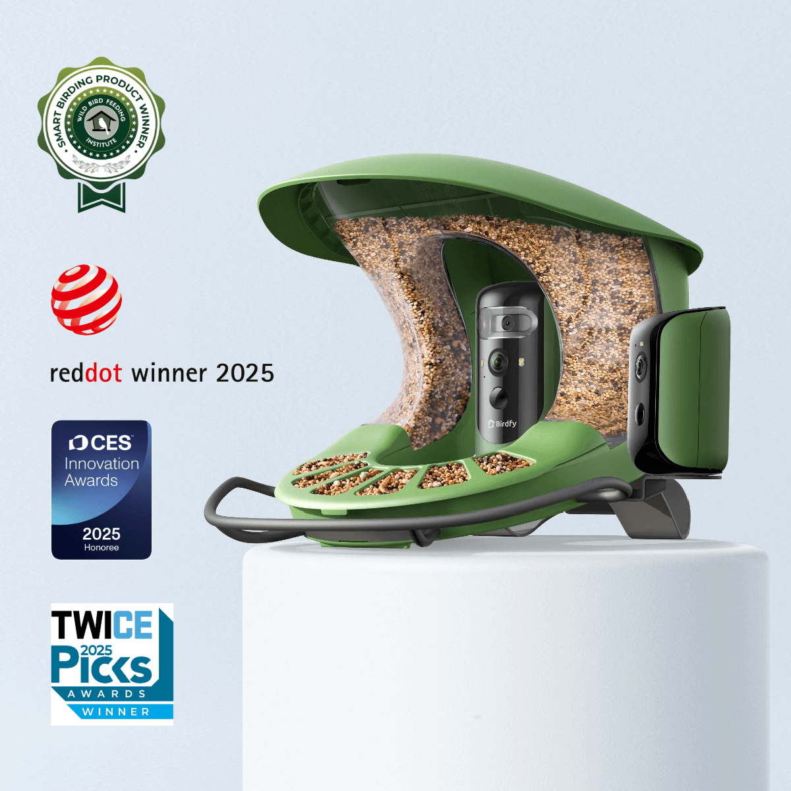
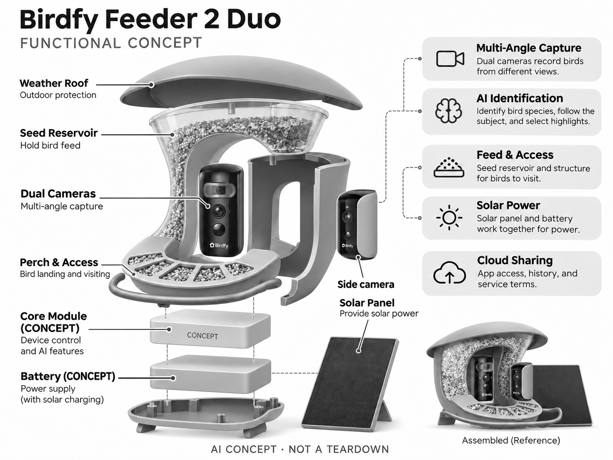

# Birdfy Feeder 2 Duo

**Birdfy** · 庭院与自然 · 核查 2026-11-04

通过多视角和AI选片记录家庭庭院访鸟

消费渠道：个人零售。

## 产品图片与结构参考

### 产品图

Birdfy Feeder 2 Duo 官方产品图 · 来源：[Birdfy · 官方图片](<https://www.birdfy.com/collections/bird-feeders/products/birdfy-feeder-2-duo>) · [原始图片](<https://cdn.shopify.com/s/files/1/0782/9346/7416/files/feeder_2_duo.png?v=1753254482&width=1200>)

### 参考图

Birdfy Feeder 2 Duo 官方外观、使用场景或功能参考图 · 来源：[Birdfy · 官方图片](<https://www.birdfy.com/collections/bird-feeders/products/birdfy-feeder-2-duo>) · [原始图片](<https://cdn.shopify.com/s/files/1/0782/9346/7416/files/2_Duo_3.png?v=1764235141&width=1200>)

### AI 生成爆炸示意

**AI 生成 · 非实物拆机。** 内部为概念推断，不能作为元件布局、BOM 或维修依据。[生成提示词](../../content/hardware/prompts/birdfy-feeder-2-duo.txt)

> 依据官方外观参考与公开功能生成；未披露的内部布局只作概念模块，不构成BOM或真实结构证据。

> 本图已局部校正：补齐独立侧摄像头。修订提示词：content/hardware/prompts/birdfy-feeder-2-duo-revision.txt。

> 保留官方图原始内容与出处；画面中的宣传参数不视为本轮独立实测。

> 分析为基于公开资料的案头研究与 AI 辅助判断，未经用户访谈、销量审计或实物拆机。需求、画像、竞争冷门度、审美及商业机会均为研究假设，不是投资结论。

## 销售与购买

- 状态：在售。官方商品页显示In Stock、预计3—7工作日及Add to cart；集合页另有US$329.99活动价，保留地区和活动差异，以结账配置为准。

- 地区：美国官方商店

- 价格：US$359.99（所查商品页）。核查时官方页面参考，价格保留原币种；套装、配件、订阅、税运及地区条件分别确认，不把容量版本重复计数。

- 中国大陆：本轮核实海外官方销售；中国大陆同型号现货、售后与云服务未确认。庭院条件、物种范围或定位服务也需按地区验证。

- [官方产品 / 商店](<https://www.birdfy.com/collections/bird-feeders/products/birdfy-feeder-2-duo>)

## AI 的实际作用

双摄与多镜头记录访鸟，AI识别鸟种、跟随主体并筛选精彩画面；这是自然观察功能，不是普通定时喂鸟器。

服务与联网依赖：识别、提醒和历史依赖App及云端。核查页宣称设备生命周期Bird ID免费，旧FAQ仍保留订阅版本说明，购买时需确认当前权益。

## 是否冷门

细分专业（研究判断）：自然观察属于场景较窄的消费兴趣市场，竞争已有多个品牌；多镜头是形态差异，不代表蓝海。

## 需求与市场

需求假设：观鸟者希望不守在窗边也能看清访鸟，并快速挑出可分享片段。应比较有效访鸟记录、误识和通知疲劳；多镜头是否增加乐趣需要长期观察，不能用照片数量代替用户满意度。

## 用户画像

画像推断：有庭院或合规悬挂位置的自然爱好者、亲子家庭和赠礼用户。使用者仍要清洁、补粮并了解野鸟习性；购买者与维护者可能不同，礼物开箱热情不等于长期活跃。

## 竞争与替代

竞争判断：与Birdbuddy、普通观鸟摄像头及人工望远镜观察竞争，双视角与自动选片提供具体差异。此类产品用户较窄，但已有多品牌，不能因消费认知低就认定没有竞争或获客容易。

## 供应链

供应链分析：摄像模组、太阳能、电池、户外壳体与食仓共同决定体验。实际芯片和工厂未披露；防晒、进水、鼠咬和食物接触清洁是重点，云视频费用也应计入长期交付而非只算硬件。

## 技术路径

官方披露多镜头捕捉、AI鸟种识别与自动选片。技术判断：逆光、快速移动和不同地区鸟种会影响识别，应支持人工更正并保留原片；数量化的识别种类不代表任意场景准确率。

## 产品审美

审美判断：喂食器需要与植物和住宅外墙协调，多摄像头不能妨碍鸟类落脚。安装位置、清洗拆卸与太阳能板走线会改变整体观感，评价应基于实际庭院而不是单张干净产品图。

## 关键风险

风险判断：喂鸟维护不当可能带来卫生问题，识别错误也会误导观察记录。官方免费AI条款与旧订阅FAQ并存，需要确认服务边界；摄像头取景应避免不必要地覆盖邻居活动空间。

## 机会与验证

机会假设：在本地鸟种、社区自然教育和家庭分享场景验证长期留存，比较多视角与单镜头的实际增益。若核心价值是内容整理，先做可纠错的软件服务可能比增加摄像头更有效。

## 功能分层示意

这是功能关系，不是实物拆机、真实空间结构或已核实 BOM。

1. **多视角采集**：双摄与不同视角记录访鸟。（官方披露）

2. **AI识别**：鸟种判断、主体跟随与选片。（官方披露）

3. **食仓与落脚**：供鸟访问的食仓和结构。（官方披露）

4. **太阳能供电**：面板与电池共同提供电力。（官方披露）

5. **云端分享**：App、历史和服务条款。（官方披露）

## 来源

1. [Birdfy Feeder 2 Duo 官方商品页](<https://www.birdfy.com/collections/bird-feeders/products/birdfy-feeder-2-duo>) — 已实际打开并核查购买与交付入口；未实际下单。

2. [Birdfy App 官方识别与服务说明](<https://support.birdfy.com/help/birdfy-app/introduction-birdfyapp/>) — 已实际打开的官方能力、服务或维护说明；不代表独立实测。

[返回目录](../hardware-market.md) · [网页分析](https://romanagent.github.io/Roman/#hardware/product/birdfy-feeder-2-duo)
