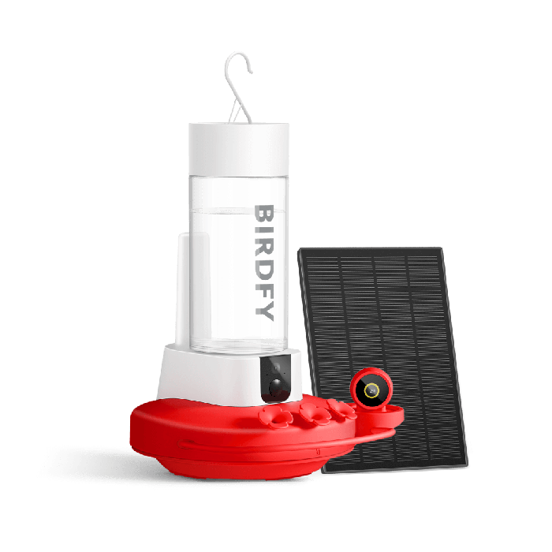
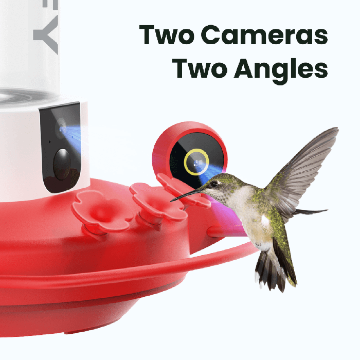
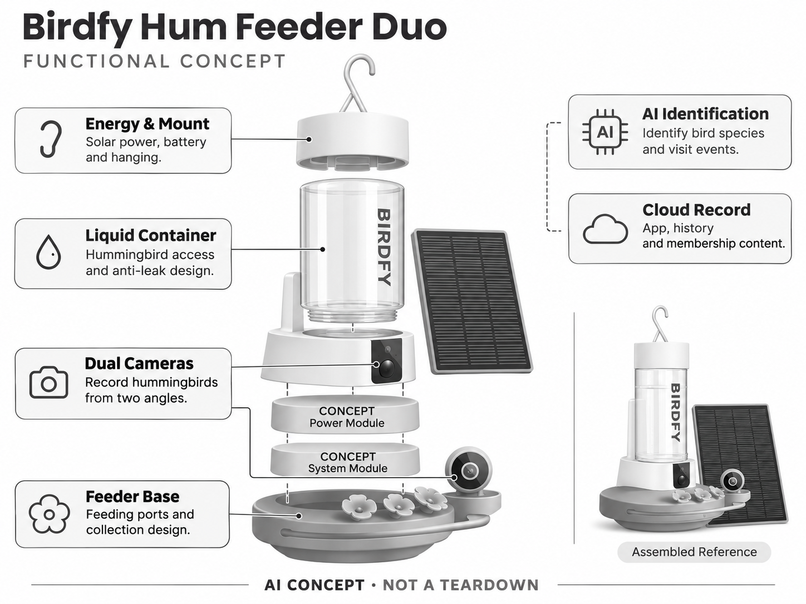

# Birdfy Hum Feeder Duo

**Birdfy** · 庭院与自然 · 核查 2026-11-04

面向蜂鸟高速访问场景的双摄喂食器

消费渠道：个人零售。

## 产品图片与结构参考

### 产品图

Birdfy Hum Feeder Duo 官方产品图 · 来源：[Birdfy · 官方图片](<https://www.birdfy.com/products/birdfy-hum-feeder>) · [原始图片](<https://cdn.shopify.com/s/files/1/0782/9346/7416/files/hum_feeder_duo_2.png?v=1792727957&width=1200>)

### 参考图

Birdfy Hum Feeder Duo 官方外观、使用场景或功能参考图 · 来源：[Birdfy · 官方图片](<https://www.birdfy.com/products/birdfy-hum-feeder>) · [原始图片](<https://cdn.shopify.com/s/files/1/0782/9346/7416/files/Hum_feeder_duo_8.png?v=1792728458&width=1200>)

### AI 生成爆炸示意

**AI 生成 · 非实物拆机。** 内部为概念推断，不能作为元件布局、BOM 或维修依据。[生成提示词](../../content/hardware/prompts/birdfy-hum-feeder-duo.txt)

> 依据官方外观参考与公开功能生成；未披露的内部布局只作概念模块，不构成BOM或真实结构证据。

> 保留官方图原始内容与出处；画面中的宣传参数不视为本轮独立实测。

> 分析为基于公开资料的案头研究与 AI 辅助判断，未经用户访谈、销量审计或实物拆机。需求、画像、竞争冷门度、审美及商业机会均为研究假设，不是投资结论。

## 销售与购买

- 状态：在售。官方页展示Hum Feeder Duo、Shop now和11月7—11日配送区间；同页单摄与会员套餐不重复计数。

- 地区：美国官方商店

- 价格：US$199.99。核查时官方页面参考，价格保留原币种；套装、配件、订阅、税运及地区条件分别确认，不把容量版本重复计数。

- 中国大陆：本轮核实海外官方销售；中国大陆同型号现货、售后与云服务未确认。庭院条件、物种范围或定位服务也需按地区验证。

- [官方产品 / 商店](<https://www.birdfy.com/products/birdfy-hum-feeder>)

## AI 的实际作用

双相机拍摄蜂鸟，AI识别鸟种并产生访鸟记录；喂食液容器与太阳能供电是物理功能，不能本身算AI。

服务与联网依赖：需要App和网络，Bird ID与Plus内容服务分开；地区蜂鸟分布和服务支持决定实际使用价值。

## 是否冷门

细分专业（研究判断）：需求高度依赖蜂鸟地理分布和维护习惯，是窄场景消费品；更窄不意味着可直接迁移到中国大陆。

## 需求与市场

需求假设：蜂鸟访问短促且速度快，用户希望获得普通手机难以持续捕捉的近距离影像。应测量有效捕捉、误触发和分享意愿，而不是仅用分辨率或摄像头数量推定体验提升。

## 用户画像

画像推断：居住在有蜂鸟活动地区、有合适悬挂位置的自然爱好者。用户还需愿意正确维护喂食液与容器；中国大陆常见居住场景不应直接套用北美蜂鸟画像或预期出现相同动物。

## 竞争与替代

竞争判断：普通蜂鸟喂食器加相机和其它智能喂鸟产品都是替代，特殊鸟种场景使竞争范围更窄。真正差异在捕捉与易清洁，而不是把通用识别模型包装成新硬件就能形成优势。

## 供应链

供应链分析：液体容器、防漏口、相机、防水连接、电池和太阳能支架需要协同。供应商及BOM未披露；糖液污染、蚂蚁、清洁死角与季节性储存会影响寿命，不能照搬干粮食仓设计。

## 技术路径

官方披露双摄和AI鸟种识别。技术判断：翅膀高速运动、强反光与近距离遮挡对成像和识别均有挑战，应记录失焦和漏拍；识别范围广不代表对所有当地蜂鸟都可靠。

## 产品审美

审美判断：透明容器和自然外观需要兼顾鸟的访问路径，镜头不应妨碍喂食。悬挂稳定、液体余量可见和拆洗便利比华丽外壳更重要，使用后的洁净度决定长期庭院观感。

## 关键风险

风险判断：不当配液或清洗可能影响野鸟健康，AI提示无法替代正确喂养知识。软件与太阳能供电存在环境限制，用户不能将设备的访鸟次数或物种判断当作专业生态调查数据。

## 机会与验证

机会假设：在真实蜂鸟地区先验证长期维护与捕捉质量，再研究本地物种内容和家庭分享。对于无蜂鸟市场，应寻找当地动物的真实观察场景，不能简单复制海外外形和宣传预期。

## 功能分层示意

这是功能关系，不是实物拆机、真实空间结构或已核实 BOM。

1. **喂食液容器**：蜂鸟访问与防漏结构。（官方披露）

2. **双摄成像**：从不同方向记录蜂鸟。（官方披露）

3. **AI识别**：访鸟物种和事件信息。（官方披露）

4. **能源支架**：太阳能、电池与悬挂。（官方披露）

5. **云端记录**：App、历史与会员内容。（官方披露）

## 来源

1. [Birdfy Hum Feeder Duo 官方商品页](<https://www.birdfy.com/products/birdfy-hum-feeder>) — 已实际打开并核查购买与交付入口；未实际下单。

2. [Birdfy App 官方识别与服务说明](<https://support.birdfy.com/help/birdfy-app/introduction-birdfyapp/>) — 已实际打开的官方能力、服务或维护说明；不代表独立实测。

[返回目录](../hardware-market.md) · [网页分析](https://romanagent.github.io/Roman/#hardware/product/birdfy-hum-feeder-duo)
