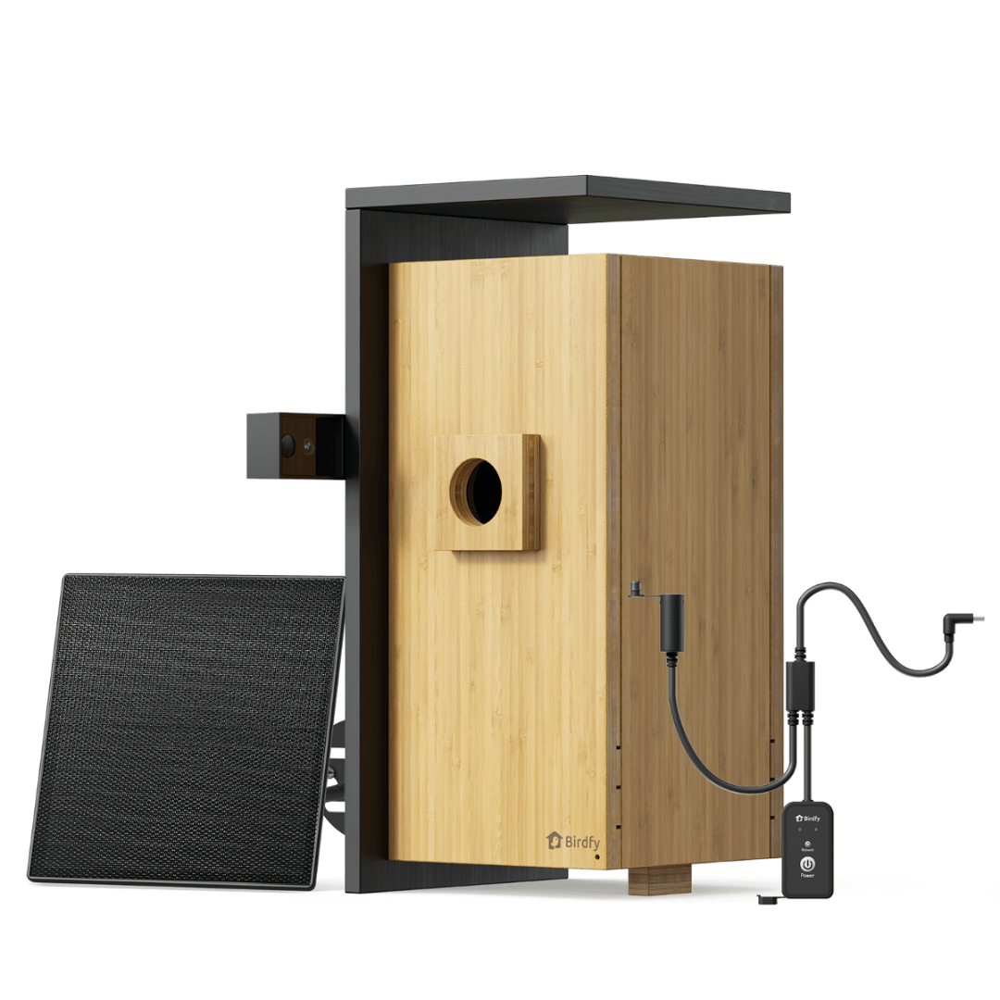
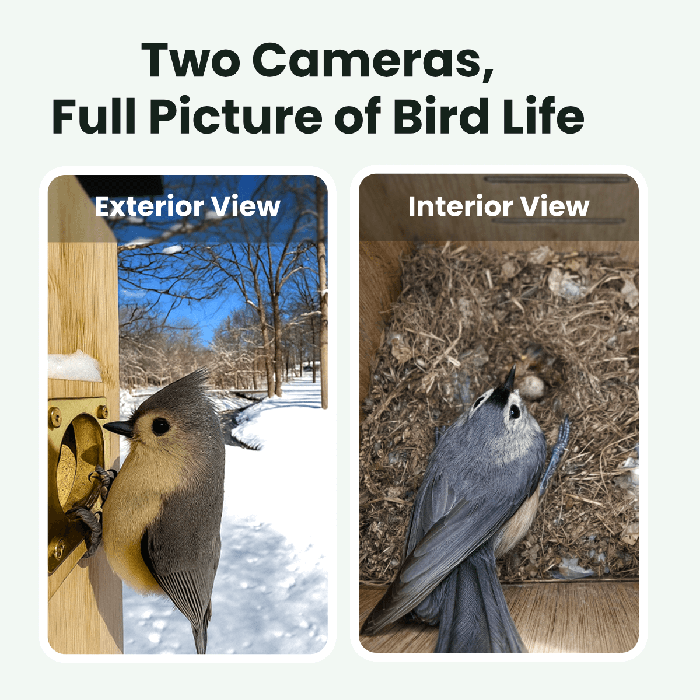
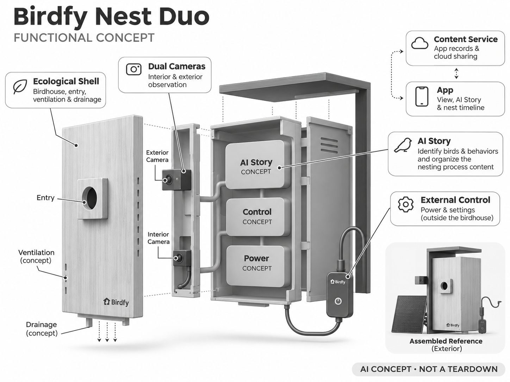

# Birdfy Nest Duo

**Birdfy** · 庭院与自然 · 核查 2026-11-04

用双摄与AI故事记录家门口的筑巢过程

消费渠道：个人零售。

## 产品图片与结构参考

### 产品图

Birdfy Nest Duo 官方产品图 · 来源：[Birdfy · 官方图片](<https://www.birdfy.com/products/birdfy-nest-duo>) · [原始图片](<https://cdn.shopify.com/s/files/1/0782/9346/7416/files/NestDuo_4.png?v=1771916438&width=1200>)

### 参考图

Birdfy Nest Duo 官方外观、使用场景或功能参考图 · 来源：[Birdfy · 官方图片](<https://www.birdfy.com/products/birdfy-nest-duo>) · [原始图片](<https://cdn.shopify.com/s/files/1/0782/9346/7416/files/NestDuo_8.png?v=1792728403&width=1200>)

### AI 生成爆炸示意

**AI 生成 · 非实物拆机。** 内部为概念推断，不能作为元件布局、BOM 或维修依据。[生成提示词](../../content/hardware/prompts/birdfy-nest-duo.txt)

> 依据官方外观参考与公开功能生成；未披露的内部布局只作概念模块，不构成BOM或真实结构证据。

> 保留官方图原始内容与出处；画面中的宣传参数不视为本轮独立实测。

> 分析为基于公开资料的案头研究与 AI 辅助判断，未经用户访谈、销量审计或实物拆机。需求、画像、竞争冷门度、审美及商业机会均为研究假设，不是投资结论。

## 销售与购买

- 状态：在售。官方页显示双摄Nest Duo、In Stock、3—7工作日及Add to cart；不把Nest、Ebony和材质变体额外计数。

- 地区：美国官方商店

- 价格：US$249.99。核查时官方页面参考，价格保留原币种；套装、配件、订阅、税运及地区条件分别确认，不把容量版本重复计数。

- 中国大陆：本轮核实海外官方销售；中国大陆同型号现货、售后与云服务未确认。庭院条件、物种范围或定位服务也需按地区验证。

- [官方产品 / 商店](<https://www.birdfy.com/products/birdfy-nest-duo>)

## AI 的实际作用

内外相机观察筑巢与出入，AI Story识别鸟类和行为并整理筑巢过程内容；不是只提供视频直播的普通鸟屋。

服务与联网依赖：App、云端故事与识别依赖服务连接；繁殖期间应避免开巢或重置设备，外部控制结构降低但不能消除人为干扰。

## 是否冷门

细分专业（研究判断）：筑巢记录是季节性自然教育细分场景，用户较少且维护有生态边界；不能因少见就宣称商业风险低。

## 需求与市场

需求假设：用户希望长期观察筑巢过程而不打开鸟屋，AI故事帮助整理零散影像。应验证鸟类入住、记录连续性和观察者的实际复看行为，不能将放置鸟屋等同保证鸟会筑巢。

### 产品任务与边界 · 研究判断

Nest Duo 用巢内外相机和 AI 故事整理支持长期观察筑巢，任务是无需频繁打开鸟屋也能了解过程。需求与即时娱乐不同，放置鸟屋不保证入住，内容价值要在季节和等待中验证，不能由安装成功推断会持续产生精彩片段。

依据：[Birdfy Nest Duo 官方商品页](<https://www.birdfy.com/products/birdfy-nest-duo>) · [Birdfy Nest 官方维护说明](<https://support.birdfy.com/product/birdfy-nest/>)

### 需求判断 · 研究判断

自动整理可能减少用户从大量静态录像中寻找关键阶段的工作，但观察需要保留完整上下文。用户可能在繁殖季高频查看而淡季很少使用，需求分析应承认季节性，不能把短期密集观看直接换算为全年订阅价值。

依据：[Birdfy Nest Duo 官方商品页](<https://www.birdfy.com/products/birdfy-nest-duo>) · [Birdfy Nest 官方维护说明](<https://support.birdfy.com/product/birdfy-nest/>)

### 需求验证 · 待验证

可记录整个观察季的入住、连续录像、关键片段和主动复看，同时统计设备干预与维护。比较原始时间线和自动故事是否帮助理解过程，明确未入住也是真实结果，不以挑选成功案例代替对产品需求的整体评估。

依据：[Birdfy Nest Duo 官方商品页](<https://www.birdfy.com/products/birdfy-nest-duo>) · [Birdfy Nest 官方维护说明](<https://support.birdfy.com/product/birdfy-nest/>)

## 用户画像

画像推断：有适合鸟屋地点的自然爱好者、学校家庭教育者和园艺用户。其使用周期受季节影响，需要耐心与维护知识；相比普通摄像头购买者，更应重视不打扰动物而非频繁操作。

### 适用行为与条件 · 研究判断

较匹配有合适鸟屋地点、愿意耐心观察且重视低干扰的自然爱好者和家庭教育用户。使用者需要理解设备不能控制动物行为，若期待开箱立即互动，季节等待和不宜频繁操作的条件可能与其需求冲突。

依据：[Birdfy Nest Duo 官方商品页](<https://www.birdfy.com/products/birdfy-nest-duo>) · [Birdfy Nest 官方维护说明](<https://support.birdfy.com/product/birdfy-nest/>)

### 人群取舍 · 研究判断

已有巢箱经验的人可能更重视材料与视角，家庭观察者可能需要清晰故事与分享，两者对操作频率不同。画像应包含安装地点、维护知识和等待意愿，不能只以喜欢鸟类或希望儿童接触自然来推定适合。

依据：[Birdfy Nest Duo 官方商品页](<https://www.birdfy.com/products/birdfy-nest-duo>) · [Birdfy Nest 官方维护说明](<https://support.birdfy.com/product/birdfy-nest/>)

### 画像验证 · 待验证

画像验证应访谈用户如何选择地点、处理未入住和安排非使用季维护，再观察其是否愿意保持低干扰。对家庭教育场景，重点记录是否围绕真实变化讨论，而不是把设备当成可以随时要求动物表演的娱乐工具。

依据：[Birdfy Nest Duo 官方商品页](<https://www.birdfy.com/products/birdfy-nest-duo>) · [Birdfy Nest 官方维护说明](<https://support.birdfy.com/product/birdfy-nest/>)

## 竞争与替代

竞争判断：与普通鸟屋加内窥相机、专业巢箱摄像系统和人工观察竞争，优势在双视角及自动整理。细分需求明确但季节性强，商业评估需要考虑淡季留存、内容分享和设备耐久。

### 比较对象与差异 · 研究判断

Nest Duo 与普通鸟屋加相机、专用巢箱摄像系统和人工观察竞争，内外双视角与自动整理构成差异。细分需求明确但季节性强，商业比较必须包含淡季使用、耐久和内容保存，不能只看繁殖期间的高活跃。

依据：[Birdfy Nest Duo 官方商品页](<https://www.birdfy.com/products/birdfy-nest-duo>) · [Birdfy Nest 官方维护说明](<https://support.birdfy.com/product/birdfy-nest/>)

### 竞争判断 · 研究判断

双摄可能补充进出与巢内过程，也增加能源和记录连续性要求。竞争优势需要在不增加动物干扰的前提下帮助观察，若用户为了调试频繁开巢，功能丰富反而与产品目的冲突，简单稳定方案可能更合适。

依据：[Birdfy Nest Duo 官方商品页](<https://www.birdfy.com/products/birdfy-nest-duo>) · [Birdfy Nest 官方维护说明](<https://support.birdfy.com/product/birdfy-nest/>)

### 竞争验证 · 待验证

可比较普通巢箱相机与自动故事方案的查找时间、原片保留和干预次数，覆盖未入住及记录缺失情况。不能只展示最成功的筑巢故事，也不以双摄数量推断专业观察价值，需检验用户是否能理解完整过程。

依据：[Birdfy Nest Duo 官方商品页](<https://www.birdfy.com/products/birdfy-nest-duo>) · [Birdfy Nest 官方维护说明](<https://support.birdfy.com/product/birdfy-nest/>)

## 供应链

供应链分析：木或竹结构、通风排水、低干扰照明、相机与外部控制共同构成产品。制造工厂与BOM未知；材料老化、虫害、相机固定和维修时机需要验证，不能只按安防相机成本估价。

### 功能模块拆分 · 研究判断

功能层包括鸟屋入口、通风排水与自然材质结构，巢内外相机、低干扰观察、外部电源控制和云端故事。公开资料没有完整材料供应商与工厂，功能示意不应推定精确内部照明或连接布局，更不能改变巢箱适宜性要求。

依据：[Birdfy Nest Duo 官方商品页](<https://www.birdfy.com/products/birdfy-nest-duo>) · [Birdfy Nest 官方维护说明](<https://support.birdfy.com/product/birdfy-nest/>)

### 制造与供应约束 · 研究判断

制造约束是材料老化、通风排水、相机固定和虫害等长期户外条件，维修时机又受到入住与繁殖影响。外部控制可以减少部分开巢操作但不能消除所有干扰，交付需要考虑整个季节，而不是按普通安防相机成本估算。

依据：[Birdfy Nest Duo 官方商品页](<https://www.birdfy.com/products/birdfy-nest-duo>) · [Birdfy Nest 官方维护说明](<https://support.birdfy.com/product/birdfy-nest/>)

### 候选与证据缺口 · 研究判断

PCH 可作为自然材质、电子和供应协同候选，龙旗可评估双摄联网终端。没有 Nest Duo 点名合作证据，巢箱设计与当地动物使用条件需专门研究，通用电子或工程能力不能被写成生态适宜或行为识别保证。

依据：[Birdfy Nest Duo 官方商品页](<https://www.birdfy.com/products/birdfy-nest-duo>) · [Birdfy Nest 官方维护说明](<https://support.birdfy.com/product/birdfy-nest/>)

## 技术路径

官方描述内外双摄及AI Story。技术判断：暗处幼鸟、相似羽色和遮挡会让行为识别困难，重要阶段应保留完整原片；自动剪辑不能删去用户需要复核的上下文，识别须允许不确定。

### 已披露技术边界 · 研究判断

官方描述内外双摄和 AI Story，核心是识别鸟类及部分行为并整理片段。技术分析应区分物种判断、行为标签和故事叙述，自动剪辑不能替代原始记录，也不能把生成的连贯故事当作对全部筑巢过程的确定解释。

依据：[Birdfy Nest Duo 官方商品页](<https://www.birdfy.com/products/birdfy-nest-duo>) · [Birdfy Nest 官方维护说明](<https://support.birdfy.com/product/birdfy-nest/>)

### 系统难点判断 · 研究判断

暗处幼鸟、相似羽色、遮挡和长时间静止会增加识别难度，关键阶段也可能短暂发生。系统需要保留不确定与连续时间线，避免精选算法为了精彩而丢掉用户要复核的上下文，内容完整性比单个片段漂亮更重要。

依据：[Birdfy Nest Duo 官方商品页](<https://www.birdfy.com/products/birdfy-nest-duo>) · [Birdfy Nest 官方维护说明](<https://support.birdfy.com/product/birdfy-nest/>)

### 技术验证 · 待验证

验证应检查巢内外不同光照和遮挡下的记录、标签与故事对应，保留原片进行核对。测试应避免打扰真实繁殖，不能为了补齐数据频繁操作动物，也不以一段自动故事成功证明所有行为和阶段都被准确理解。

依据：[Birdfy Nest Duo 官方商品页](<https://www.birdfy.com/products/birdfy-nest-duo>) · [Birdfy Nest 官方维护说明](<https://support.birdfy.com/product/birdfy-nest/>)

## 产品审美

审美判断：自然材质有助融入庭院，但孔径、内部抓握、排水和通风首先服务鸟类。外部电池或控制盒的线缆需要整齐且防动物接触，外观设计不应为了镜头效果破坏巢箱适宜性。

### 外观与交互语言 · 研究判断

自然材质有助融入庭院，但入口、内部抓握、排水与通风首先服务鸟类，镜头不能凌驾于这些条件。审美需要同时考虑外部控制盒和线缆，不能为了更好拍摄或隐藏设备而破坏巢箱结构的合理使用。

依据：[Birdfy Nest Duo 官方商品页](<https://www.birdfy.com/products/birdfy-nest-duo>) · [Birdfy Nest 官方维护说明](<https://support.birdfy.com/product/birdfy-nest/>)

### 使用中审美判断 · 研究判断

设备在一个季节中可能无法随意拆开清洁或调整，因此初始安装和长期稳定比频繁外观维护更重要。自然老化不必被视为缺陷，但应能区分正常变化与结构问题，让用户不因追求照片整洁而过度干预。

依据：[Birdfy Nest Duo 官方商品页](<https://www.birdfy.com/products/birdfy-nest-duo>) · [Birdfy Nest 官方维护说明](<https://support.birdfy.com/product/birdfy-nest/>)

### 设计验证 · 待验证

设计验证应在未入住时评估安装、外部控制和非使用季维护，检查用户能否不打开巢箱完成必要设置。还要观察线材与相机固定是否清楚稳定，避免只由自然材质外观推断设备天然低干扰或适合所有鸟类。

依据：[Birdfy Nest Duo 官方商品页](<https://www.birdfy.com/products/birdfy-nest-duo>) · [Birdfy Nest 官方维护说明](<https://support.birdfy.com/product/birdfy-nest/>)

## 关键风险

风险判断：繁殖期打开巢箱、移位或强光可能干扰动物；断网与软件错误会导致内容缺失。设备识别不提供野生动物照护资格，应遵循当地鸟类保护要求，避免为了拍摄频繁操作。

### 主要失效与依赖 · 研究判断

风险包括繁殖期操作、移位和光照对动物造成干扰，以及网络或软件故障导致记录缺失。设备识别不提供野生动物照护资格，用户需按当地条件管理观察，不能为了得到内容而频繁开巢或假定所有鸟都会入住。

依据：[Birdfy Nest Duo 官方商品页](<https://www.birdfy.com/products/birdfy-nest-duo>) · [Birdfy Nest 官方维护说明](<https://support.birdfy.com/product/birdfy-nest/>)

### 风险传播判断 · 研究判断

自动故事可能让用户过度相信记录完整，而关键片段缺失会影响对过程的理解。若系统没有明确离线和数据空窗，精选内容的连贯性可能掩盖事实缺口，因此产品应把记录完整状态与故事呈现同时提供。

依据：[Birdfy Nest Duo 官方商品页](<https://www.birdfy.com/products/birdfy-nest-duo>) · [Birdfy Nest 官方维护说明](<https://support.birdfy.com/product/birdfy-nest/>)

### 风险验证 · 待验证

风险验证应演练外部断网和电源异常后的提示与恢复，检查用户是否知道哪些时段没有记录。维护方案应在合适时机测试，不能干扰动物；所有识别与故事结论应保留原片和时间范围，不作为专业生态调查保证。

依据：[Birdfy Nest Duo 官方商品页](<https://www.birdfy.com/products/birdfy-nest-duo>) · [Birdfy Nest 官方维护说明](<https://support.birdfy.com/product/birdfy-nest/>)

## 机会与验证

机会假设：为自然教育提供低干扰的季节记录和可追溯时间线，比增加互动功能更合理。应先评估适宜安装地点和观察需求，再考虑智能化，无法保证入住的产品不适合用即时娱乐来承诺。

### 可能的机会入口 · 研究判断

机会在于低干扰的季节记录、可追溯时间线和家庭自然讨论，而不是增加互动或要求动物配合。新项目可先验证适宜地点与观察需求，再决定双摄和故事服务，承认等待及未入住也是产品体验的一部分。

依据：[Birdfy Nest Duo 官方商品页](<https://www.birdfy.com/products/birdfy-nest-duo>) · [Birdfy Nest 官方维护说明](<https://support.birdfy.com/product/birdfy-nest/>)

### 机会成立条件 · 研究判断

机会成立需要用户认可季节性价值并愿意维护多年，如果商业模式依赖全年高频内容，可能与真实自然周期不匹配。长期资料保存、简洁摘要与教育使用也许比实时通知更重要，应依据实际观察行为选择服务。

依据：[Birdfy Nest Duo 官方商品页](<https://www.birdfy.com/products/birdfy-nest-duo>) · [Birdfy Nest 官方维护说明](<https://support.birdfy.com/product/birdfy-nest/>)

### 下一步验证 · 待验证

下一步可跟踪完整季节的记录与家庭使用，比较原始时间线、简短摘要和自动故事的帮助，再访谈未入住用户。用真实等待、干预和复看决定产品设计，避免将成功筑巢视频的吸引力直接当作普遍市场需求。

依据：[Birdfy Nest Duo 官方商品页](<https://www.birdfy.com/products/birdfy-nest-duo>) · [Birdfy Nest 官方维护说明](<https://support.birdfy.com/product/birdfy-nest/>)

## 对应供应链公司

能力候选用于选型研究，不代表本产品实际采用；未公开的供货关系不作推断。

- [pch-international](../supply-chain/pch-international.md) — **能力候选 · 非已采用** / 自然材质巢箱与电子供应协同：PCH 的产品开发、采购和制造管理可协调自然材质外壳、相机及外部控制，但巢箱适宜性和低干扰要求需专门验证；没有 Nest Duo 点名合作证据，不能将候选视为实际制造或生态背书。

- [longcheer](../supply-chain/longcheer.md) — **能力候选 · 非已采用** / 巢内外双摄联网电子系统：龙旗智能终端工程能力可对应双摄、能源和联网电子评估，但季节连续记录、低光及行为服务需独立确认；未发现 Nest Duo 供货披露，当前仅为电子工程候选。

[浏览供应链目录](../supply-chain.md)

## 功能分层示意

这是功能关系，不是实物拆机、真实空间结构或已核实 BOM。

1. **生态外壳**：鸟屋、入口、通风与排水。（官方披露）

2. **双摄观察**：巢内和巢外相机记录。（官方披露）

3. **AI故事**：识别鸟与行为并整理片段。（官方披露）

4. **外部控制**：在巢外处理电源与设置。（官方披露）

5. **内容服务**：App记录与云端分享。（官方披露）

## 来源

1. [Birdfy Nest Duo 官方商品页](<https://www.birdfy.com/products/birdfy-nest-duo>) — 已实际打开并核查购买与交付入口；未实际下单。

2. [Birdfy Nest 官方维护说明](<https://support.birdfy.com/product/birdfy-nest/>) — 已实际打开的官方能力、服务或维护说明；不代表独立实测。

[返回目录](../hardware-market.md) · [网页分析](https://romanagent.github.io/Roman/#hardware/product/birdfy-nest-duo)
