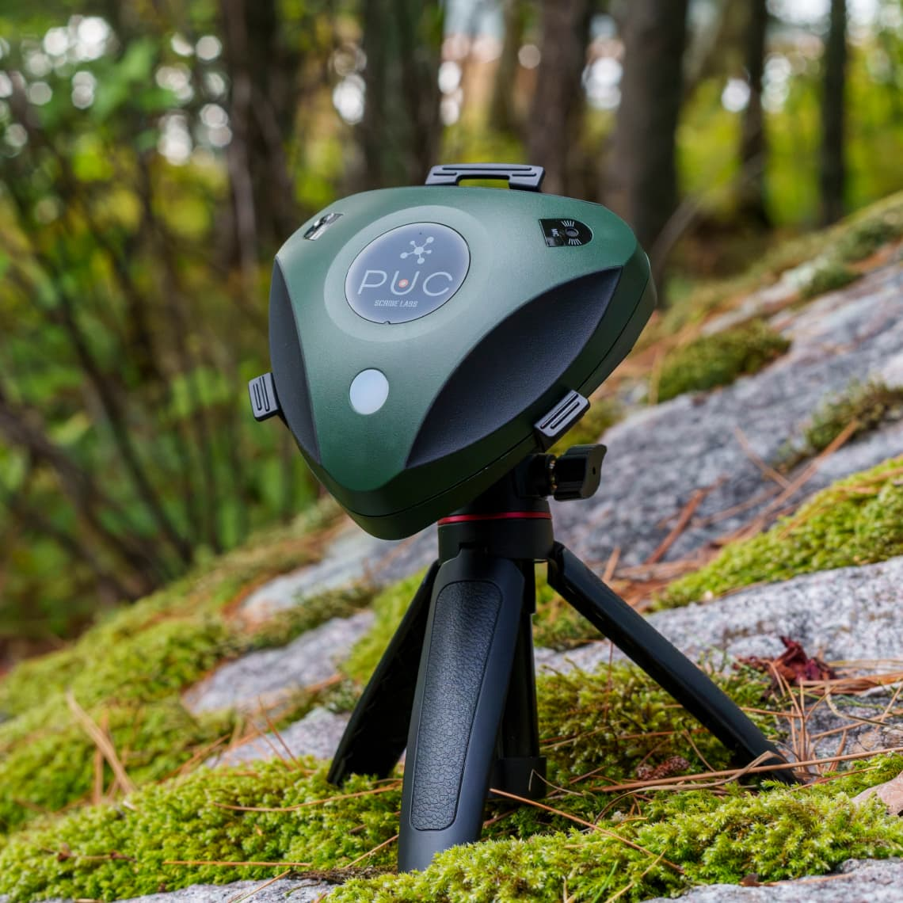
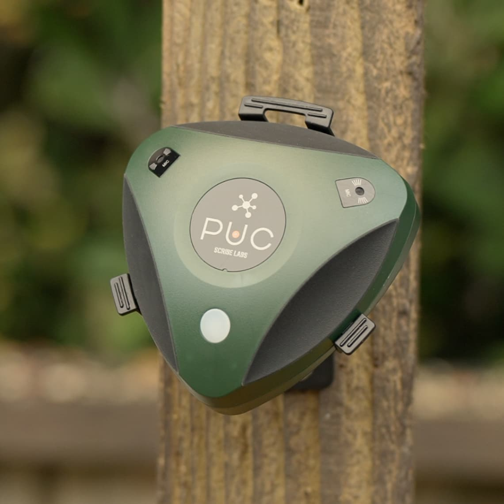
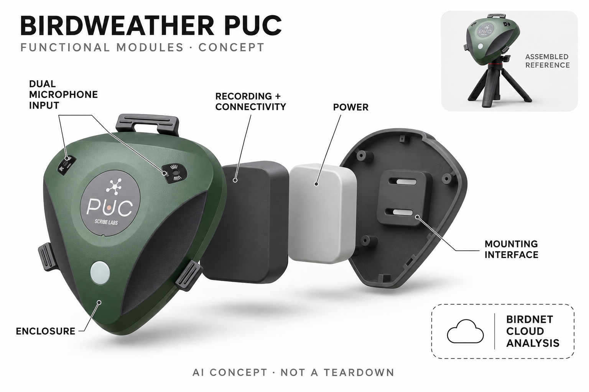

# BirdWeather PUC

**BirdWeather** · 庭院与自然 · 核查 2026-11-05

用环境录音建立个人鸟声观察站，而不必先把鸟引到镜头前

消费渠道：个人零售。

## 产品图片与结构参考

### 产品图

官方PUC与三脚架展示 · 来源：[BirdWeather · 官方图片](<https://www.birdweather.com/shop-birdweather-puc>) · [原始图片](<https://media.birdweather.com/media/277/PUC-Product-1.jpg>)

### 参考图

官方树干安装参考 · 来源：[BirdWeather · 官方图片](<https://www.birdweather.com/shop-birdweather-puc>) · [原始图片](<https://media.birdweather.com/media/276/PUC-Product-3.jpg>)

### AI 生成爆炸示意

**AI 生成 · 非实物拆机。** 内部为概念推断，不能作为元件布局、BOM 或维修依据。[生成提示词](../../content/hardware/prompts/birdweather-puc.txt)

> 依据已核验官方外形与公开功能生成；未知内部仅为概念功能块，不代表原机电路板、芯片或实际布局。

> 已目视核对官方当前商品的准确型号与外观；原图保持未编辑，商品图不替代独立性能测试。

> 分析为基于公开资料的案头研究与 AI 辅助判断，未经用户访谈、销量审计或实物拆机。需求、画像、竞争冷门度、审美及商业机会均为研究假设，不是投资结论。

## 销售与购买

- 状态：在售。官方当前商店可点击Order Now，普通PUC为US$299；本条不含Bat Edition或配件套装。店铺当前页首明确直邮美国与加拿大，其他地区转经销商。

- 地区：美国、加拿大、部分授权国际经销地区

- 价格：官方 US$299。普通PUC主机价；蝙蝠版、保护屋及支架套装不另作新品，跨境经销价格与配送另确认。

- 中国大陆：实际查看官方经销目录，亚洲列韩国经销商，未列中国大陆；欧洲有全球分销商但未验证大陆结算、进口和保修，不据此保证国内可购。

- [官方产品 / 商店](<https://www.birdweather.com/shop-birdweather-puc>)

## AI 的实际作用

双麦克风采集声音并上传BirdWeather，由BirdNET对鸟类发声进行识别；重点是声音事件分类，不是生成鸟叫或通过照片识别。

服务与联网依赖：实时识别需要网络及BirdWeather服务；Recorder模式可将声音先存SD卡，后续上传分析，离线录音不代表本机离线推理。

## 是否冷门

细分专业（研究判断）：固定点声学鸟类观察是个人自然兴趣的细分任务，区别于依赖喂食或影像的设备；户外布置与误识别复核限制大众采用。

## 需求与市场

需求假设：有庭院或阳台的观察者希望知道未被看见的鸟类何时发声，持续录音能补足偶然目击与喂食摄像的盲区。价值取决于当地声景、安装位置和纠错负担，不能从自动生成物种数量推断识别准确或生态价值。

### 产品任务与边界 · 研究判断

需求假设：有庭院或阳台的观察者希望知道未被看见的鸟类何时发声，持续录音能补足偶然目击与喂食摄像的盲区。价值取决于当地声景、安装位置和纠错负担，不能从自动生成物种数量推断识别准确或生态价值。

依据：[BirdWeather PUC官方商店](<https://www.birdweather.com/shop-birdweather-puc>) · [BirdWeather PUC官方使用手册](<https://www.birdweather.com/owners-manual>)

### 需求判断 · 研究判断

判断：固定声学站最有意义的增量是人在睡眠、工作或外出时仍能留下声音证据，而不是替代观察技能。没有进入喂食器的鸟也可能被记录，但不发声的个体不会因此出现，背景物种名单不能被理解成完整的庭院生物清单。

依据：[BirdWeather PUC官方商店](<https://www.birdweather.com/shop-birdweather-puc>) · [BirdWeather PUC官方使用手册](<https://www.birdweather.com/owners-manual>)

### 需求验证 · 待验证

验证：在同一庭院选取连续观察周期，将设备记录与定时人工听音、手机识别和已知声源分别比对。统计新增可确认事件、误报复核时间及断网缺口，并征询共同居住者对音频上传的接受程度，而不是只展示自动识别数量增长。

依据：[BirdWeather PUC官方商店](<https://www.birdweather.com/shop-birdweather-puc>) · [BirdWeather PUC官方使用手册](<https://www.birdweather.com/owners-manual>)

## 用户画像

画像推断：愿意布置户外电源或更换电池、维护网络并听回音频的个人鸟类爱好者较匹配。共享庭院和密集城市的隐私、噪声与安装权限不同，不能把任何有窗台的家庭都当成适合全天上传声音的用户。

### 适用行为与条件 · 研究判断

画像推断：愿意布置户外电源或更换电池、维护网络并听回音频的个人鸟类爱好者较匹配。共享庭院和密集城市的隐私、噪声与安装权限不同，不能把任何有窗台的家庭都当成适合全天上传声音的用户。

依据：[BirdWeather PUC官方商店](<https://www.birdweather.com/shop-birdweather-puc>) · [BirdWeather PUC官方使用手册](<https://www.birdweather.com/owners-manual>)

### 人群取舍 · 研究判断

判断：热衷长期观察变化的人比只想偶尔拍到漂亮鸟的人更可能持续使用。树木遮挡、可安装支点和屋内无线覆盖会改变操作负担，出行携带还需要解决供电与回传，因此家庭固定站与旅行录音应作为两类行为单独理解。

依据：[BirdWeather PUC官方商店](<https://www.birdweather.com/shop-birdweather-puc>) · [BirdWeather PUC官方使用手册](<https://www.birdweather.com/owners-manual>)

### 画像验证 · 待验证

验证：邀请有庭院、城市阳台和共享花园的观察者分别试装，记录从选点到第一条可确认识别的步骤。观察其是否愿意回听模糊结果、调整安装方向和维护存储，并核实邻居、家人与访客是否理解设备正在采集环境声音。

依据：[BirdWeather PUC官方商店](<https://www.birdweather.com/shop-birdweather-puc>) · [BirdWeather PUC官方使用手册](<https://www.birdweather.com/owners-manual>)

## 竞争与替代

竞争判断：与手机听音识鸟、手工录音设备和喂鸟摄像头比较，差异是固定点长期采样并自动整理声音记录。普通PUC与蝙蝠版不当作不同需求新增；长期覆盖是否值得硬件成本，需要与短时手机观察直接比较。

### 比较对象与差异 · 研究判断

竞争判断：与手机听音识鸟、手工录音设备和喂鸟摄像头比较，差异是固定点长期采样并自动整理声音记录。普通PUC与蝙蝠版不当作不同需求新增；长期覆盖是否值得硬件成本，需要与短时手机观察直接比较。

依据：[BirdWeather PUC官方商店](<https://www.birdweather.com/shop-birdweather-puc>) · [BirdWeather PUC官方使用手册](<https://www.birdweather.com/owners-manual>)

### 竞争判断 · 研究判断

判断：手机方案几乎不增加固定设备，适合带着疑问即时识别；PUC则把观察从人到场改成固定地点长期覆盖。喂鸟摄像能够显示外形和行为，声学站提供不同证据，因此二者可能互补，不能仅因都有鸟类识别就合并体验价值。

依据：[BirdWeather PUC官方商店](<https://www.birdweather.com/shop-birdweather-puc>) · [BirdWeather PUC官方使用手册](<https://www.birdweather.com/owners-manual>)

### 竞争验证 · 待验证

验证：让同一用户分别使用手机短时录音、固定PUC和已有喂鸟摄像，围绕一个具体问题比较答案质量。例如是否能确认某鸟清晨出现，而不是比较三种方案的累计种类；同时记录订正、充电和整理内容占用的总时间。

依据：[BirdWeather PUC官方商店](<https://www.birdweather.com/shop-birdweather-puc>) · [BirdWeather PUC官方使用手册](<https://www.birdweather.com/owners-manual>)

## 供应链

供应链分析：户外壳体、防水声学开孔、双麦克风、无线控制、存储和供电构成设备，公开页面点名部分器件但整机制造伙伴与BOM未披露。收音一致性和户外装配比单纯加装一块联网板更影响识别输入质量。

### 功能模块拆分 · 研究判断

模块拆分：双麦克风和声学开孔形成输入，控制、无线与存储负责记录和传输，供电与固定外壳支撑户外运行。环境与位置数据可辅助索引，但不能代替音频证据；未知内部排列只画功能模块，不将概念爆炸图当作实际电路拆解。

依据：[BirdWeather PUC官方商店](<https://www.birdweather.com/shop-birdweather-puc>) · [BirdWeather PUC官方使用手册](<https://www.birdweather.com/owners-manual>)

### 制造与供应约束 · 研究判断

供应链分析：户外壳体、防水声学开孔、双麦克风、无线控制、存储和供电构成设备，公开页面点名部分器件但整机制造伙伴与BOM未披露。收音一致性和户外装配比单纯加装一块联网板更影响识别输入质量。

依据：[BirdWeather PUC官方商店](<https://www.birdweather.com/shop-birdweather-puc>) · [BirdWeather PUC官方使用手册](<https://www.birdweather.com/owners-manual>)

### 候选与证据缺口 · 研究判断

候选判断：英飞凌公开MEMS麦克风能力可用于评估收音输入，环旭电子的无线与系统整合能力可用于连接模块方案。这里仅匹配候选能力，未发现两家公司制造PUC的型号点名证据；实际供应、采购渠道和声音校准工艺仍待厂商披露。

依据：[BirdWeather PUC官方商店](<https://www.birdweather.com/shop-birdweather-puc>) · [BirdWeather PUC官方使用手册](<https://www.birdweather.com/owners-manual>)

## 技术路径

技术判断：厂商明确使用BirdNET分析上传声景，实时站点依赖服务，离线模式先记录再传输。置信度与出现概率过滤可帮助管理结果，但不等于已验证准确率，设备具有神经处理能力的芯片也不能证明当前模型在本地运行。

### 已披露技术边界 · 研究判断

技术判断：厂商明确使用BirdNET分析上传声景，实时站点依赖服务，离线模式先记录再传输。置信度与出现概率过滤可帮助管理结果，但不等于已验证准确率，设备具有神经处理能力的芯片也不能证明当前模型在本地运行。

依据：[BirdWeather PUC官方商店](<https://www.birdweather.com/shop-birdweather-puc>) · [BirdWeather PUC官方使用手册](<https://www.birdweather.com/owners-manual>)

### 系统难点判断 · 研究判断

判断：声学识别的端到端误差来自采样、噪声、上传、模型分类与结果筛选。云端BirdNET与本地记录职责不同，网络中断会改变及时性；不能因为主控带神经处理指令，就把产品宣传成完整模型在设备内独立推断。

依据：[BirdWeather PUC官方商店](<https://www.birdweather.com/shop-birdweather-puc>) · [BirdWeather PUC官方使用手册](<https://www.birdweather.com/owners-manual>)

### 技术验证 · 待验证

验证：用已标注的现场录音分别检查安静、风雨、多人交谈和多鸟重叠时的识别表现，再测试断网后记录与回传。评估不同置信筛选对漏报和误报的取舍，并确认删除、位置模糊化和音频公开范围是否符合实际设置。

依据：[BirdWeather PUC官方商店](<https://www.birdweather.com/shop-birdweather-puc>) · [BirdWeather PUC官方使用手册](<https://www.birdweather.com/owners-manual>)

## 产品审美

审美判断：绿色圆角三角外壳和可见收音开孔更接近户外工具，固定在树干或支架时应保持声学通道无遮挡。设计判断需结合雨水、清洁和邻居对录音的理解，不能只用自然背景营销照片推定低干扰或隐私安全。

### 外观与交互语言 · 研究判断

审美判断：绿色圆角三角外壳和可见收音开孔更接近户外工具，固定在树干或支架时应保持声学通道无遮挡。设计判断需结合雨水、清洁和邻居对录音的理解，不能只用自然背景营销照片推定低干扰或隐私安全。

依据：[BirdWeather PUC官方商店](<https://www.birdweather.com/shop-birdweather-puc>) · [BirdWeather PUC官方使用手册](<https://www.birdweather.com/owners-manual>)

### 使用中审美判断 · 研究判断

判断：三角轮廓及绿色材质弱化了电子监控器的印象，也可能让旁人不易察觉录音。外观需要同时支持牢固固定、声孔辨认和状态理解，支架的视觉与空间成本不能从主机单独照片中消失，长期户外污损也属于真实审美体验。

依据：[BirdWeather PUC官方商店](<https://www.birdweather.com/shop-birdweather-puc>) · [BirdWeather PUC官方使用手册](<https://www.birdweather.com/owners-manual>)

### 设计验证 · 待验证

验证：在树干、三脚架和阳台等位置观察可见性与收音通道遮挡，测试戴手套时的操作和拆装。请不熟悉设备的人解释它会采集什么数据，若普遍认为只是天气传感器，就应调整现场告知与状态设计，而不是依靠绿色外壳。

依据：[BirdWeather PUC官方商店](<https://www.birdweather.com/shop-birdweather-puc>) · [BirdWeather PUC官方使用手册](<https://www.birdweather.com/owners-manual>)

## 关键风险

风险判断：风雨、昆虫、人声和邻近设备会影响声景，错误标签可能被误当作罕见物种发现。实时上传也可能包含可识别谈话，用户需理解采集范围与位置显示；断网可保留部分录音路径，却不保证实时分析继续。

### 主要失效与依赖 · 研究判断

风险判断：风雨、昆虫、人声和邻近设备会影响声景，错误标签可能被误当作罕见物种发现。实时上传也可能包含可识别谈话，用户需理解采集范围与位置显示；断网可保留部分录音路径，却不保证实时分析继续。

依据：[BirdWeather PUC官方商店](<https://www.birdweather.com/shop-birdweather-puc>) · [BirdWeather PUC官方使用手册](<https://www.birdweather.com/owners-manual>)

### 风险传播判断 · 研究判断

判断：错误物种识别若被自动分享，可能扩散成貌似确定的自然观察记录。另一条风险来自声音中无意包含人类谈话，位置模糊化只降低地理精度，并不自动移除音频中的身份信息，因此结果分享和原始音频应分开管理。

依据：[BirdWeather PUC官方商店](<https://www.birdweather.com/shop-birdweather-puc>) · [BirdWeather PUC官方使用手册](<https://www.birdweather.com/owners-manual>)

### 风险验证 · 待验证

验证：检查用户能否追溯每条标签到原始声音并明确标记未确认，模拟误报纠正后的分享更新。另测试断电、存储已满和服务不可用时是否有清楚提示；户外防护要以官方安装要求和实测条件确认，不从外观推断永久全天候。

依据：[BirdWeather PUC官方商店](<https://www.birdweather.com/shop-birdweather-puc>) · [BirdWeather PUC官方使用手册](<https://www.birdweather.com/owners-manual>)

## 机会与验证

机会假设：可从自家庭院固定点的每日变化记录验证，而不是承诺替代专业生态调查。若用户主要想看鸟外形，摄像设备可能更适合；若能减少漏听和整理时间，清晰回放与纠错比不断扩展物种清单更有持续价值。

### 可能的机会入口 · 研究判断

机会假设：可从自家庭院固定点的每日变化记录验证，而不是承诺替代专业生态调查。若用户主要想看鸟外形，摄像设备可能更适合；若能减少漏听和整理时间，清晰回放与纠错比不断扩展物种清单更有持续价值。

依据：[BirdWeather PUC官方商店](<https://www.birdweather.com/shop-birdweather-puc>) · [BirdWeather PUC官方使用手册](<https://www.birdweather.com/owners-manual>)

### 机会成立条件 · 研究判断

判断：更值得探索的是可回听、可纠错的长期观察工作流，而非把设备包装成自动发现稀有物种的机器。若新用户被大量不确定记录淹没，入门筛选和解释可能比更高采样规格更重要，公共数据价值也需要明确的参与与隐私选择。

依据：[BirdWeather PUC官方商店](<https://www.birdweather.com/shop-birdweather-puc>) · [BirdWeather PUC官方使用手册](<https://www.birdweather.com/owners-manual>)

### 下一步验证 · 待验证

验证：先以少量家庭站点评估一个月后的继续使用和纠错习惯，记录哪些提醒真正促成观察。把持续电源、网络与存储维护计入总成本，再判断是否扩展到社区协作；商业机会不能由鸟类爱好者总人数直接换算得到。

依据：[BirdWeather PUC官方商店](<https://www.birdweather.com/shop-birdweather-puc>) · [BirdWeather PUC官方使用手册](<https://www.birdweather.com/owners-manual>)

## 对应供应链公司

能力候选用于选型研究，不代表本产品实际采用；未公开的供货关系不作推断。

- [infineon](../supply-chain/infineon.md) — **能力候选 · 非已采用** / MEMS麦克风与声音输入：公开MEMS麦克风资料与PUC双麦克风采集需求相关，可作为输入动态范围、噪声及封装评估候选。没有该型号采购或合作证据，不能标成已披露供应商，也不能套用公开器件参数给整机背书。

- [usi](../supply-chain/usi.md) — **能力候选 · 非已采用** / 联网记录与紧凑系统制造：环旭公开无线通信与系统整合能力可对应户外记录器的连接和紧凑电子模块需求。这里只建立研发选型匹配，未确认PUC实际代工或模块来源，户外声学密封及校准仍须单独验证。

[浏览供应链目录](../supply-chain.md)

## 功能分层示意

这是功能关系，不是实物拆机、真实空间结构或已核实 BOM。

1. **户外外壳与固定**：绿色三角圆角外壳与支架/树干安装。（官方披露）

2. **双麦克风输入**：收集环境声音，不将每段声源都认定为鸟。（官方披露）

3. **记录与连接**：本地存储、网络通信与控制功能。（官方披露）

4. **电源与辅助传感**：电池或USB供电、位置及环境数据辅助记录。（官方披露）

5. **外部BirdNET分析**：上传声音后的识别与观察记录服务，不虚构机内AI加速板。（官方披露）

## 来源

1. [BirdWeather PUC官方商店](<https://www.birdweather.com/shop-birdweather-puc>) — 2026-11-05实际打开与浏览器核对US$299 Order Now；以页首美加配送说明为准，不沿用下方旧国际物流概述。

2. [BirdWeather PUC官方使用手册](<https://www.birdweather.com/owners-manual>) — 实际打开实时上传BirdNET、离线记录后上传、结果过滤及位置处理说明；不把录音离线等同AI离线。

3. [BirdWeather官方经销目录](<https://www.birdweather.com/puc-distributors-and-resellers>) — 实际查看全球经销区域，未验证中国大陆直邮或本地库存。

[返回目录](../hardware-market.md) · [网页分析](https://romanagent.github.io/Roman/#hardware/product/birdweather-puc)
