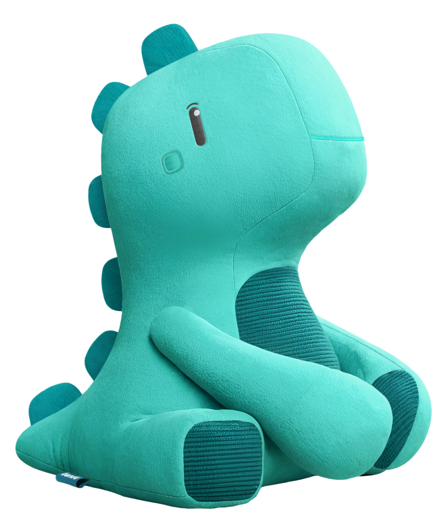
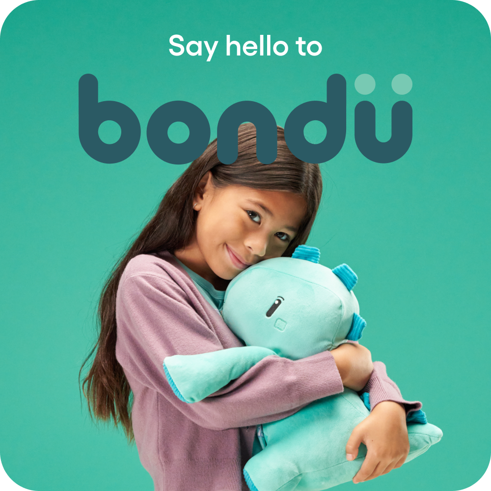
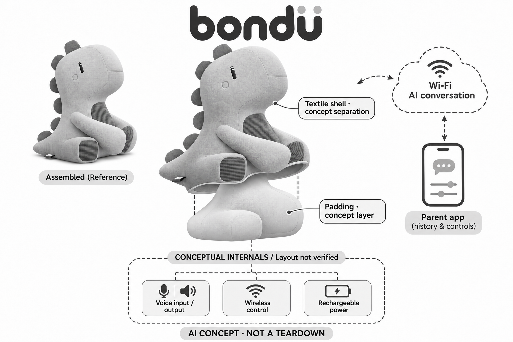

# bondu AI Plush

**bondu** · AI玩具 · 核查 2026-11-06

带家长对话记录与可选时长订阅的语音恐龙玩偶

消费渠道：个人零售。

## 产品图片与结构参考

### 产品图

官方Aqua恐龙外观 · 来源：[产品品牌官网](<https://bondu.com/products/bondu>) · [原始图片](<https://bondu.com/cdn/shop/files/Aqua_Scroll_2.png?v=1775614839&width=1412>)

### 参考图

官方家庭使用场景，保留原广告字样 · 来源：[产品品牌官网](<https://bondu.com/products/bondu>) · [原始图片](<https://bondu.com/cdn/shop/files/Main_Hero.png?v=1775614839&width=1000>)

### AI 生成爆炸示意

**AI 生成 · 非实物拆机。** 内部为概念推断，不能作为元件布局、BOM 或维修依据。[生成提示词](../../content/hardware/prompts/bondu.txt)

> 两阶段内置ImageGen生成；修订删除未验证的外皮可维修拆卸暗示，保留初稿溯源。

> 图片保留官方原貌；效果、安全与性能宣传不代表本目录独立验证。

> 分析为基于公开资料的案头研究与 AI 辅助判断，未经用户访谈、销量审计或实物拆机。需求、画像、竞争冷门度、审美及商业机会均为研究假设，不是投资结论。

## 销售与购买

- 状态：在售。2026-11-06官方商品页及浏览器显示Aqua单只US$199、可用Add to cart；颜色和双只套装不重复计数。FAQ明确目前只配送美国，未实际付款或核收货地址。

- 地区：美国

- 价格：US$199（当前单只促销）。浏览器核实当前价，划线US$299.99不是实际成交记录；含一个月bondu+，可选订阅起US$19.99/月，税费和后续权益以当前套餐为准。

- 中国大陆：官方FAQ明确目前仅配送美国；本轮未核实中国大陆官方零售、应用可用与售后，转运不等于正式本地渠道。

- [官方产品 / 商店](<https://bondu.com/products/bondu>)

## AI 的实际作用

通过语音进行即时生成对话、共创故事和游戏，并利用历史对话与家长输入个性化回应；具备内容过滤与提示家长的服务功能，不能据此保证回答准确或安全。

服务与联网依赖：需要稳定Wi-Fi或手机热点与家长App设置，AI对话依联网服务；基础使用与可选bondu+时长、语言及报告权益不同，停服后的能力未完整披露。

## 是否冷门

新兴竞争（研究判断）：儿童生成式毛绒对话产品正在增多，记忆与家长参与是比较维度；这不是销量、效果或竞争空白判断。

## 需求与市场

需求假设是孩子希望自己的问题和故事能被接续，家长则希望在部分游戏时段减少持续操作手机。是否有价值取决于孩子能否主导玩法，而不是对话时间越长越好；如果玩具持续吸引注意却削弱与家人的交流，就不能仅以参与时长来定义成功。

### 事实｜玩具把生成对话放进日常共玩 · 官方资料

bondu定位四至八岁儿童，提供问答、故事和游戏，并可记住此前对话及家长提供的信息。它以语音为主要输入，和只按按钮播放固定录音的玩具不同；官方描述的情绪适应和成长收益仍是产品定位，不能由会回答问题直接证明儿童语言或情绪能力得到改善。

依据：[bondu官方商品与当前订单入口](<https://bondu.com/products/bondu>) · [bondu官方FAQ](<https://bondu.com/pages/faq>)

### 判断｜需求是有回应的玩法而非替代照护 · 研究判断

需求假设是孩子希望自己的问题和故事能被接续，家长则希望在部分游戏时段减少持续操作手机。是否有价值取决于孩子能否主导玩法，而不是对话时间越长越好；如果玩具持续吸引注意却削弱与家人的交流，就不能仅以参与时长来定义成功。

依据：[bondu官方商品与当前订单入口](<https://bondu.com/products/bondu>) · [bondu官方FAQ](<https://bondu.com/pages/faq>)

### 验证｜观察反复使用后的真实任务 · 待验证

可让家庭记录一段时间内主动发起的故事、重复提问、听不懂和放弃的时刻，再区分孩子喜欢角色外形还是对话本身。应同时观察家长查看和处理提醒的负担；本目录没有访谈、销量或对照试验，不能根据官网家庭证言推算市场规模和教育效果。

依据：[bondu官方商品与当前订单入口](<https://bondu.com/products/bondu>) · [bondu官方信任中心](<https://bondu.com/pages/trust-center>)

## 用户画像

孩子体验的是软质角色和游戏，家长需要理解套餐、对话记录和内容设置，两者的期待可能不同。购买画像应关注家庭愿不愿意维护联网和回看记录，而不只看是否有儿童；多孩子共用时还需避免把一个人的偏好或经历混入另一个人的对话。

### 事实｜语音能力与家长设置构成门槛 · 官方资料

FAQ说明产品完全通过语音互动，表达能力较强的儿童通常更适合该方式，并要求家长应用配置网络和个人体验。年龄标签并不意味着每位同龄儿童都能独立使用；目录因此不把语音玩偶描述为适用于所有沟通方式的辅助工具，也不将其作治疗设备推荐。

依据：[bondu官方FAQ](<https://bondu.com/pages/faq>)

### 判断｜使用者和付费管理者是两个人 · 研究判断

孩子体验的是软质角色和游戏，家长需要理解套餐、对话记录和内容设置，两者的期待可能不同。购买画像应关注家庭愿不愿意维护联网和回看记录，而不只看是否有儿童；多孩子共用时还需避免把一个人的偏好或经历混入另一个人的对话。

依据：[bondu官方商品与当前订单入口](<https://bondu.com/products/bondu>) · [bondu官方FAQ](<https://bondu.com/pages/faq>)

### 验证｜检查家庭成员能否理解边界 · 待验证

试用应让家长独立完成设置，确认孩子知道玩具会出错并能随时停止互动，再观察谁负责充电和处理异常。应分别验证发音、口音与背景噪声中的理解情况；这些是适配检查，并不预设某类家庭或儿童一定受益，也不能用一次顺畅演示替代长期体验。

依据：[bondu官方FAQ](<https://bondu.com/pages/faq>) · [bondu官方信任中心](<https://bondu.com/pages/trust-center>)

## 竞争与替代

竞争不仅是其他AI毛绒，也包括预录故事机、普通玩偶、亲子讲故事和现有智能音箱。bondu的差异在于角色承载的回应与记忆，是否值得额外付费必须放回实际游戏比较；不能因为生成内容更多，就认为它必然比有限但精心编排的故事更有吸引力。

### 事实｜颜色与测试版不作为新增任务 · 官方资料

当前商品有多个颜色及组合包，FAQ另提旧Dino测试用户的升级安排，说明新旧交付版本需要区分。目录只计当前bondu一次，不把颜色、双只装或旧测试版当作独立市场场景；价格和功能也以当前商品及服务说明为依据，而非旧推广文章。

依据：[bondu官方商品与当前订单入口](<https://bondu.com/products/bondu>) · [bondu官方FAQ](<https://bondu.com/pages/faq>)

### 判断｜替代品包括没有电子的共玩方式 · 研究判断

竞争不仅是其他AI毛绒，也包括预录故事机、普通玩偶、亲子讲故事和现有智能音箱。bondu的差异在于角色承载的回应与记忆，是否值得额外付费必须放回实际游戏比较；不能因为生成内容更多，就认为它必然比有限但精心编排的故事更有吸引力。

依据：[bondu官方商品与当前订单入口](<https://bondu.com/products/bondu>)

### 验证｜将硬件和持续服务一起比较 · 待验证

可比较同样使用周期内的购置、订阅、额外时长和家长维护工作，并观察不订阅时核心玩法是否仍满足期待。不同产品的语言、时长和记录权益未必可直接对应；本目录只记录公开条件，不从促销价格推断生产成本、品牌利润或未来长期服务能力。

依据：[bondu官方商品与当前订单入口](<https://bondu.com/products/bondu>) · [bondu官方FAQ](<https://bondu.com/pages/faq>)

## 供应链

拥抱和挤压会改变声音传播，填充物和外皮还会影响散热、充电接口和按键手感。类似产品的供应研究应同时看材料、结构、采音和续航，不能只采购一块聊天模块就忽略整机验证；具体清洗与电池维护方式需依据随货说明，照片不能证明可机洗。

### 事实｜联网充电公开而内部BOM未知 · 官方资料

官方披露Wi-Fi、充电线与底座，以及休眠和底部按键操作；没有公开主控、麦克风、无线模块或装配工厂的完整信息。美国销售不代表美国制造，外部照片也不能证明内部空间布局；爆炸示意只能表达功能模块，不能用作维修或采购原机替换件的依据。

依据：[bondu官方商品与当前订单入口](<https://bondu.com/products/bondu>) · [bondu官方FAQ](<https://bondu.com/pages/faq>)

### 判断｜毛绒声学与电子耐用性共同约束 · 研究判断

拥抱和挤压会改变声音传播，填充物和外皮还会影响散热、充电接口和按键手感。类似产品的供应研究应同时看材料、结构、采音和续航，不能只采购一块聊天模块就忽略整机验证；具体清洗与电池维护方式需依据随货说明，照片不能证明可机洗。

依据：[bondu官方商品与当前订单入口](<https://bondu.com/products/bondu>) · [bondu官方FAQ](<https://bondu.com/pages/faq>)

### 验证｜候选公司只对应能力而非真实采用 · 待验证

可以研究无线控制和MEMS采音供应商，分别验证包覆后的连接、睡眠耗电及回声环境下的输入，再与内容服务集成。现有公开资料未点名bondu采用哪家器件，目录中的关联只表示同类新设计可评估的能力，不构成供货关系、芯片型号或代工厂结论。

依据：[bondu官方商品与当前订单入口](<https://bondu.com/products/bondu>) · [bondu官方FAQ](<https://bondu.com/pages/faq>)

## 技术路径

记住故事角色或兴趣有助于继续游戏，但错误识别和多人共用可能让旧信息反复进入回答。产品设计需要允许更正与遗忘，并区分孩子玩笑、虚构故事和实际生活陈述；不能将自然的接话能力当作事实判断，模型听起来有把握并不代表它记得正确。

### 事实｜生成记忆和家长应用依赖服务 · 官方资料

bondu需要稳定Wi-Fi或手机热点，应用提供历史查看、删除和偏好配置，bondu+扩展部分时长、语言与报告权益。它不能被描述为完全离线的毛绒大模型；底层模型版本和端云精确分工未公开，官方的个性化记忆也不等于玩具理解了人的真实情绪。

依据：[bondu官方商品与当前订单入口](<https://bondu.com/products/bondu>) · [bondu官方FAQ](<https://bondu.com/pages/faq>)

### 判断｜长期记忆可能有帮助也可能误记 · 研究判断

记住故事角色或兴趣有助于继续游戏，但错误识别和多人共用可能让旧信息反复进入回答。产品设计需要允许更正与遗忘，并区分孩子玩笑、虚构故事和实际生活陈述；不能将自然的接话能力当作事实判断，模型听起来有把握并不代表它记得正确。

依据：[bondu官方FAQ](<https://bondu.com/pages/faq>)

### 验证｜测试中断断网与记忆修正 · 待验证

可以用非敏感的虚构角色测试对话续接、删除历史后的变化和网络中断时的提示，再确认停用套餐后哪些功能保留。测试重点是状态是否可理解和可恢复，而不是诱导儿童提交私密经历；本轮未激活设备或实际验证模型，只核了公开功能说明。

依据：[bondu官方FAQ](<https://bondu.com/pages/faq>) · [bondu官方信任中心](<https://bondu.com/pages/trust-center>)

## 产品审美

软质身体让玩具容易进入卧室和日常游戏，也可能使孩子期待它具有真实朋友的理解与承诺。审美设计应与清晰的开关、收音状态和休息方式一起考虑；减少屏幕并不自动意味着更少依赖，产品角色的语气和退出互动方式同样会影响体验。

### 事实｜恐龙毛绒降低屏幕存在感 · 官方资料

官方产品图展示坐姿恐龙、刺绣表情、腹部及脚部织物和背部软质突起，实际交互主要通过声音。图像支持外观与尺度关系观察，却不能验证触感、耐洗或长期缝线强度；生成图将保留角色轮廓，内部只以抽象的语音、供电和控制模块表达。

依据：[bondu官方商品与当前订单入口](<https://bondu.com/products/bondu>)

### 判断｜可拥抱外形会提高情感期待 · 研究判断

软质身体让玩具容易进入卧室和日常游戏，也可能使孩子期待它具有真实朋友的理解与承诺。审美设计应与清晰的开关、收音状态和休息方式一起考虑；减少屏幕并不自动意味着更少依赖，产品角色的语气和退出互动方式同样会影响体验。

依据：[bondu官方商品与当前订单入口](<https://bondu.com/products/bondu>) · [bondu官方FAQ](<https://bondu.com/pages/faq>)

### 验证｜观察拿放充电和停止是否容易 · 待验证

可在家庭常见位置检查按键是否被压住、充电操作是否需要成人协助、播放音量是否适当，以及孩子能否主动结束游戏。还应按说明核对清洁和收纳要求；这些体验无法由宣传图片证明，目录不把可爱造型或圆润外观当作安全与易用认证。

依据：[bondu官方商品与当前订单入口](<https://bondu.com/products/bondu>) · [bondu官方FAQ](<https://bondu.com/pages/faq>)

## 关键风险

儿童可能在自然聊天中说出家庭和个人信息，记忆功能又会延长这些内容的使用时间。家长需要理解哪些资料保存、谁能查看以及停用后的处理；同时，云服务变化可能影响已购买硬件，不能将一次买下玩具解释成永久获得相同模型能力与服务条件。

### 事实｜过滤和提醒是厂商披露机制 · 官方资料

官网描述内容过滤、敏感话题转向和向家长发送提醒，并允许回看历史与控制部分话题。它们属于服务设计，不代表每次风险都能被识别或所有回答都合适；对话玩具不是紧急监护工具，不能让家长依据没有提醒就判断儿童没有需要关注的问题。

依据：[bondu官方FAQ](<https://bondu.com/pages/faq>) · [bondu官方信任中心](<https://bondu.com/pages/trust-center>)

### 判断｜隐私与依赖风险来自持续对话 · 研究判断

儿童可能在自然聊天中说出家庭和个人信息，记忆功能又会延长这些内容的使用时间。家长需要理解哪些资料保存、谁能查看以及停用后的处理；同时，云服务变化可能影响已购买硬件，不能将一次买下玩具解释成永久获得相同模型能力与服务条件。

依据：[bondu官方FAQ](<https://bondu.com/pages/faq>)

### 验证｜检查记录删除和服务退出流程 · 待验证

后续评估应核对聊天记录、记忆与家长配置能否分别管理，退款和订阅取消后是否仍保留数据，并了解停服应对安排。涉及儿童资料时使用最少必要样本并由监护人管理；本目录没有进行安全审计，不把官网合规标志转写成覆盖全部使用情境的保证。

依据：[bondu官方商品与当前订单入口](<https://bondu.com/products/bondu>) · [bondu官方FAQ](<https://bondu.com/pages/faq>)

## 机会与验证

值得研究的是家庭是否在新鲜感之后仍用它发展自己的故事、游戏和日常交流，以及家长愿意为何种服务付费。更长聊天记录不一定意味着更高价值；对创业者而言，角色、家长参与和可靠退出机制比单纯接入更大的模型更可能形成可验证差异。

### 事实｜基础使用与可选订阅同时存在 · 官方资料

官方明确bondu+不是使用的必要条件，新购包含一个月体验，之后可选付费扩展；当前销售限制在美国。目录据此描述硬件加服务的组合，而不把所有语言和报告默认算入基础权益，也不由海外页面可访问推定中国大陆已有完整官方消费渠道。

依据：[bondu官方商品与当前订单入口](<https://bondu.com/products/bondu>) · [bondu官方FAQ](<https://bondu.com/pages/faq>)

### 判断｜市场空间取决于可持续的共玩价值 · 研究判断

值得研究的是家庭是否在新鲜感之后仍用它发展自己的故事、游戏和日常交流，以及家长愿意为何种服务付费。更长聊天记录不一定意味着更高价值；对创业者而言，角色、家长参与和可靠退出机制比单纯接入更大的模型更可能形成可验证差异。

依据：[bondu官方商品与当前订单入口](<https://bondu.com/products/bondu>) · [bondu官方FAQ](<https://bondu.com/pages/faq>)

### 验证｜以留存原因而非时长单项判断 · 待验证

可以记录家庭继续或停止使用的原因，区分语音理解、故事质量、订阅成本和维护负担，并观察亲子共同使用的变化。该研究应允许得到无持续需求的结果；目前没有用户访谈或独立市场数据，目录的机会分析是案头假设，不是投资或效果承诺。

依据：[bondu官方商品与当前订单入口](<https://bondu.com/products/bondu>) · [bondu官方信任中心](<https://bondu.com/pages/trust-center>)

## 对应供应链公司

能力候选用于选型研究，不代表本产品实际采用；未公开的供货关系不作推断。

- [espressif](../supply-chain/espressif.md) — **能力候选 · 非已采用** / 同类联网毛绒的无线控制候选：Espressif公开Wi-Fi与低功耗控制能力，可作为类似恐龙玩具联网及睡眠唤醒部分的研发候选；必须实测毛绒包覆下信号、休眠功耗和充电噪声。它并不提供bondu对话记忆或内容审核服务，当前没有品牌点名采用证据，不能据候选反推原机芯片。

- [infineon](../supply-chain/infineon.md) — **能力候选 · 非已采用** / 毛绒包覆下语音采集器件候选：Infineon的MEMS麦克风可用于同类毛绒产品采音方案比较，重点应是拥抱遮挡、衣物摩擦和扬声器回声中的儿童语音质量。实际开孔、数量和声学结构必须另行设计，没有bondu供货关系证据，也不能由麦克风能力推导云端识别或儿童内容安全。

[浏览供应链目录](../supply-chain.md)

## 功能分层示意

这是功能关系，不是实物拆机、真实空间结构或已核实 BOM。

1. **毛绒与操作**：恐龙造型毛绒，底部按键唤醒与开关；颜色仅外观差异。（官方披露）

2. **语音交互**：接收儿童语音并播报回复，具体麦克风与扬声器型号未披露。（官方披露）

3. **联网与供电**：连接家庭Wi-Fi或手机热点，使用充电线及底座；内部主控与电池料号未知。（官方披露）

4. **外部AI服务**：生成对话并利用记忆进行个性化，需联网；模型供应和云端具体分工未公开。（官方披露）

5. **家长管理**：应用提供历史回看、删除、内容偏好及提醒，套餐权益需分别确认。（官方披露）

## 来源

1. [bondu官方商品与当前订单入口](<https://bondu.com/products/bondu>) — 已打开并用浏览器核实当前单只199美元和加购入口；不采用页面疗效、销量或绝对安全宣传。

2. [bondu官方FAQ](<https://bondu.com/pages/faq>) — 已打开美国配送、联网、可选订阅、年龄、历史控制及旧Dino升级说明。

3. [bondu官方信任中心](<https://bondu.com/pages/trust-center>) — 已打开对话风险提醒及家长控制说明；这是厂商机制描述，不是本目录安全测试或认证审计。

[返回目录](../hardware-market.md) · [网页分析](https://romanagent.github.io/Roman/#hardware/product/bondu)
