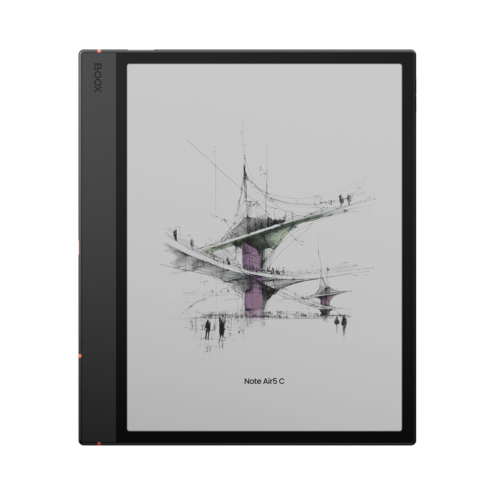
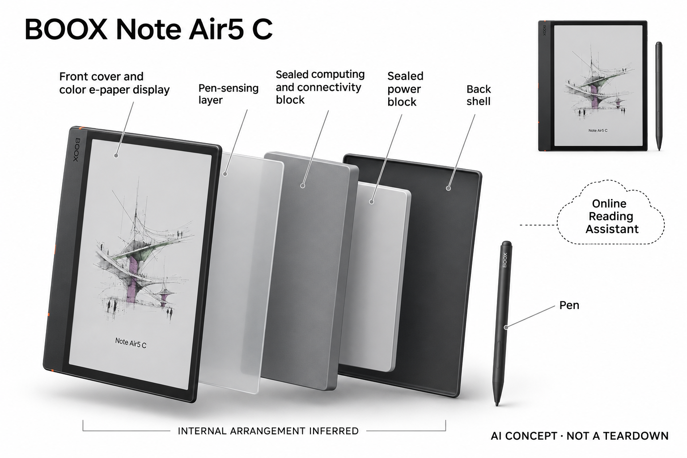

# BOOX Note Air5 C

**BOOX** · 手机与 AI PC · 核查 2026-11-04

彩色电子纸中的内置阅读解释

消费渠道：个人零售。

## 产品图片与结构参考

### 产品图

BOOX Note Air5 C · 官方产品图 · 来源：[BOOX · 官方图片](<https://shop.boox.com/products/noteair5c>) · [原始图片](<https://shop.boox.com/cdn/shop/files/01_36f01cab-06ea-40e1-b564-9a2d837064f1.jpg?v=1760437629>)

### 参考图

BOOX Note Air5 C · 官方参考图 · 来源：[BOOX · 官方图片](<https://shop.boox.com/products/noteair5c>) · [原始图片](<https://cdn.shopify.com/s/files/1/0604/6410/3654/files/03_31d43319-2332-4c09-a868-6d62393b7a61.jpg?v=1761015092>)

### AI 生成爆炸示意

**AI 生成 · 非实物拆机。** 内部为概念推断，不能作为元件布局、BOM 或维修依据。[生成提示词](../../content/hardware/prompts/boox-note-air5c.txt)

> 已目视核对外形、标签与非拆机声明；不代表内部结构经实测验证。

> 分析为基于公开资料的案头研究与 AI 辅助判断，未经用户访谈、销量审计或实物拆机。需求、画像、竞争冷门度、审美及商业机会均为研究假设，不是投资结论。

## 销售与购买

- 状态：在售。官方页面Order Now，结构化商品Offer所列美国标准套装为InStock。仅收这一代可购型号，不同时堆叠Air4、Air6或容量变体。

- 地区：美国官网所列仓库与配送区域

- 价格：官方美国标准套装 US$529.99。核查日页面快照；运费、税费、会员和配送区域按官方结算确认，不视为中国到手价。

- 中国大陆：本轮核实所列区域官方商店；未确认中国大陆官方现货、账户及完整服务，不把境外可购等同大陆可用。

- [官方产品 / 商店](<https://shop.boox.com/products/noteair5c>)

## AI 的实际作用

内置阅读AI Assistant解释术语与复杂句子；Smart Scribe辅助整理手写和草图。普通刷新算法与可以安装应用本身不作为AI收录依据。

服务与联网依赖：联网助手的账户、模型与地区服务需另核对；本地阅读手写和系统显示优化是不同功能。第三方应用可用性受系统与电子纸适配限制。

## 是否冷门

新兴竞争（研究判断）：面向阅读批注和轻量创作形成具体使用场景；本轮没有销量与市场份额证据。

## 需求与市场

需求假设：阅读论文、教材或个人资料的人希望在批注时快速解释难句，同时保留颜色标记。应比较实际长文中的提示质量与切屏次数，确认彩色和AI服务是否支持同一个高频需求。

## 用户画像

画像推断：常做文档批注、草图和个人学习笔记，愿意调整电子纸显示设置的人较匹配。它有安卓应用自由，也存在刷新和配色取舍，不能当作通用娱乐平板或专业绘图屏的直接替代。

## 竞争与替代

竞争判断：手写电子纸和平板市场都有成熟产品，阅读助手还会受到手机软件替代。此款的差异是彩色标记、笔输入和内置解释衔接，不能用更多系统功能直接证明更适合所有阅读者。

## 供应链

供应链推断：彩色电子纸、笔触层、前光和轻薄金属结构对装配与屏幕保护有要求，笔尖和键盘套也是维护环节。官方未披露完整工厂和物料表，维修与固件支持需按销售地区确认。

## 技术路径

官方区分阅读AI Assistant与Smart Scribe等输入辅助。技术判断应分别观察术语解释是否准确、手写整理是否改变原意，以及复杂页面的响应，不能把刷新更顺滑等同语言模型更可靠。

## 产品审美

审美判断：宽握持边与柔和色彩延续数字纸张风格，笔和可选键盘套提供不同使用姿势。彩色电子纸的饱和度与背景亮度不能按宣传屏幕图判断，需要在实际照明下查看自己的材料。

## 关键风险

风险判断：账户地区、在线服务和第三方应用权限会影响助手功能；彩色屏幕也可能需要更频繁调光。重要笔记应保留原始导出，模型解释需回查原文，不以厂商护眼措辞作医疗效果承诺。

## 机会与验证

市场观察：后续可按教材、科研阅读和个人绘画分别记录使用，不把多个场景混成单一用户。比较批注复用率、设置时间和助手纠错成本，判断这套组合是否超出普通平板已经满足的需求。

## 功能分层示意

这是功能关系，不是实物拆机、真实空间结构或已核实 BOM。

1. **彩色显示**：电子纸与前光显示文档和标记。（官方披露）

2. **笔触输入**：手写笔与触控层记录批注草图。（官方披露）

3. **内容辅助**：Smart Scribe和阅读AI助手处理内容。（官方披露）

4. **系统连接**：应用、网络与文档同步服务。（官方披露）

## 来源

1. [Note Air5 C官方商店](<https://shop.boox.com/products/noteair5c>) — 已实际打开官方页面；功能说明不等于独立性能测量。

2. [Note Air5 C官方功能介绍](<https://shop.boox.com/blogs/news/introducing-note-air5-c-the-10-3-color-epaper-notebook-for-light-productivity>) — 已实际打开官方页面；功能说明不等于独立性能测量。

[返回目录](../hardware-market.md) · [网页分析](https://romanagent.github.io/Roman/#hardware/product/boox-note-air5c)
