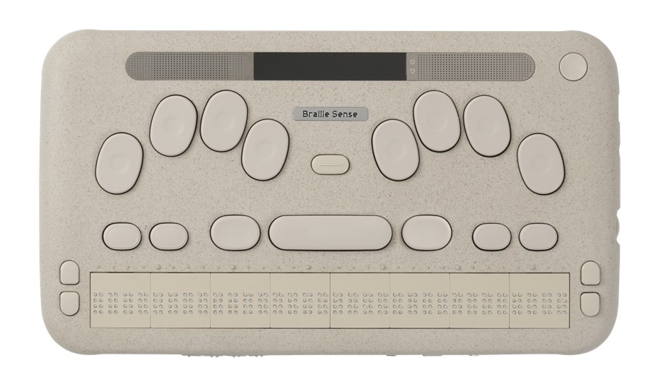
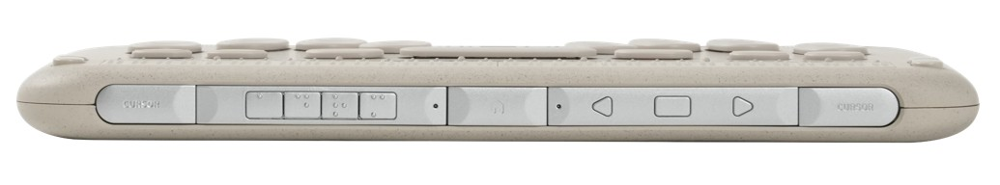
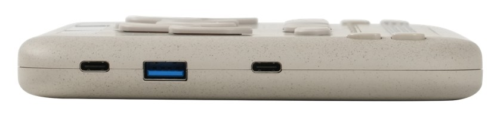
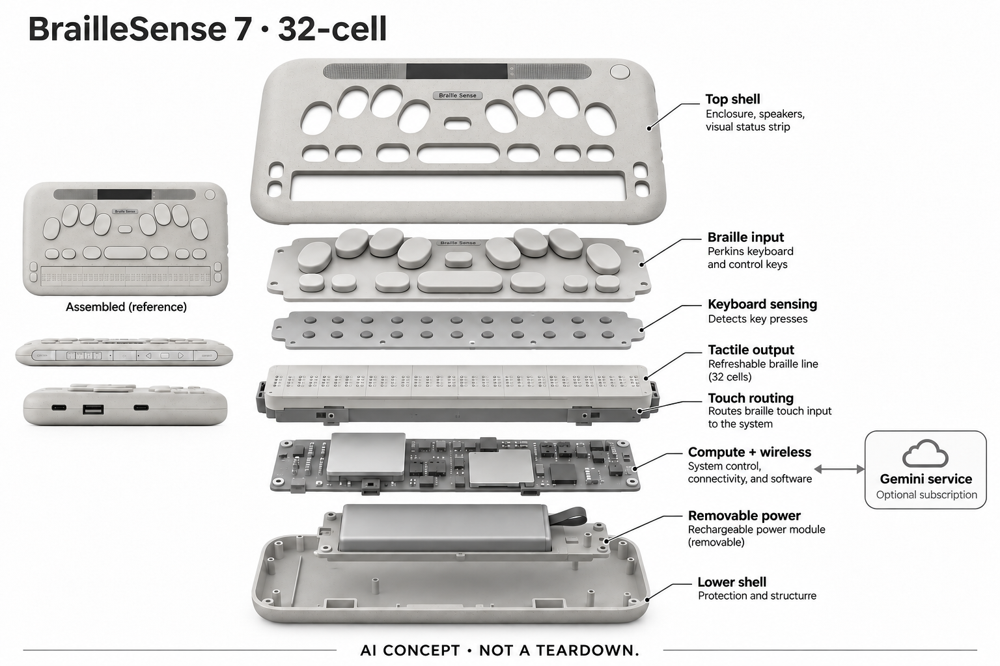

# BrailleSense 7（32-cell）

**SELVAS BLV / HIMS** · 无障碍与辅助沟通 · 核查 2026-11-05

把盲文输入、触觉回读和AI文档交互放在同一终端

消费渠道：个人零售。

## 产品图片与结构参考

### 产品图

BrailleSense 7 32cell官方俯视图，含实体输入和盲文区 · 来源：[SELVAS Healthcare / HIMS · 官方产品图片](<https://himsintl.com/en/blindness/view.php?idx=35>) · [原始图片](<https://himsintl.com/data/goodsImages/GOODS2_177258953520260429043541.jpg>)

### 参考图

BrailleSense 7 32cell官方前缘控制键参考 · 来源：[SELVAS Healthcare / HIMS · 官方产品图片](<https://himsintl.com/en/blindness/view.php?idx=35>) · [原始图片](<https://himsintl.com/data/goodsImages/ADD_GOODS1_177258953520260429043541.jpg>)

### 参考图

BrailleSense 7 32cell官方侧面接口参考 · 来源：[SELVAS Healthcare / HIMS · 官方产品图片](<https://himsintl.com/en/blindness/view.php?idx=35>) · [原始图片](<https://himsintl.com/data/goodsImages/ADD_GOODS2_177258953520260429043541.jpg>)

### AI 生成爆炸示意

**AI 生成 · 非实物拆机。** 内部为概念推断，不能作为元件布局、BOM 或维修依据。[生成提示词](../../content/hardware/prompts/braillesense-7-32.txt)

> 已视觉检查外形、灰阶、文本和数据路径；未知内部为概念模块，不代表实际拆机、完整BOM或医疗效果。

> 初稿外壳重复画出已分离的按键和盲文层，已用ImageGen改为空开口；初稿及两阶段提示词保留。

> 实际逐张查看并核对具体型号，保留厂家原图；参考场景和人物不能证明效果，历史图像与当前购买条件分别核查。

> 北美站静态图片和浏览器遇访问验证，改用制造商HIMS国际站准确32cell照片；未绕过验证，也未借40单元或旧6代外形。

> 分析为基于公开资料的案头研究与 AI 辅助判断，未经用户访谈、销量审计或实物拆机。需求、画像、竞争冷门度、审美及商业机会均为研究假设，不是投资结论。

## 销售与购买

- 状态：在售。当前官方具体型号选择与Buy Now入口、价目表均列32-cell H732B；页面说明32/40单元版本从2026年10月末开始交付，具体库存未实测，不借20单元12月计划冒充现货。

- 地区：美国和加拿大：SELVAS BLV官方购买/报价、其他地区经HIMS当地渠道另核

- 价格：US$5,995（32-cell官方价目）。北美价目另列US$69运费；维修计划和AI订阅另核。只收一个代表，不按20/32/40单元拆数。

- 中国大陆：未核到32-cell当前大陆订单、中文适配及Gemini服务条件；全球产品资料和语言可能性不等于当地完整交付。

- [官方产品 / 商店](<https://selvasblv.com/product/braillesense-7/>)

## AI 的实际作用

官方集成Gemini问答、文档分析和语音输入，配合实体盲文键盘、可刷新盲文及文件编辑；触摸滚动本身不被当作AI。

服务与联网依赖：HIMS披露的Gemini集成服务需有效订阅，内容从设备送Google服务；基础盲文和本地文件功能、第三方AI权益与网络条件须分开。

## 是否冷门

细分专业（研究判断）：关注盲文使用者自主写作、编辑和AI资料交互，区别于仅输出触觉图形；适配、软件权益和维护成本关键，无效率或学习效果实测。

## 需求与市场

需求假设是盲文使用者希望自己完成文字输入、回读和资料提问，而不是不断切换独立电脑、显示器和助手。生成内容只有在用户能逐步检查、定位和修改时才可能有用；减少设备切换也可能增加专用系统学习，价值需要围绕真实文档任务来判断。

### 官方｜写入与触觉回读形成一个工作流 · 官方资料

BrailleSense 7将实体盲文输入、可刷新盲文回读、专用文件工具和AI入口整合，用户可以在同一终端组织、检查和修改内容。Gemini问答及文档处理是明确的生成式功能，触摸滚动和按键本身则属于交互机制；不能把所有自动刷新都称为AI，也不把它视作普通平板外接一个显示附件。

依据：[BrailleSense 7北美官方产品与购买入口](<https://selvasblv.com/product/braillesense-7/>) · [HIMS国际官网BrailleSense 7 32cell](<https://himsintl.com/en/blindness/view.php?idx=35>)

### 判断｜资料交互需要用户能检查和修改 · 研究判断

需求假设是盲文使用者希望自己完成文字输入、回读和资料提问，而不是不断切换独立电脑、显示器和助手。生成内容只有在用户能逐步检查、定位和修改时才可能有用；减少设备切换也可能增加专用系统学习，价值需要围绕真实文档任务来判断。

依据：[BrailleSense 7北美官方产品与购买入口](<https://selvasblv.com/product/braillesense-7/>) · [HIMS国际官网BrailleSense 7 32cell](<https://himsintl.com/en/blindness/view.php?idx=35>)

### 验证｜从可核对的短文与表格开始 · 待验证

可使用公开样本检查输入、移动光标、修改文字、保存和重新打开的完整过程，再观察AI建议是否易于定位和复核。不要只测试一次问答或朗读，而应保留用户修改结果的步骤；本目录没有盲文操作、工作效率或学习效果实测，不承诺替代所有既有工具。

依据：[BrailleSense 7北美官方产品与购买入口](<https://selvasblv.com/product/braillesense-7/>) · [HIMS国际官网BrailleSense 7 32cell](<https://himsintl.com/en/blindness/view.php?idx=35>)

## 用户画像

已有盲文键盘和快捷操作习惯的人，可能更重视触觉回读和专用文件工具；另一些人更偏好常规电脑配读屏软件。两种方式没有通用胜负，用户要完成的文档类型、外设和协作方式更关键；不能仅因产品被用于学校就推定其全部AI服务适合所有年龄。

### 官方｜同系列不同单元数不混为同一配置 · 官方资料

本条选择32-cell型号，北美价目表列明对应型号和价格，国际官网也提供准确的32单元外形。四十和二十单元版本具有不同尺寸及交付安排，不能因为都叫BrailleSense 7就交换图片或库存信息；目录只保留一个需求代表，配套键盘与电池权益还须按地区订单确认。

依据：[BrailleSense 7北美官方产品与购买入口](<https://selvasblv.com/product/braillesense-7/>) · [SELVAS BLV当前官方价目表](<https://selvasblv.com/price-list/>) · [HIMS国际官网BrailleSense 7 32cell](<https://himsintl.com/en/blindness/view.php?idx=35>)

### 判断｜盲文习惯和软件任务决定适配 · 研究判断

已有盲文键盘和快捷操作习惯的人，可能更重视触觉回读和专用文件工具；另一些人更偏好常规电脑配读屏软件。两种方式没有通用胜负，用户要完成的文档类型、外设和协作方式更关键；不能仅因产品被用于学校就推定其全部AI服务适合所有年龄。

依据：[BrailleSense 7北美官方产品与购买入口](<https://selvasblv.com/product/braillesense-7/>) · [HIMS国际官网BrailleSense 7 32cell](<https://himsintl.com/en/blindness/view.php?idx=35>)

### 验证｜明确基础能力与付费AI分界 · 待验证

试用和购买前应分别确认本地文件编辑、盲文操作、第三方应用和HIMS Gemini服务的权限。AI隐私披露说明相关服务不面向儿童，具体使用条件必须核对，不能把教育定位当作无限制AI授权；本研究未建立账户或提交文件，也没有完成个人适配评估。

依据：[BrailleSense 7北美官方产品与购买入口](<https://selvasblv.com/product/braillesense-7/>) · [HIMS Gemini AI服务隐私披露，2026-08-20](<https://himsintl.com/en/etc/support-gemini-disclosure.php>)

## 竞争与替代

Dot Pad X侧重将图形空间关系转为触觉，BrailleSense则把文字写作、编辑、回读和AI交互组织为个人终端。两者都使用盲文不代表核心任务相同，也可能组合使用；比较应围绕输入、文件处理和纠错流程，而不是用单元数量或处理器代次作为创新与价值的主要标准。

### 官方｜当前购买入口与实际库存分开记录 · 官方资料

官方现行页面提供型号选择和购买入口，价目表列出32单元产品，报价渠道也接受个人产品需求。页面仍保留十月末开始交付的说明，本轮没有实际库存或发货验证；因此在售表示存在明确购买路径，不等于每个配置随时现货，更不能把其他地区的未来上市计划混入。

依据：[BrailleSense 7北美官方产品与购买入口](<https://selvasblv.com/product/braillesense-7/>) · [SELVAS BLV当前官方价目表](<https://selvasblv.com/price-list/>) · [SELVAS BLV个人产品报价渠道](<https://selvasblv.com/contact/request-a-quote/>)

### 判断｜与Dot Pad图形输出任务不同 · 研究判断

Dot Pad X侧重将图形空间关系转为触觉，BrailleSense则把文字写作、编辑、回读和AI交互组织为个人终端。两者都使用盲文不代表核心任务相同，也可能组合使用；比较应围绕输入、文件处理和纠错流程，而不是用单元数量或处理器代次作为创新与价值的主要标准。

依据：[BrailleSense 7北美官方产品与购买入口](<https://selvasblv.com/product/braillesense-7/>) · [HIMS国际官网BrailleSense 7 32cell](<https://himsintl.com/en/blindness/view.php?idx=35>)

### 验证｜比较完整文档任务及维护成本 · 待验证

可让用户用原有电脑与读屏方案和该终端处理同一份文档，记录准备、编辑、校对、导出及协作步骤。费用需包含维护计划、外设和所选AI服务，不能只看整机标价；本目录没有访谈、销量或长期使用数据，不推定专用终端一定更高效或更适合每个人。

依据：[BrailleSense 7北美官方产品与购买入口](<https://selvasblv.com/product/braillesense-7/>) · [SELVAS BLV当前官方价目表](<https://selvasblv.com/price-list/>) · [HIMS国际官网BrailleSense 7 32cell](<https://himsintl.com/en/blindness/view.php?idx=35>)

## 供应链

同类新设计既需要盲文点阵稳定刷新，也要保证按键、触摸路由和文件操作不会打断阅读。通用电池或USB电源控制可支持外围功能，却不能解决盲文执行器寿命与触感一致性；供应研究应把这些专有约束保留，不能因为常见计算器件易采购就低估核心模块难度。

### 官方｜盲文模块与通用电子层应分别看待 · 官方资料

厂家披露可刷新盲文、触摸路由、实体键盘、计算平台、显示和可更换电池等结构，但没有完整点名各模块的供应厂商。触觉单元的微机构也未公开拆机细节，不能借普通键盘或LCD供应链补成完整BOM；概念图只表达输入、触觉输出和电子层关系，不构成制造或维修图纸。

依据：[BrailleSense 7北美官方产品与购买入口](<https://selvasblv.com/product/braillesense-7/>) · [HIMS国际官网BrailleSense 7 32cell](<https://himsintl.com/en/blindness/view.php?idx=35>)

### 判断｜机械一致性与交互响应要共同验证 · 研究判断

同类新设计既需要盲文点阵稳定刷新，也要保证按键、触摸路由和文件操作不会打断阅读。通用电池或USB电源控制可支持外围功能，却不能解决盲文执行器寿命与触感一致性；供应研究应把这些专有约束保留，不能因为常见计算器件易采购就低估核心模块难度。

依据：[HIMS国际官网BrailleSense 7 32cell](<https://himsintl.com/en/blindness/view.php?idx=35>)

### 验证｜候选只覆盖具体外围能力 · 待验证

供电候选可研究接口协商、可更换电池和保护，显示或电子工程候选则需核对实际机械空间与系统接口。这里没有品牌点名采用证据，也不提供完整盲文单元方案；任何重新设计仍须验证整机、辅助输入和用户可操作性，不能从通用模块直接跳到量产结论。

依据：[BrailleSense 7北美官方产品与购买入口](<https://selvasblv.com/product/braillesense-7/>) · [HIMS国际官网BrailleSense 7 32cell](<https://himsintl.com/en/blindness/view.php?idx=35>)

## 技术路径

生成式建议可能帮助解释资料，但也可能遗漏或改写原意，尤其文档包含表格、格式和专业符号时。技术价值在于用户能否知道建议针对哪里、选择采用哪些部分并恢复原文；回答流畅和可被朗读并不足以证明无障碍，触觉定位与编辑路径同样重要。

### 官方｜Gemini内容需要交给第三方服务 · 官方资料

HIMS披露部分应用通过Gemini接口处理用户提交的文本或文件，并要求有效订阅，内容从设备直送Google服务。HIMS不保存相关内容不等于Google也不保留，后者另有数据条款；目录因此不将AI写为全本地或购买硬件即永久免费，基础文件功能也不能与云端问答混同。

依据：[BrailleSense 7北美官方产品与购买入口](<https://selvasblv.com/product/braillesense-7/>) · [HIMS Gemini AI服务隐私披露，2026-08-20](<https://himsintl.com/en/etc/support-gemini-disclosure.php>)

### 判断｜答案必须回到可编辑内容 · 研究判断

生成式建议可能帮助解释资料，但也可能遗漏或改写原意，尤其文档包含表格、格式和专业符号时。技术价值在于用户能否知道建议针对哪里、选择采用哪些部分并恢复原文；回答流畅和可被朗读并不足以证明无障碍，触觉定位与编辑路径同样重要。

依据：[BrailleSense 7北美官方产品与购买入口](<https://selvasblv.com/product/braillesense-7/>) · [HIMS国际官网BrailleSense 7 32cell](<https://himsintl.com/en/blindness/view.php?idx=35>) · [HIMS Gemini AI服务隐私披露，2026-08-20](<https://himsintl.com/en/etc/support-gemini-disclosure.php>)

### 验证｜检查失败状态是否可被非视觉识别 · 待验证

可核对网络断开、订阅失效、文件不支持或生成失败时，用户是否能通过盲文与语音理解状态并返回原任务。测试应保留原文件副本，区分AI建议和用户最终内容；本轮没有运行真实文档或辅助接口测试，不能承诺所有Android应用都同样易于操作。

依据：[BrailleSense 7北美官方产品与购买入口](<https://selvasblv.com/product/braillesense-7/>) · [HIMS国际官网BrailleSense 7 32cell](<https://himsintl.com/en/blindness/view.php?idx=35>) · [HIMS Gemini AI服务隐私披露，2026-08-20](<https://himsintl.com/en/etc/support-gemini-disclosure.php>)

## 产品审美

专用按键位置可能帮助形成熟悉的操作路线，但是否方便携带和与其他设备共用，仍取决于桌面空间与个人习惯。外壳颜色或圆角不能代表触感和耐久，视觉简洁也不等于盲文使用方便；审美评价需要包含本人如何拿取、定位和收纳，而不只看照片。

### 官方｜小型视觉条与实体键盘并非全触屏 · 官方资料

准确32单元官方图显示浅色圆角机身、Perkins键布局、上方小型视觉显示及扬声器区域，下方是长条盲文输出，前侧还有控制键。它不是整面触屏平板，生成图保留这些特征；未知内部仅画概念层，不增加大屏幕或借用旧六代的光标键结构。

依据：[HIMS国际官网BrailleSense 7 32cell](<https://himsintl.com/en/blindness/view.php?idx=35>)

### 判断｜触觉定位和桌面布置影响外观价值 · 研究判断

专用按键位置可能帮助形成熟悉的操作路线，但是否方便携带和与其他设备共用，仍取决于桌面空间与个人习惯。外壳颜色或圆角不能代表触感和耐久，视觉简洁也不等于盲文使用方便；审美评价需要包含本人如何拿取、定位和收纳，而不只看照片。

依据：[BrailleSense 7北美官方产品与购买入口](<https://selvasblv.com/product/braillesense-7/>) · [HIMS国际官网BrailleSense 7 32cell](<https://himsintl.com/en/blindness/view.php?idx=35>)

### 验证｜按完整外设配置观察使用 · 待验证

可以检查连接耳机、外部键盘或显示器后的接口位置和线缆安排，观察用户是否仍容易摸到常用控制。将外观偏好、按键手感、点阵辨识与携带分别记录，避免一项体验覆盖全部判断；本研究没有实际触摸、刷新噪声或长期机械寿命测试。

依据：[BrailleSense 7北美官方产品与购买入口](<https://selvasblv.com/product/braillesense-7/>) · [HIMS国际官网BrailleSense 7 32cell](<https://himsintl.com/en/blindness/view.php?idx=35>)

## 关键风险

当写作、阅读和资料交互集中在一台设备上，维修、固件或应用变化可能同时影响多项日常任务。用户需要了解导出、备份和备用访问方式，生成式服务的变化又增加另一层依赖；本地可编辑文件与云端助手应尽量保持清楚分界，避免失去订阅便无法理解原始资料。

### 官方｜服务与地区条件不能由全球页面推定 · 官方资料

北美购买和国际型号资料支持产品存在，但没有核到中国大陆该配置的完整交付、语言和Gemini服务条件。AI需要订阅和第三方处理的事实也不能用通用Android兼容性绕过；页面关于未来系统升级的期待，不应被写成已经交付或长期保证的版本支持。

依据：[BrailleSense 7北美官方产品与购买入口](<https://selvasblv.com/product/braillesense-7/>) · [HIMS Gemini AI服务隐私披露，2026-08-20](<https://himsintl.com/en/etc/support-gemini-disclosure.php>) · [SELVAS BLV个人产品报价渠道](<https://selvasblv.com/contact/request-a-quote/>)

### 判断｜专用设备可能形成支持依赖 · 研究判断

当写作、阅读和资料交互集中在一台设备上，维修、固件或应用变化可能同时影响多项日常任务。用户需要了解导出、备份和备用访问方式，生成式服务的变化又增加另一层依赖；本地可编辑文件与云端助手应尽量保持清楚分界，避免失去订阅便无法理解原始资料。

依据：[BrailleSense 7北美官方产品与购买入口](<https://selvasblv.com/product/braillesense-7/>) · [HIMS国际官网BrailleSense 7 32cell](<https://himsintl.com/en/blindness/view.php?idx=35>)

### 验证｜确认数据出口与维修安排 · 待验证

购买前应核对文件格式、备份、订阅管理、数据保留和维修计划的具体范围，并确认出现故障时如何继续重要任务。AI提交资料前还需理解第三方处理条件；本目录没有访问用户文档或账户，也不能据供应商一般隐私声明承诺所有资料绝不外发。

依据：[SELVAS BLV当前官方价目表](<https://selvasblv.com/price-list/>) · [HIMS国际官网BrailleSense 7 32cell](<https://himsintl.com/en/blindness/view.php?idx=35>) · [HIMS Gemini AI服务隐私披露，2026-08-20](<https://himsintl.com/en/etc/support-gemini-disclosure.php>)

## 机会与验证

后续研究可观察用户是否更容易自己创建、检查和分享资料，以及AI加入后是否仍能掌控内容。若生成回答增加了校对或账户配置负担，未必比原有工具更好；需求验证应允许个人选择不同输入方式，而不是因新终端集成更多功能就预设替换现有方案。

### 官方｜盲文写作与AI交互保留一个核心需求 · 官方资料

本条以32单元BrailleSense 7代表实体盲文写作、触觉校对和AI文档交互的组合，不把单元数、外接键盘或同系列旧代拆成独立创新数量。它与仅供触觉图形阅读的设备有所分工，实际差异应放在完整任务中说明，而不是把每一项自动交互都叫新场景。

依据：[BrailleSense 7北美官方产品与购买入口](<https://selvasblv.com/product/braillesense-7/>) · [HIMS国际官网BrailleSense 7 32cell](<https://himsintl.com/en/blindness/view.php?idx=35>)

### 判断｜关注自主完成任务的实际步骤 · 研究判断

后续研究可观察用户是否更容易自己创建、检查和分享资料，以及AI加入后是否仍能掌控内容。若生成回答增加了校对或账户配置负担，未必比原有工具更好；需求验证应允许个人选择不同输入方式，而不是因新终端集成更多功能就预设替换现有方案。

依据：[BrailleSense 7北美官方产品与购买入口](<https://selvasblv.com/product/braillesense-7/>) · [HIMS国际官网BrailleSense 7 32cell](<https://himsintl.com/en/blindness/view.php?idx=35>) · [HIMS Gemini AI服务隐私披露，2026-08-20](<https://himsintl.com/en/etc/support-gemini-disclosure.php>)

### 验证｜跟踪文件与服务变化后的可用性 · 待验证

可在合适同意下记录不同文件、软件更新和订阅变化时的操作困难，尤其关注是否还能可靠回读和修改原文。当前是官方资料案头研究，没有长期访谈、独立无障碍测试或销量证据；不推断学习成绩、职业能力或个人效率改善，更不把用户数量宣传当作需求证明。

依据：[BrailleSense 7北美官方产品与购买入口](<https://selvasblv.com/product/braillesense-7/>) · [HIMS国际官网BrailleSense 7 32cell](<https://himsintl.com/en/blindness/view.php?idx=35>) · [HIMS Gemini AI服务隐私披露，2026-08-20](<https://himsintl.com/en/etc/support-gemini-disclosure.php>)

## 对应供应链公司

能力候选用于选型研究，不代表本产品实际采用；未公开的供货关系不作推断。

- [texas-instruments](../supply-chain/texas-instruments.md) — **能力候选 · 非已采用** / 同类盲文计算终端的USB-C供电管理候选：TI TPS25751公开USB-C供电协商与功率路径控制，可研究同类终端的接口角色、异常保护和系统负载，但不包含盲文驱动、Gemini服务或完整充电系统。未发现BrailleSense点名采用证据，具体电池和主板接口须核对；候选不能视作现机换件或已完成辅助设备适配。

- [sunwoda](../supply-chain/sunwoda.md) — **能力候选 · 非已采用** / 同类可更换电池盲文终端的供电模块候选：欣旺达公开消费电池能力，可作为相近终端的电池封装、保护和供电项目研究入口，但需要验证可更换结构、接口、充电和长期维护条件。没有本产品采用证据，也不能由容量相近推断直接兼容；候选不包含专用盲文机构或软件权益，整机验证仍独立进行。

[浏览供应链目录](../supply-chain.md)

## 功能分层示意

这是功能关系，不是实物拆机、真实空间结构或已核实 BOM。

1. **实体输入**：Perkins键盘、功能键及可选外接QWERTY处理文字和命令。（官方披露）

2. **触觉回读**：32个可刷新盲文单元配合触摸路由和滚轮。（官方披露）

3. **本地计算与文件**：Android平台和专用应用提供文档处理及外设连接。（官方披露）

4. **选配云AI**：Gemini集成通过有效服务方案处理用户提交内容。（官方披露）

5. **供电与共享**：可更换电池、接口及小型视觉显示支持整体工作流。（官方披露）

## 来源

1. [BrailleSense 7北美官方产品与购买入口](<https://selvasblv.com/product/braillesense-7/>) — 已打开具体型号与Buy Now、Gemini集成、分批交付说明；浏览器额外核查遇安全验证未绕过，不声称实测现货。

2. [SELVAS BLV当前官方价目表](<https://selvasblv.com/price-list/>) — 已打开32-cell H732B US$5995、运费69，其他单元数及维护计划分开列出。

3. [HIMS国际官网BrailleSense 7 32cell](<https://himsintl.com/en/blindness/view.php?idx=35>) — 已打开并读取公开HTML：准确32单元图片、输入与接口、可更换电池、本地应用；旧6代图片未使用。

4. [HIMS Gemini AI服务隐私披露，2026-08-20](<https://himsintl.com/en/etc/support-gemini-disclosure.php>) — 已打开有效Google Play订阅、内容直送Google Gemini API/Firebase AI Logic、HIMS不存内容而Google另有保留条款；不推定全离线或无订阅。

5. [SELVAS BLV个人产品报价渠道](<https://selvasblv.com/contact/request-a-quote/>) — 已打开产品数量报价和本地服务联系流程，Organization字段非必填；没有提交个人信息或询价。

[返回目录](../hardware-market.md) · [网页分析](https://romanagent.github.io/Roman/#hardware/product/braillesense-7-32)
