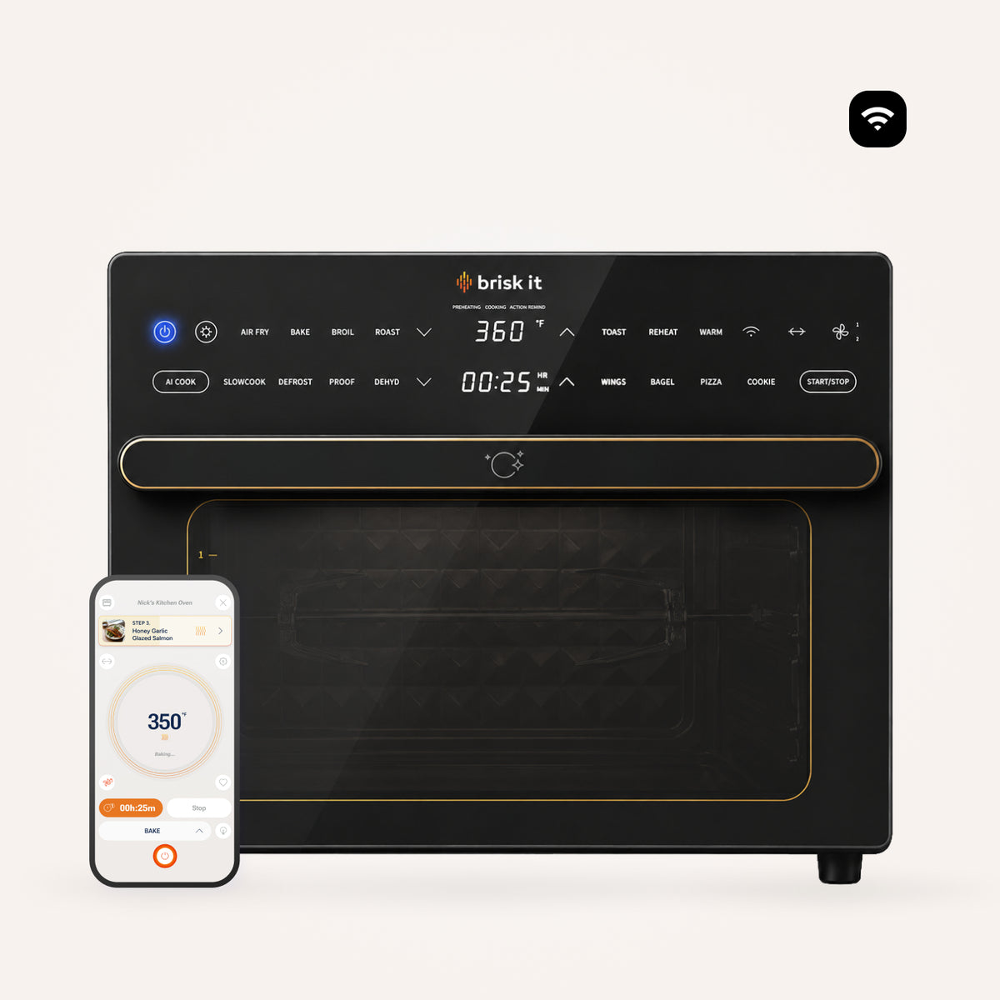
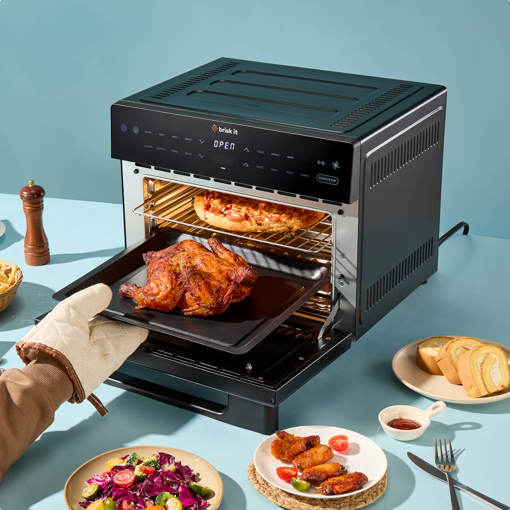
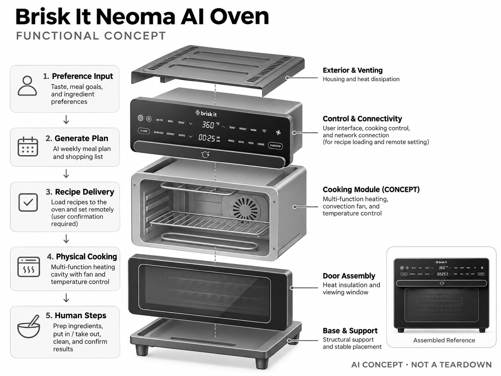

# Brisk It Neoma AI Oven

**Brisk It** · 厨房与烹饪 · 核查 2026-11-04

连接周餐计划、食谱与台式烤箱的 AI 厨房产品

消费渠道：个人零售。

## 产品图片与结构参考

### 产品图

官方商品图：Neoma 烤箱、面板与配套 App · 来源：[Brisk It · 官方图片](<https://briskit.ai/products/neomaoven>) · [原始图片](<https://cdn.shopify.com/s/files/1/0568/4271/5314/files/cream_background_1.jpg?v=1788854608&width=1200>)

### 参考图

官方开门场景：Neoma 烤架与食物放取路径 · 来源：[Brisk It · 官方图片](<https://briskit.ai/products/neomaoven>) · [原始图片](<https://cdn.shopify.com/s/files/1/0568/4271/5314/files/briskit-neomaopenracks-1445x1445.png?v=1787879697&width=1200>)

### AI 生成爆炸示意

**AI 生成 · 非实物拆机。** 内部为概念推断，不能作为元件布局、BOM 或维修依据。[生成提示词](../../content/hardware/prompts/brisk-it-neoma-oven.txt)

> 依据官方外观参考与公开功能生成；未披露的内部布局只作概念模块，不构成BOM或真实结构证据。

> 图片版权归原权利人；用于产品研究并保留出处。未改变图片色彩或内容。

> 分析为基于公开资料的案头研究与 AI 辅助判断，未经用户访谈、销量审计或实物拆机。需求、画像、竞争冷门度、审美及商业机会均为研究假设，不是投资结论。

## 销售与购买

- 状态：在售。官方产品页列 Neoma AI Multi-function Oven、US$249、Available In Stock 与 Add to Cart；不是仅有新闻发布或众筹概念。

- 地区：美国

- 价格：US$249。官方促销价快照；页面提示不含订阅，运费和地区税费按结账确认。

- 中国大陆：未核实中国大陆官方购买、食品接触认证、电源版本及本地服务，不能直接从海外可购买推断国内适用。

- [官方产品 / 商店](<https://briskit.ai/products/neomaoven>)

## AI 的实际作用

根据口味或目标生成周餐计划和购物清单，并将食谱加载到联网烤箱；生成内容需用户确认。

服务与联网依赖：AI 计划、购物清单和远程控制依赖联网 App 与服务，第三方购物能力有地区限制。

## 是否冷门

新兴竞争（研究判断）：生成式餐食规划与实体烤箱连接是新组合；烤箱与食谱服务本身并不冷门，需求仍需验证。

## 需求与市场

需求假设：工作日家庭的痛点可能是决定吃什么、采购和安排步骤，而不只是加热。需要观察一周内计划采纳、食材浪费与清理时间；如果用户不按计划采购，智能烤箱也无法自动补齐流程。

## 用户画像

画像假设：愿意尝试餐食规划、厨房空间有限的家庭或个人。消费者的饮食偏好和过敏要求差异大；偏爱中式炒菜的人可能不适合以烤箱为中心的周餐计划，不能直接搬用海外画像。

## 竞争与替代

竞争判断：台式烤箱、空气炸锅和手机食谱应用都是替代品，生成式规划仍在探索。应证明软硬件闭环明显优于普通烤箱加手机，而不是假设把两个成熟品类相连就形成新市场。

## 供应链

供应链推断：加热组件、风机、隔热材料、温控探头、食品接触内腔和联网控制板是关键。具体制造商与成本未披露；热工一致性、密封、易清洗和电气安全比模型品牌更直接影响质量。

## 技术路径

官方披露餐单生成、购物清单与配方加载。技术判断：食谱需映射为可解释参数和物理控制边界；实际食材重量与初温会影响结果，不能把文字推理能力视为可靠测熟能力。

## 产品审美

审美判断：黑色台式家电有利于与现代厨房搭配，但大面积门体、把手与操作区要适应油污和频繁触摸。体积、开门空间和清洁路径决定它能否长期留在台面，而不仅是发布图片好看。

## 关键风险

风险判断：生成式餐单可能不适合过敏、特殊疾病或儿童营养需求，不能作为医疗营养建议。联网服务和第三方购物有地区依赖，食材准备、放入取出与清洁仍需人完成。

## 机会与验证

可验证机会：聚焦固定食材、少步骤和可复现的一人食或家庭餐流程，验证用户是否持续采用。若主要价值在采购与计划，先做软件原型可能比立即开发完整烤箱更有效。

## 功能分层示意

这是功能关系，不是实物拆机、真实空间结构或已核实 BOM。

1. **偏好输入**：口味、餐食目标与食材偏好。（官方披露）

2. **生成计划**：AI 周餐计划与购物清单。（官方披露）

3. **配方传递**：食谱加载到设备及远程设置。（官方披露）

4. **实体烹饪**：多功能加热炉体、风机和温控为功能架构推断。（分析推断）

5. **人工环节**：备料、放入取出、清洁与结果确认仍由用户完成。（分析推断）

## 来源

1. [Brisk It Neoma AI Oven 官方商店](<https://briskit.ai/products/neomaoven>) — 已打开；库存、购物入口、AI 餐单和订阅提示明确。

[返回目录](../hardware-market.md) · [网页分析](https://romanagent.github.io/Roman/#hardware/product/brisk-it-neoma-oven)
