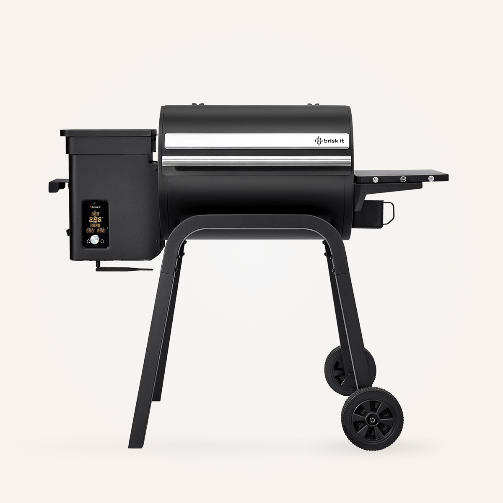
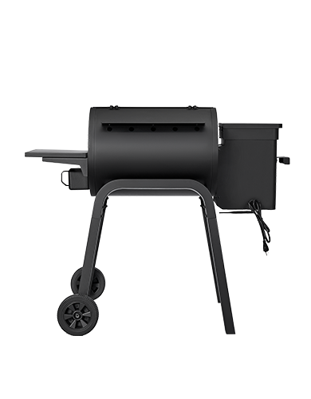
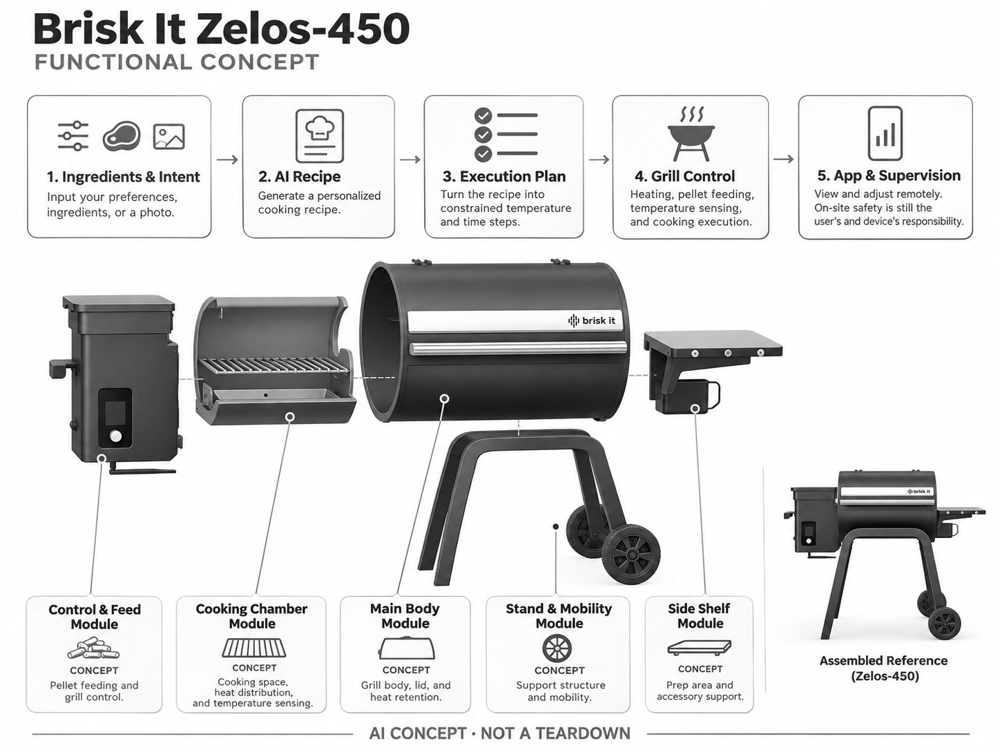

# Brisk It Zelos-450

**Brisk It** · 厨房与食物管理 · 核查 2026-11-04

把生成式食谱连接到颗粒烧烤炉的烹饪流程

消费渠道：个人零售。

## 产品图片与结构参考

### 产品图

官方商品图：Zelos-450 烧烤炉正面 · 来源：[Brisk It · 官方图片](<https://briskit.ai/products/brisk-it-zelos-450-a-i-powered-and-wifi-grill>) · [原始图片](<https://cdn.shopify.com/s/files/1/0568/4271/5314/files/briskit-zelos450-black-front-1445x1445.png?v=1787731679&width=1200>)

### 参考图

官方后视参考：Zelos-450 炉体、支腿与料仓 · 来源：[Brisk It · 官方图片](<https://briskit.ai/products/brisk-it-zelos-450-a-i-powered-and-wifi-grill>) · [原始图片](<https://cdn.shopify.com/s/files/1/0568/4271/5314/files/ZELOS_BACK_RESIZE_V1.png?v=1776118186&width=1200>)

### AI 生成爆炸示意

**AI 生成 · 非实物拆机。** 内部为概念推断，不能作为元件布局、BOM 或维修依据。[生成提示词](../../content/hardware/prompts/brisk-it-zelos-450.txt)

> 依据官方外观参考与公开功能生成；未披露的内部布局只作概念模块，不构成BOM或真实结构证据。

> 图片版权归原权利人；用于产品研究并保留出处。未改变图片色彩或内容。

> 分析为基于公开资料的案头研究与 AI 辅助判断，未经用户访谈、销量审计或实物拆机。需求、画像、竞争冷门度、审美及商业机会均为研究假设，不是投资结论。

## 销售与购买

- 状态：在售。官方商店显示 US$349.99、Available In Stock 与 Add to Cart。页面同时提示价格不含订阅，配送范围以结账为准。

- 地区：美国

- 价格：US$349.99。官方促销页面快照，订阅、运费、税费、燃料和配件另计；非完整使用成本。

- 中国大陆：未核实中国大陆官方销售、认证和售后；进口还需确认供电、燃料、使用场地及联网服务条件。

- [官方产品 / 商店](<https://briskit.ai/products/brisk-it-zelos-450-a-i-powered-and-wifi-grill>)

## AI 的实际作用

根据偏好、食材或图片生成个性化食谱，并将烹饪步骤与温度、时间控制连接。

服务与联网依赖：生成式能力和远程控制依赖 App、联网与服务方案；实体加热仍应受独立的安全控制约束。

## 是否冷门

新兴竞争（研究判断）：生成式食谱接入实体烹饪是发展中的服务组合，但颗粒炉和联网控温本身已有成熟竞争。

## 需求与市场

需求假设：烧烤新手既缺食谱选择也担心温度与时间控制，希望更稳定地完成食物。应比较同等食材下的完成率、操作负担与重复使用，不能把自动生成食谱等同口味好或更安全。

### 产品任务与边界 · 研究判断

Zelos-450 将生成食谱与木颗粒炉温度时间控制连接，任务是帮助烧烤新手选择做法并减少过程试错。需求应看相同食材下的完成、人工调整和复做，不能把自动生成配方等同口味好、熟度正确或烹饪更安全。

依据：[Brisk It Zelos-450 官方商店](<https://briskit.ai/products/brisk-it-zelos-450-a-i-powered-and-wifi-grill>) · [Brisk It 当前官方产品与AI厨房介绍](<https://briskit.ai/>)

### 需求判断 · 研究判断

户外聚会用户可能既缺食谱也担心控温，有经验者则更重视手动掌控和炉体品质。AI 价值需要在真实烹饪流程中验证，燃料补充、清洁和收纳仍由用户承担，不能只看应用里生成计划的速度或文字吸引力。

依据：[Brisk It Zelos-450 官方商店](<https://briskit.ai/products/brisk-it-zelos-450-a-i-powered-and-wifi-grill>) · [Brisk It 当前官方产品与AI厨房介绍](<https://briskit.ai/>)

### 需求验证 · 待验证

可用家庭常做的固定食材比较手动配方与生成方案，记录准备、调整、失败恢复和清洁，再观察是否愿意复做。保留食材尺寸和初始条件，确认软件帮助的是决策还是执行，避免一次聚会成功被当成普遍效果。

依据：[Brisk It Zelos-450 官方商店](<https://briskit.ai/products/brisk-it-zelos-450-a-i-powered-and-wifi-grill>) · [Brisk It 当前官方产品与AI厨房介绍](<https://briskit.ai/>)

## 用户画像

画像假设：有合适户外空间、喜欢家庭聚会但烹饪经验有限的人；有经验的烧烤玩家可能更重视可手动控制与设备品质。消费者需同时愿意承担清洁、燃料补充和户外收纳。

### 适用行为与条件 · 研究判断

较匹配有合适户外空间、愿维护颗粒炉并喜欢家庭聚会的消费者，新手可能更需要步骤引导。已有烧烤经验的人需求不同，不能把所有想省事的人都当作目标，使用者仍需接受燃料、油脂和季节收纳工作。

依据：[Brisk It Zelos-450 官方商店](<https://briskit.ai/products/brisk-it-zelos-450-a-i-powered-and-wifi-grill>) · [Brisk It 当前官方产品与AI厨房介绍](<https://briskit.ai/>)

### 人群取舍 · 研究判断

家庭聚会频率与烹饪习惯会决定设备是否被持续使用，偶尔尝鲜可能不足以支持服务费用。画像应包括实际空间、现场照看和维护者，而不是只按收入或喜欢烧烤分类，尤其要区分购买者与最终操作的人。

依据：[Brisk It Zelos-450 官方商店](<https://briskit.ai/products/brisk-it-zelos-450-a-i-powered-and-wifi-grill>) · [Brisk It 当前官方产品与AI厨房介绍](<https://briskit.ai/>)

### 画像验证 · 待验证

画像验证应让用户完成组装准备、一次完整烹饪和清洁，记录哪些步骤希望自动化、哪些坚持手动。再观察几周内复做与食谱选择，识别真正需要生成引导的人，避免把对新 AI 功能的兴趣当作长期需求。

依据：[Brisk It Zelos-450 官方商店](<https://briskit.ai/products/brisk-it-zelos-450-a-i-powered-and-wifi-grill>) · [Brisk It 当前官方产品与AI厨房介绍](<https://briskit.ai/>)

## 竞争与替代

竞争判断：联网颗粒炉已有 Traeger、Weber 等成熟替代，生成式食谱是较新服务层。机会不是简单增加聊天框，而是能否把实际烹饪状态、异常处理和可信执行连成闭环。

### 比较对象与差异 · 研究判断

Zelos-450 与成熟联网颗粒炉、普通烧烤工具和手机食谱竞争，生成式食谱是服务层差异。它需要证明软硬件联动优于已有炉体加应用，不能只增加聊天入口就认为创造了新市场，基础热工和清洁仍决定体验。

依据：[Brisk It Zelos-450 官方商店](<https://briskit.ai/products/brisk-it-zelos-450-a-i-powered-and-wifi-grill>) · [Brisk It 当前官方产品与AI厨房介绍](<https://briskit.ai/>)

### 竞争判断 · 研究判断

模型可能提供多样做法，但实际食材和燃料状态会限制执行，竞争优势应来自可信参数、异常处理和可复做结果。若用户主要需要稳定控温，成熟普通方案可能足够，AI 不应成为掩盖炉体品质或服务不足的理由。

依据：[Brisk It Zelos-450 官方商店](<https://briskit.ai/products/brisk-it-zelos-450-a-i-powered-and-wifi-grill>) · [Brisk It 当前官方产品与AI厨房介绍](<https://briskit.ai/>)

### 竞争验证 · 待验证

可在相同食材与聚会规模下比较生成、固定食谱和手动控制，记录人工调整与结果，再纳入燃料和清洁。不同订阅状态需明确，不能用完整试用服务与其他品牌基础功能直接比较而忽略持续费用。

依据：[Brisk It Zelos-450 官方商店](<https://briskit.ai/products/brisk-it-zelos-450-a-i-powered-and-wifi-grill>) · [Brisk It 当前官方产品与AI厨房介绍](<https://briskit.ai/>)

## 供应链

供应链推断：钣金炉体、送料机构、点火、温度探头、控制板与无线模组构成基础。具体工厂、芯片与 BOM 未披露；高温、油脂、腐蚀和清洁耐受决定长期可靠性，模型调用不是主要制造门槛。

### 功能模块拆分 · 研究判断

功能层包括偏好、食材或图片输入，生成食谱，受约束的执行计划，以及颗粒炉加热、送料、测温和应用。部分炉体与控制分层是工程推断，公开资料没有具体工厂、芯片或物料表，不能据此伪造拆机结构。

依据：[Brisk It Zelos-450 官方商店](<https://briskit.ai/products/brisk-it-zelos-450-a-i-powered-and-wifi-grill>) · [Brisk It 当前官方产品与AI厨房介绍](<https://briskit.ai/>)

### 制造与供应约束 · 研究判断

制造约束在于钣金、送料、点火、温度探头和无线控制承受高温油脂与户外环境，清洁后仍需可靠。生成模型不是主要制造门槛，燃料中断和探头异常的处理需要实体控制负责，不能把所有可靠性转交云端软件。

依据：[Brisk It Zelos-450 官方商店](<https://briskit.ai/products/brisk-it-zelos-450-a-i-powered-and-wifi-grill>) · [Brisk It 当前官方产品与AI厨房介绍](<https://briskit.ai/>)

### 候选与证据缺口 · 研究判断

RapidDirect 可支持炉体钣金和结构样件，SIIX 可作为控制板与电子装配候选。没有 Zelos-450 点名合作证据，热工、燃料执行和食品使用条件需专项工程，候选不代表能够直接复制完整炉体或 AI 服务。

依据：[Brisk It Zelos-450 官方商店](<https://briskit.ai/products/brisk-it-zelos-450-a-i-powered-and-wifi-grill>) · [Brisk It 当前官方产品与AI厨房介绍](<https://briskit.ai/>)

## 技术路径

官网宣称食谱生成及自动管理温度、时间。技术判断：文本计划需转成受限烹饪程序，必须处理食材尺寸、探头误差与燃料中断。模型输出不能绕过实体限温和用户安全操作。

### 已披露技术边界 · 研究判断

官方说明个性化食谱与自动管理温度时间，技术评价应区分生成建议、程序转换和实际热控制。食材尺寸、探头位置与燃料状态会改变结果，模型输出不能绕过独立限制，也不能把联网控制理解为无需现场管理。

依据：[Brisk It Zelos-450 官方商店](<https://briskit.ai/products/brisk-it-zelos-450-a-i-powered-and-wifi-grill>) · [Brisk It 当前官方产品与AI厨房介绍](<https://briskit.ai/>)

### 系统难点判断 · 研究判断

系统难点是把开放文本变为可解释且有边界的步骤，并在异常时保持可恢复。食谱看起来合理不代表适合当前份量或设备状态，应用需要让用户复核关键条件，而不是用流畅文字掩盖热工和测量不确定性。

依据：[Brisk It Zelos-450 官方商店](<https://briskit.ai/products/brisk-it-zelos-450-a-i-powered-and-wifi-grill>) · [Brisk It 当前官方产品与AI厨房介绍](<https://briskit.ai/>)

### 技术验证 · 待验证

验证应比较不同食材条件、探头异常和网络中断下的计划与控制，记录用户如何修正和恢复。测试应遵循厂商操作要求，不能把自动化演示作为食品安全或无人照看保证，也不由模型品牌推断结果可靠。

依据：[Brisk It Zelos-450 官方商店](<https://briskit.ai/products/brisk-it-zelos-450-a-i-powered-and-wifi-grill>) · [Brisk It 当前官方产品与AI厨房介绍](<https://briskit.ai/>)

## 产品审美

审美判断：黑色工具化炉体符合户外烧烤场景，AI 并未要求额外拟人形象。面板易读性、热区提示、挂钩和清洁路径比屏幕尺寸更重要，应让复杂软件退到可靠烹饪操作之后。

### 外观与交互语言 · 研究判断

黑色工具化炉体符合户外烧烤场景，AI 不需要额外拟人外观。面板可读、热区和清洁路径比屏幕大小更重要，设计应让复杂软件服务于可靠烹饪，不能让用户为了联网功能忽略燃料和炉体状态。

依据：[Brisk It Zelos-450 官方商店](<https://briskit.ai/products/brisk-it-zelos-450-a-i-powered-and-wifi-grill>) · [Brisk It 当前官方产品与AI厨房介绍](<https://briskit.ai/>)

### 使用中审美判断 · 研究判断

挂放工具、打开炉盖和处理油脂的动作决定真实体验，外观耐看也取决于使用后的清洁与腐蚀。简洁面板应保留关键状态，不能为了视觉安静隐藏异常，户外日光和油污环境都需要纳入交互设计。

依据：[Brisk It Zelos-450 官方商店](<https://briskit.ai/products/brisk-it-zelos-450-a-i-powered-and-wifi-grill>) · [Brisk It 当前官方产品与AI厨房介绍](<https://briskit.ai/>)

### 设计验证 · 待验证

设计验证应观察备料放入、查看状态、开盖和清理油脂，记录工具摆放及提示是否清楚。还需评估应用与本体信息是否一致，避免只看新品黑色外壳或漂亮食物照片判断整套操作是否简单。

依据：[Brisk It Zelos-450 官方商店](<https://briskit.ai/products/brisk-it-zelos-450-a-i-powered-and-wifi-grill>) · [Brisk It 当前官方产品与AI厨房介绍](<https://briskit.ai/>)

## 关键风险

风险判断：生熟判断、食品过敏与高温明火不能仅依赖生成式建议。远程控制也不能取消现场监管，必须遵守厂商操作规程；订阅停用、断网或服务终止后的基础功能需要购买前确认。

### 主要失效与依赖 · 研究判断

风险包括高温、燃料、生成配方错误和食物过敏条件，以及网络、订阅和服务变化。远程控制不能取消现场监管，模型建议不应被当作熟度或营养保证，用户仍需按实际食材与厂商规程操作。

依据：[Brisk It Zelos-450 官方商店](<https://briskit.ai/products/brisk-it-zelos-450-a-i-powered-and-wifi-grill>) · [Brisk It 当前官方产品与AI厨房介绍](<https://briskit.ai/>)

### 风险传播判断 · 研究判断

如果用户过度相信自动计划，可能忽略燃料不足或探头状态，错误会从文本传播到实体烹饪。产品需要把关键确认和异常清楚呈现，并说明停服或断网后保留哪些基础能力，不能将所有智能功能统一描述为永久可用。

依据：[Brisk It Zelos-450 官方商店](<https://briskit.ai/products/brisk-it-zelos-450-a-i-powered-and-wifi-grill>) · [Brisk It 当前官方产品与AI厨房介绍](<https://briskit.ai/>)

### 风险验证 · 待验证

风险验证应演练断网、计划修改和受控设备异常，检查用户是否能转为手动及理解剩余能力。核对当前服务和维修条件，所有结论需绑定设备与食材，不能由一次成功烹饪推断所有生成食谱安全有效。

依据：[Brisk It Zelos-450 官方商店](<https://briskit.ai/products/brisk-it-zelos-450-a-i-powered-and-wifi-grill>) · [Brisk It 当前官方产品与AI厨房介绍](<https://briskit.ai/>)

## 机会与验证

可验证机会：从一种明确菜系或重复性烹饪任务切入，记录用户失败原因与能否安全恢复。用已有控温硬件验证辅助价值，再决定整机创新，避免用 AI 掩盖基本热工与清洁体验不足。

### 可能的机会入口 · 研究判断

机会在于明确菜式或重复任务中的可信执行与恢复，让新手少失败又保留控制。新项目可以先用成熟控温硬件验证食谱辅助价值，再决定整机创新，避免为了 AI 叙事承担原本没有优势的热工与清洁制造。

依据：[Brisk It Zelos-450 官方商店](<https://briskit.ai/products/brisk-it-zelos-450-a-i-powered-and-wifi-grill>) · [Brisk It 当前官方产品与AI厨房介绍](<https://briskit.ai/>)

### 机会成立条件 · 研究判断

机会成立需要减少真实调整和失败，且用户愿意重复使用生成方案，如果只是偶尔尝试新菜，持续服务价值应重新评估。基础炉体与维护仍需可靠，软件无法补偿油脂处理困难或长期配件缺失带来的负担。

依据：[Brisk It Zelos-450 官方商店](<https://briskit.ai/products/brisk-it-zelos-450-a-i-powered-and-wifi-grill>) · [Brisk It 当前官方产品与AI厨房介绍](<https://briskit.ai/>)

### 下一步验证 · 待验证

下一步可记录同类食材多次烹饪的计划采用、人工调整、结果和清洁，比较固定配方与生成方案。根据失败原因选择算法、控制或结构改进，避免以食谱数量、远程功能或 AI 名称直接推断市场需求。

依据：[Brisk It Zelos-450 官方商店](<https://briskit.ai/products/brisk-it-zelos-450-a-i-powered-and-wifi-grill>) · [Brisk It 当前官方产品与AI厨房介绍](<https://briskit.ai/>)

## 对应供应链公司

能力候选用于选型研究，不代表本产品实际采用；未公开的供货关系不作推断。

- [rapiddirect](../supply-chain/rapiddirect.md) — **能力候选 · 非已采用** / 颗粒炉钣金与维护结构原型：RapidDirect 的钣金和机械原型服务可支持炉体、支架与清洁结构评审，但高温、油脂和燃料系统需专项验证；没有 Zelos-450 点名合作证据，候选不代表整机实际制造。

- [siix](../supply-chain/siix.md) — **能力候选 · 非已采用** / 炉体控制与无线电子装配：SIIX 电子制造能力可用于控制板、无线连接和功能测试导入，但独立热控、送料保护及生成服务需另外负责；未见 Zelos-450 供货披露，当前只是电子制造候选。

[浏览供应链目录](../supply-chain.md)

## 功能分层示意

这是功能关系，不是实物拆机、真实空间结构或已核实 BOM。

1. **食材与意图**：用户输入偏好、食材或图片。（官方披露）

2. **AI 食谱**：生成个性化烹饪建议。（官方披露）

3. **执行计划**：将食谱转为受约束温度与时间步骤，具体内部实现未公开。（分析推断）

4. **炉体控制**：加热、送料、测温和烹饪执行。（分析推断）

5. **App 与监督**：远程查看及调整，现场安全仍由用户与设备保护承担。（官方披露）

## 来源

1. [Brisk It Zelos-450 官方商店](<https://briskit.ai/products/brisk-it-zelos-450-a-i-powered-and-wifi-grill>) — 已打开；列库存、购物入口、AI 生成食谱和订阅提示，自动烹饪效果为厂商声明。

[返回目录](../hardware-market.md) · [网页分析](https://romanagent.github.io/Roman/#hardware/product/brisk-it-zelos-450)
