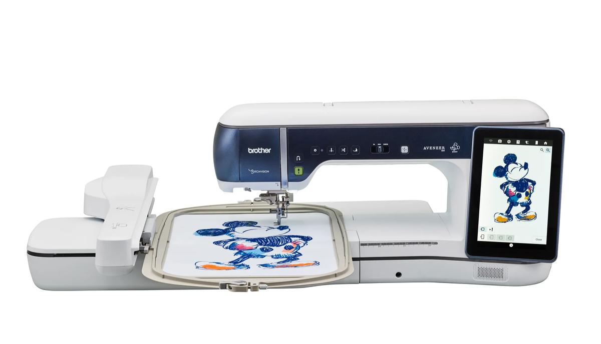
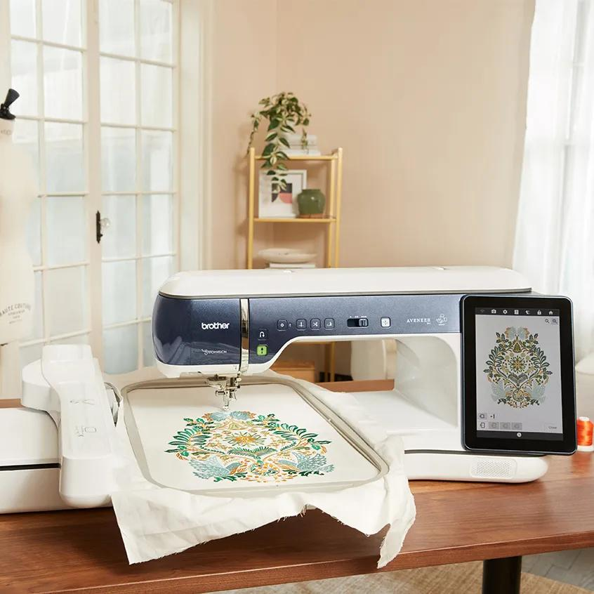
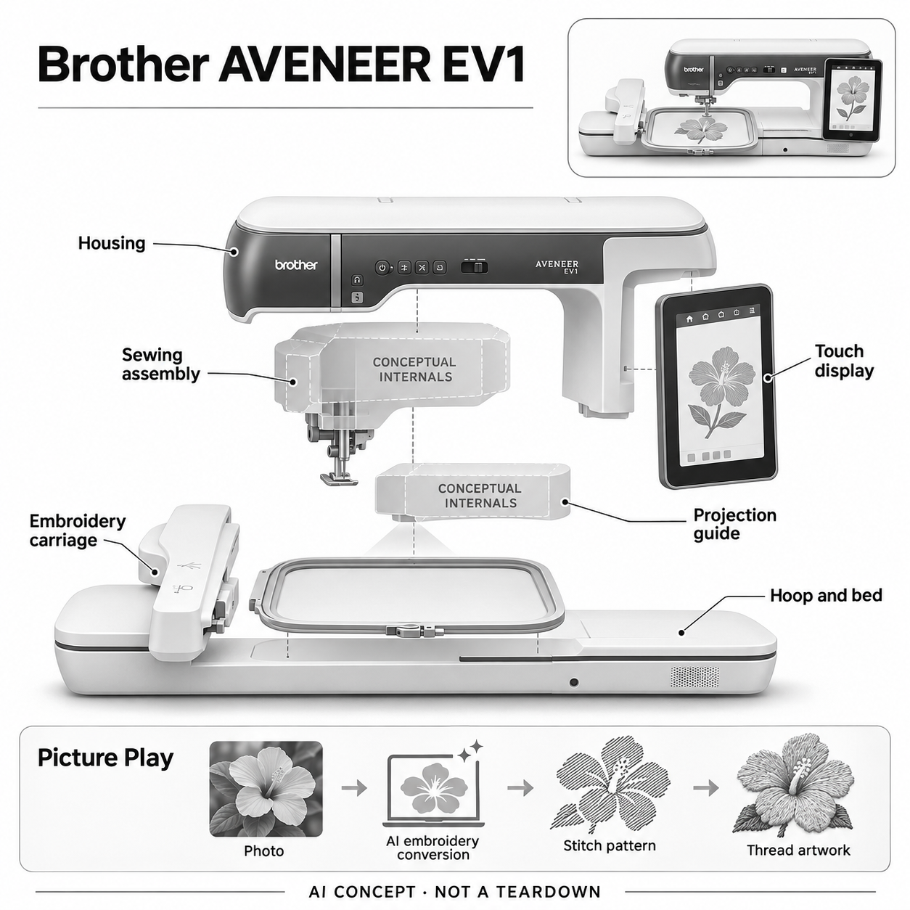

# Brother AVENEER EV1

**Brother** · 专业兴趣工具 · 核查 2026-11-05

把照片和图像转换为可执行刺绣图案的家用创作设备

消费渠道：个人零售。

## 产品图片与结构参考

### 产品图

Brother基础EV1官方产品图（地区内置图案及附件以当地订单为准） · 来源：[Brother · 官方资料](<https://www.brother-usa.com/p/sewing-embroidery/EV1>) · [原始图片](<https://assets.brother.com/transform/4b54646d-25e8-4449-93e8-54f1e2a05824/21282_Aveneer_15692_NE_Disney_Front_w-jpg?io=transform%3Afit%2Cwidth%3A1200>)

### 参考图

Brother基础EV1官方刺绣工作场景（厂商作品，非本站效果实测） · 来源：[Brother · 官方资料](<https://www.brother-usa.com/p/sewing-embroidery/EV1>) · [原始图片](<https://assets.brother.com/transform/a36c1fe5-2935-49cb-8471-d0f15b4b94f7/21441_Machine_02_B_0086846x846-jpg?io=transform%3Afit%2Cwidth%3A1000>)

### AI 生成爆炸示意

**AI 生成 · 非实物拆机。** 内部为概念推断，不能作为元件布局、BOM 或维修依据。[生成提示词](../../content/hardware/prompts/brother-aveneer-ev1.txt)

> 以原厂EV1图独立生成并完成目视QA；未知内部为功能块，未编造芯片、传动或AI部署位置。

> 保留原厂图像原貌；只对应基础EV1，不以EV1LE或升级包替代。

> 分析为基于公开资料的案头研究与 AI 辅助判断，未经用户访谈、销量审计或实物拆机。需求、画像、竞争冷门度、审美及商业机会均为研究假设，不是投资结论。

## 销售与购买

- 状态：在售。核查日Brother原厂英国门店查询器选择Aveneer EV1，明确列出A61 Woodseats Sewing Machines Ltd；对应授权店实际页面In stock、Add to cart，公开变体53624917164369为available=true。仅收基础EV1，不重复计LE或升级包。

- 地区：英国（已核EV1原厂授权门店库存）

- 价格：英国授权店实际页面£14,999。实际浏览器与公开商品数据一致；搜索及旧抓取有£12,749促销，未沿用。大件配送、安装、培训和当地订单总价应由门店确认。

- 中国大陆：未核中国大陆基础EV1对应的官方现货、培训和维修；英国门店与日本发布资料不能证明大陆同型号可完整交付。进口电源、软件语言和本地保修需另核。

- [官方产品 / 商店](<https://www.brother-usa.com/p/sewing-embroidery/EV1>)

## AI 的实际作用

原厂Picture Play利用AI把照片或图像转为刺绣数据，用户选择风格并在机上查看和调整，再由刺绣执行机构把图案落实到线材与布料。

服务与联网依赖：照片可经兼容移动应用和同一无线网络传入，机器界面完成Picture Play工作流；模型架构与完整端云位置未公开，不假定是语言模型。投影、普通送布与语音提示不是独立AI证据。

## 是否冷门

细分专业（研究判断）：照片刺绣是明确高阶兴趣，软件与制版服务替代成熟，机器投入和材料经验门槛高；不以AI标签推断蓝海。

## 需求与市场

案头需求是把自己拍摄或设计的图像变成线材作品，减少手工数字化图案的起步步骤。AI转换只是创作链路的一环，仍需选择线色、布料与支撑；价值要由可用针迹和返工成本判断，不能只看屏幕预览。

### 事实：任务边界 · 官方资料

Brother官方Picture Play明确利用AI把照片和图像转换为刺绣数据，在机器界面选择风格和预览后交给针线执行。原厂英国EV1门店查询器列出的授权店当前有库存，设备是个人可购买的家用创作机；本条不是把单独的图像App当作实体硬件。

依据：[Brother EV1原厂产品与Picture Play](<https://www.brother-usa.com/p/sewing-embroidery/EV1>) · [Brother日本EV1刺绣技术说明](<https://www.brother.co.jp/product/hsm/embropc/ev1/feature/feature1/index.aspx>)

### 判断：真实需求 · 研究判断

需求假设是创作者希望把自己的图像更快做成线材作品，减少从头制版的阻力。屏幕上看起来像刺绣的预览并不等于布面上已经可用，布料、衬底和线色选择仍会改变结果；AI的价值应由从原图到样片的完整时间与返工衡量。

依据：[Brother EV1原厂产品与Picture Play](<https://www.brother-usa.com/p/sewing-embroidery/EV1>) · [Brother日本EV1刺绣技术说明](<https://www.brother.co.jp/product/hsm/embropc/ev1/feature/feature1/index.aspx>)

### 验证：任务完成 · 待验证

验证可用参与者真实准备制作的照片、线稿和复杂背景图，记录转换、修改、选线、试绣与重做过程，再与原有制版方法比较。询问哪些图像愿意交给自动转换、哪些必须手调，不能只展示一件成功作品就推断所有个人定制都更容易。

依据：[Brother EV1原厂产品与Picture Play](<https://www.brother-usa.com/p/sewing-embroidery/EV1>) · [Brother日本EV1刺绣技术说明](<https://www.brother.co.jp/product/hsm/embropc/ev1/feature/feature1/index.aspx>)

## 用户画像

适合持续做个性化刺绣、拼布或小批量手作的个人创作者，且愿意学习材料与机器设置。偶尔修补衣物者不必需要这类高阶功能；已有图案数字化经验与本地培训条件会影响实际适配。

### 事实：使用条件 · 官方资料

EV1是单针家用缝纫、拼布和刺绣组合设备，具有较大工作区、独立刺绣车架与右侧显示界面，基础机器与LE及升级套件应区分。已核当前英国授权库存，不代表其它国家的同型号价格、附件、培训或售后条件已经相同，尤其不能外推大陆交付。

依据：[Brother EV1原厂产品与Picture Play](<https://www.brother-usa.com/p/sewing-embroidery/EV1>) · [Brother英国官方EV1授权门店查询](<https://sewingcraft.brother.eu/en/products/how-to-buy/where-to-buy>) · [A61 Woodseats授权店当前EV1商品](<https://woodseatssewingmachinesshop.co.uk/products/brother-aveneer-ev1-sewing-embroidery-quilting-machine-1>)

### 判断：人群筛选 · 研究判断

潜在人群是持续做个性化刺绣和手作项目、有稳定工作台并愿意学习材料处理的个人创作者。只偶尔修补衣物的人未必需要图像数字化；已有制版经验者与初次接触刺绣者也会遇到不同问题，不能简单按是否爱手工判断适配。

依据：[Brother EV1原厂产品与Picture Play](<https://www.brother-usa.com/p/sewing-embroidery/EV1>) · [Brother英国官方EV1授权门店查询](<https://sewingcraft.brother.eu/en/products/how-to-buy/where-to-buy>) · [A61 Woodseats授权店当前EV1商品](<https://woodseatssewingmachinesshop.co.uk/products/brother-aveneer-ev1-sewing-embroidery-quilting-machine-1>)

### 验证：参与者差异 · 待验证

访谈应先查看用户最近几件作品的图案来源、准备耗时和失败原因，再观察他们能否完成从照片导入到可用样片的全部步骤。记录何时需要门店培训或人工帮助，以及机器是否占用过多空间；不把家用定位理解为无需学习或无需维护。

依据：[Brother EV1原厂产品与Picture Play](<https://www.brother-usa.com/p/sewing-embroidery/EV1>) · [Brother英国官方EV1授权门店查询](<https://sewingcraft.brother.eu/en/products/how-to-buy/where-to-buy>) · [A61 Woodseats授权店当前EV1商品](<https://woodseatssewingmachinesshop.co.uk/products/brother-aveneer-ev1-sewing-embroidery-quilting-machine-1>)

## 竞争与替代

与PFAFF压脚兼容提示相比，EV1处理的是图像到刺绣数据的创作准备，任务明显不同。替代包括电脑数字化软件、外包制版和预制图案；不将LE内置花样或升级附件当成新AI硬件。

### 事实：方案范围 · 官方资料

本目录PFAFF creative icon 2的明确AI任务是压脚与针迹兼容检测，EV1的Picture Play则把图像转成刺绣数据，两者处于不同工序。EV1仍与电脑数字化软件、外包制版及预制花样竞争，不因LE增加授权图案或附件改变就再算一种独立AI实现。

依据：[Brother EV1原厂产品与Picture Play](<https://www.brother-usa.com/p/sewing-embroidery/EV1>) · [Brother日本EV1刺绣技术说明](<https://www.brother.co.jp/product/hsm/embropc/ev1/feature/feature1/index.aspx>)

### 判断：替代关系 · 研究判断

竞争判断应围绕用户是否经常制作自己的图案。如果只用现成花样，软件转换的额外价值有限；如果希望保留图像的特定细节，人工制版可能更可控。机上完成流程减少文件切换，但不证明输出针迹一定优于专业软件，二者可能结合使用。

依据：[Brother EV1原厂产品与Picture Play](<https://www.brother-usa.com/p/sewing-embroidery/EV1>) · [Brother日本EV1刺绣技术说明](<https://www.brother.co.jp/product/hsm/embropc/ev1/feature/feature1/index.aspx>)

### 验证：比较方法 · 待验证

可把同一素材分别经Picture Play、熟悉的电脑软件和外包服务做成样片，比较准备、人工修正、耗线与实际布面效果。让用户解释哪些细节必须保留，哪些可以风格化；评价应来自真实创作要求，而非内置花样数量或旗舰宣传。

依据：[Brother EV1原厂产品与Picture Play](<https://www.brother-usa.com/p/sewing-embroidery/EV1>) · [Brother日本EV1刺绣技术说明](<https://www.brother.co.jp/product/hsm/embropc/ev1/feature/feature1/index.aspx>)

## 供应链

功能链涉及图像输入、显示与处理、针线执行、刺绣框运动和投影，真实芯片、电机与工厂未披露。候选供应关联只匹配运动、显示与结构能力；软件转换不能代替材料试样和机械一致性验证。

### 事实：功能组成 · 官方资料

公开功能包含图像输入与处理、触屏、投影、针线执行、刺绣框和车架运动，实际处理芯片、电机及整机工厂没有在本轮来源披露。官方照片支持外形和操作区识别，不能据此重建传动；供应关联仅为显示、运动及结构开发候选，不伪造真实BOM。

依据：[Brother EV1原厂产品与Picture Play](<https://www.brother-usa.com/p/sewing-embroidery/EV1>) · [Brother日本EV1刺绣技术说明](<https://www.brother.co.jp/product/hsm/embropc/ev1/feature/feature1/index.aspx>)

### 判断：交付约束 · 研究判断

工程判断，图案数据生成后还要通过材料、线张力、针与框架运动实现，软件看起来正确也可能在布面失败。对用户而言，耗材兼容、配件供应和当地维护与AI能力同样影响交付；仅分析算力或图像模型无法解释长期使用成本。

依据：[Brother EV1原厂产品与Picture Play](<https://www.brother-usa.com/p/sewing-embroidery/EV1>) · [Brother日本EV1刺绣技术说明](<https://www.brother.co.jp/product/hsm/embropc/ev1/feature/feature1/index.aspx>)

### 验证：选型缺口 · 待验证

选型与验证应记录从输入素材到针迹文件再到样片的误差来源，分别检查机械重复性与材料准备。向候选供应商提出明确屏幕、运动与结构条件后再比较方案；未有品牌点名证据前，不写真实元件型号、代工地点或采购价格。

依据：[Brother EV1原厂产品与Picture Play](<https://www.brother-usa.com/p/sewing-embroidery/EV1>) · [Brother日本EV1刺绣技术说明](<https://www.brother.co.jp/product/hsm/embropc/ev1/feature/feature1/index.aspx>)

## 技术路径

官方明确AI转换照片为刺绣数据，并提供多种风格与机上预览。最终图案是对输入的重新表达，不是照片无损复制；模型与计算部署未充分公开，不能把普通针距调节或投影统称为AI。

### 事实：AI机制 · 官方资料

原厂日本说明将Picture Play的AI图像转换与风格选择明确列在EV1刺绣功能中，并说明可通过My Design Snap在同一无线网络传入图片。模型架构和完整计算部署未公开，本条不假定语言模型、独立AI芯片或所有处理完全离线，也不把普通投影和送布自动化算作AI。

依据：[Brother EV1原厂产品与Picture Play](<https://www.brother-usa.com/p/sewing-embroidery/EV1>) · [Brother日本EV1刺绣技术说明](<https://www.brother.co.jp/product/hsm/embropc/ev1/feature/feature1/index.aspx>)

### 判断：系统边界 · 研究判断

分析上，照片转刺绣需要对颜色、轮廓和细节重新表达，所得图案不可能简单等同原始像素。低对比、细文字、毛发或复杂背景可能出现取舍；用户需要在预览与试绣之间反复核对，不能因为模型输出了设计，就认为它已满足材料和成品要求。

依据：[Brother EV1原厂产品与Picture Play](<https://www.brother-usa.com/p/sewing-embroidery/EV1>) · [Brother日本EV1刺绣技术说明](<https://www.brother.co.jp/product/hsm/embropc/ev1/feature/feature1/index.aspx>)

### 验证：算法与体验 · 待验证

技术验证可保存输入图片、所选风格、预览和最终样片，检查被省略或改变的信息，再区分转换问题与材料问题。对不同线色和织物分别记录条件，不发布未经实测的自动制版准确率；涉及照片或授权花样时，也保留素材来源和使用边界。

依据：[Brother EV1原厂产品与Picture Play](<https://www.brother-usa.com/p/sewing-embroidery/EV1>) · [Brother日本EV1刺绣技术说明](<https://www.brother.co.jp/product/hsm/embropc/ev1/feature/feature1/index.aspx>)

## 产品审美

蓝白长臂机身、右侧竖向屏幕和左侧刺绣车架形成清楚的工作区。分析上，布料支撑、绷框操作、屏幕与针区之间的切换比外观更重要；官方画面中的手机、桌面与作品不当作整套标配。

### 事实：外观与交互 · 官方资料

真实官方图显示蓝白长臂机身、右侧竖向触屏、左侧延伸车架及大面积绷框，属于家用单针设备而非工业多针机。生成图保留这一外形，用普通花朵展示图像到针迹流程，内部驱动与投影仅用概念块，不复制授权卡通花样作技术效果承诺。

依据：[Brother EV1原厂产品与Picture Play](<https://www.brother-usa.com/p/sewing-embroidery/EV1>) · [Brother日本EV1刺绣技术说明](<https://www.brother.co.jp/product/hsm/embropc/ev1/feature/feature1/index.aspx>)

### 判断：使用中的形态 · 研究判断

审美与交互判断要看用户在屏幕设计、绷框和针区检查之间怎样移动视线和身体。大的工作区有利于支撑作品，也要求实际桌面与照明；如果预览操作复杂或附件收纳不便，漂亮外观并不能减少创作负担，需要放到真实房间观察。

依据：[Brother EV1原厂产品与Picture Play](<https://www.brother-usa.com/p/sewing-embroidery/EV1>) · [Brother日本EV1刺绣技术说明](<https://www.brother.co.jp/product/hsm/embropc/ev1/feature/feature1/index.aspx>)

### 验证：日常接受度 · 待验证

让创作者按自己的项目导入素材、修改、装框、查看投影和开始试样，记录是否频繁离座或求助。比较不同工作台上的布料支撑与屏幕可见性，再问是否愿意保持常驻；不能根据品牌场景图推断所有家庭空间都适配。

依据：[Brother EV1原厂产品与Picture Play](<https://www.brother-usa.com/p/sewing-embroidery/EV1>) · [Brother日本EV1刺绣技术说明](<https://www.brother.co.jp/product/hsm/embropc/ev1/feature/feature1/index.aspx>)

## 关键风险

风险在复杂图像生成不可用针迹、材料与线色选择失败，以及高价设备依赖本地维护。商品须确认基础EV1与地区版本；照片和内置授权花样的使用条件不同，AI转换不会自动授予商用权利。

### 事实：已知限制 · 官方资料

授权店实际界面和公开商品数据为一万四千九百九十九英镑，而旧网页索引出现更低促销，本条采用实时核查值。原厂门店查询器有EV1专门类别，渠道可追溯；不过具体大件配送、培训、地区附件和后续软件仍需按个人订单确认，不能概括为全球统一交付。

依据：[Brother EV1原厂产品与Picture Play](<https://www.brother-usa.com/p/sewing-embroidery/EV1>) · [Brother日本EV1刺绣技术说明](<https://www.brother.co.jp/product/hsm/embropc/ev1/feature/feature1/index.aspx>) · [Brother英国官方EV1授权门店查询](<https://sewingcraft.brother.eu/en/products/how-to-buy/where-to-buy>) · [A61 Woodseats授权店当前EV1商品](<https://woodseatssewingmachinesshop.co.uk/products/brother-aveneer-ev1-sewing-embroidery-quilting-machine-1>)

### 判断：失效影响 · 研究判断

风险判断包括自动生成图案需要大量修正、试绣失败带来材料损耗，以及用户把高价设备理解为能替代制版经验。AI转换不会自动授予照片或内置授权角色的商用权利；设备功能、素材许可和创作判断属于不同层面，不应混为购买后的保证。

依据：[Brother EV1原厂产品与Picture Play](<https://www.brother-usa.com/p/sewing-embroidery/EV1>) · [Brother日本EV1刺绣技术说明](<https://www.brother.co.jp/product/hsm/embropc/ev1/feature/feature1/index.aspx>) · [Brother英国官方EV1授权门店查询](<https://sewingcraft.brother.eu/en/products/how-to-buy/where-to-buy>) · [A61 Woodseats授权店当前EV1商品](<https://woodseatssewingmachinesshop.co.uk/products/brother-aveneer-ev1-sewing-embroidery-quilting-machine-1>)

### 验证：风险处理 · 待验证

验证应在正式作品前用合适试样核对转换和材料，保留原图与版本，确认当前软件、附件及售后条件。购前由当地门店明确交付总价和培训安排，不用搜索摘要替代报价；这些是后续核查计划，本目录没有宣称完成针迹质量或安全认证。

依据：[Brother EV1原厂产品与Picture Play](<https://www.brother-usa.com/p/sewing-embroidery/EV1>) · [Brother日本EV1刺绣技术说明](<https://www.brother.co.jp/product/hsm/embropc/ev1/feature/feature1/index.aspx>) · [Brother英国官方EV1授权门店查询](<https://sewingcraft.brother.eu/en/products/how-to-buy/where-to-buy>) · [A61 Woodseats授权店当前EV1商品](<https://woodseatssewingmachinesshop.co.uk/products/brother-aveneer-ev1-sewing-embroidery-quilting-machine-1>)

## 机会与验证

可验证机会是把一次真实个性化图案从照片做到样片。比较AI转换、人工软件和外包制版的准备、修正、耗线与重做，询问用户是否愿意持续使用；不由一次漂亮作品推断市场销量或成功率。

### 判断：可尝试切口 · 研究判断

机会假设在把个人图像转换为可试制刺绣作品的起步过程，使创作者能更快判断某个想法是否值得继续。这个任务与压脚配置检查不同，也不意味着必须自动完成所有工序；如果能减少一段制版准备，并保留可修改空间，就有具体工作流价值。

依据：[Brother EV1原厂产品与Picture Play](<https://www.brother-usa.com/p/sewing-embroidery/EV1>) · [Brother日本EV1刺绣技术说明](<https://www.brother.co.jp/product/hsm/embropc/ev1/feature/feature1/index.aspx>)

### 判断：商业边界 · 研究判断

商业分析应区分偶尔纪念品、持续个性化项目和专业制版需求，机器投入与外包服务的比较取决于使用频率和返工成本。技术新颖不能证明用户会持续做更多作品；本轮没有销量、利润或回本周期数据，不用厂商故事推导市场规模。

依据：[Brother EV1原厂产品与Picture Play](<https://www.brother-usa.com/p/sewing-embroidery/EV1>) · [Brother日本EV1刺绣技术说明](<https://www.brother.co.jp/product/hsm/embropc/ev1/feature/feature1/index.aspx>)

### 验证：下一步调研 · 待验证

建议跟踪一批真实创作项目，记录每次自动转换被保留、修改或放弃的原因，统计准备和试样总成本。结束访谈要求用户解释继续机上转换、回电脑软件或外包的选择，再与实际项目日志核对；不以模型评分预测作品质量或商业成功。

依据：[Brother EV1原厂产品与Picture Play](<https://www.brother-usa.com/p/sewing-embroidery/EV1>) · [Brother日本EV1刺绣技术说明](<https://www.brother.co.jp/product/hsm/embropc/ev1/feature/feature1/index.aspx>)

## 对应供应链公司

能力候选用于选型研究，不代表本产品实际采用；未公开的供货关系不作推断。

- [dings-motion](../supply-chain/dings-motion.md) — **能力候选 · 非已采用** / 刺绣车架定位开发候选：DINGS的精密运动与线性执行能力可用于讨论刺绣车架的定位路线，但针线时序、材料负载和噪声必须整机验证。Brother未披露EV1实际电机来源，本关联不代表DINGS供货，也不覆盖Picture Play图像转换模型。

- [tianma](../supply-chain/tianma.md) — **能力候选 · 非已采用** / 机上设计预览显示候选：天马具备中小尺寸显示与触控模组工程能力，可作为竖向设计预览界面的选型方向，颜色、可视性及接口需要针对刺绣工作流评估。EV1实际面板厂未公开，不由屏幕外形推定供应关系或具体型号兼容。

- [protolabs](../supply-chain/protolabs.md) — **能力候选 · 非已采用** / 机壳与刺绣支撑样件候选：Protolabs的结构加工和样件能力可用于机壳、框架支撑与车架配合验证，但缝纫传动精度和长期耐用还需专门测试。没有资料表明其制造EV1，本关联只是开发候选，不作为量产工厂、材料或真实内部结构证明。

[浏览供应链目录](../supply-chain.md)

## 功能分层示意

这是功能关系，不是实物拆机、真实空间结构或已核实 BOM。

1. **图像输入**：照片或图像可经兼容应用等进入设计工作流；具体导入方式按地区说明。（官方披露）

2. **Picture Play转换**：AI将图像转为刺绣数据，用户在屏幕选择风格与预览。（官方披露）

3. **屏幕及定位**：右侧触屏处理设计交互，投影在布料上辅助定位。（官方披露）

4. **刺绣执行**：单针缝制与框架、车架移动把图案落实到线材和布面。（官方披露）

5. **工程概念**：内部计算、传动及投影布局未披露，图仅作功能拆分，不代表真实BOM。（分析推断）

## 来源

1. [Brother EV1原厂产品与Picture Play](<https://www.brother-usa.com/p/sewing-embroidery/EV1>) — 实际打开；基础EV1蓝白外形、AI图像转刺绣、投影与家用执行链路，不混LE和升级包。

2. [Brother日本EV1刺绣技术说明](<https://www.brother.co.jp/product/hsm/embropc/ev1/feature/feature1/index.aspx>) — 实际打开；Picture Play照片与图像转刺绣数据、风格选择、My Design Snap同网络传图，不将Artspira单独App当硬件。

3. [Brother英国官方EV1授权门店查询](<https://sewingcraft.brother.eu/en/products/how-to-buy/where-to-buy>) — 实际浏览器选择Aveneer EV1类别，以公开门店邮编S18 2GF检索，首项A61 Woodseats Sewing Machines Ltd，59 Sheffield Rd/Dronfield，与零售店主体地址一致。

4. [A61 Woodseats授权店当前EV1商品](<https://woodseatssewingmachinesshop.co.uk/products/brother-aveneer-ev1-sewing-embroidery-quilting-machine-1>) — 实际浏览器In stock、Add to cart、£14999；公开商品变体available=true、1499900便士。旧索引促销12749未沿用；未下单。

[返回目录](../hardware-market.md) · [网页分析](https://romanagent.github.io/Roman/#hardware/product/brother-aveneer-ev1)
