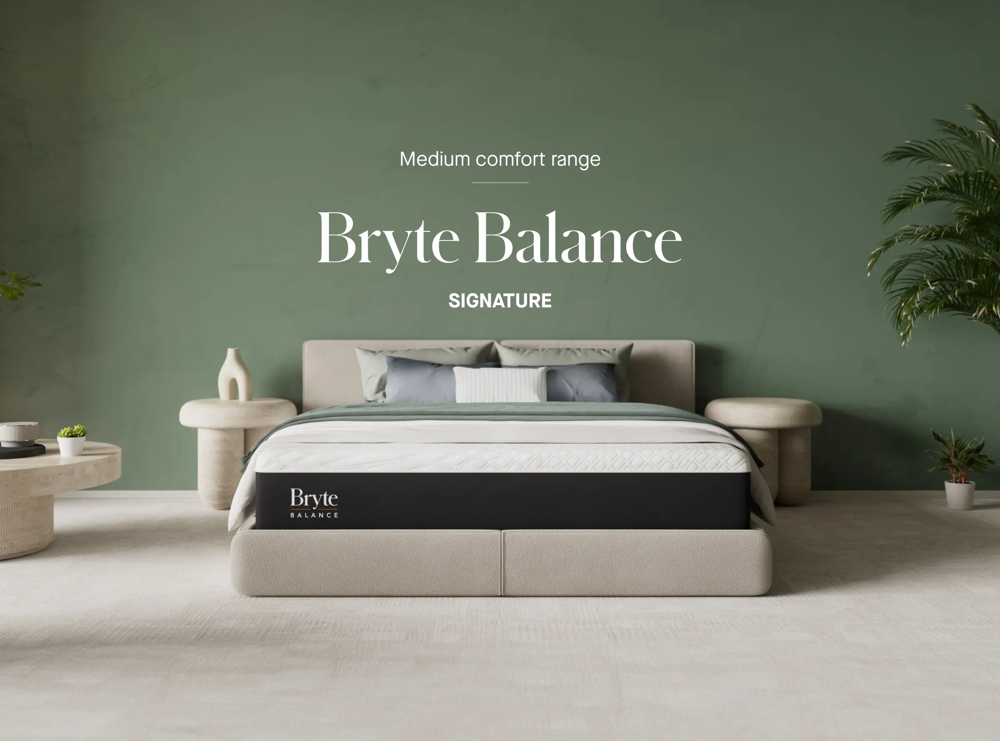
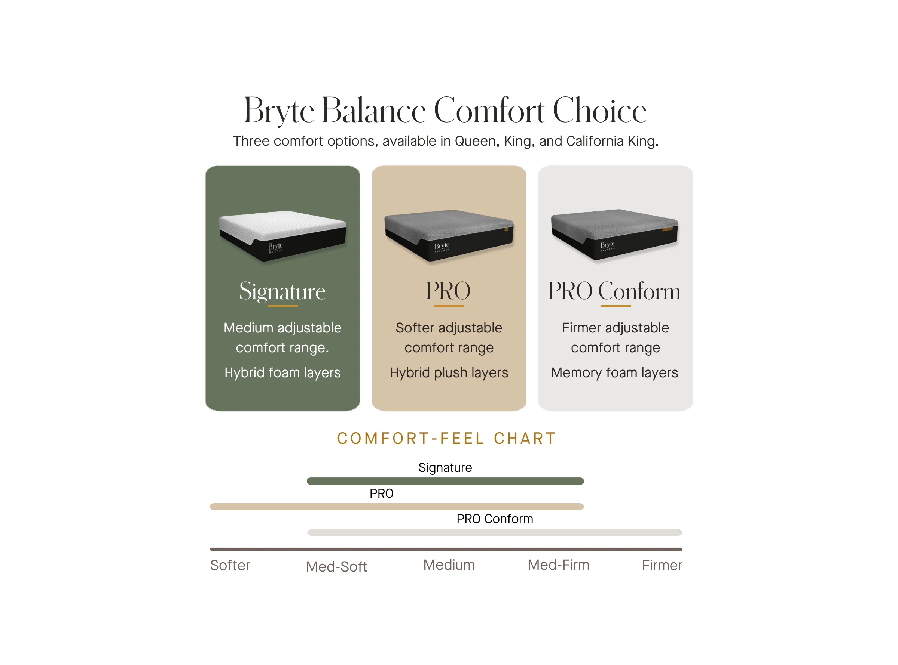
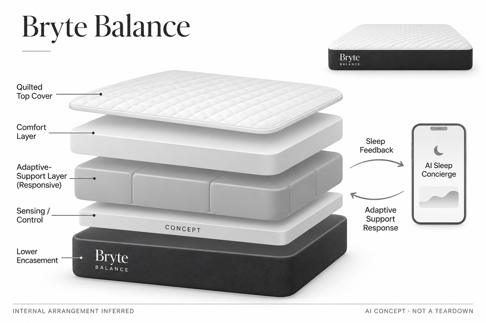

# Bryte Balance Smart Bed

**Bryte** · 睡眠与放松 · 核查 2026-11-04

围绕床面支撑与AI睡眠解释构建的家用智能床垫。

消费渠道：个人零售。

## 产品图片与结构参考

### 产品图

Bryte Balance Smart Bed官方产品图 · 来源：[Bryte](<https://www.bryte.com/shop-bryte>) · [原始图片](<https://cdn.prod.website-files.com/620c829f8cae7c794703e81a/6aa7969a47d62244c90b024c_signature-wide.webp>)

### 参考图

官方不同舒适层选项对照；本目录按Bryte Balance产品系列计一款 · 来源：[Bryte](<https://www.bryte.com/shop-bryte>) · [原始图片](<https://cdn.prod.website-files.com/620c829f8cae7c794703e81a/6ac8a6faa24b03c201d177fd_2.webp>)

### AI 生成爆炸示意

**AI 生成 · 非实物拆机。** 内部为概念推断，不能作为元件布局、BOM 或维修依据。[生成提示词](../../content/hardware/prompts/bryte-balance-smart-bed.txt)

> 分析为基于公开资料的案头研究与 AI 辅助判断，未经用户访谈、销量审计或实物拆机。需求、画像、竞争冷门度、审美及商业机会均为研究假设，不是投资结论。

## 销售与购买

- 状态：在售。官方Shop Bryte页面提供尺寸与可选底座，显示Add to cart和1–2周发货说明。不同尺寸、材料与底座套装合并为一条，不按组合凑数。

- 地区：美国官方消费购买渠道

- 价格：美国官网常规US$4,799起；核查时基础促销US$3,839.20。为所标地区和配置的核查参考；活动、税费、物流及可选服务以实际结算为准，不进行汇率换算或保证最低价。

- 中国大陆：本轮核查海外官方消费渠道，未验证中国大陆结算、型号、保修与全部AI服务可用性；不因品牌来源或支持中文推定国内可购。

- [官方产品 / 商店](<https://www.bryte.com/shop-bryte>)

## AI 的实际作用

官方描述实时自适应支撑及AI Sleep Concierge应用体验。其舒适或健康效果属于厂商声明，本目录未独立验证。

服务与联网依赖：完整体验依赖床垫硬件、App、账户和服务支持；可选底座并非所有配置标配，不将所有历史Pro版本功能混入当前基础选项。

## 是否冷门

细分专业（研究判断）：高价自适应床垫是家庭消费中的细分场景，但有传统高端床品和多类智能寝具竞争。

## 需求与市场

需求假设：希望减少手动调节、关注床面支撑和伴侣差异的家庭，可能愿意选择可适应的床垫。购买理由仍应以长期舒适和维护为核心，而不是把AI解释或睡眠评分直接等同于良好体验。

### 需求假设：床面支撑随姿态变化而少手动调整 · 研究判断

Bryte Balance针对希望床面适应身体位置、减少反复寻找合适支撑的人，双人还可能有不同软硬偏好。需求首先是躺卧体验而非睡眠数据，研究应询问目前床垫具体哪里不合意，不能把AI解释或支撑变化次数直接等同舒适和休息质量。

依据：[Bryte 官方消费购买页](<https://www.bryte.com/shop-bryte>) · [Bryte 官方产品说明](<https://www.bryte.com/>)

### 价值判断：两个人的偏好不能压成一个评分 · 研究判断

双人分区设置为不同偏好提供调整入口，但伴侣对触感、声音与变化的接受度可能不同。研究需要分别记录双方感受和设置冲突，不能用一人满意代替整床体验，也不将自动调节视为所有夜晚都优于手动或传统床垫。

依据：[Bryte 官方产品说明](<https://www.bryte.com/>)

### 验证方案：从长期躺卧与维护观察 · 待验证

让实际同住用户在符合使用条件下记录数周的设置、主动调整、打扰和停用原因，并与原有床垫体验对照。避免只进行展厅短时试躺，也不以应用睡眠分数证明效果，访谈应围绕真实夜晚和双方不同感受展开。

依据：[Bryte 官方消费购买页](<https://www.bryte.com/shop-bryte>) · [Bryte 官方产品说明](<https://www.bryte.com/>)

## 用户画像

画像推断：有稳定卧室、较高预算且愿意接受联网寝具的个人或伴侣。搬家频率、对床垫触感的偏好和退换便利会影响接受度，不能把高收入或关注睡眠简单当作同一个消费画像。

### 画像假设：稳定卧室与明确支撑偏好的用户 · 研究判断

较匹配者有固定居住安排、愿意为床垫与持续服务投入，并能清楚描述当前软硬或双人偏好问题。高收入或关注睡眠并不足以定义需求，搬家、身体触感敏感度和退换便利都会影响选择，不能把所有睡眠困扰者归为同一市场。

依据：[Bryte 官方消费购买页](<https://www.bryte.com/shop-bryte>) · [Bryte 官方产品说明](<https://www.bryte.com/>)

### 使用约束：寝具变化要被共同生活者接受 · 研究判断

联网床垫进入日常卧室，另一位使用者可能不想管理账户或数据，也可能只关心传统触感。研究应了解谁设置、谁维护和谁决定退换，不能仅访谈购买者，自动化是否低打扰需要双方长期反馈，而不是单次智能功能演示。

依据：[Bryte 官方产品说明](<https://www.bryte.com/>)

### 访谈重点：用户真正想改变什么 · 待验证

请用户回忆最近一次手动调整床品、床垫或睡姿的原因，区分支撑、冷热、噪声和生活习惯，再判断Balance对应哪项问题。不能把所有不满意都归结为需要动态支撑，也不将应用提供的解释当作用户已经认同的实际原因。

依据：[Bryte 官方产品说明](<https://www.bryte.com/>)

## 竞争与替代

竞争判断：它面对传统高端床垫、可调支撑系统和温控寝具等替代。自适应与AI应用增加了维度，也增加维护复杂性；消费者究竟为舒适、解释还是服务付费需要真实研究。

### 替代方案：传统高端床垫与手动调整 · 研究判断

Balance与传统床垫、不同软硬组合和可调支撑寝具竞争，床面温控则解决另一类问题。比较应固定用户最在意的支撑任务，不能把温度、AI聊天和动态软硬混为同一功能，也不以技术更多推断整体躺卧更好。

依据：[Bryte 官方消费购买页](<https://www.bryte.com/shop-bryte>) · [Bryte 官方产品说明](<https://www.bryte.com/>)

### 差异判断：自适应支撑与AI解释分别验证 · 研究判断

官方空气支撑单元承担床面调整，AI应用提供设置和解释，它们可能分别产生价值，也可能只有一项被使用。研究应观察用户是否仍频繁手动干预，以及解释是否帮助理解，不能用应用活跃度证明床体舒适，也不把调节频繁当作更有效。

依据：[Bryte 官方产品说明](<https://www.bryte.com/>)

### 比较方法：把试睡和退出成本纳入 · 待验证

比较应覆盖完整夜间使用、日常清洁、设置与退换条件，而不是只让用户躺几分钟选择更喜欢哪张床。不同配置和底座需要明确，不能用高级版本体验替代基础Balance，也不把厂商试睡口号当作所有地区和配件都适用的统一条款。

依据：[Bryte 官方消费购买页](<https://www.bryte.com/shop-bryte>) · [Bryte 官方产品说明](<https://www.bryte.com/>)

## 供应链

公开资料展示床垫结构和自适应功能，完整传感器、驱动与供应商信息未核实。分析重点是材料耐久、支撑执行、噪声、清洁、配送和售后，不能由宣传剖面图估算确定的单机BOM。

### 已披露结构：空气支撑与双人设置 · 官方资料

本轮官网再次确认Balance采用空气支撑单元并提供双人分区软硬设置，应用承接智能交互；这比普通床垫增加感知和控制链路。具体压力器件、阀泵、电路与工厂仍未披露，不能把宣传剖面当作拆机，也不自行补写模块数量以外的真实布局。

依据：[Bryte 官方产品说明](<https://www.bryte.com/>)

### 制造判断：柔性材料与调节机构共同影响体验 · 研究判断

床面长期承载、支撑变化、连接与清洁需要共同设计，声音和维修入口也会影响卧室接受度。供应评估不能只估算电子成本，本轮没有材料耐久、密封寿命或单机维修记录，不能因外观仍像传统床垫就推断维护同样简单。

依据：[Bryte 官方消费购买页](<https://www.bryte.com/shop-bryte>) · [Bryte 官方产品说明](<https://www.bryte.com/>)

### 候选选型：压力输入与连接服务分层 · 研究判断

MEMSensing公开压力传感方向，可用于讨论支撑控制输入；Tuya可作为联网控制与应用工程候选，具体数据和隐私架构需重新评估。两者都不是已披露供应商，公开能力不能证明适配Balance的空气结构，也不替代床垫材料与舒适性验证。

依据：[Bryte 官方产品说明](<https://www.bryte.com/>)

## 技术路径

技术需拆成感知、状态判断、支撑调节与App解释，不能把显示在手机里的AI结论等同于床体直接测得事实。厂商自适应描述有具体条件，本轮没有体验对比或算法准确率测量。

### 已披露能力：感知、支撑与应用解释 · 官方资料

官方描述实时感知并调整支撑，双人可设置各自偏好，AI应用承担交互和日常洞察。需要区分床体输入、控制决策和手机解释，不能将应用结论等同直接测量，也不把厂商关于疼痛和睡眠改善的宣传作为本目录独立验证的结果。

依据：[Bryte 官方产品说明](<https://www.bryte.com/>)

### 技术判断：调整应符合偏好而非只求更主动 · 研究判断

支撑控制即使按算法运行，也可能与用户习惯不同，设备需要让人理解和改变目标。研究应观察自动与手动之间如何切换，以及双人设置是否产生冲突，不能把调整次数当作智能程度，更不能从压力输入推断完整身体状态。

依据：[Bryte 官方产品说明](<https://www.bryte.com/>)

### 验证方案：记录设置、变化与主观反馈 · 待验证

在实际卧室中记录用户设定、主动修改和感知到的床面变化，再分别询问双方是否觉得有帮助或受到打扰。应用报告可作为对照线索，但不作为唯一效果指标，本轮没有算法准确率、临床结果或长期舒适度实测，不推导疾病改善。

依据：[Bryte 官方消费购买页](<https://www.bryte.com/shop-bryte>) · [Bryte 官方产品说明](<https://www.bryte.com/>)

## 产品审美

设计观察：外观保持常见床垫形态，降低卧室中的科技突兀感；真正的设计取舍在于支撑变化是否安静自然，以及维护是否便利。静态照片无法判断长期躺卧舒适、边缘支撑或双人干扰。

### 外形判断：传统床垫轮廓弱化科技存在 · 研究判断

Balance保持常见床垫形态，智能部分不必明显暴露，这可能降低卧室视觉突兀，但真正体验来自躺卧和夜间变化。外观照片无法说明边缘支撑、噪声或伴侣干扰，也不能从看不见机械部分推断维护入口和连接没有额外要求。

依据：[Bryte 官方消费购买页](<https://www.bryte.com/shop-bryte>) · [Bryte 官方产品说明](<https://www.bryte.com/>)

### 交互判断：睡前不应变成复杂设置任务 · 研究判断

床垫的智能交互如果需要频繁查看手机或理解很多分数，可能与用户希望放松的任务相冲突。研究应观察常用设置是否容易保持、自动变化是否可解释，而不是把AI聊天和报告丰富当作优点，减少操作与保留控制感需要同时考虑。

依据：[Bryte 官方产品说明](<https://www.bryte.com/>)

### 体验验证：从换床到日常整理完整观察 · 待验证

让用户按实际尺寸和底座配置完成布置、床品更换、清洁与设置，记录哪些环节需要协助，夜间再评价声音与变化。不要只依据展示床和整洁卧室照片判断设计，运输、门口通行和长期维护同样属于消费寝具的真实体验。

依据：[Bryte 官方消费购买页](<https://www.bryte.com/shop-bryte>)

## 关键风险

主要风险是大件退换成本、个人偏好差异、连接与服务延续。医疗或疼痛改善表述需独立证据，不应由商品宣传推导；同时要把可选底座和当前型号功能与历史版本分开。

### 效果边界：舒适与医学效果不能混写 · 研究判断

用户感觉更舒适可以作为个人体验记录，但不能从床体支撑或AI报告推导疼痛治疗、睡眠疾病改善或医学诊断。官网积极描述需要独立研究背景才能评价，本轮只核查产品机制，没有开展临床复核或实机试睡，不提供疗效保证。

依据：[Bryte 官方产品说明](<https://www.bryte.com/>)

### 拥有风险：配置和大件退出条件要核对 · 研究判断

尺寸、可选底座、当前Balance和其他Pro配置需要区分，退换和保修也可能有不同适用范围。联网、应用和长期服务使床垫多出维护条件，不能把某地促销承诺推广到所有用户，也不能仅按硬件价格评估完整拥有成本。

依据：[Bryte 官方消费购买页](<https://www.bryte.com/shop-bryte>) · [Bryte 官方产品说明](<https://www.bryte.com/>)

### 验证安排：纳入不适应和停用的用户 · 待验证

研究应记录不喜欢支撑变化、关闭自动功能、减少查看报告或选择退换的人，询问具体原因并区分触感与服务问题。不要只观察满意使用者，也不把不适应归因给用户设置错误，长期偏好差异正是这类产品必须面对的边界。

依据：[Bryte 官方消费购买页](<https://www.bryte.com/shop-bryte>) · [Bryte 官方产品说明](<https://www.bryte.com/>)

## 机会与验证

可验证的市场差异是自适应支撑能否带来长期、低打扰的体验。后续应观察试睡、退换和维护原因，并与传统床垫比较完整成本，本轮不提供统一收益、疗效或商业成功判断。

### 研究方向：低打扰地适应个人支撑偏好 · 研究判断

Balance对应的机会是让支撑调整在长期使用中保持可理解、可控且不增加负担，未必需要更多睡眠分数。应先验证自动变化是否解决明确的软硬与双人偏好问题，再讨论应用解释和服务，避免用AI概念替代床垫最基础的体验。

依据：[Bryte 官方产品说明](<https://www.bryte.com/>)

### 执行计划：跟踪双方设置与维护行为 · 待验证

连续观察实际卧室中的设置变化、关闭自动、清洁和服务联系，访谈时让双方分别回忆一晚具体体验。将支撑、噪声、报告和售后分开分析，不以厂商累计夜数或用户星级代表留存，也不将个人舒适描述外推为普遍医学收益。

依据：[Bryte 官方消费购买页](<https://www.bryte.com/shop-bryte>) · [Bryte 官方产品说明](<https://www.bryte.com/>)

### 决策边界：技术寝具需要完整持有证据 · 研究判断

自适应支撑与连接服务增加差异，也增加交付和维护复杂度，供应商候选不能证明用户愿意长期付费。当前没有访谈、销量、材料寿命或报价，不以高级版本功能、品牌评价或模型评分预测创业成功，需求必须回到具体卧室与使用者。

依据：[Bryte 官方消费购买页](<https://www.bryte.com/shop-bryte>) · [Bryte 官方产品说明](<https://www.bryte.com/>)

## 对应供应链公司

能力候选用于选型研究，不代表本产品实际采用；未公开的供货关系不作推断。

- [memsensing](../supply-chain/memsensing.md) — **能力候选 · 非已采用** / 空气支撑控制的压力感知方向候选：MEMSensing公开压力传感产品方向，与Balance空气支撑的感知控制存在工程对应，但原机传感器位置、量程和封装未披露，必须另取具体压力料号资料，不能套用已核麦克风规格。此关联只是能力候选，没有Bryte实际采用证据。

- [tuya](../supply-chain/tuya.md) — **能力候选 · 非已采用** / 联网床面控制与应用服务工程候选：Tuya公开AIoT连接和应用开发平台，可作为Balance这类联网支撑设备的软件工程候选，但需专项确认控制延迟、离线行为、账户与睡眠数据隐私，不能替代Bryte已有算法或舒适性验证。当前没有点名合作或供货证据。

[浏览供应链目录](../supply-chain.md)

## 功能分层示意

这是功能关系，不是实物拆机、真实空间结构或已核实 BOM。

1. **床面与舒适层**：官方外观和家用床垫形态。（官方披露）

2. **感知与反馈**：厂商描述用于自适应支撑的感知功能。（官方披露）

3. **支撑执行**：动态支撑模块属于功能层，精确布局未验证。（分析推断）

4. **AI应用体验**：官方列出AI Sleep Concierge与App体验。（官方披露）

5. **外壳与连接**：供电、结构和可选底座需按具体配置核对。（分析推断）

## 来源

1. [Bryte 官方消费购买页](<https://www.bryte.com/shop-bryte>) — 尺寸、可选底座、加购与交期说明。

2. [Bryte 官方产品说明](<https://www.bryte.com/>) — 实时支撑与AI应用声明，未作为独立效果证明。

[返回目录](../hardware-market.md) · [网页分析](https://romanagent.github.io/Roman/#hardware/product/bryte-balance-smart-bed)
