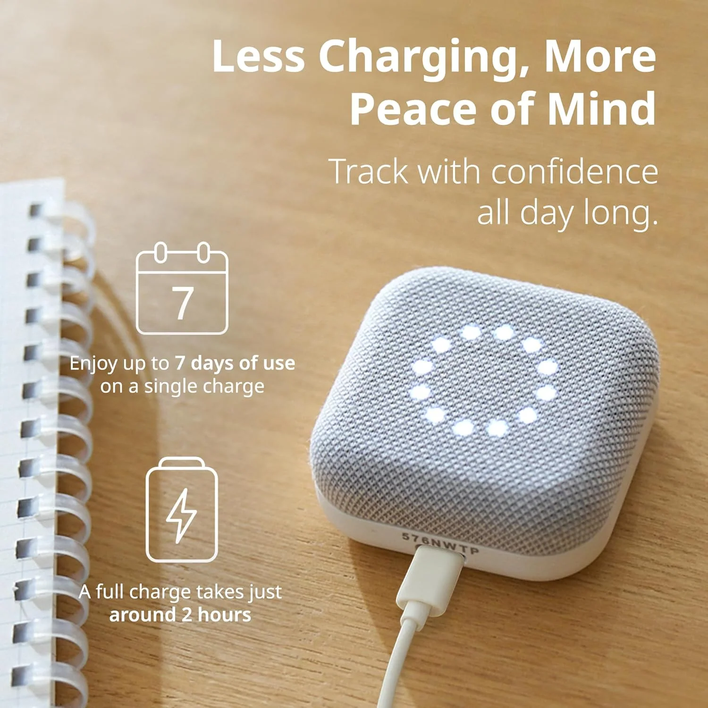
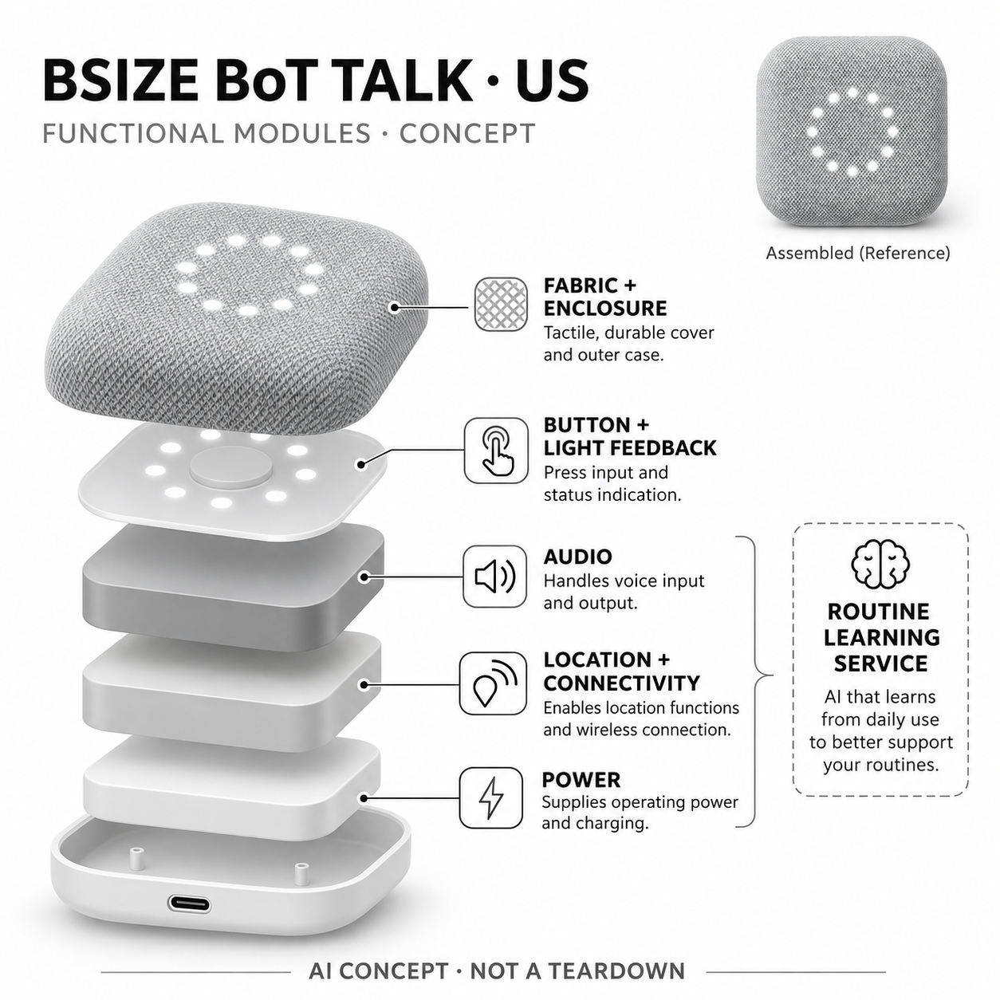

# Bsize BoT Talk（美国版）

**Bsize / BoT US** · 健康与穿戴 · 核查 2026-11-05

学习儿童常去地点并将偏离提醒与无屏语音留言结合

消费渠道：个人零售。

## 产品图片与结构参考

### 产品图

官方美国无屏版正面 · 来源：[Bsize / BoT US · 官方图片](<https://us.shop.bot.app/products/bot-talk>) · [原始图片](<https://us.shop.bot.app/cdn/shop/files/BoT_Talk_Shopify_Product_Image_Top_NoShadow2.png?v=1763623240&width=1646>)

### 参考图

官方美国版充电侧面参考（含厂商说明） · 来源：[Bsize / BoT US · 官方图片](<https://us.shop.bot.app/products/bot-talk>) · [原始图片](<https://us.shop.bot.app/cdn/shop/files/BoT_Talk_Shopify_Product_Image_Charge.jpg?v=1776631351&width=1646>)

### AI 生成爆炸示意

**AI 生成 · 非实物拆机。** 内部为概念推断，不能作为元件布局、BOM 或维修依据。[生成提示词](../../content/hardware/prompts/bsize-bot-talk-us.txt)

> 依据已核验官方外形与公开功能生成；未知内部仅为概念功能块，不代表原机电路板、芯片或实际布局。

> 已核对对应型号与地区版本，原图未改色或语义编辑；促销与效果文案为官方图内容，不构成独立验证。

> 分析为基于公开资料的案头研究与 AI 辅助判断，未经用户访谈、销量审计或实物拆机。需求、画像、竞争冷门度、审美及商业机会均为研究假设，不是投资结论。

## 销售与购买

- 状态：在售。2026-11-05实际浏览美国官方商店，当前US$44.99、Add to cart可用；为无屏布面美国版，不用日本第五代带显示屏照片或规格替代。

- 地区：美国（本条地区版本）

- 价格：美国官方 US$44.99。GPS月费US$4.99或GPS＋Talk月费US$6.99另计，保护套另购。官方说明取消会永久停用设备，不按可随意暂停恢复理解；日本版本价格和显示屏能力不混入。

- 中国大陆：官方明确美版仅美国服务，日本版也只在日本工作，不能跨地区激活使用；未有大陆版本。中国大陆监护人能否从境外查看与设备可在大陆工作是不同问题。

- [官方产品 / 商店](<https://us.shop.bot.app/products/bot-talk>)

## AI 的实际作用

官方Monitoring AI学习常去地点及日常活动范围，在到达、离开或偏离常规时提示监护人；定位组合与运动输入辅助记录，不是生成式聊天机器人。

服务与联网依赖：依赖设备在美国受支持蜂窝网络内、持续订阅、电量与监护人应用；语音为留言非实时电话，位置有间隔与误差，AI不保证安全或即时救援。

## 是否冷门

细分专业（研究判断）：儿童定位大类成熟，无屏蜂窝语音与日常模式学习提供具体交互取舍；地区订阅、一次激活和实际携带行为限制适用范围。

## 需求与市场

需求假设：家庭希望孩子在短途独立活动时能够联系并留下位置线索，又不希望过早引入完整手机。模式学习可能减少反复查看地图，但应以沟通与共同约定验证，不能把自动通知理解成能防止所有走失或突发事件。

### 产品任务与边界 · 研究判断

需求假设：家庭希望孩子在短途独立活动时能够联系并留下位置线索，又不希望过早引入完整手机。模式学习可能减少反复查看地图，但应以沟通与共同约定验证，不能把自动通知理解成能防止所有走失或突发事件。

依据：[BoT Talk美国官方当前商店](<https://us.shop.bot.app/products/bot-talk>) · [BoT美国官方AI与产品说明](<https://www.bot.app/us>)

### 需求判断 · 研究判断

判断：设备解决的是家人已约定的独立活动中的联系与位置线索，不是代替陪同或安全教育。日常范围学习可能让家长少看几次地图，但如果孩子只是临时改变路线，系统也不能自行理解原因，仍需要沟通和情境判断。

依据：[BoT Talk美国官方当前商店](<https://us.shop.bot.app/products/bot-talk>) · [BoT美国官方AI与产品说明](<https://www.bot.app/us>)

### 需求验证 · 待验证

验证：以家庭正常出行流程记录孩子携带、家长查看和留言回复的实际步骤，比较引入设备前后是否减少打扰。使用安全的计划内路线变化观察提醒，不把任何测试设计成真实危险；成功发来位置不等于产品能够防止意外。

依据：[BoT Talk美国官方当前商店](<https://us.shop.bot.app/products/bot-talk>) · [BoT美国官方AI与产品说明](<https://www.bot.app/us>)

## 用户画像

画像推断：孩子愿意携带并理解按钮、监护人能够维护订阅与响应留言的家庭较匹配。不同学校规则和独立出行方式会改变适配，不能仅按年龄决定；设备应服务家庭沟通而非不告知孩子的隐蔽持续跟踪。

### 适用行为与条件 · 研究判断

画像推断：孩子愿意携带并理解按钮、监护人能够维护订阅与响应留言的家庭较匹配。不同学校规则和独立出行方式会改变适配，不能仅按年龄决定；设备应服务家庭沟通而非不告知孩子的隐蔽持续跟踪。

依据：[BoT Talk美国官方当前商店](<https://us.shop.bot.app/products/bot-talk>) · [BoT美国官方AI与产品说明](<https://www.bot.app/us>)

### 人群取舍 · 研究判断

判断：能够理解按键、愿意携带和知道何时联系家人的孩子更容易使用，无屏设计也适合不想处理完整手机的家庭。学校规则、书包习惯和家长响应能力可能比年龄更关键，不能把设备作为不告知持有者的隐蔽监控工具。

依据：[BoT Talk美国官方当前商店](<https://us.shop.bot.app/products/bot-talk>) · [BoT美国官方AI与产品说明](<https://www.bot.app/us>)

### 画像验证 · 待验证

验证：分别向孩子和监护人解释会记录什么以及哪些家人可以查看，再观察他们能否独立完成录音和收听。测试放在书包不同位置的可操作性，并了解家长对提醒不及时、位置不准确时的处理预期，建立行为画像而非年龄标签。

依据：[BoT Talk美国官方当前商店](<https://us.shop.bot.app/products/bot-talk>) · [BoT美国官方AI与产品说明](<https://www.bot.app/us>)

## 竞争与替代

竞争判断：与儿童手表、手机、蓝牙物品标签及简单GPS终端竞争，差异是独立蜂窝无屏沟通和日常范围学习。日本带屏代次与美国无屏版不作为两种新需求重复计数，应比较孩子愿意携带、家长理解提醒和持续费用。

### 比较对象与差异 · 研究判断

竞争判断：与儿童手表、手机、蓝牙物品标签及简单GPS终端竞争，差异是独立蜂窝无屏沟通和日常范围学习。日本带屏代次与美国无屏版不作为两种新需求重复计数，应比较孩子愿意携带、家长理解提醒和持续费用。

依据：[BoT Talk美国官方当前商店](<https://us.shop.bot.app/products/bot-talk>) · [BoT美国官方AI与产品说明](<https://www.bot.app/us>)

### 竞争判断 · 研究判断

判断：蓝牙标签依赖附近设备网络且主要用于物品，儿童手表能提供更多交互但也增加屏幕与操作，BoT选择独立蜂窝与单按钮。AI学习的增量需要来自更有用的变化提醒，不能只把一般定位、语音传输都包装成AI能力。

依据：[BoT Talk美国官方当前商店](<https://us.shop.bot.app/products/bot-talk>) · [BoT美国官方AI与产品说明](<https://www.bot.app/us>)

### 竞争验证 · 待验证

验证：在同一个家庭的既定路线中比较手机联系、已有手表和BoT的查看频率、沟通成功及维护成本。日美不同硬件代次仍服务同一核心任务，不重复计数；比较中必须说明月费、地区绑定和取消后不能重新使用的限制。

依据：[BoT Talk美国官方当前商店](<https://us.shop.bot.app/products/bot-talk>) · [BoT美国官方AI与产品说明](<https://www.bot.app/us>)

## 供应链

供应链分析：布面结构、按键灯光、音频、定位运动与蜂窝通信、电池充电构成小设备，整机具体工厂和BOM未披露。官方称日本制造不等于所有器件均来自日本，订阅服务和地区运营也是实际交付链的一部分。

### 功能模块拆分 · 研究判断

模块拆分：布面机身和灯光按键提供低步骤交互，定位与运动输入形成位置线索，音频单元承载留言，电源及蜂窝连接支持回传。日常模式学习属于服务路径，内部主控、天线和电池只画概念块，不虚构摄像头或监听功能。

依据：[BoT Talk美国官方当前商店](<https://us.shop.bot.app/products/bot-talk>) · [BoT美国官方AI与产品说明](<https://www.bot.app/us>)

### 制造与供应约束 · 研究判断

供应链分析：布面结构、按键灯光、音频、定位运动与蜂窝通信、电池充电构成小设备，整机具体工厂和BOM未披露。官方称日本制造不等于所有器件均来自日本，订阅服务和地区运营也是实际交付链的一部分。

依据：[BoT Talk美国官方当前商店](<https://us.shop.bot.app/products/bot-talk>) · [BoT美国官方AI与产品说明](<https://www.bot.app/us>)

### 候选与证据缺口 · 研究判断

候选判断：环旭的无线与消费电子系统能力可匹配蜂窝定位终端的连接需求，歌尔的声学能力可匹配小机身留言体验。两家公司未被公开证实参与BoT该美版生产，地区运营、数据服务和长期维护也不能由硬件候选关系推定。

依据：[BoT Talk美国官方当前商店](<https://us.shop.bot.app/products/bot-talk>) · [BoT美国官方AI与产品说明](<https://www.bot.app/us>)

## 技术路径

技术判断：官方AI学习常去地点与规律，位置来自多种信号并有更新间隔，运动状态还会影响更新。它不能证明孩子在楼内的具体楼层或解释每次偏离原因，语音留言也不是即时通话，模型与定位误差须分开理解。

### 已披露技术边界 · 研究判断

技术判断：官方AI学习常去地点与规律，位置来自多种信号并有更新间隔，运动状态还会影响更新。它不能证明孩子在楼内的具体楼层或解释每次偏离原因，语音留言也不是即时通话，模型与定位误差须分开理解。

依据：[BoT Talk美国官方当前商店](<https://us.shop.bot.app/products/bot-talk>) · [BoT美国官方AI与产品说明](<https://www.bot.app/us>)

### 系统难点判断 · 研究判断

判断：常去地点与活动范围来自历史数据学习，而当前定位仍受卫星、无线信号和更新策略限制。用户可能把旧位置、静止省电或延迟留言误读为实时状态，因此AI提醒需要同时表达时间与不确定性，不能只显示一个确定的地图点。

依据：[BoT Talk美国官方当前商店](<https://us.shop.bot.app/products/bot-talk>) · [BoT美国官方AI与产品说明](<https://www.bot.app/us>)

### 技术验证 · 待验证

验证：在正常、室内弱信号和静止情况下检查更新时间及提醒差异，再用安全的计划变动观察学习如何调整。确认语音消息发送与收听状态是否容易理解，不把短时间测试当成定位精度保证，更不能承诺房间或楼层级识别。

依据：[BoT Talk美国官方当前商店](<https://us.shop.bot.app/products/bot-talk>) · [BoT美国官方AI与产品说明](<https://www.bot.app/us>)

## 产品审美

审美判断：布面圆角方块和隐约灯环减少屏幕诱惑，单按钮降低操作数量，但也要求清楚表达收听、录音和连接状态。放入书包可能影响触达与音量，造型友好不代表孩子能在紧张或嘈杂环境下正确使用。

### 外观与交互语言 · 研究判断

审美判断：布面圆角方块和隐约灯环减少屏幕诱惑，单按钮降低操作数量，但也要求清楚表达收听、录音和连接状态。放入书包可能影响触达与音量，造型友好不代表孩子能在紧张或嘈杂环境下正确使用。

依据：[BoT Talk美国官方当前商店](<https://us.shop.bot.app/products/bot-talk>) · [BoT美国官方AI与产品说明](<https://www.bot.app/us>)

### 使用中审美判断 · 研究判断

判断：布面柔和外观降低了电子设备的视觉复杂度，单按钮却可能承载多个时长和状态动作。灯环是否能被理解、放在包内是否听得到留言，以及携带配件是否牢固，都比照片中的简洁更直接影响孩子愿不愿意持续使用。

依据：[BoT Talk美国官方当前商店](<https://us.shop.bot.app/products/bot-talk>) · [BoT美国官方AI与产品说明](<https://www.bot.app/us>)

### 设计验证 · 待验证

验证：让首次使用的孩子在安静和普通环境声下尝试录音与收听，记录错误而非只看完成结果。观察充电、装包和清洁是否需要持续成人协助；对灯光和声音状态进行理解测试，不能因为没有屏幕就假定完全没有学习成本。

依据：[BoT Talk美国官方当前商店](<https://us.shop.bot.app/products/bot-talk>) · [BoT美国官方AI与产品说明](<https://www.bot.app/us>)

## 关键风险

风险判断：遗忘携带、低电量、室内弱信号和常规变化会使位置或提醒不完整，过度依赖可能产生虚假安心。官方地区和一次激活限制影响二手转让与取消，家庭还需谨慎管理位置权限，不能把不显示视频当作没有隐私风险。

### 主要失效与依赖 · 研究判断

风险判断：遗忘携带、低电量、室内弱信号和常规变化会使位置或提醒不完整，过度依赖可能产生虚假安心。官方地区和一次激活限制影响二手转让与取消，家庭还需谨慎管理位置权限，不能把不显示视频当作没有隐私风险。

依据：[BoT Talk美国官方当前商店](<https://us.shop.bot.app/products/bot-talk>) · [BoT美国官方AI与产品说明](<https://www.bot.app/us>)

### 风险传播判断 · 研究判断

判断：家人如果把没有偏离提醒当作一切正常，可能忽略遗忘携带、掉电或无信号等原因。位置和规律本身也属于敏感家庭信息，共享权限需要明确；美国版的国家限制和永久取消政策又使跨境使用与二手转让产生额外约束。

依据：[BoT Talk美国官方当前商店](<https://us.shop.bot.app/products/bot-talk>) · [BoT美国官方AI与产品说明](<https://www.bot.app/us>)

### 风险验证 · 待验证

验证：模拟低电量、网络暂不可用与通知权限关闭，确认用户能够识别缺数据而非误以为孩子静止不动。审阅家庭成员权限撤销和订阅变更步骤，遵循持有者知情；本研究未激活设备、建立账户或对任何人进行实际位置追踪。

依据：[BoT Talk美国官方当前商店](<https://us.shop.bot.app/products/bot-talk>) · [BoT美国官方AI与产品说明](<https://www.bot.app/us>)

## 机会与验证

机会假设：可从家庭已有独立通勤中的约定与留言流程验证，关注是否减少双方打扰并保留自主性。若学习提醒频繁误报，用户可能退回手动查看；持续机会取决于清晰解释、可靠服务与孩子接受，而非单纯追求更多追踪功能。

### 可能的机会入口 · 研究判断

机会假设：可从家庭已有独立通勤中的约定与留言流程验证，关注是否减少双方打扰并保留自主性。若学习提醒频繁误报，用户可能退回手动查看；持续机会取决于清晰解释、可靠服务与孩子接受，而非单纯追求更多追踪功能。

依据：[BoT Talk美国官方当前商店](<https://us.shop.bot.app/products/bot-talk>) · [BoT美国官方AI与产品说明](<https://www.bot.app/us>)

### 机会成立条件 · 研究判断

判断：较好的机会入口是协助家庭从被动反复查地图转向有约定的简短沟通，并保留孩子逐步独立的空间。若学习提醒持续误报或无法解释，用户可能忽略全部通知，产品需要提高可理解性而非无限增加监控功能。

依据：[BoT Talk美国官方当前商店](<https://us.shop.bot.app/products/bot-talk>) · [BoT美国官方AI与产品说明](<https://www.bot.app/us>)

### 下一步验证 · 待验证

验证：持续观察家庭是否减少不必要的检查、是否按约定响应以及孩子是否愿意继续携带，分别评估无屏留言和模式学习的贡献。将订阅、取消限制和维护纳入净价值，不用家长焦虑或儿童人口总量直接推算潜在购买规模。

依据：[BoT Talk美国官方当前商店](<https://us.shop.bot.app/products/bot-talk>) · [BoT美国官方AI与产品说明](<https://www.bot.app/us>)

## 对应供应链公司

能力候选用于选型研究，不代表本产品实际采用；未公开的供货关系不作推断。

- [usi](../supply-chain/usi.md) — **能力候选 · 非已采用** / 小型蜂窝定位与无线系统：环旭公开无线模块与消费系统能力可对应BoT的蜂窝连接、定位通信与紧凑终端集成需求。没有该美国版的供货披露，不能视为实际制造伙伴；运营商服务、地区激活与位置学习平台须另行验证。

- [goertek](../supply-chain/goertek.md) — **能力候选 · 非已采用** / 小型双向语音留言声学：歌尔公开声学与智能硬件能力可作为布面小终端麦克风、扬声器和声音交互的候选评估。未确认BoT实际采购或合作，不能套用其器件能力推导整机音质；书包内声学及儿童操作仍需具体场景测试。

[浏览供应链目录](../supply-chain.md)

## 功能分层示意

这是功能关系，不是实物拆机、真实空间结构或已核实 BOM。

1. **布面外壳与按键**：圆角方形白灰机身、中心按压交互和灯光反馈。（官方披露）

2. **位置与运动输入**：卫星、无线辅助定位与运动信息。（官方披露）

3. **音频留言**：麦克风与扬声器供家庭语音留言。（官方披露）

4. **能源与蜂窝连接**：可充电电源、USB连接及内置移动通信。（官方披露）

5. **监护应用与学习**：外部服务识别常去地点、活动范围与偏离提醒。（官方披露）

## 来源

1. [BoT Talk美国官方当前商店](<https://us.shop.bot.app/products/bot-talk>) — 实际浏览器核实US$44.99可加购、两种月费与取消永久停用提示；图片为美国无屏版。

2. [BoT美国官方AI与产品说明](<https://www.bot.app/us>) — 实际打开Monitoring AI学习常去地点、日常范围与偏离提醒，语音为留言；不沿用页面旧价格片段。

3. [Bsize官方地区与设备转让说明](<https://support.bot.app/hc/en-us/articles/56063899670041-Can-I-Resell-BoT-Products-at-Online-Stores-e-g-Amazon-eBay-or-Mercari>) — 实际打开美日设备地区限制及一次激活、取消后不可转用，未宣称大陆可使用。

4. [BoT美国官方服务条款](<https://support.bot.app/hc/en-us/articles/13216167333273-BoT-Subscription-Service-Terms>) — 实际阅读家庭个人用途、监护与持有者知情及美国使用范围；不进行任何账户注册、定位或追踪。

[返回目录](../hardware-market.md) · [网页分析](https://romanagent.github.io/Roman/#hardware/product/bsize-bot-talk-us)
