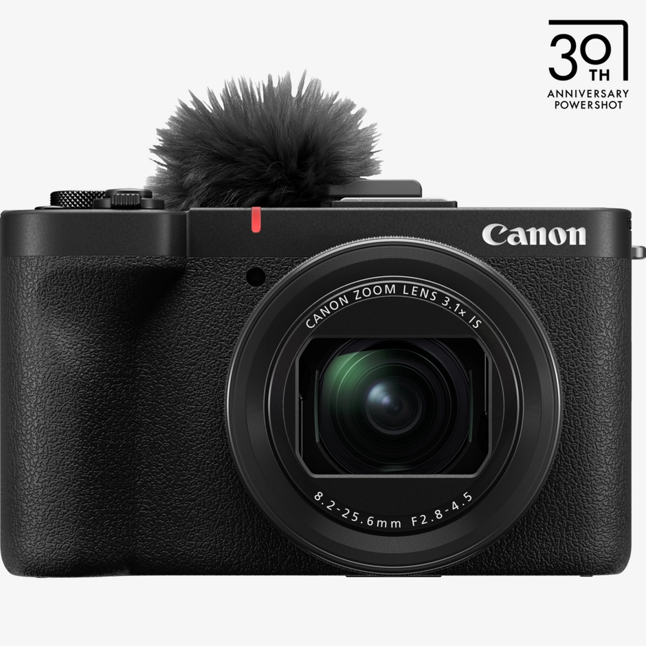
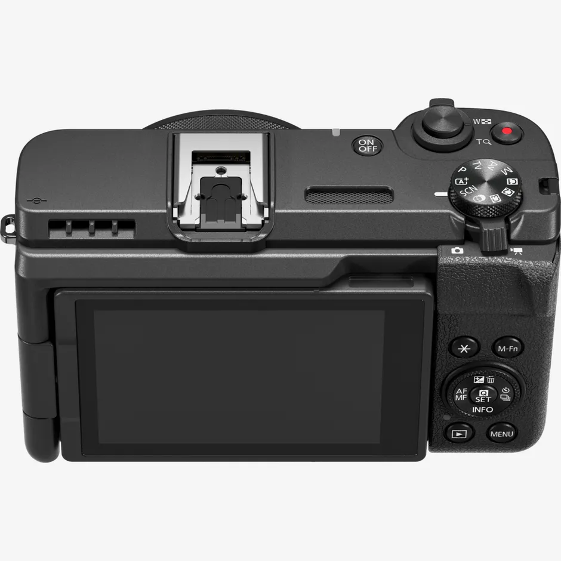
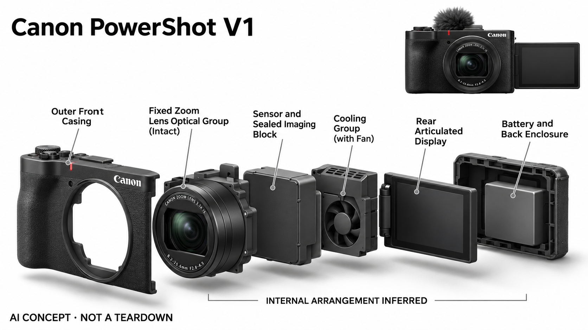

# Canon PowerShot V1

**Canon** · 影像与创作 · 核查 2026-11-04

固定镜头相机中的深度学习主体跟踪

消费渠道：个人零售。

## 产品图片与结构参考

### 产品图

Canon PowerShot V1 · 官方产品图 · 来源：[Canon · 官方图片](<https://www.canon.co.uk/store/canon-powershot-v1-camera-black/6390C001/>) · [原始图片](<https://i1.adis.ws/i/canon/6390C001_PowerShot-V1_01_AE_Logo?aspect=1%3A1&bg=rgb%28245%2C246%2C246%29&fmt=webp&qlt=100&sm=aspect&w=940>)

### 参考图

Canon PowerShot V1 · 官方参考图 · 来源：[Canon · 官方图片](<https://www.canon.co.uk/store/canon-powershot-v1-camera-black/6390C001/>) · [原始图片](<https://i1.adis.ws/i/canon/6390C001_PowerShot-V1_04?aspect=1%3A1&bg=rgb%28245%2C246%2C246%29&fmt=webp&qlt=80&sm=aspect&w=940>)

### AI 生成爆炸示意

**AI 生成 · 非实物拆机。** 内部为概念推断，不能作为元件布局、BOM 或维修依据。[生成提示词](../../content/hardware/prompts/canon-powershot-v1.txt)

> 分析为基于公开资料的案头研究与 AI 辅助判断，未经用户访谈、销量审计或实物拆机。需求、画像、竞争冷门度、审美及商业机会均为研究假设，不是投资结论。

## 销售与购买

- 状态：在售。英国官方商店明确In stock online与Add to Basket。美国页同时含库存及停售模板，未采用其冲突文字；以英国当前购买证据为准。

- 地区：英国官方商店

- 价格：英国官方 £859.99。核查日页面快照；运费、税费、会员和配送区域按官方结算确认，不视为中国到手价。

- 中国大陆：本轮核实所列区域官方商店；未确认中国大陆官方现货、账户及完整服务，不把境外可购等同大陆可用。

- [官方产品 / 商店](<https://www.canon.co.uk/store/canon-powershot-v1-camera-black/6390C001/>)

## AI 的实际作用

Dual Pixel CMOS AF II for PowerShot结合深度学习主体检测，对人和猫狗进行识别跟踪；不把普通光学防抖、变焦或所有自动曝光都统一称为AI。

服务与联网依赖：内置镜头与机内主体识别可独立拍摄；素材传输、直播连接和固件功能有系统要求，主体类型及场景限制以官方说明为准。

## 是否冷门

新兴竞争（研究判断）：面向个人旅行与讲解记录形成具体使用场景；本轮没有销量与市场份额证据。

## 需求与市场

需求假设：个人创作者希望比手机拥有更多拍摄控制，又不想管理多支镜头，主体识别可以减轻自拍对焦负担。应观察从取出相机到开始录制的时间，确认整机便利性真正超过现有手机。

## 用户画像

画像推断：以旅行、宠物和单人讲解为主，偏好一机一镜的人较匹配。内置广角变焦覆盖明确场景，也限制远摄和镜头升级，不能把无需换镜头的便利描述成对所有拍摄任务都更适合。

## 竞争与替代

竞争判断：固定镜头视频机、手机和入门可换镜头相机相互竞争，深度学习对焦已不是孤立能力。V1的差异是镜头、散热和视频操作集成，应比较整套准备成本而非只比较单项AI标签。

## 供应链

供应链推断：内置变焦镜头、传感器、翻转屏和散热风道形成紧凑整机，光学维修通常涉及较多部件。官方未披露具体工厂及完整物料成本，镜头损伤、风道清洁和地区保修需要关注。

## 技术路径

官方明确深度学习辅助识别人和猫狗，属于感知对焦而非生成影像。技术判断应测试主体转身、遮挡与背景干扰，不能把识别范围扩大为所有动物，也不将厂家宣传理解为零失焦保证。

## 产品审美

审美判断：厚实握柄、镜头环和翻转屏突出随身拍摄工具属性，防风毛罩会改变外观与收纳。内置镜头使整体比例稳定，但单手自拍、竖拍与包内收纳仍需要按个人习惯体验。

## 关键风险

风险判断：固定镜头的焦段限制和算法误识别会影响特定题材，长录制也需核对电源与环境条件。官方不同地区页面可能有模板差异，购买时应以所选地区实际库存和保修为准。

## 机会与验证

市场观察：可以让手机创作者进行相同的旅行或产品讲解任务，记录成功对焦、重拍和素材传输步骤。只有整体拍摄流程改善才可能支持换设备，不用画面参数或AI对焦名称推算需求规模。

## 功能分层示意

这是功能关系，不是实物拆机、真实空间结构或已核实 BOM。

1. **内置光学**：变焦镜头与传感器采集画面。（官方披露）

2. **主体检测**：深度学习识别人和猫狗目标。（官方披露）

3. **对焦执行**：机内自动对焦跟随被选主体。（官方披露）

4. **视频操作**：翻转屏、音频和散热支持录制。（官方披露）

## 来源

1. [PowerShot V1英国官方商店](<https://www.canon.co.uk/store/canon-powershot-v1-camera-black/6390C001/>) — 已实际打开官方页面；功能说明不等于独立性能测量。

2. [Canon官方深度学习功能说明](<https://hk.canon/en/consumer/powershot-v1-embargo/news>) — 已实际打开官方页面；功能说明不等于独立性能测量。

3. [Canon香港型号介绍](<https://hk.canon/en/consumer/powershot-v1/main/product>) — 已实际打开官方页面；功能说明不等于独立性能测量。

[返回目录](../hardware-market.md) · [网页分析](https://romanagent.github.io/Roman/#hardware/product/canon-powershot-v1)
