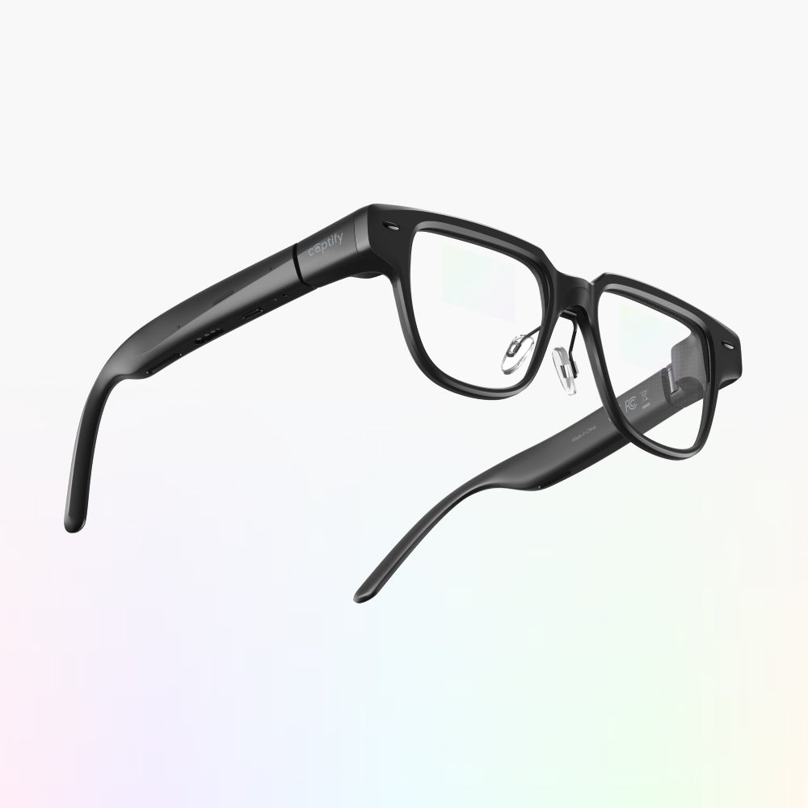
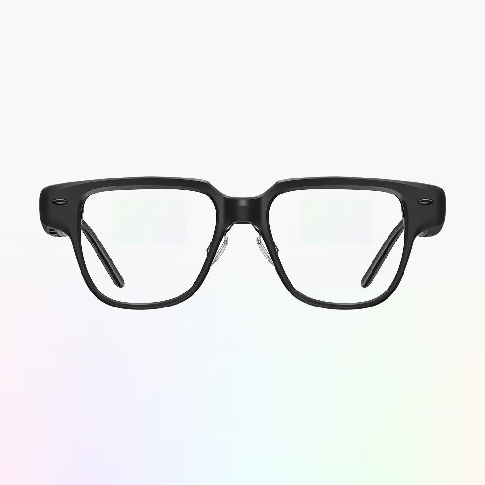
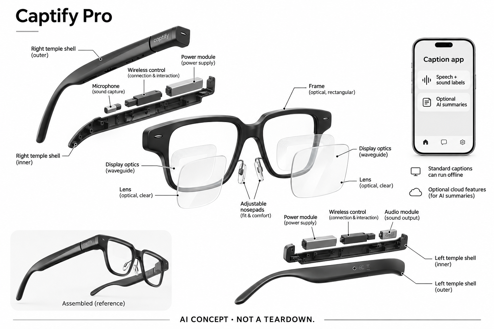

# Captify Pro

**Captify** · 无障碍与辅助沟通 · 核查 2026-11-05

把对话和非语音环境声音转成眼前可读信息

消费渠道：个人零售。

## 产品图片与结构参考

### 产品图

Captify Pro官方斜向产品图与可调鼻托 · 来源：[Captify · 官方产品图片](<https://captify.glass/products/captify-pro>) · [原始图片](<https://cdn.shopify.com/s/files/1/0722/1749/3736/files/captify_pro_product_1.jpg?v=1776238198&width=1200>)

### 参考图

Captify Pro官方佩戴场景参考 · 来源：[Captify · 官方产品图片](<https://captify.glass/products/captify-pro>) · [原始图片](<https://cdn.shopify.com/s/files/1/0722/1749/3736/files/captify_pro_model_1.jpg?v=1776238198&width=1200>)

### 参考图

Captify Pro官方正面双眼显示外形参考 · 来源：[Captify · 官方产品图片](<https://captify.glass/products/captify-pro>) · [原始图片](<https://cdn.shopify.com/s/files/1/0722/1749/3736/files/captify_pro_product_2.jpg?v=1776238198&width=1200>)

### AI 生成爆炸示意

**AI 生成 · 非实物拆机。** 内部为概念推断，不能作为元件布局、BOM 或维修依据。[生成提示词](../../content/hardware/prompts/captify-pro.txt)

> 已检查外形、标签与灰阶；分离模块是概念功能架构，非真实内部布局、完整BOM或性能证明。

> 逐张实际查看确认型号与代次，保留官方源图；图片与界面中的营销内容不作为独立实测或效果保证。

> 分析为基于公开资料的案头研究与 AI 辅助判断，未经用户访谈、销量审计或实物拆机。需求、画像、竞争冷门度、审美及商业机会均为研究假设，不是投资结论。

## 销售与购买

- 状态：在售。当前官方具体商品US$699、Add to cart，公开product.js available=true；页面说明下单后1–2周发出，再按地区配送，非仅候补申请。

- 地区：美国：官方零售、其他地区：厂家称国际配送，具体地址与服务需确认

- 价格：US$699（所见基础硬件）。标准方案有免费离线字幕；Premium所见US$15/月。处方镜片另有费用和退货限制，不采用旧宣传页的全部功能永久免费或30天口径。

- 中国大陆：厂家称国际配送且支持中文，但未核到中国大陆具体订单、App和售后条件；语言支持不等于当地正式销售。

- [官方产品 / 商店](<https://captify.glass/products/captify-pro>)

## AI 的实际作用

配套App进行AI语音转写与非语音声音标签，眼镜显示字幕；可选Premium增加说话人区分、AI摘要和对话回查。

服务与联网依赖：需要兼容iOS/Android手机；标准字幕可离线，语言和功能范围按方案不同，可选云端同步与AI服务不能泛化为全部本地。

## 是否冷门

细分专业（研究判断）：关注听障用户对对话及声音上下文的视觉访问，区别于一般翻译眼镜；不能替代所有听力支持，缺少本研究独立识别和用户访谈证据。

## 需求与市场

需求假设是用户希望减少低头看手机字幕的次数，并在交流中注意到笑声、掌声或音乐等信息。文字显示可以提供另一种访问方式，但阅读、看人和理解表情仍需要分配注意力；是否更方便取决于实际对话节奏和本人偏好，不能用“听见每个字”的宣传替代观察。

### 官方｜语音与非语音声音进入视觉界面 · 官方资料

Captify Pro将附近对话转为眼前字幕，同时提供支持环境声音的标签，帮助使用者获得语音之外的上下文。官方明确AI转写由配套App承担，并有可选生成式摘要功能；眼镜不是普通放大声音的助听器，也不是摄像理解场景的设备，核心输入和输出应分别说明。

依据：[Captify Pro当前具体官方商品](<https://captify.glass/products/captify-pro>) · [Captify Caption Vision AI工作流说明](<https://captify.glass/pages/landingpage>) · [Captify标准与Premium当前方案](<https://captify.glass/pages/subscription>)

### 判断｜保持看向对方同时读到信息 · 研究判断

需求假设是用户希望减少低头看手机字幕的次数，并在交流中注意到笑声、掌声或音乐等信息。文字显示可以提供另一种访问方式，但阅读、看人和理解表情仍需要分配注意力；是否更方便取决于实际对话节奏和本人偏好，不能用“听见每个字”的宣传替代观察。

依据：[Captify Pro当前具体官方商品](<https://captify.glass/products/captify-pro>) · [Captify Caption Vision AI工作流说明](<https://captify.glass/pages/landingpage>)

### 验证｜记录理解与纠错的完整过程 · 待验证

可在取得交流对象合适同意后，用短对话观察字幕是否跟上、错误是否被发现，以及用户怎样要求重复或暂停。非语音标签应与真实声音逐项核对，不只看是否出现提示；本研究没有识别和交流效果实测，不能承诺恢复听力或所有场景都能独立理解。

依据：[Captify Pro当前具体官方商品](<https://captify.glass/products/captify-pro>) · [Captify标准与Premium当前方案](<https://captify.glass/pages/subscription>)

## 用户画像

目标使用者可能已有助听设备、读唇习惯或手机字幕工具，希望增加一种选择。能否轻松阅读眼前文字、同时留意对方和管理手机连接，比是否追求新眼镜更关键；不能只按听力损失程度判断适合，也不能用某位用户的成功故事推断其他人获得相同体验。

### 官方｜手机仍是必需组成部分 · 官方资料

当前商品要求兼容的iOS或Android手机，眼镜通过Bluetooth与App协作，基本字幕可按方案离线运行。它不需要把所有对话都送到云端，但也不是离开手机就能工作的独立字幕机；处方镜片支持属于另一个适配条件，不能由通用眼镜外形推定每个人都能直接佩戴。

依据：[Captify Pro当前具体官方商品](<https://captify.glass/products/captify-pro>) · [Captify Caption Vision AI工作流说明](<https://captify.glass/pages/landingpage>)

### 判断｜文字阅读习惯和佩戴条件影响适配 · 研究判断

目标使用者可能已有助听设备、读唇习惯或手机字幕工具，希望增加一种选择。能否轻松阅读眼前文字、同时留意对方和管理手机连接，比是否追求新眼镜更关键；不能只按听力损失程度判断适合，也不能用某位用户的成功故事推断其他人获得相同体验。

依据：[Captify Pro当前具体官方商品](<https://captify.glass/products/captify-pro>)

### 验证｜确认本人可操作的开关和设置 · 待验证

试用应核对戴上、配对、启动字幕、调整文字和停止记录的步骤，区分本人可完成与需要帮助的环节。手机兼容、镜片和鼻托也需一起评估；目录没有实际个人适配结果，不因厂家称无需就诊购买就推定它能替代专业听力支持或任何现有工具。

依据：[Captify Pro当前具体官方商品](<https://captify.glass/products/captify-pro>) · [Captify官方FAQ](<https://captify.glass/pages/faqs>)

## 竞争与替代

一般翻译眼镜更多处理跨语言内容，助听器主要改变声音接收，而本条聚焦持续字幕和环境声音的视觉上下文。它们可有重叠功能，但用户任务和失败后恢复方式不同；比较不应简单以镜框相似判为同一产品，也不应因为加入摘要就重复计算同一字幕需求。

### 官方｜当前方案与旧宣传不能混用 · 官方资料

具体商品和当前方案页区分免费标准功能与付费Premium，产品页还说明十四天退货和定制镜片成本限制。旧落地页仍有三十天、所有功能永久免费及几乎任意环境准确等表述，因此本条采用当前具体条件，并保留差异，不把互相矛盾的营销文本拼成最有利版本。

依据：[Captify Pro当前具体官方商品](<https://captify.glass/products/captify-pro>) · [Captify Caption Vision AI工作流说明](<https://captify.glass/pages/landingpage>) · [Captify标准与Premium当前方案](<https://captify.glass/pages/subscription>)

### 判断｜与翻译眼镜和助听器关注点不同 · 研究判断

一般翻译眼镜更多处理跨语言内容，助听器主要改变声音接收，而本条聚焦持续字幕和环境声音的视觉上下文。它们可有重叠功能，但用户任务和失败后恢复方式不同；比较不应简单以镜框相似判为同一产品，也不应因为加入摘要就重复计算同一字幕需求。

依据：[Captify Pro当前具体官方商品](<https://captify.glass/products/captify-pro>) · [Captify标准与Premium当前方案](<https://captify.glass/pages/subscription>)

### 验证｜用同一种交流任务比较 · 待验证

可让用户在本人熟悉的场景比较手机字幕、原有听力辅助和眼镜字幕，记录理解、纠错、视线转移及连接负担。硬件、镜片、订阅和手机成本都需计入，不能只看基础价格；本目录没有访谈、市场份额或销量证据，不推断这类设备可普遍替代现有方案。

依据：[Captify Pro当前具体官方商品](<https://captify.glass/products/captify-pro>) · [Captify标准与Premium当前方案](<https://captify.glass/pages/subscription>)

## 供应链

同类字幕眼镜既需要可读的文字输出，也要获得适合识别的近场声音，同时兼顾配戴、功耗和手机连接。高亮度显示不能补救听错的人名，更多算法功能也不会自动改善鼻梁和镜片适配；供应链研究应把这几个约束联系起来，而不是只列处理器和屏幕参数。

### 官方｜双眼显示与双麦克风结构已披露 · 官方资料

当前型号资料列出双眼衍射波导显示、双麦克风、音频输出和Bluetooth连接，官方图片对应Captify Pro外形。微显示、无线芯片、电池和工厂未完整点名，不能从相似Myvu外观推定全部硬件供应关系；生成图中的板卡、供电和光学层均为概念，不是拆机BOM。

依据：[Captify Pro当前具体官方商品](<https://captify.glass/products/captify-pro>)

### 判断｜光学显示和声学输入要共同匹配 · 研究判断

同类字幕眼镜既需要可读的文字输出，也要获得适合识别的近场声音，同时兼顾配戴、功耗和手机连接。高亮度显示不能补救听错的人名，更多算法功能也不会自动改善鼻梁和镜片适配；供应链研究应把这几个约束联系起来，而不是只列处理器和屏幕参数。

依据：[Captify Pro当前具体官方商品](<https://captify.glass/products/captify-pro>) · [Captify Caption Vision AI工作流说明](<https://captify.glass/pages/landingpage>)

### 验证｜候选覆盖模型或显示的局部能力 · 待验证

语音软件候选需核对手机平台、语言、许可和离线性能，微显示候选则需要与目标波导、视场和驱动接口验证。两者没有Captify点名采用证据，也不是完整可复制眼镜；尤其不能把开发套件或通用模型支持直接写成量产外形、用户效果和实际供货关系。

依据：[Captify Pro当前具体官方商品](<https://captify.glass/products/captify-pro>) · [Captify Caption Vision AI工作流说明](<https://captify.glass/pages/landingpage>) · [Captify标准与Premium当前方案](<https://captify.glass/pages/subscription>)

## 技术路径

环境提示若与说话内容混在一起，用户可能分不清某个词是对方说的还是系统对声音的解释。说话人区分也可能出错，尤其多人交叠时，不能把文字前的标记当成可靠身份确认；技术评价需要包括显示组织、时间对应和纠错，而不只看识别出来多少字。

### 官方｜标准离线与Premium功能分层 · 官方资料

当前标准方案包括部分语言的离线字幕和翻译、环境声音标签及文字记录；Premium增加说话人区分、摘要、定制词和云端回查等。语言总数和离线可用范围不同，不能把整体支持列表全部归为离线，也不能将“基本不收费”扩写为所有AI功能永久包含。

依据：[Captify Pro当前具体官方商品](<https://captify.glass/products/captify-pro>) · [Captify标准与Premium当前方案](<https://captify.glass/pages/subscription>)

### 判断｜文字流和声音标签需要清楚区分 · 研究判断

环境提示若与说话内容混在一起，用户可能分不清某个词是对方说的还是系统对声音的解释。说话人区分也可能出错，尤其多人交叠时，不能把文字前的标记当成可靠身份确认；技术评价需要包括显示组织、时间对应和纠错，而不只看识别出来多少字。

依据：[Captify Pro当前具体官方商品](<https://captify.glass/products/captify-pro>) · [Captify标准与Premium当前方案](<https://captify.glass/pages/subscription>)

### 验证｜覆盖安静、交叠与断连情况 · 待验证

可在可控场景记录单人说话、短暂重叠、背景音乐和连接中断时的输出，检查遗漏、误标和恢复。当前产品页明确很嘈杂或多个人同时说话并非理想环境，应以此约束测试预期；本目录没有独立准确率或延迟数据，不采用厂家百分比作为已证实性能。

依据：[Captify Pro当前具体官方商品](<https://captify.glass/products/captify-pro>) · [Captify标准与Premium当前方案](<https://captify.glass/pages/subscription>)

## 产品审美

用户可能长时间在文字与真实场景之间切换，显示位置、眼镜稳定和处方镜片组合都会影响体验。看起来像普通眼镜不一定意味着旁人不会注意，也不代表所有头型都舒适；审美评价应允许不同偏好，同时把触控位置、摘戴和清洁的实际动作纳入观察。

### 官方｜外形保留普通镜片与显示层 · 官方资料

官方图显示黑色矩形镜框、可调鼻托、前端较厚而末端弯曲的镜腿，双眼有显示相关结构。正面装饰性小椭圆不是摄像头，不能照其他AI眼镜增加镜头；配戴参考照片只用于确认外形，不能从人物表情推断听力改善，内部光学层数和供电布置也未公开。

依据：[Captify Pro当前具体官方商品](<https://captify.glass/products/captify-pro>)

### 判断｜持续阅读需要兼顾视线与重量分布 · 研究判断

用户可能长时间在文字与真实场景之间切换，显示位置、眼镜稳定和处方镜片组合都会影响体验。看起来像普通眼镜不一定意味着旁人不会注意，也不代表所有头型都舒适；审美评价应允许不同偏好，同时把触控位置、摘戴和清洁的实际动作纳入观察。

依据：[Captify Pro当前具体官方商品](<https://captify.glass/products/captify-pro>)

### 验证｜在实际镜片组合中评价佩戴 · 待验证

试用可检查鼻托、镜腿和镜片清洁路径，以及用户是否能看清字幕而不持续调整姿势。需要把外观喜欢、视觉舒适和字幕理解分开，避免一项优点掩盖另一项问题；本轮只检查官方照片，没有真实佩戴、耐汗或长时间阅读测试，不保证全天使用体验。

依据：[Captify Pro当前具体官方商品](<https://captify.glass/products/captify-pro>) · [Captify官方FAQ](<https://captify.glass/pages/faqs>)

## 关键风险

错误人名、时间或否定词可能改变理解，生成摘要还可能省略上下文，因此重要内容仍需与交流对象核对。对话保存和云备份也涉及旁人信息，基本字幕能离线并不代表开启全部服务后数据永不外发；产品研究需要区分读取便利、记录行为和后续使用权限。

### 官方｜当前产品已承认识别边界 · 官方资料

当前具体页面列出不理想情况，包括很嘈杂环境、多个人同时说话、超出麦克风有效范围和不清晰语音。这比旧宣传页“任何环境不漏字”更具体，应优先采用；国际配送与中文支持也不能证明中国大陆地址、软件和售后均已核实，国内状态仍保留不明。

依据：[Captify Pro当前具体官方商品](<https://captify.glass/products/captify-pro>)

### 判断｜字幕错误和保存内容都有影响 · 研究判断

错误人名、时间或否定词可能改变理解，生成摘要还可能省略上下文，因此重要内容仍需与交流对象核对。对话保存和云备份也涉及旁人信息，基本字幕能离线并不代表开启全部服务后数据永不外发；产品研究需要区分读取便利、记录行为和后续使用权限。

依据：[Captify Pro当前具体官方商品](<https://captify.glass/products/captify-pro>) · [Captify标准与Premium当前方案](<https://captify.glass/pages/subscription>) · [Captify官方隐私政策](<https://captify.glass/pages/privacy-policy>)

### 验证｜核对保存、分享和删除控制 · 待验证

正式使用前应了解哪些模式会保存文字、哪些功能访问云端，以及如何停止、导出或删除记录，并尊重交流对象的知情选择。公开隐私政策未逐项说明全部模式细节，应保留待确认范围；目录没有采集对话，不把自动声音标签当作紧急警报或安全保障。

依据：[Captify Pro当前具体官方商品](<https://captify.glass/products/captify-pro>) · [Captify标准与Premium当前方案](<https://captify.glass/pages/subscription>) · [Captify官方隐私政策](<https://captify.glass/pages/privacy-policy>)

## 机会与验证

后续值得观察的是使用者是否更容易发起、跟上和结束交流，以及何时选择关掉字幕或回到手机。环境声音标签可能提供上下文，也可能成为干扰；需要由本人任务体验判断，而不是让产品功能数量或官方用户故事替代需求验证，更多信息不一定总是更有帮助。

### 官方｜听障视觉访问只保留一个代表 · 官方资料

Captify Pro在本目录代表对话和环境声音的持续视觉访问，不再按Light、Myvu、颜色或镜片套餐增加同一核心需求数量。可选摘要和问答只是延伸功能，主要收录理由仍是输入到字幕与声音标签的流程；这也避免把普通AI眼镜更新误当成新的独立场景。

依据：[Captify Pro当前具体官方商品](<https://captify.glass/products/captify-pro>) · [Captify标准与Premium当前方案](<https://captify.glass/pages/subscription>)

### 判断｜关注用户仍能参与多少交流步骤 · 研究判断

后续值得观察的是使用者是否更容易发起、跟上和结束交流，以及何时选择关掉字幕或回到手机。环境声音标签可能提供上下文，也可能成为干扰；需要由本人任务体验判断，而不是让产品功能数量或官方用户故事替代需求验证，更多信息不一定总是更有帮助。

依据：[Captify Pro当前具体官方商品](<https://captify.glass/products/captify-pro>) · [Captify标准与Premium当前方案](<https://captify.glass/pages/subscription>)

### 验证｜跟踪保留与放弃的场景 · 待验证

可在合适同意下记录数周内哪些对话继续使用、哪些场景错误较多、何时需要充电和重新连接，再结合订阅与镜片成本分析。当前只有公开资料与真实商品证据，没有本研究访谈或效果测量；不预判长期采用率，也不承诺改善听力或消除沟通困难。

依据：[Captify Pro当前具体官方商品](<https://captify.glass/products/captify-pro>) · [Captify标准与Premium当前方案](<https://captify.glass/pages/subscription>) · [Captify官方FAQ](<https://captify.glass/pages/faqs>)

## 对应供应链公司

能力候选用于选型研究，不代表本产品实际采用；未公开的供货关系不作推断。

- [sensory](../supply-chain/sensory.md) — **能力候选 · 非已采用** / 同类字幕眼镜手机端离线语音识别候选：Sensory公开端侧语音转写能力，可研究相近字幕工作流在手机平台的离线模型、语言、时延和授权条件，但不证明覆盖Captify全部声音标签或Premium摘要。没有本产品点名采用证据，实际麦克风输入、接口和许可须确认，通用转写模型不能直接保证听障交流效果。

- [jade-bird-display](../supply-chain/jade-bird-display.md) — **能力候选 · 非已采用** / 同类双眼字幕设备的微显示图像源候选：JBD公开微显示与相关光机开发能力，可作为同类字幕显示图像源的候选，但需要与衍射波导、驱动、视场、功耗和个人镜片条件配合验证。没有Captify采用证据，也不假定本款显示制式或完整光学方案来自JBD；器件可用不等于整机佩戴和文字阅读已验证。

[浏览供应链目录](../supply-chain.md)

## 功能分层示意

这是功能关系，不是实物拆机、真实空间结构或已核实 BOM。

1. **声音输入**：眼镜麦克风采集附近语音与环境声音，无摄像头工作流。（官方披露）

2. **手机识别**：配套App进行字幕与支持声音标签处理，需兼容手机。（官方披露）

3. **视觉输出**：双眼衍射波导显示字幕与提示，适配镜片需按订单确认。（官方披露）

4. **触控与连接**：眼镜触控、Bluetooth与供电维持佩戴中的交互。（官方披露）

5. **可选AI服务**：Premium提供摘要、声音区分和回查等，云端与离线条件分别核对。（官方披露）

## 来源

1. [Captify Pro当前具体官方商品](<https://captify.glass/products/captify-pro>) — 已打开及核公开JSON可售；US$699、具体发运说明、14天退货及处方镜片限制。当前页明确嘈杂/多人重叠并非理想场景。

2. [Captify Caption Vision AI工作流说明](<https://captify.glass/pages/landingpage>) — 已打开AI语音转写和手机承担处理；其中旧退货期限、绝对准确与全部权益宣传不用于覆盖当前具体商品及方案页。

3. [Captify标准与Premium当前方案](<https://captify.glass/pages/subscription>) — 已打开标准离线字幕/翻译、声音标签与可选US$15/月Premium的说话人区分、摘要、云备份和Ask AI；不采98%宣传为独立实测。

4. [Captify官方FAQ](<https://captify.glass/pages/faqs>) — 已打开购买和使用条件；不同页面若有版本差异，以当前具体型号与计划为准，不混旧Myvu/Light。

5. [Captify官方隐私政策](<https://captify.glass/pages/privacy-policy>) — 已打开账户、订单及服务数据的一般政策；未完整说明每种字幕模式的全部录音保留，不能据此承诺所有对话永不外发。

[返回目录](../hardware-market.md) · [网页分析](https://romanagent.github.io/Roman/#hardware/product/captify-pro)
