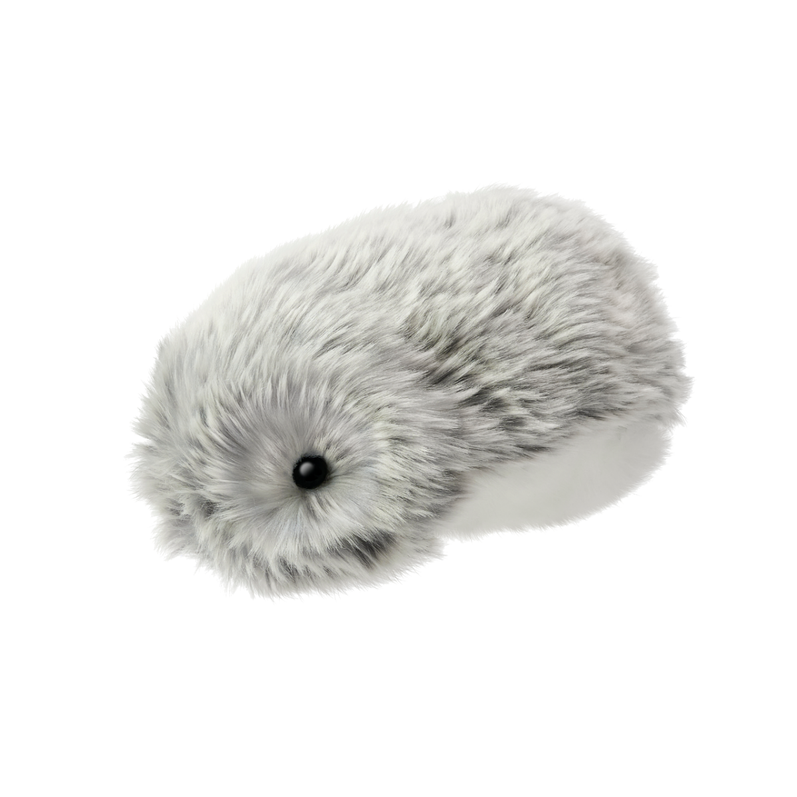
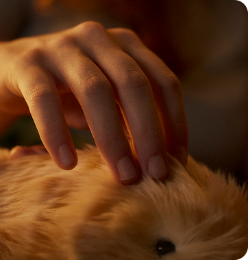
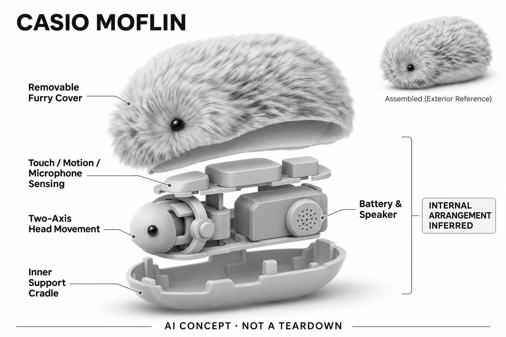

# Moflin

**CASIO** · 陪伴与宠物 · 核查 2026-11-04

没有屏幕的毛绒触觉陪伴

## 产品图片与结构参考

### 产品图

Moflin 银色官方产品图 · 来源：[CASIO · 官方图片](<https://www.casio.com/us/moflin/>) · [原始图片](<https://www.casio.com/content/dam/casio/product-info/locales/us/en/moflin/product/P/PE/PEM/PE-M10SR/assets/pe-m10sr_001.png.transform/main-visual-sp/image.png>)

### 参考图

Moflin 官方触摸互动场景参考 · 来源：[CASIO · 官方图片](<https://www.casio.com/us/moflin/>) · [原始图片](<https://www.casio.com/content/casio/locales/us/en/products/moflin/_jcr_content/root/responsivegrid/container/container_847828903_/container/container/container_2004498952/container/container/container/image.casiocoreimg.png/1791229549458/always-bg-01.png>)

### AI 生成爆炸示意

**AI 生成 · 非实物拆机。** 内部为概念推断，不能作为元件布局、BOM 或维修依据。[生成提示词](../../content/hardware/prompts/casio-moflin.txt)

> 已目视核对产品外形与AI标识；verified不代表内部布局经实物拆机验证。

> 主图为银色型号，参考图为同系列触摸场景；未将颜色差异解读为型号差异。

> 分析为基于公开资料的案头研究与 AI 辅助判断，未经用户访谈、销量审计或实物拆机。需求、画像、竞争冷门度、审美及商业机会均为研究假设，不是投资结论。

## 销售与购买

- 状态：在售。美国官网列出多个颜色及BUY NOW入口，日本官网列出可加入购物袋的型号；中国官网已设Moflin栏目和售后服务。具体颜色与批次库存仍以区域商店为准。

- 地区：美国、日本、中国大陆

- 价格：以地区官网为准。本次可读页面未稳定返回各地区具体型号售价；不把旧款、不同充电仓或跨境价混为同价。

- 中国大陆：卡西欧中国官网已有Moflin产品栏目及大陆洗护维修服务。动态商店未完整返回库存，国行颜色及现货需在官方渠道确认。

- [官方产品 / 商店](<https://www.casio.com/us/moflin/>)

## AI 的实际作用

根据声音、触碰和姿态等信号调整情绪状态与动作，属于感知和行为适应，不宣称大模型自由对话。

服务与联网依赖：配套MofLife应用提供状态与维护相关功能；具体模型运行位置及全部云端边界未在本次资料中完整披露。

## 是否冷门

新兴竞争（研究判断）：非语言毛绒陪伴与聊天机器人有明显区隔，长期留存仍需实际验证。

## 需求与市场

需求假设：希望桌边或怀中有安静回应、又不想持续看屏幕的人，可能接受低语言密度的陪伴。应验证触碰反馈是否让人反复使用，而不是把“情绪AI”直接等同心理改善。

## 用户画像

用户画像推断：偏好柔软触感、可随手抱起的小型物件，并愿意进行充电与清洁的成年人或家庭。对毛绒材质过敏、希望明确问答能力的用户，可能不适合这一交互取向。

## 竞争与替代

竞争判断：毛绒情感机器人仍属新兴细分，但要与普通毛绒玩具、桌面宠物和电子陪伴应用比较。真正差异可能在长期状态变化是否可信，而不是宣称能识别多少种情绪。

## 供应链

供应链推断：毛绒外套的触感、耐脏与可维修性，需与电池和小型运动机构一起设计；本次未披露制造工厂。官方大陆沙龙提供洗护和换毛，说明持续外观维护不能忽略。

## 技术路径

官方列出麦克风、光照、触碰及惯性传感器和两轴动作。推断产品难点是把有限动作与声音组合成持续可辨识的状态，避免随机反馈被用户误解为真正理解其心理。

## 产品审美

审美判断：弱化面孔、以毛发和体态表达情绪，更接近可以触碰的居家物件。小幅动作可减少视觉打扰；但材质老化、机械声音和充电姿态都可能破坏整体的生物感。

## 关键风险

风险判断：用户可能把厂商情绪描述当作医疗或心理疗效保证，研究中不作这种推断。清洁、续航及App地区支持影响真实使用，送给儿童或长者也需要合适的使用陪同。

## 机会与验证

机会假设：可以探索不依赖语言和屏幕的细小互动，例如固定休息时段的触觉陪伴。先测触感、反馈节奏和长期接受度，再决定是否增加联网对话，避免把复杂度当成价值。

## 功能分层示意

这是功能关系，不是实物拆机、真实空间结构或已核实 BOM。

1. **环境输入**：麦克风、照度、触碰、加速度与陀螺仪信号。（官方披露）

2. **状态调整**：官网描述随互动形成情绪与个性差异。（官方披露）

3. **物理反馈**：头部旋转与倾斜、扬声器形成低语言互动。（官方披露）

4. **维护闭环**：充电小窝、MofLife与区域售后共同支持使用。（官方披露）

## 来源

1. [CASIO 美国Moflin页面](<https://www.casio.com/us/moflin/>) — 已打开，含购买入口、传感器与运动规格。

2. [CASIO 日本Moflin商店](<https://www.casio.com/jp/moflin/>) — 列出颜色和可加购物袋的型号。

3. [CASIO 中国Moflin栏目](<https://www.casio.com.cn/moflin>) — 动态库存未完整读取，不以模板价格判断现货。

4. [CASIO 中国Moflin沙龙](<https://www.casio.com.cn/support/moflin/salon>) — 官方说明大陆洗护、换毛和取件维修服务。

[返回目录](../hardware-market.md) · [网页分析](https://romanagent.github.io/Roman/#hardware/product/casio-moflin)
